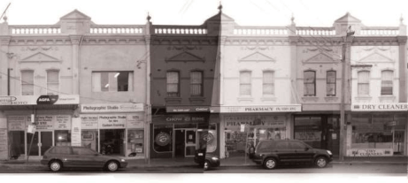
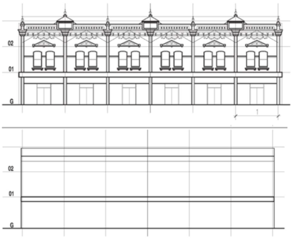
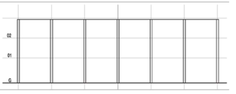
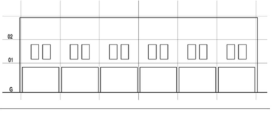
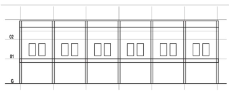
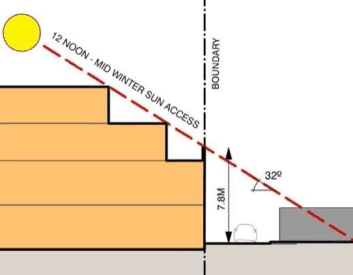

### 3.2 GENERIC CONTROLS

This section outlines the general planning controls that apply to all centres.

Note: Compliance with a control does not guarantee that the objectives are satisfied.

In some instances the design solutions may not be appropriate for the particular site or situation and Council may require an alternative design solution.

In order to ensure the physical characteristics of the site and the nature and proximity of adjoining and nearby development has been considered, a centre analysis is required to be submitted with all development applications which includes the existing built form within the surrounding local village area. Refer to the Waverley Development Application Guide for further details.

Annexures are provided to illustrate examples of typical built form envelopes for 2, 3 and 4 storey local village centres as follows:

Annexure E3-1 – 2 storeys Annexure E3-2 – 3 storeys Annexure E3-3 – 4 storeys

#### 3.2.1 Land Uses Objectives

(a) To provide for a range of predominately small shops and services to meet the daily needs of the local resident community.

(b) To ensure the ground floor small shop character of each centre prevails and is protected.

(c) To limit and manage potentially disruptive uses, such as cafes and restaurants in order that they do not dominate a centre or limit the provision of a broad range of local shops that are needed to meet the needs of the local resident community.

(d) To promote mixed-use development incorporating high quality residential use above ground level.

(e) To improve the quality of the built and pedestrian environment, particularly the interface between properties and land uses.

#### Controls

(a) The ground floor component of a mixed use building is to be used for a permitted non-residential use, with the exception of:

(i) Access areas for residential dwellings on upper levels.

(ii) Existing purpose built approved and occupied residential dwellings occupying the ground floor of a building.

(iii) Where a site addresses a rear lane, the residential dwellings may address the rear lane at ground level but only where all other Local Village Centre planning controls have been satisfied.

(b) Cafes and restaurants located in corner buildings, with side street frontage to residential streets are to orient the trade area, including any outdoor dining, to the commercial street.

(c) Seating for cafes and restaurants is to be limited to the enclosed ground floor and, where appropriate, the footpath frontage of buildings.

(d) Building floors above ground and first floor are to be designed for permanent residential use only.

(e) Car parking is to be located at basement level with vehicular access from side streets or rear lanes rather than the primary street frontage.

(f) Vehicle access across the primary street frontage within a Local Village Centre is not supported.

(g) In cases where no side street or rear lane access is available, development is not required to provide car parking.

(f) Residential and low scale commercial office uses are acceptable at first floor level.

(g) Commercial office uses may only take place where the building has been specifically designed, or acceptably adapted, for this use, including adequate separation from residential uses elsewhere in the building.

(h) Clearly separate and distinguish commercial and residential entries and vertical separation.

#### 3.2.2 Public Domain Interface Objectives

(a) To create well defined Local Village Centres, designed for retail trading, appropriate commercial uses and community activity at street level.

(b) To ensure that ground level frontage is of retail uses to the street edge.

(c) To ensure interest and vitality by maintaining and encouraging a mix of predominately small scale individual retail outlets.

(d) To ensure original shop fronts, where they exist, are retained and restored.

#### Controls

(a) Development must be sensitive to the streetscape character and views. A streetscape and context analysis is to be provided in accordance with Part B12 Design Excellence.

(b) Development on a lot identified in this Part is to provide active street frontages. Refer to Part B15.2 Active Street Frontages.

(c) Buildings are to be located to the front street alignment, with the exception of recommended upper level setbacks, nominated in the controls for each of the individual centres.

(d) Where existing buildings are setback from the street and are to be refurbished, they are to be extended to the street edge at ground level, except listed heritage items and buildings of historic character.

(e) Individual buildings are to have a clear street address where entries to upper levels are well defined at the ground floor address.

(f) New shop fronts are to be consistent in width and height with the predominant and historical character of the street.

(g) Shop fronts may include recessed entries and display windows, where these are included to provide useable display space and achieve the desired future character of the centre.

(h) Shop fronts are to be made up predominantly of clear glazing with sill heights to be a maximum of 700mm above finished footpath level along street frontages.

(i) Access to residential dwellings above ground level should not occupy more than 20% of the principal street frontage of any development.

(j) There are to be no solid facades along the primary street frontage at ground level.

(k) Vehicular entries into buildings are not permitted along the primary commercial street frontage of sites, except where contemplated in the planning controls for individual centres.

(l) The public domain interface of development should provide universal access to all users.

(m) The design of a development proposal is to have regard to the existing streetscape pattern by applying (i) to (v) below.

> [Picture on page 111: a picture, saved as a picture (images/part-e-site-specific-development-page-111-14.gif, 150 dpi).]

> [Picture on page 111: a picture, saved as a picture (images/part-e-site-specific-development-page-111-15.gif, 150 dpi).]

> [Picture on page 111: a picture, saved as a picture (images/part-e-site-specific-development-page-111-16.gif, 150 dpi).]

> [Picture on page 111: a picture, saved as a picture (images/part-e-site-specific-development-page-111-17.gif, 150 dpi).]

(i) Existing streetscapes are to be analysed to understand the existing streetscape pattern. The pattern can be quantified simply by a height to width ratio. New buildings inserted into an existing streetscape should display similar aspect ratios. This ensures the overall pattern and rhythm of the strip is not negatively impacted by new infill development.

(ii) Horizontal datum points should be established.

(iii) The vertical divisions suggestive of lot subdivision should be referenced even if the development site is larger than the traditional lot sizes.

(iv) Older buildings display a solid to void ratio consistent with a glazed ground level and a more enclosed upper level. The upper levels of these buildings present as a single form with ‘punched’ openings generally in a masonry background. While a strict

replication of this building form is not necessary any new buildings should display similar characteristics in regards to proportions and ratios.

(v) The application of (i) to (v) above means that a pattern indicating an understanding of the existing streetscape building form can be quickly established so as to guide the direction of new infill development.

> [Picture on page 112: a picture, saved as a picture (images/part-e-site-specific-development-page-112-13.gif, 150 dpi).]

#### 3.2.3 Built Form Objectives

(a) To ensure new and refurbished buildings are of an appropriate scale and design quality, achieving the desired future character of each of the centres.

(b) To ensure development conserves and enhances buildings and locations of historic character.

(c) To allow, in some locations identified as appropriate in individual centres, some increase in the height and scale of new development, in order to achieve the desired future character for the individual centre.

(d) To ensure that buildings provide high quality internal environments for the occupants and users of the buildings.

(e) In the case of development adjacent to buildings of historic character, to promote a complementary scale and form that enhances the character of the centre.

(f) In the case of corner buildings, to encourage massing and articulation in order to achieve the desired future character of individual centres.

(g) To ensure good solar access and amenity to the public domain within the individual centres.

(h) To support excellence in contemporary design.

(i) To maintain reasonable solar access to residential properties backing onto rear lanes across from village centres.

#### Controls

(a) Development is to be consistent with the planning controls relating to overall height, floor to ceiling heights and setbacks, outlined for each of the centres In Annexures E3-1 to E3-3.

(b) Ground floor retail depth must allow for adequate display and sales area as well as essential back-of-house storage and loading facilities. In total this must be a minimum of 8 - 10m in depth.

(c) The preferred building depth for floors above ground level is 10-14m. The maximum building depth for floors above ground level, glazing line to glazing line is 18m. Refer to the control diagrams for each individual centre.

(d) Sites in local village centres that adjoin residential development at the rear are to provide deep soil zones within the rear setback area with a minimum depth of 2 metres from the boundary.

(e) Ensure any alterations or additions are well designed and responsive to existing built form, history and heritage with appropriate street frontage heights and upper storey setbacks.

(f) The maximum street wall height of buildings fronting rear lanes is 7.8m or two storeys, whichever is the lesser (refer to Figure 56).

(g) Floors fronting lanes which are located 7.8m above the level of the lane or higher (except those on the south side of the lane) and have residential properties backing onto the rear lane opposite must be setback at an angle of 32 degrees in accordance with Figure 70.

> [Picture on page 113: a picture, saved as a picture (images/part-e-site-specific-development-page-113-10.gif, 150 dpi).]

Figure 70 Setbacks at rear lanes to ensure solar access to neighbours

#### 3.2.4 Building Façade Articulation Objectives

(a) To ensure that buildings are designed and detailed to provide a strong street address, enhance the streetscape and achieve the desired future character of the relevant centre.

(b) To reinforce the prevailing street pattern and rectilinear building forms as well as predominantly vertical proportion of bays, openings and windows.

(c) To maintain and promote the vertical emphasis of the narrow built forms.

(d) To actively support excellence in contemporary design, respecting buildings of historic character with contemporary infill development which does not mimic but builds on the principles of the structure of the streetscape pattern.

(e) To ensure ground level building frontages are active, open and inviting.

(f) To reinforce the historic street and subdivision pattern and building articulation to ensure that the rhythm of older street patterns is maintained and enhanced.

(g) To ensure that, where the amalgamation of sites occurs to achieve a singular larger development area, the rhythmic pedestrian street experience is not lost.

#### Controls

(a) New buildings should display proportions which respect and build upon proportions similar to the adjoining streetscape and building forms.

(b) New buildings should draw on the predominant pattern of the existing streetscape. They are to be open and glazed at the street level, have an emphasis toward a singular more enclosed building form at the upper levels and be capped by a lighter more articulated element.

(c) Balconies to the street facade are to be recessed behind the principal building facade.

(d) Balustrades to balconies fronting the street are to be predominantly solid with minimal or no glass.

(e) Development directly adjoining buildings of historic character are to be designed so as to respect the hierarchy of the adjoining facade articulation.

#### 3.2.5 Buildings of Historic Character Objectives

(a) To protect and maintain the historical identity of each of the individual local centres.

(b) To protect individual buildings that are considered to be of historic character in each of the centres.

(c) To encourage the ongoing and adaptive re-use of buildings of historic character.

(d) To allow for new development in the individual centres that complements the character and scale of buildings of historic character.

#### Controls

(a) Identified buildings of historic character, as detailed in the planning controls for each of the individual local centres, are to be retained.

(b) Where the building form, detailing or use of individual buildings of historic character have been inappropriately altered and changed, any application to upgrade or re-use the buildings must clearly demonstrate that the architectural and streetscape value of the building will be enhanced by the proposal.

(c) Any application to demolish an identified building of historic character must clearly demonstrate that a replacement building will possess equal or higher quality contributory value with respect to streetscape, character, architectural design, material quality and construction.

(d) New development adjacent to buildings of historic character must be sympathetic in scale, alignment, detailing and materials.

#### 3.2.6 Building Services and Site Facilities

Building services and site facilities for the purposes of this Part relate to:

• Garbage and recycling collection and storage areas;

• Basement storage areas;

• Mail boxes;

• Laundry facilities; and

• Clothes drying areas.

#### Objectives

(a) To ensure that adequate provision is made for essential building services and facilities on site, integrated into the overall design and planning of the building.

(b) To ensure that the services and facilities are unobtrusive and do not detrimentally impact on the appearance of the buildings or the view of the buildings from the public domain or adjoining residential properties.

(c) To ensure that the use and operation of the building services and facilities does not unacceptably impact on the residential amenity of adjoining residential properties.

(d) To provide a clean environment, with waste disposal managed efficiently.

#### Controls

(a) Garbage and recycling storage and collection areas, and the structures in which they are contained, are not to be visible from the public domain.

(b) Setbacks on ground level at the rear are not to be used at all for any purposes associated with storage of waste or recycling material, such as garbage rooms or bottle storage. Buildings are to be designed and used in a manner that ensures that these activities are wholly contained within the building proper. The only exception is for the regular collection of waste and recycling from the rear, in the event of rear lane access. Where a setback at the rear at ground level is provided, it is to be designed and maintained as a landscaped buffer between the subject site and the adjoining properties to the rear.

(c) The rear of buildings, at ground level, where they back directly on to residential properties or uses, are to be designed to be effectively ‘sealed’ at the rear, in order that noise and odour transmission from the rear of these premises does not occur in any form that detracts from the amenity of the adjoining residential properties.

(d) New and refurbished buildings must incorporate venting from ground floor premises in a way that does not result in the transfer of cooking odours impacting on residential properties within the same site/building or neighbouring and adjacent residential properties.

(e) Air-conditioning units, exhaust fluing, mechanical ventilation ducting, including venting and exhaust structures and equipment associated with ground floor food premises such as cafes and restaurants and the like, are not to be located in front of the front building line or in places clearly visible to the main street frontage or any adjoining or nearby residential properties should be integrated into the building.

(f) Mixed use buildings are to be provided with sound proof materials between the commercial and residential level.

(g) Mixed use buildings are to be provided with one only common television antenna and/ or satellite dish, which is to be unobtrusive in appearance when viewed from the public domain.

(h) Residential units within mixed use developments are to be provided with laundry facilities and at least one external clothes drying area, not visible from the public domain.

### Special Character Areas      E4
