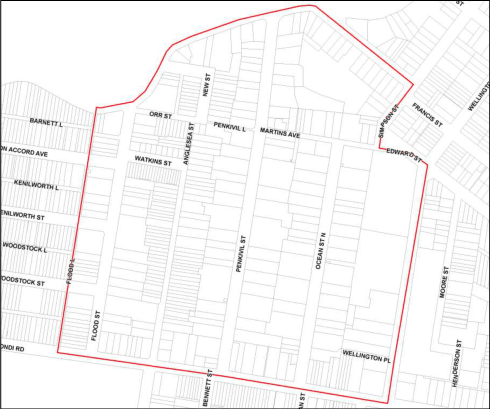

### 4.1 BONDI HEIGHTS

Bondi Heights Special Character Area applies to the area bound by Old South Head Road and Francis Street to the north, Wellington Street to the east, Bondi Road to the south and Flood Lane to the west (refer to Figure 1).

> [Picture on page 116: a picture, saved as a picture (images/part-e-site-specific-development-page-116-20.gif, 150 dpi).]

Figure 1 Bondi Heights Special Character Area

#### Existing Character Elements

Bondi Heights Special Character Area is located on a local topographical high point. This vantage allows district views to and from the area. It is characterised by north-south oriented streets with well-established street trees. Street blocks are generally long (700-750m) with a range of site lot sizes. A range of building types and styles exist that relate to lot sizes and development history of the area. The overall character of the area is of buildings that multiunit buildings sit in a landscape setting.

#### Desired Future Character Objectives

(a) To ensure the landscape character is the dominant image of Bondi Heights.

(b) To maintain the predominant street and rear setback to provide for front gardens and planting of mature trees.

(c) To ensure buildings respond to their location on the low and high sides of the street with respect to height and site access.

(d) To ensure front garden walls and fences do not detract from the setting.

#### Controls

(a) Garden walls and fences on the low side of the street are to be a maximum height of 1.2m, to allow front gardens to contribute to the streetscape. Garden retaining walls on the high side of the street are to be a maximum of 1.5m.

(b) Front setbacks should be predominantly planted or grassed, to allow the elevated view of the front garden to contribute to the streetscape.

(c) Outdoor terraces and decks are not permitted over garages located on the street boundary on the high side of the street.

(d) Communal landscaped gardens are required within the front setback to contribute to the public domain.

(e) The private open space is permitted to encroach 2.5m into the communal landscaped front setback provided that the front setback is a minimum of 6m from the street boundary.

(f) Roof-top terraces are discouraged due to the greater potential impacts in higher density areas.
