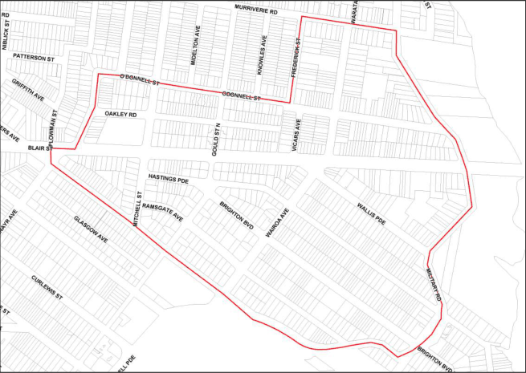

### 4.2 NORTH BONDI

North Bondi Special Character Area applies to the area bound by O’Donnell Street, Frederick Street, Murriverie Road to the north, Military Road to the east, Campbell Parade and Warners Avenue to the south, and Glenayr Avenue to the west (refer to Figure 2).

> [Picture on page 118: a picture, saved as a picture (images/part-e-site-specific-development-page-118-5.gif, 150 dpi).]

Figure 2 North Bondi Special Character Area

#### Existing Character Elements

North Bondi Special Character Area has an undulating topography. The roofscape is prominent when viewed from surrounding high points. There is often a high and low side of the street. Streets generally have wide grassed verges that are sometimes privately planted (through Council’s Footpath Gardens Scheme) with vegetation that contributes to the natural headland character. Regular block and lot pattern responds to the changing topographical conditions.

The predominant building stock is characterised by minimum side setbacks, consistent front setbacks and building frontages to the street whether the building type is residential flat buildings or semi-detached dwellings. Roofs are predominantly pitched and red tiled, and are visually dominant on the low side of the street. Much of the area is already developed with very little opportunity for redevelopment on infill sites.

#### Desired Future Character Objectives

(a) To maintain the streetscape rhythm created by uniform building frontages.

(b) To improve the amenity for residents while not detracting from the amenity of adjacent buildings.

(c) To allow minor alterations and additions in the roof space.

#### Controls

(a) Communal landscaped gardens are required within the front setback.

(b) Private open space is permitted to encroach 2.5m into communal landscaped front setback provided the front setback is a minimum of 6m from the street boundary.

(c) The proportion of openings along street facades is to be maintained when retrofitting with balconies.

(d) Buildings should have pitched roofs with red tiles in keeping with the existing character of the area.

(e) Attics are to be secondary to the main pitched roof form.

(f) The established patterns of materiality and colour where there are existing rows of consistency along a street are to be maintained.

(g) Roof-top terraces are discouraged due to the greater potential impacts in higher density areas.
