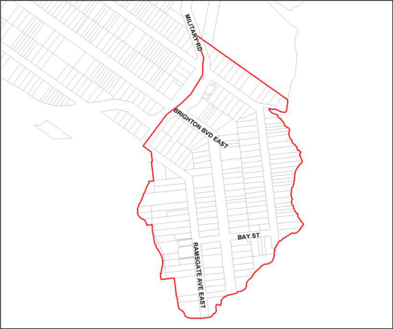

### 4.3 BEN BUCKLER

Ben Buckler Special Character Area is located on the northern headland at Bondi Beach and applies to the area bound by Campbell Parade and the coastline to the west, Bondi Golf Course to the north, and the coastline to the east and south (refer to Figure 3).

> [Picture on page 120: a picture, saved as a picture (images/part-e-site-specific-development-page-120-5.gif, 150 dpi).]

Figure 3 Ben Buckler Special Character Area

#### Existing Character Elements

Ben Buckler exhibits a distinctive palisaded character of parallel streets rising to the outer southern  cliff line and lined with Inter War and Mid Century residential flats and housing. Viewed from Bondi Bay, Ben Buckler presents as a dense wall of brick and painted masonry punctuated by glazed openings and a skyline of hipped tile roofs which forms a distinctive and much recognised background to the beach.

Despite the rise of topography to the north and east, streetscapes at Ben Buckler are lined with close set buildings on uniform subdivisions restricting the outlook to glimpses of Bondi Bay, the skyline to the south and the high ground of Bondi Golf course to the north. Only at the extremities of the main streets are vistas of the coastline and beach revealed.

Wide driveways and cross falls to the west, limit the amenity of otherwise wide verges landscaped with turf and sparse coastal tree species. Cranked street alignments to the northern approaches to Campbell Parade, and dense planting within properties to the low side of streets add further to the sense of enclosure.

Within this ground plan the varied styles and forms of construction are unified by orientation of balconies, decks and picture windows southwest over Bondi Bay. The visual complexity of the setting is further emphasized by a distinct separation of public and private space along all streets.

#### Desired Future Character Objectives

(a) To maintain the headland character of Ben Buckler through the landscaping of the front gardens and appropriate planting of verges.

(b) To maintain the rhythm of buildings frontages to the street.

(c) To ensure side setbacks allow glimpses of the beach or ocean.

(d) To respect the existing building character of boxy proportioned buildings, architectural elements and range of materials and finishes.

(e) To encourage view sharing.

#### Controls

(a) Planting should utilise minimum maintenance species growing to no more than 1m in height at maturity. The appearance and species selection should be compatible with the adjoining gardens. Growth must not encroach upon the footpath or obstruct pedestrian access.

(b) Side setbacks are to be clear of obstructions to allow views between buildings to the beach.

(c) Sites adjacent to laneways and pedestrian connections may be able to achieve increased site coverage with a reduced deep soil requirement. Where deep soil requirements are not met, this area is to be replaced with landscaped open space above ground level.

(d) Communal landscaped gardens are required within the front setback to contribute to the public domain.

(e) The private open space is permitted to encroach 2.5m into the communal landscaped front setback provided that the front setback is a minimum of 6m from the street boundary.

(f) Rendered and painted finish is appropriate in this area.

(g) Allow balconies to be provided over existing car courts for existing buildings on battle-axed blocks along Ramsgate Avenue.

(h) Roof-top terraces are discouraged due to the greater potential impacts in higher density areas.

## 113 Macpherson Street, Bronte      E5
