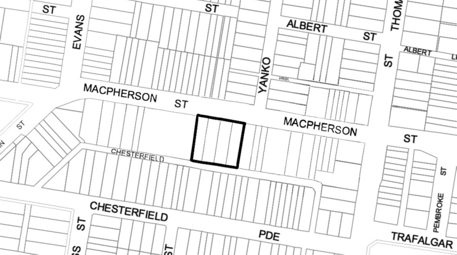

#### E5 113 MACPHERSON STREET, BRONTE

Where there are discrepancies between this Part and other Parts of this DCP, the controls in this Part take precedence.

The following objectives and provisions apply to 113 Macpherson Street, Bronte described as Lot 19, Lot 20 and Lot 21 of DP 192094 and Lot 22 of DP 72912, also known as the Bronte RSL site (refer to Figure 57).

> [Picture on page 122: a picture, saved as a picture (images/part-e-site-specific-development-page-122-8.gif, 150 dpi).]

Figure 1 113 Macpherson Street Site Plan
