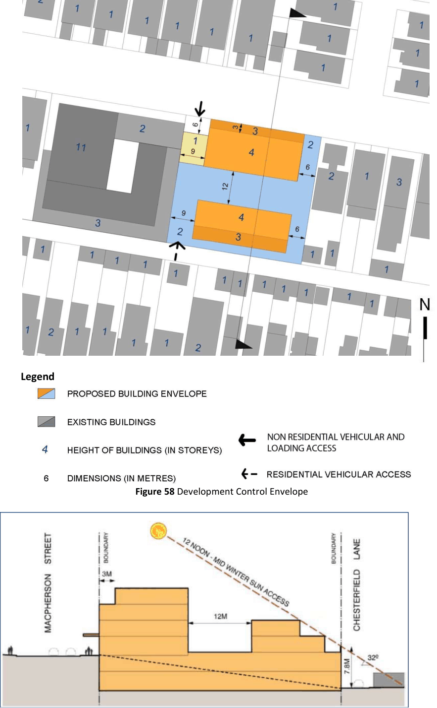

### 5.2 BUILT FORM

#### Objectives

(a) Facilitate the redevelopment of the site to achieve a high quality urban form.

(b) To ensure that redevelopment does not result in adverse impacts on the amenity, privacy and solar access of existing and future residential premises within the precinct.

(c) To facilitate built form that accounts for the change in level between Macpherson Street and Chesterfield Lane.

(d) To set building heights and frontage alignments to respect the existing character and desired future character of the Bronte’s Macpherson Street and St. Thomas Street Neighbourhood Centre.

(e) Ensure that development has high architectural quality and diversity, and strongly defined streets.

(f) To ensure that new development reflects the historical subdivision pattern and established rhythm of the main street retail buildings located east of the site.

#### Controls

(a) The development of 113 Macpherson Street is to be in accordance with the development control envelope illustrated in Figures 58 and 59.

(b) Development is to comply with Part B16 Public Domain.

(c) Provide awnings to the entire Macpherson Street frontage between the ground and first floor, except over the driveway. Refer to Part B16.4 Awnings and Colonnades.

(d) Buildings are to be built to the street and lane alignments.

(e) No less than 90% of the building is to be aligned to the street boundary for the ground and first floor fronting Macpherson Street.

(f) Provide setbacks above the street-wall in accordance with Figures 58 and 59.

(g) Provide side setbacks in accordance with Figures 58 and 59.

(h) Each retail unit must present to Macpherson Street with a frontage no greater than 6m wide.

(i) The Macpherson Street facade must be articulated to reflect the established 6m / 12m rhythm of the existing main street retail buildings located east of the site.

> [Picture on page 124: a picture, saved as a picture (images/part-e-site-specific-development-page-124-1.gif, 150 dpi).]

#### Legend

Figure 58 Development Control Envelope

Figure 1 Development Control Envelope section
