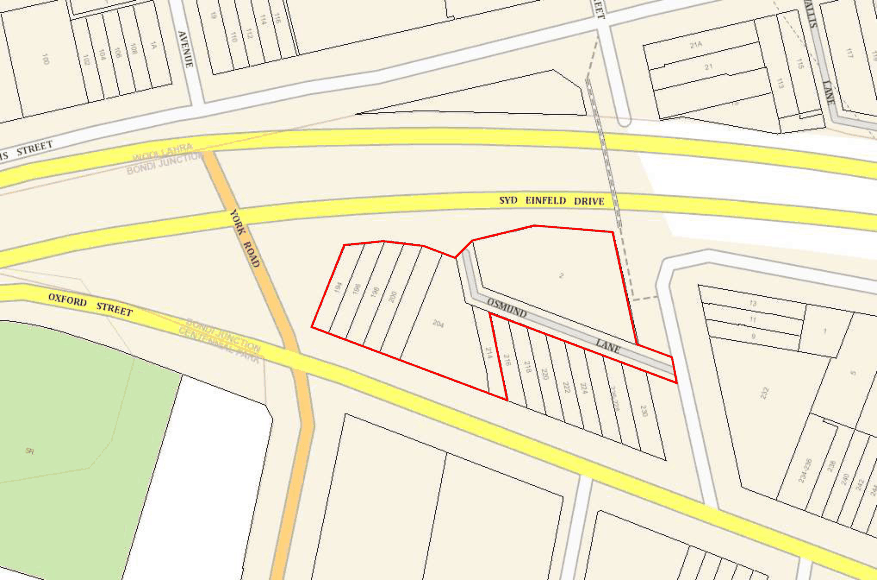

#### E6 194-214 OXFORD STREET, 2 NELSON STREET AND OSMUND LANE, BONDI JUNCTION

The following objectives and controls apply to 194-214 Oxford Street, 2 Nelson Street and Osmund Lane, Bondi Junction described as Lots 10, 11, 12 and 13 DP 260116, Lot 16 DP 68010, Lot 1 DP 79947, Lot 1 DP 708295 and SP 34942 (refer to Figure 60).

> [Picture on page 128: a picture, saved as a picture (images/part-e-site-specific-development-page-128-7.gif, 150 dpi).]

Figure 1 Subject sites outlined in red

Where there are discrepancies between the controls of the DCP and others within this site specific DCP, these controls take precedence.

The intention of this site-specific DCP is to encourage and facilitate innovative design that reflects the landmark significance of this site. The controls in this Part of the DCP are not intended to be prescriptive if it can be demonstrated that the design has achieved the objectives of this Part through minor discrepancies from this Part. This Part of the DCP has been created with regard to the following Planning Principles for the site:

An acceptable human scale at the podium height Slender towers to mitigate visual amenity impacts Good public amenity on the site Significant landscaping on site including deep soil planting and substantial mature tree planting
