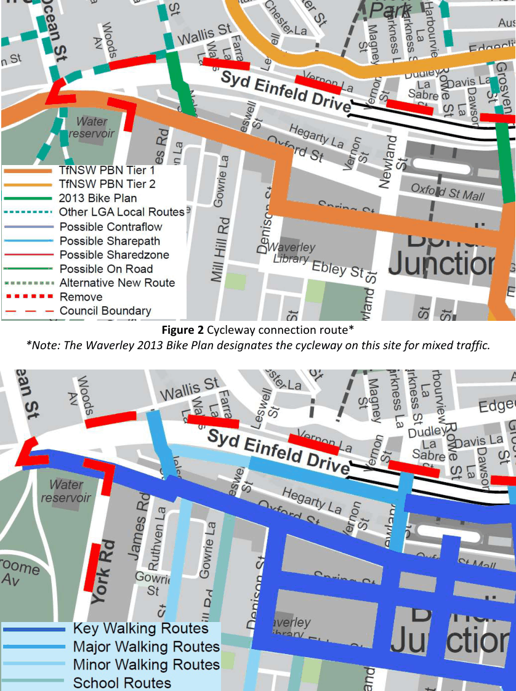

### 6.6 PEDESTRIAN AND CYCLEWAY CONNECTIONS

> [Picture on page 136: a picture, saved as a picture (images/part-e-site-specific-development-page-136-2.gif, 150 dpi).]

Figure 2 Cycleway connection route*

\*Note: The Waverley 2013 Bike Plan designates the cycleway on this site for mixed traffic.

Figure 3 Pedestrian connection route

### EDINA ESTATE E7
