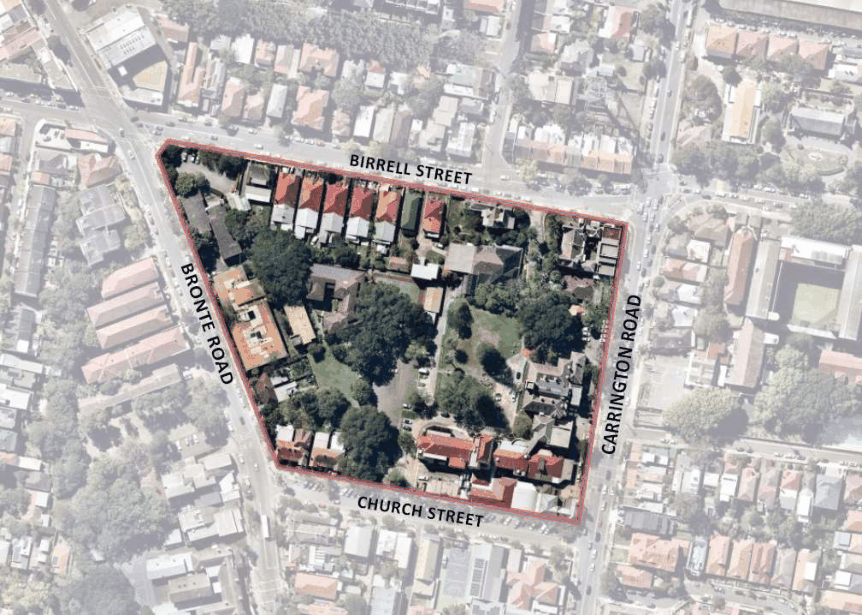

#### E7 EDINA ESTATE

Where there are discrepancies between this Part and other Parts of this DCP, the controls in this Part take precedence.

The following objectives and provisions apply to the site known as the Edina Estate, identified in Figure 1. For clarity, the Edina Estate is the entirety of the urban block bound by Birrell Street, Carrington Road, Church Street, and Bronte Road, Waverley.

> [Picture on page 137: a picture, saved as a picture (images/part-e-site-specific-development-page-137-8.gif, 150 dpi).]

Figure 1 Edina Estate
