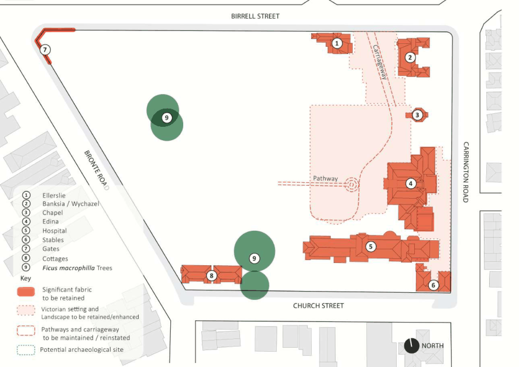
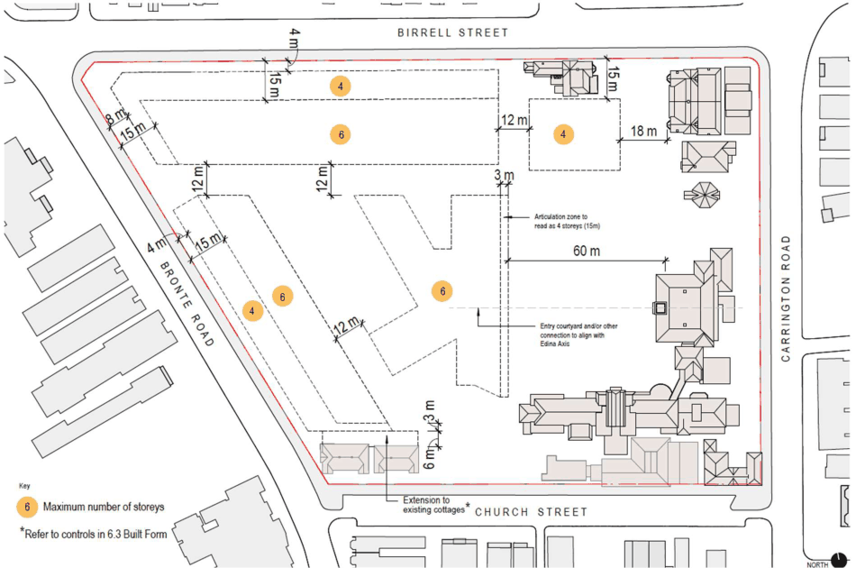

### 7.2 SITE LAYOUT

#### Objectives

(a) To provide invited public access to and enjoyment of the setting of the heritage buildings and their heritage landscape.

(b) To identify developable portions of the site.

(c) To reinstate the experience for the public of exceptional Victorian buildings set in a Victorian-style landscape for its users.

#### Controls

(a) The site layout is to interpret the original arrival experience via the historic pathway from the gates at Bronte Road and Birrell Street as a key entrance point to the site predominately for residents.

(b) Maintain the buildings identified in Figure 2 as Significant.

(c) There is to be a series of open spaces and layouts within the site.

(d) The eastern portion of the site is to be retained as an invited, publicly accessible area as identified in Figure 4 and a public access pathway is also to be provided from the north-west of the site via the heritage gates as identified in Figures 4 and 5.

(e) The scale of new buildings must not challenge or overwhelm the heritage buildings, Victorian streetscape, or landscape.

(f) Where possible, provide vistas throughout the site to the western façade of the Vickery (Edina) Building and tower.

> [Picture on page 140: a picture, saved as a picture (images/part-e-site-specific-development-page-140-22.gif, 150 dpi).]

Figure 2 Site Plan identifying significant fabric and spaces to be retained

> [Picture on page 141: a picture, saved as a picture (images/part-e-site-specific-development-page-141-1.gif, 150 dpi).]

Figure 3 Site Layout and New Building Zones
