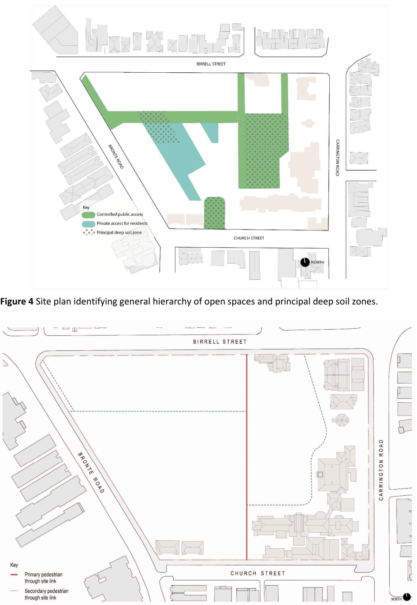

### 7.5 PUBLIC DOMAIN AND OPEN SPACE

#### Objectives

(a) To encourage a cool microclimate within the precinct.

(b) To encourage public access and engagement with the heritage of the site.

(c) To cultivate spaces that encourage mental and physical wellbeing.

(d) To promote social cohesion and connectedness.

(e) To contribute to the key environmental targets in Council’s strategic plans.

#### Controls

(a) Invited publicly accessible open space is to be provided as identified in Figure 4.

(b) Where open space is to be publicly accessible, these spaces should be open to the public at a minimum of 9 daylight hours. Where fences or gates are to be included, these are to be arranged in an ‘open’ fashion between open hours to encourage movement through the site.

(c) The management around the operation of any fences or gates surrounding publicly accessibility, including any exceptional circumstances in which opening hours may need to be altered, should be included in a Plan of Management for the site.

(d) Provide primary and secondary through site links for pedestrians to increase permeability across the site, as identified in Figure 5.

(e) The invited publicly accessible outdoor areas are to be accessible and designed with a mix of shade and direct sun throughout the year.

(f) Consider the provision of accessible vegetable garden beds and facilities (e.g. tools, composting) for collective activities.

> [Picture on page 148: a picture, saved as a picture (images/part-e-site-specific-development-page-148-1.gif, 150 dpi).]

Figure 4 Site plan identifying general hierarchy of open spaces and principal deep soil zones.

Figure 5 Site plan identifying through site links
