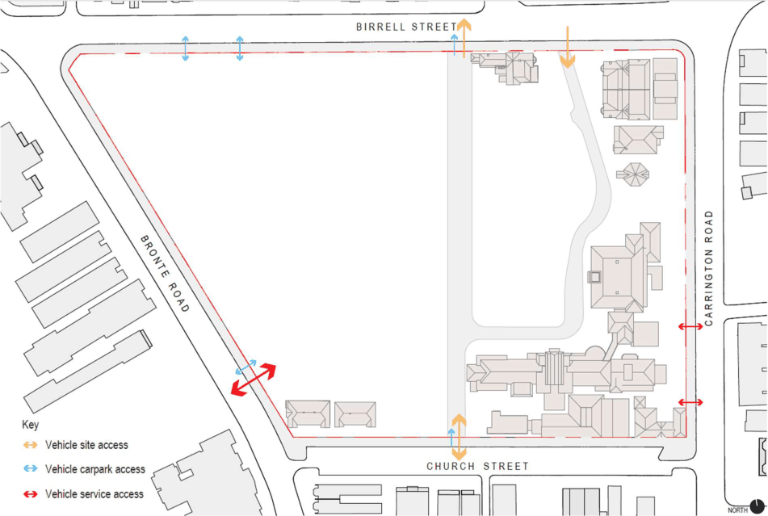

### 7.8 TRANSPORT AND SITE ACCESS

#### Objectives

(a) To reduce the reliance on private vehicle usage.

(b) To minimise conflicts between pedestrians and vehicles.

(c) To ensure the provision of an appropriate number of vehicular spaces having regard to the proposed operating activities on the land. The intensity of these uses should aim to minimise traffic congestion and waiting time at intersections.

(d) To promote bicycle usage to and from the site.

#### Controls

#### 7.8.1  Loading Facilities

(a) Loading for RAC, commercial and hospital facilities should be accessed from Bronte Road.

(b) Loading for residential facilities should be located to ensure easy access for residents, removalists and waste collection services while ensuring adequate amenity and safety for surrounding uses.

(c) Loading facilities should be visually concealed where possible within building envelopes.

#### 7.8.2  Driveways and Vehicle Access

(a) Vehicle access to the site is to be provided in accordance with Figure 6.

(b) Vehicle access through the site is to be designed to ensure the safety of visitors and residents, whilst encouraging pedestrian movements across the site.

(c) Any vehicle access that may be provided via Bronte Road, must be designed to minimise vehicle, cyclist and pedestrian conflicts, and must not create unreasonable service disruption to the intersections surrounding the site.

(d) Traffic modelling is to take into account busy traffic periods during school zone times.

(e) Service vehicle movements across the site should be managed to minimise vehicle and pedestrian conflicts, and to maximise pedestrian amenity.

> [Picture on page 154: a picture, saved as a picture (images/part-e-site-specific-development-page-154-1.gif, 150 dpi).]

Figure 6: Vehicle access

#### 7.8.3  Parking

(a) On-site staff car parking is to be minimised to the extent that it does not affect the operation of the site and its facilities.

(b) Car parking must not be sub-leased out to external users.

(c) Car parking is predominantly to be provided in basements underneath the buildings on site.

(d) Consolidated basements between buildings are to be designed to maximise deep soil across the site.

(e) The car parking rate for independent living units and residential aged care is to be in accordance with the provisions of any relevant Environmental Planning Instrument that governs the provision of Seniors Housing.

(f) Bicycle parking, lockers and changerooms are to be provided at the rates specified in Part B General Provisions of this DCP. These facilities should be accessible and attractive. Where provided in a basement the facilities are not to contribute to the calculation of gross floor area.

#### 7.8.4  Electric Vehicles

(a) Provision for electric vehicle charging stations is to be provided in accordance with Part B7.8 Electric Vehicle Charging Points of the WDCP.

(b) A dedicated space and charging point for electric bicycles and mobility scooters to be charged must be provided.

(c) Car share is to be provided at the rates specified in Part B7.7 Car Share of the WDCP.
