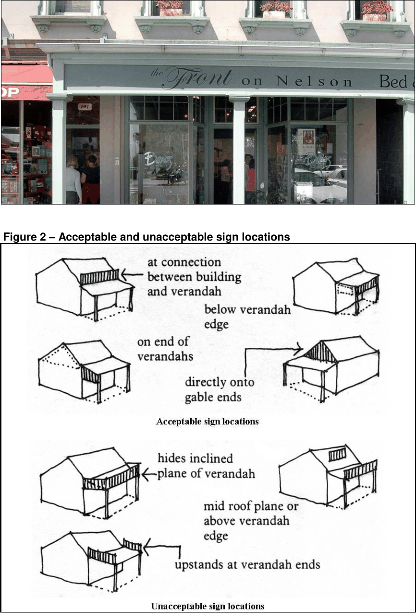

#### 1. Advertising and Signage

The following requirements apply to advertising and signage where proposed on a listed heritage item building or on land which contains a heritage item or on land within a heritage conservation or   a Landscape Conservation Area.

1\. Advertising and business signage must be designed to complement the heritage quality of the building.

2\. Signage is not to compete with architectural features of the building or to dominate the streetscape.

3\. Signs (which may include the wording content and lettering styles) that would have an adverse impact on the heritage character of buildings will not be supported.

4\. The location of signage must be consistent with the historic setting.

Note: Refer to Figure 1 for an example picture of acceptable sign location and Figure 2 representing acceptable and unacceptable sign locations

#### Figure 1 – Photographic representation of an acceptable sign location

> [Picture on page 23: a picture, saved as a picture (images/volume-01-general-page-23-1.gif, 150 dpi).]

#### Figure 2 – Acceptable and unacceptable sign locations
