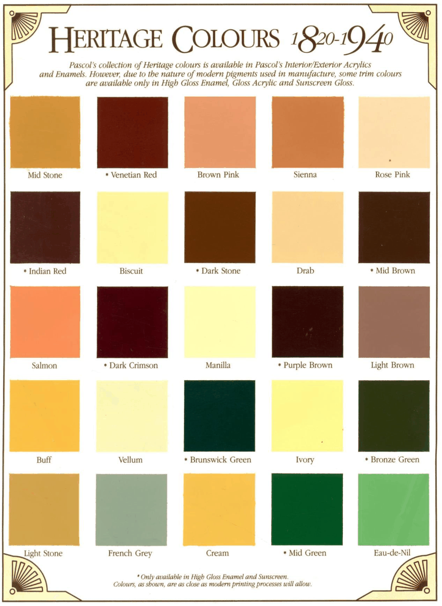
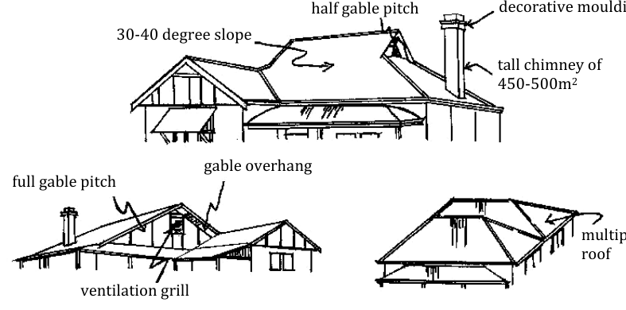
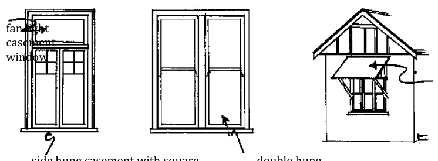
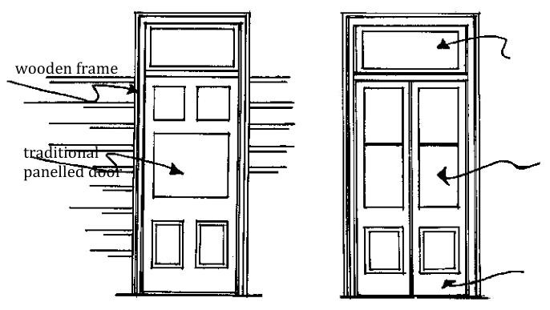
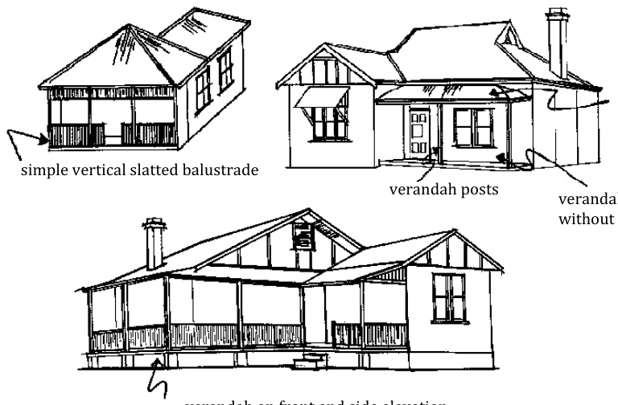
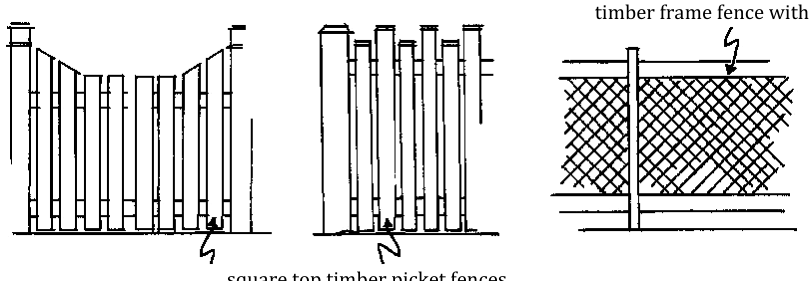
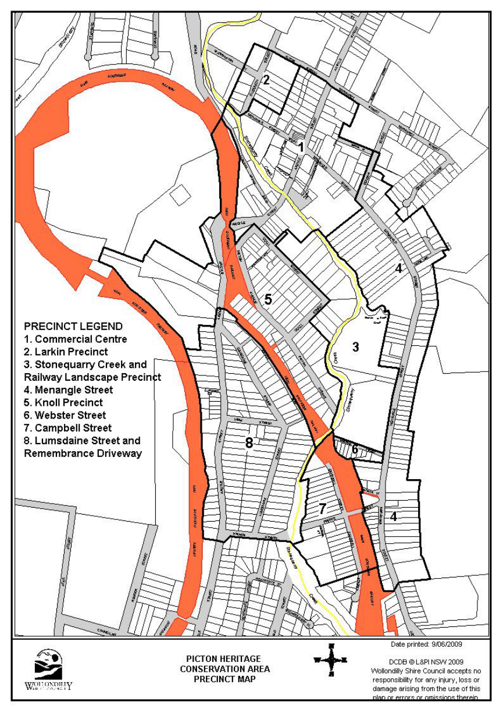
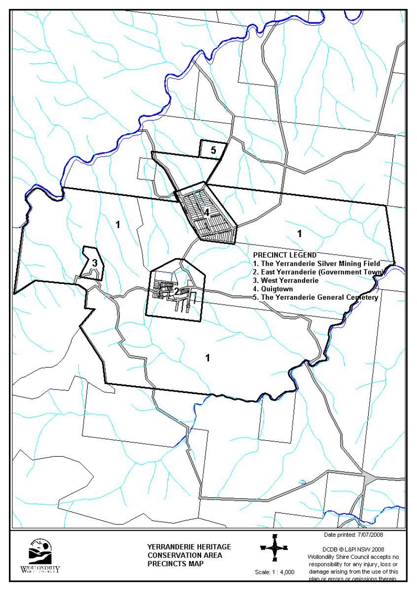
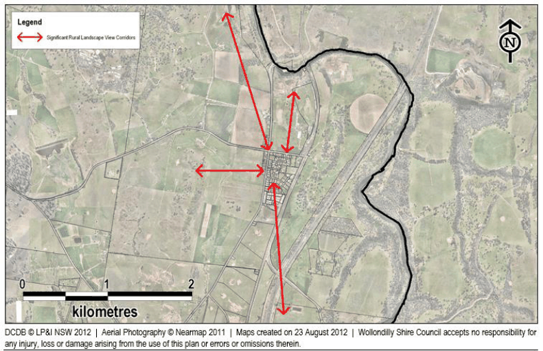
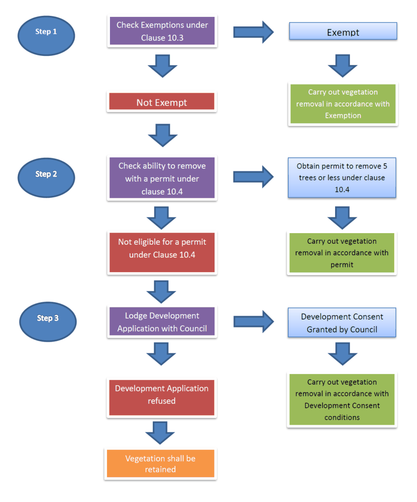

#### 5. Colours and built form on sites containing heritage items and within heritage conservation areas or a Landscape Conservation Area.

1\. Works must use only the colours identified in Figure 3.

2\. Existing weatherboard walls are to be maintained in situ or may only be replaced with timber weatherboards.  Lightweight over-cladding in imitation weatherboards (e.g. plastic, fibrous cement or metal) is prohibited.

3\. Roofs may only be corrugated, galvanised, clay tiled, clay slate or stone slate. Square profile or “cliplock” corrugated roofing is not permitted.

4\. Roof drainage may only be exposed gutters of quad, ogee or half-round profile in galvanised finish, with round downpipes in galvanised finish.  Square profile or “cliplock” roofing is not permitted.

5\. Window and glazed door framing may only be timber framed except in commercial shopfronts where a metal frame size approximating timber (such as Vantage Magnum) may be considered.

6\. Windows and glazed doors must be vertically proportioned to match the best historic examples in the conservation area or vicinity. Windows should be double-hung or casement sash types (not sliders or hopper windows over a fixed sash).

7\. Original front verandahs are to be retained in all new work and restoration must match original proportions and details.

8\. Chimneys must not be removed unless they are structurally unsound and unable to be restored.

9\. Commercial development car parking must be provided behind the main building alignment. Parking areas and access driveways should be visually discreet and must be accessed via a rear lane where available.

10\. Verandahs must not be enclosed. Ground floor verandahs should not be enclosed by balustrades unless required under the BCA.

11\. Original unpainted brickwork and stonework should remain unpainted.

12\. Paint schemes should be simple. Applied finishes to external walls should be of subtle, earthy tones that complement the streetscape. Typically, this would be one color for the body of the building and one or two colors for the trim.

13\. Plant species types and landscaping formations found in and around the Heritage Conservation area or Landscape Conservation Area should be featured in new developments.

#### Figure 3 – Palette of acceptable colours

Note: Creams to be used for walls.  Dark colours for timber joinery only. Close equivalents from other manufacturer’s colour ranges may be considered.  French Grey was an interior colour only (Source:  Pascol Heritage Colour Chart c1980).

> [Picture on page 26: a picture, saved as a picture (images/volume-01-general-page-26-5.gif, 150 dpi).]

### 5.4 Adaptive reuse proposals for Heritage items

1\. Any proposal involving the adaptive reuse of a heritage item must demonstrate that:

1\. The new use requires minimal alterations to significant fabric and building elements, and that any changes to these are reversible or have minimal impact on the heritage significance of the item.

2\. Any internal changes where visible from a public street do not compromise the external heritage significance of the building.

3\. Alterations and/or additions must meet the requirements for alterations and additions as provided in this section and the adaptive re-use must maintain the understanding of the building’s original use.

## PART 6 – Heritage (Specific Locations)

### 6.1 Objectives

The objectives of heritage conservation are:

(a) To provide specific guidance and controls for development of key conservation areas in Wollondilly.

### 6.2 Application

These controls apply in addition to the controls contained in Part 6 of this volume. Where there is an inconsistency between Parts 5 and 6 of this volume Part 6 shall prevail to the extent of the inconsistency.

### 6.3 Heritage Conservation Area and Landscape Conservation Area - Menangle Character Description

Menangle Village, created in the 1850’s and 1860’s, is unique in that it  has remained essentially contained within the settlement boundaries formed by village development by the second decade of the 20th century. It was established by the Macarthur family for their estate workers and was centred on St James’ Church, then later the school and the general store.

The town has had a strong association with the dairy industry, which developed following the opening of the railway after construction of the railway bridge over the Nepean River in 1863. The railway line became the commercial focus of the village and the growing dairy industry and the historic character of the village, as we see it today, is largely a reflection of the railway-related development that took place in the late 19th and early 20th centuries.

Further evidence of the association with the dairy industry includes buildings such as the Camden Estate Central Creamery (1910) and Rotolactor (1952) and worker cottages for the nearby Camden Park Estate (1870‘s to 1920’s). The Macarthurs of nearby Camden Park Estate patronised the Village and were directly responsible for many of the fine buildings in Menangle, which assisted the village to grow and gives its character. They paid for St James's church (including Horbury Hunt's nave in 1876 and Sulman's chancel and steeple in 1898) and in circa 1904 they built the present General Store (used by the Estate as its buying agent for all provisions, stores, seeds fuel etc),

#### Objectives

(a) To ensure development is sympathetic to the heritage character of the Menangle heritage conservation area and Landscape Conservation Area,

(b) To ensure that the design and materials used in new buildings, restoration and renovation of existing buildings is appropriate in scale and form to the character of Menangle, and

(c) To encourage the removal or upgrading of non-contributory elements in the area so as to enhance the setting of contributory elements.

#### Controls

1\. New development must have a minimum front building set back of 6 metres.

2\. Maximum allotment width of 25 metres where located within a residential or commercial zone along Menangle Road within the Heritage Conservation Area and Landscape Conservation Area.

3\. All dwellings must have a front building façade width of between 7.5 and 10.5 metres.

4\. The height of a new dwelling is not to exceed one storey in height.

5\. The pitch of new roofs must generally match the slope of existing earlier dwellings which average 30 to 40 degrees in slope. To provide contrast and variety to roof forms, gable overhangs, eaves, half gables and ventilation grills are encouraged to be used as devices to give a visual interest and help new developments relate sympathetically to the architectural character of the existing buildings. Dwelling roofs should have a corrugated finish.  Roofs can be either painted or be colorbond.  Colours should be similar to those found elsewhere in Menangle.

#### Figure 1 – Examples of Traditional Roof Forms

> [Picture on page 29: a picture, saved as a picture (images/volume-01-general-page-29-2.gif, 150 dpi).]
> Words printed on the picture (title and legend, copied from the PDF):
> decorative moulding
> half gable pitch
> 30-40 degree slope
> tall chimney of
> 450-500m2
> gable overhang
> full gable pitch
> roof
> ventilation grill

multiple hip

6\. Chimneys are a prominent aspect of many roofs in Menangle, most of the existing chimneys have a single flue and are approximately 450 to 500 square millimetres and located at the back or side elevations.  The incorporation of chimneys in the design of new dwellings should achieve a similar dimension and scale to those earlier dwellings.  The decoration of new chimneys should also be in the form undertaken on the earlier dwellings.

7\. Windows must be timber framed.  They are to reflect examples used in early cottages within the village. Vertically proportioned timber frame side hung easements and double hung sash windows must be

used. Fanlight casement windows can be used above windows and doors for extra glazing and light.

8\. Window awnings, roofed with corrugated galvanised iron, flat sheet steel, ripple iron or timber shingles with timber supports may be used where appropriate to the design of the dwelling.  Square profile or “cliplock” roofing is not permitted.

#### Figure 2 – Examples of Window Styles and Use of Awning Hoods

> [Picture on page 29: a picture, saved as a picture (images/volume-01-general-page-29-16.gif, 150 dpi).]
> Words printed on the picture (title and legend, copied from the PDF):
> fan light
> casement
> window

window awning with timber supports

side hung casement with square grid decorative pattern on top

double hung casement window

9\. Doors must reflect the examples used in early cottages within the village. External doors on major elevations must be timber consisting of up to five panels with the top two or three panels of which may be glazed.

10\. French doors can be used on front and/or side elevations opening onto a verandah, following the general design character of traditional village examples. French doors must be of timber frame and panelled base sections, narrow vertical proportions and 1 to 3 panes of glass.

#### Figure 3 – Doors used in Early 20th Century Dwellings

fan light casement window over door

glass panelled inserts

side hung french doors

> [Picture on page 30: a picture, saved as a picture (images/volume-01-general-page-30-9.gif, 150 dpi).]
> Words printed on the picture (title and legend, copied from the PDF):
> wooden frame
> traditional
> panelled door

11\. Verandahs contribute to a house's Heritage character.  The predominant shape of verandahs within the village consists of a slightly curved verandah roof of a convex profile.  Bullnosed and concave profile verandah roofs are not considered to be appropriate forms for Menangle and therefore are not encouraged.  Verandahs should be constructed of the same or similar materials used for the residence as a whole.  Timber shall be used for verandah framing and balustrades as well as for decorative detailing.  Verandahs can also be left without a balustrade, or may be fitted with simple vertical slated balustrades.  Cast iron or pre-cast concrete verandah posts and balustrades are acceptable, so long as they are characteristic of existing styles and forms used on earlier cottages.

#### Figure 4 – Examples of Verandah Styles & Forms in Menangle

> [Picture on page 30: a picture, saved as a picture (images/volume-01-general-page-30-19.gif, 150 dpi).]
> Words printed on the picture (title and legend, copied from the PDF):
> simple vertical slatted balustrade
> verandah posts
> verandah left

slightly curved roofline

without a balustrade

verandah on front and side elevation

12\. External walls may be only timber weatherboard, bagged or rendered brick, or face brick to match the colour and texture of the bungalow at 106 Menangle Road.

13\. Driveways may only be gravel, brick drive strips, clay brick unit pavers, asphalt, 8% black oxide coloured concrete (to match asphalt) in broom finish.

14\. Fences A. Front fences must be constructed to a height of 1.2 metres (as per Housing Code).  Front fences must be constructed of wooden picket, wooden post and rail, or wire mesh enclosed by wooden post and rails.  Timber paling fences are the preferred option for side and rear boundary fences.

B. Except for hedges, all fencing in front of the main elevation of the house must be able to be seen through (i.e. not a solid wall). C. Fence types must only be one of the following and consistent with the style of building being fenced:

▪ woven wire with steel posts and rails in timber sizes,

▪ wire with timber strainer posts,

▪ mesh with timber strainer posts,

▪ timber post and rail,

▪ timber picket or timber paling. D. All front fences and boundary fences to the road must be constructed to a maximum height of 1.2 metres above natural ground level. E. All present and future front boundary hedges shall be maintained at a maximum height of 1200 mm above natural ground level. F. Fencing along boundaries to public open spaces, where installed, shall be either of wire or wire mesh utilising timber straining posts or of timber post and rail design to a maximum height of 1400 mm. G. Hedges, trees and shrubs may be planted for privacy. H. Internal boundary fences including those between lots, where installed, shall match the fencing along boundaries to public open spaces OR be stone or timber paling construction to a maximum height of 1600 mm not extending forward of the building line. I. Neighbours may plant hedges, trees or shrubs in addition to or instead of fencing. J. Hollow section metal picket and metal sheet fencing are not permitted.

#### Figure 5 – Traditional Fence Construction Used in Menangle

> [Picture on page 31: a picture, saved as a picture (images/volume-01-general-page-31-23.gif, 150 dpi).]
> Words printed on the picture (title and legend, copied from the PDF):
> timber frame fence with wire infill

square top timber picket fences

15\. Landscaping should utilise species of trees appropriate to Menangle including brushbox, silky oaks, pepper trees, monterey cypress, poplars and canary island palms, jacaranda and various eucalypt species.  Slightly smaller trees and hedge planting should also be used for screen planting.  Appropriate species include camellias, crepe myrtles and common olive.  Vines on trellises and low shrub planting and flowering perennials in traditional cottage garden plans are encouraged

### 6.4 Heritage Conservation Area - Picton Picton Heritage Conservation Precincts

Distinct precincts are identifiable within the heritage conservation areas, including a Landscape Conservation Area, in the Picton town centre, namely:

1\. Commercial Centre.

2\. Larkin Precinct.

3\. Stonequarry Creek and Railway Landscape Precinct.

4\. Menangle Street.

5\. The Knoll Precinct.

6\. Webster Street.

7\. Campbell Street.

8\. Lumsdaine Street and Remembrance Driveway

Specific character description, development objectives and controls are provided for each precinct within the Picton Heritage conservation Area, including a Landscape Conservation Area that reflects their unique character and contribution towards the overall heritage significance of the town.

These precincts are shown on Map 1 below.

#### MAP 1 – PICTON HERITAGE CONSERVATION AREA PRECINCTS

> [Picture on page 33: a picture, saved as a picture (images/volume-01-general-page-33-2.gif, 150 dpi).]

#### Precinct 1 – Commercial Centre Character Description

The commercial centre precinct forms a part of the private town of Picton subdivided on Major Antill’s Estate Jarvisfield in 1841.  Key historic buildings within the precinct include the Picton Lockup and Court House (1865), the former CBC Bank and Coach House (1882), the former Post Office (1892), the George IV Inn

(1839) located on the southern banks of Stonequarry Creek and the adjacent Stonequarry Creek Bridge Piers (1899).  There are also a number of shops dating from the late 19th and early 20th centuries.  The former Wollondilly Shire Hall (1915) in Menangle Street demonstrates the historic importance of the town as the municipal and administrative centre of the Shire in the early 20th century.

There is a cluster of significant buildings and associated railway infrastructure extending from Stonequarry Creek up the rise south along Argyle Street, starting with the former railway hotel (circa 1880), Anglican rectory (circa 1860) and finishing the commercial precinct with the railway bridge or ‘hole in the wall’ (1918) which merges into Precinct 5 – The Knoll Precinct.

#### Objectives

(a) To ensure development is sympathetic to the heritage character of the Commercial Centre Precinct,

(b) To ensure that the design and materials used in new buildings, restoration and renovation of existing buildings is appropriate in scale and form to the character of the Commercial Centre Precinct,

(c) To encourage the removal or upgrading of non-contributory elements in the area so as to enhance the setting of contributory elements,

(d) To encourage the retention of significant shop fronts,

(e) To promote the retention and reinstatement of original and characteristic shop front elements, and

(f) To ensure that alteration, additions and the construction of new buildings do not compromise the integrity and consistency of the commercial centre.

#### Precinct 2 – Larkin Precinct

#### Character Description

The Larkin Precinct is characterised by low lying flood prone land adjacent to Stonequarry Creek, containing examples of early detached cottages built by Thomas Larkin who constructed the first steam mill in the region. Key historic buildings include the St Marks Anglican Church (1857), and associated pioneer cemetery and gardens and cottages in Elizabeth Street (circa 1830) built by Thomas Larkin. Unfortunately there are unsympathetic residential buildings constructed within the precinct which detract from the overall heritage significance of the area.

#### Objectives

(a) To ensure development is sympathetic to the heritage character of the Larkin Precinct,

(b) To ensure that the design and materials used in new buildings, restoration and renovation of existing buildings is appropriate in scale and form to the character of the Larkin Precinct,

(c) To encourage the removal or upgrading of non-contributory elements in the area so as to enhance the setting of contributory elements,

(d) To ensure development reflects the traditional architectural design and form of the existing cottages in the precinct, and

(e) To encourage re-vegetation and weed eradication of the Stonequarry Creek riparian zone as part of future development activities.

#### Controls

1\. The architectural form of new dwellings must be designed in sympathy with the simple character of existing Larkin cottages in Elizabeth Street and must utilise traditional building elements and design.

2\. Fences must be constructed of wire mesh with wooden support posts.

3\. New dwellings must have a gable roof pitch with a minimum 30 degree angle.

4\. Development in this Precinct must be constructed in accordance with the flood controls contained in this Volume.

#### Precinct 3 - Stonequarry Creek Precinct

#### Character Description

This precinct is characterised by Stonequarry Creek, its associated floodplain and vegetated riparian buffers. In conjunction with Victoria Park, enclosed by a group of significant exotic trees of heritage value and the surrounding playing fields on the Picton Show lands, the precinct forms a unique vegetated and semi-rural backdrop to Picton. Due to the presence of the floodplain there are a limited number of buildings within the precinct.

#### Objectives

(a) To ensure development is sympathetic to the heritage character of the Stonequarry Creek Precinct,

(b) To ensure that the design and materials used in new buildings, restoration and renovation of existing buildings is appropriate in scale and form to the character of the Stonequarry Creek Precinct,

(c) To encourage the removal or upgrading of non-contributory elements in the area so as to enhance the setting of contributory elements,

(d) To retain the semi-rural and relatively undeveloped open feel of the Precinct, and

(e) To encourage re-vegetation and weed eradication of the Stonequarry Creek riparian zone as a requirement of future development activities.

#### Controls

1\. Development in this precinct must be constructed in accordance with the flood controls contained in this Volume.

2\. Development must maintain the visual landscape character of Victoria Oval.

3\. Development on or adjoining Victoria Oval must ensure minimum impact on existing old cattle yards and the existing bunya pine.

#### Precinct 4 – Menangle Street

#### Character Description

The Menangle Street Precinct provides an aesthetic heritage gateway into Picton, which is due to the number of 19th and early 20th century buildings appearing at intervals along the road. Key historic buildings include the Imperial (former Terminus) Hotel (1863), Wendover House (1886), and the former Great Southern Hotel (circa 1885). The development of the railway yards and associated infrastructure in the 1890s led to the development of a small commercial area near the railway station.

Key historic buildings in the Precinct include the Jarvisfield Store (1863), Stationmasters House (1877) and Railway Station (1863), former Furrier’s factory (1920) and the former railway turntable and inspection pit for the Great Southern Railway Line.

The well established landscaping along the street incorporates a mix of introduced deciduous and native trees adding to the visual context and overall gateway feel of the Menangle Street approach into Picton. Unfortunately there have been unsympathetic residential flat buildings constructed along Menangle Street which detract from the overall heritage character of the precinct.

#### Objectives

(a) To ensure development is sympathetic to the heritage character of the Menangle Street Precinct,

(b) To ensure that the design and materials used in new buildings, restoration and renovation of existing buildings is appropriate in scale and form to the character of the Menangle Street Precinct,

(c) To encourage the removal or upgrading of non-contributory elements in the area so as to enhance the setting of contributory elements,

(d) To recognise the heritage significance of Menangle Street in providing the historic gateway to the town of Picton,

(e) To ensure medium density infill development is undertaken to be sympathetic to the heritage and gateway character of the Precinct, and

(f) To encourage re-vegetation and weed eradication of the Stonequarry Creek riparian zone.

#### Controls

1\. New development, including infill, must have regard to the importance of Menangle Street as the historic gateway to Picton and reflect the architectural characteristics of existing buildings.

2\. New development is to maintain existing historic sandstone kerb and guttering in-situ.  (Note: listed as a heritage item under Schedule 5 of the LEP)

3\. Fences must be constructed of wire mesh with wooden support posts.

4\. Development in this Precinct must be constructed in accordance with flood controls in this Volume.

5\. Any proposed new development on allotments backing onto Stonequarry Creek must consider revegetation and weed eradication measures as part of any landscape plan.

#### Precinct 5 – The Knoll Precinct

#### Character Description

The Knoll Precinct is characterised by a number of significant one and two storey heritage buildings which provide it with a sense of place and denote its contribution towards the development of Picton. The precinct can be divided; firstly into railway infrastructure and associated buildings along Argyle Street and secondly, residential cottages on the northern side of the main southern railway line.

The railway bridge or ‘hole in the wall’ (1918) begins at the rise into the hill with the former main line railway tunnel, commonly known as the mushroom tunnel (circa 1860).  The significant area to the north of the main southern railway line is residential in character with significant weatherboard and brick cottages along Picton Avenue built in the early 20th century, which feature the railway line as a backdrop and have significant views over Picton towards Antill.

A significant structure in the Precinct is the railway viaduct over Stonequarry Creek, constructed between 1863 and 1867, located adjacent to the park and the old Picton swimming pool at the end of Picton Avenue.

#### Objectives

(a) To ensure development is sympathetic to the heritage character of the Precinct,

(b) To ensure that the design and materials used in new buildings, restoration and renovation of existing buildings is appropriate in scale and form to the character of the Precinct, and

(c) To encourage the removal or upgrading of non-contributory elements in the area so as to enhance the setting of contributory elements.

#### Precinct 6 – Webster Street

#### Character Description

The small cottages of Webster Street are thought to have been built for railway workers, mainly in the 1890s. They tend to show similar design character and style, particularly evident from complementary rooflines and front verandahs although most have been extended at the rear elevation. From the street, the significant cottages of Webster Street show evidence that their original form is still intact, and provide an historic link to the development of the railway in Picton.

#### Objectives

(a) To ensure development is sympathetic to the heritage character of the Webster Street Precinct,

(b) To ensure that the design and materials used in new buildings, restoration and renovation of existing buildings is appropriate in scale and form to the character of the Webster Street Precinct,

(c) To encourage the removal or upgrading of non-contributory elements in the area so as to enhance the setting of contributory elements,

(d) To maintain the existing view corridor across Victoria Park towards Antill,

(e) To maintain the historic significance of the single row of weatherboard cottages purpose built to house railway workers, and

(f) To encourage in-fill development that reflects the simple design character of the existing railway cottages.

#### Controls

1\. Renovation, maintenance and restoration must be simple in architectural design and be sympathetic with the modest character of the existing cottages in the precinct.

#### Precinct 7 – Campbell Street

#### Character Description

The Campbell Street cottages have local significance as evidence of the town's early residential development along the railway line, associated with the Jarvisfield subdivision initiated by Antill. More generally, it is also significant because of its contribution to the important stock of early buildings and townscape features of the town as a whole and the Picton Heritage Conservation Area including a Landscape Conservation Area.  Its proximity to the railway station and relative consistency of style, form and materials strengthens this contribution. The group also has local aesthetic and streetscape significance as a typical representative group of modest Federation period (c1890 to c1915) cottages.

As documented in historic photographs taken c1900, the original Campbell Street railway workers’ cottages were built mainly by the 1890s. Most of the cottages were of a simple colonial style, with timber weatherboard walls and a steep pitched hipped, tin roof over the original cottage, sometimes with a skillion roof addition at the rear. Two are later Arts and Crafts style influenced cottages, built c1915. Two cottages, one at each end of the street were more substantially built brick wall structures thought to have been built for more senior railway officers. Historic photographs dating from circa 1900 show most of the backyards as being open and used for garden, vegetable and tree planting.  By 2007 a few of the cottages had been extended and a few newer cottages had been built in the street. Overall, Campbell Street is the most significantly intact colonial period streetscape in the Shire.

#### Objectives

(a) To ensure development is sympathetic to the heritage character of the Campbell Street Precinct,

(b) To ensure that the design and materials used in new buildings, restoration and renovation of existing buildings is appropriate in scale and form to the character of the Campbell Street Precinct,

(c) To encourage the removal or upgrading of non-contributory elements in the area so as to enhance the setting of contributory elements,

(d) To maintain the aesthetic and architectural character design of the Campbell Street Precinct as intact row of purpose built railway cottages, and

(e) To encourage the restoration of existing cottages and maintain the visual continuity of the Precinct from the Campbell Street frontage.

#### Controls

1\. Development must be designed in sympathy with the best characteristics of this historic late Victorian period streetscape.

#### Precinct 8 – Lumsdaine Street and Remembrance Driveway

#### Character Description

The precinct is of heritage significance in that it represents a transitional area of development between lower Picton, now the main town centre, and upper Picton, formerly known as Redbank. Lumsdaine Street contains a highly intact grouping of late 19th century residences representing the boom period of Picton's growth (circa 1860 – 1910) built facing the railway line that have significant view lines of, Stonequarry Creek, the Prince Street Bridge and the main southern railway line.

The stretch of Remembrance Drive contains a number of significant homes built in the 19th and early 20th centuries, which are generally grouped together in three or four adjoining properties. Well established landscaped gardens and mature trees add to the character of the precinct. Homes of particular significance include Fairview (circa 1900) and the former gatehouse and toll keeper’s cottage (1867) built adjacent to the former level crossing site of the Picton – Mittagong Railway Line.

#### Objectives

(a) To ensure development is sympathetic to the heritage character of the Precinct,

(b) To ensure that the design and materials used in new buildings, restoration and renovation of existing buildings is appropriate in scale and form to the character of the Precinct,

(c) To encourage the removal or upgrading of non-contributory elements in the area so as to enhance the setting of contributory elements,

(d) To ensure that alterations and extensions to existing buildings are sympathetic in design maintaining / restoring the original architectural features, and

(e) To maintain significant view lines to the main southern railway line, Stonequarry Creek and the Prince Street Bridge for any new development in Lumsdaine Street.

### 6.5 Heritage Conservation Area - Thirlmere Character Description

The Conservation Area contains local significance as a village centre and a relatively intact late 19th century streetscape relating to the construction of the southern railway line.  Many of the residences particularly along Thirlmere Way, relate directly to the construction of the line and the commercial buildings in the main street generally reflect the railway village character of Thirlmere.  Thirlmere is known to railway enthusiasts as the home of the NSW Rail Transport Museum (otherwise identified as Thirlmere Rail Heritage Centre).

Further significant themes contributing towards the heritage of Thirlmere include the timber industry, early pastoralist and agricultural pursuits in the surrounding district, the building of the Queen Victoria Hospital for sufferers of tuberculosis in 1886, and the post World War I and II migration of Estonians who settled west of the village and were significant contributors towards the development of poultry production in the Shire.

The first major impetus to development was the 1882 subdivision of Creighton’s 1850 grant and a total of three main subdivisions completed during the 1880s, which formed the basis of Thirlmere’s settlement pattern today.  This minor land boom led to the construction of several substantial buildings including shops, the Welcome Inn, the public school (1888) and the railway station. Thirlmere railway station, originally called Redbank was opened in 1883.

#### Objectives

(a) To ensure development is sympathetic to the heritage character of the Thirlmere Heritage Conservation Area, including a Landscape Conservation Area,

(b) To ensure that the design and materials used in new buildings, restoration and renovation of existing buildings is appropriate in scale and form to the character of the Thirlmere Heritage Conservation Area, including a Landscape Conservation Area,

(c) To encourage the removal or upgrading of non-contributory elements in the area so as to enhance the setting of contributory elements,

(d) To encourage the development of new commercial buildings that are sympathetic in design to existing heritage buildings incorporating skillion verandahs to the edge of the street, and

(e) To retain the historic association of Thirlmere and the former great southern railway line with any new development.

#### Controls

1\. New Commercial Buildings must incorporate skillion verandahs that extend over the footpath to the street edge.

### 6.6 Heritage Conservation Area - Warragamba Character Description

The township of Warragamba is significant through its direct association with the development of the Metropolitan Water Supply System in NSW.  Although originally built as temporary accommodation for workers constructing Warragamba Dam, the township is unique in that it has survived as opposed to other purpose built accommodation towns for the construction of the Metropolitan and Snowy Mountains Dams, which are no longer intact.

The conservation area is significant in its design, with a central park featuring established trees and the town hall which has significant views west to the Greater Blue Mountains World Heritage Area. The town centre incorporates commercial buildings, the church and the school.

The existing commercial strip within the Warragamba town centre forms the boundaries of the heritage conservation area, including a Landscape Conservation Area.  This area has been identified due to its significant history and potential for redevelopment which recognises past historic connections and to encourage development which is attractive to the tourism industry and does not detract from the visual setting of the area.  It is recognised that existing buildings within the heritage conservation area, including a Landscape Conservation Area, are generally non-contributory elements which in some cases are in bad disrepair and could benefit from a revitalisation in line with the heritage character of the Warragamba township.

#### Objectives

(a) To ensure development is sympathetic to the heritage character of the Warragamba Heritage Conservation Area, including a Landscape Conservation Area, and the town itself,

(b) To ensure that the design and materials used in new buildings, restoration and renovation of existing buildings is appropriate in scale and form to the character of the Warragamba Heritage Conservation Area, including a Landscape Conservation Area,

(c) To encourage the removal or upgrading of non-contributory elements in the area so as to enhance the setting of contributory elements,

(d) To encourage the redevelopment of commercial zoned land in Warragamba,

(e) To encourage the simple, post WWII architectural design character features for new buildings within the conservation area,

(f) To maintain the existing view corridor from the conservation area west to the Blue Mountains World Heritage Area, and

(g) To ensure new development maintains the historic significance and association of the town with the construction of Warragamba Dam.

#### Controls

1\. New building design must be sympathetic to and reflect the simple, post WWII architectural design character of original buildings within the Warragamba village.

2\. New commercial buildings must maintain significant view lines west to the Blue Mountains World Heritage Area where present.

3\. Simple designed skillion verandahs that extend over the footpath are encouraged when designing new commercial buildings within the precinct.

### 6.7 Heritage Conservation Area - Yerranderie Character Description

The Yerranderie Conservation Area is a partially intact mining town located in the far west portion of the Shire, west of Lake Burragorang within the greater Blue Mountains World Heritage Conservation Area, including a Landscape Conservation Area. The settlement is encompassed on three sides by precipitous cliffs.

European activity within the area commenced in the early 1800’s and prospered in the 1890’s following the discovery of silver ore in the area. The population reached a peak of 2000 in 1911. The Depression, industrial disputes, transport difficulties and poor market conditions contributed towards the decline in mining operations, most of which had ceased by the mid 1930’s. The area was further isolated by the flooding of the Burragorang Valley which cut direct access from Camden and Picton in 1960. The isolation and location factors contribute towards Yerranderie’s heritage significance and representation of an early 1900’s mining settlement.

There are five main precincts of the Yerranderie Heritage Conservation Area including a Landscape Conservation Area namely:

1\. Yerranderie Silver Mine Field and General Cemetery

2\. East Yerranderie (Government Town)

3\. West Yerranderie

4\. Quigtown

5\. The Yerranderie General Cemetery

For the purposes of this DCP, the Yerranderie Heritage Conservation Area including a Landscape Conservation Area has been divided into these precincts that comprise the conservation area.  These are shown on Map 2 below.

#### MAP 2 – YERRANDERIE HERITAGE CONSERVATION AREA PRECINCTS

> [Picture on page 41: a picture, saved as a picture (images/volume-01-general-page-41-1.gif, 150 dpi).]

#### Precinct 1 - The Yerranderie Silver Mining Field

#### Character description

The Yerranderie Silver Mining Field is comprised of five mines containing a rich assemblage of large and small mining equipment of the 1910’ to 1920’s period. Significant former mines include the Boreblock Mine 1904 (Silver Peak Mine consisting of crushers and mine shafts) and Bartlett’s Mine 1898 (a diagonal shaft). The site also contains the Silver King Mine and Wollondilly Mine (consisting of steam winding engines).  The Yerranderie Silver Mining Field is often the collective term used to describe the whole area identified as the Yerranderie Heritage Conservation Area including a Landscape Conservation Area, as it was the major elements contributing to the development of the Yerranderie Settlement.

#### Objectives

(a) To retain physical evidence of Yerranderie’s past settlement and mining activities,

(b) To actively conserve a full range of evidence representing the history of development of the area as a silver mining town,

(c) To reinforce and promote the character and identity of the Yerranderie Silver Mining Field recognising its contribution towards the development of the area and sense of place,

(d) To promote understanding and appreciation of Yerranderie’s cultural heritage resources to encourage appropriate conservation activities by private owners, visitors and resource managers,

(e) To present and interpret the historic evidence of the silver mining field for the enjoyment and education of people associated with early mining activities and visitors of the area, and

(f) To protect remaining graves and fencepost remains in-situ from disturbance and regeneration of vegetation within the vicinity of the general cemetery.

#### Controls

1\. Visible remains, graves, ruins, and structures associated with the mining fields must be conserved and retained in situ.  Any development within the vicinity of such items requires an archaeological survey.

2\. Any new development must assist in the interpretation of the former silver mining fields as an educational resource.

#### Precinct 2 - East Yerranderie (Government Town)

#### Character description

The East Yerranderie Group consists of a mixture of original buildings, a number of sites, remains, ruins and several new dwellings. Significant original buildings include the former Police Station (1896), Courthouse (1906/07), St Senan Catholic Church (1907) and Deacon’s cottage.

#### Objectives

(a) To ensure development is sympathetic to the heritage character of the East Yerranderie Precinct,

(b) To ensure that the design and materials used in new buildings, restoration and renovation of existing buildings is appropriate in scale and form to the character of the East Yerranderie Precinct,

(c) To retain in situ and protect all remaining archaeological evidence of the role of East Yerranderie including the clearly visibly remains, ruins and areas of previous social activity in the town,

(d) To retain the historic layout where it has not been disturbed by the airstrip and new residences,

(e) To minimise the impact of new development by encouraging development of appropriate scale, materials and alignment,

(f) To maintain the views to surrounding bushland and escarpments and retain the open character of the settlement,

(g) To interpret both the individual sites and the East Yerranderie Group as a whole, and

(h) To undertake further documentation and archaeological survey of the settlement.

#### Controls

1\. Visible remains, ruins, and structures such as Bud Singh’s shop, various houses, the Silver Mines Hotel, must be conserved and retained in situ. Any development within the vicinity of such items requires an archaeological survey.

2\. The sites of the former social activities namely the roller skating rink, cricket ground and racecourse must be conserved and retained in situ.

3\. New development must retain the historic layout and setbacks of the town where it has not been disturbed by the airstrip and new residences.

4\. New buildings must be designed and constructed to reflect the scale of existing heritage items within the town, utilising matching building materials, architectural form, historic building alignment and setback.

5\. Building height is restricted to a maximum of one storey.

6\. Any modification or restoration of existing heritage buildings must incorporate interpretative signage to be located at the primary street boundary.

#### Precinct 3 - West Yerranderie

#### Character description

The West Yerranderie Group consists of eight original buildings and several sites and remains of original structures.  The remaining structures used for both domestic and commercial activities.  Significant buildings remaining include Mrs. Barnes Boarding House (built prior to 1907), the former post office (circa 1907) and general store.

#### Objectives

(a) To ensure development is sympathetic to the heritage character of the West Yerranderie Precinct,

(b) To ensure that the design and materials used in new buildings, restoration and renovation of existing buildings is appropriate in scale and form to the character of the West Yerranderie Precinct,

(c) To retain the original town layout, historic building alignments and setbacks for any new development,

(e) To retain in situ, protect and to encourage the ongoing documentation of remaining archaeological sites,

(f) To encourage the use of similar materials and a vernacular style of new buildings and garden plantings to reflect the original character of the settlement,

(g) To maintain key views to the peak and surrounding escarpments,

(h) To continue to interpret the role of West Yerranderie as part of the original broader settlement and mining fields with its range of residential, commercial, religious and recreational activities which can be understood through the location of various sites, remains, ruins and existing structures, and

(i) To utilise the opportunities for the future use of West Yerranderie as an educational resource.

#### Controls

1\. The Methodist Church, the Oddfellows Hall, the butcher’s shop, the tennis court, Bartlett House and prior mining field archaeological sites must be retained in situ.

2\. New buildings must be constructed of a combination of galvanised iron and timber sympathetic to the character of existing buildings.

3\. Building height is restricted to a maximum of one storey.

4\. Any modification or restoration of existing heritage buildings must incorporate interpretative signage to be located at the primary street boundary.

#### Precinct 4 - Quigtown

#### Character description

Quigtown has no original buildings remaining and is covered by vegetation regrowth. Despite this, Quigtown is a rich collection of sites and remains and ruins from the original development offer archaeological potential. It was noted in the 1992 Heritage Survey, three streets that form part of the original subdivision - Yerranderie, Hilder and Dobson Streets - remain visible and that several new dwellings had been constructed on the southern side of Yerranderie Street.

#### Objectives

(a) To conserve the entire Quigtown area as an archaeological site to retain its layout and remains that encapsulate the residential activities which developed this part of the Yerranderie settlement,

(b) To protect fragile elements such as garden edgings, original plantings, bases of fireplaces, dwellings water tanks and fence posts in situ from disturbance, removal, and reuse and from regeneration of vegetation, and

(c) To encourage further archaeological survey and documentation of Quigtown.

#### Controls

1\. Archaeological surveys are required for all new development.

2\. New buildings must match the scale, architectural features and historic setbacks of the settlements original buildings.

3\. Retain remnant garden plantings with any re-development.

4\. Visible remains, ruins, and structures associated with early settlement must be conserved and retained in situ.

#### Precinct 5 - The Yerranderie General Cemetery

#### Character description

The Yerranderie General Cemetery is located to the north of Quigtown. The area dedicated for the cemetery is 4.5 hectares and is split into four denominations. There is 0.3 hectares of the site utilised containing approximately 39 burial sites. The oldest noted burial site is dated 23/5/1908, however there may be earlier graves that are unmarked. The site is covered by native vegetation re-growth and there are tangible remains of an early post and rail fence along the western boundary.

#### Objectives

(a) To present and interpret the historic evidence of the general cemetery as an educational resource demonstrating the social conditions and fabric of Yerranderie’s early inhabitants,

(b) To protect remaining graves, fencepost remains and other fragile elements in-situ from disturbance and regeneration of vegetation, and

(c) To encourage ongoing maintenance of the general cemetery area.

#### Controls

1\. New burials must be consistent in style and alignment to the existing graves.

### 6.8 The Greater Blue Mountains World Heritage Area

The Greater Blue Mountains was inscribed on the World Heritage List in 2000. The World Heritage criteria against which the Greater Blue Mountains was listed remain the formal criteria for this area, which may be revised periodically.

The Greater Blue Mountains World Heritage Area covers 10,000 square kilometres of wild bushland.  The eight connected conservation areas of Wollemi, Yengo, Gardens of Stone, Blue Mountains, Kanangra-Boyd, Nattai and Thirlmere Lakes National Parks and Jenolan Karst Conservation Reserve make up Australia's most accessible World Heritage Area. It extends 220 km from the Southern Highlands to the Hunter Valley, and from western Sydney to the farming tablelands of the Great Divide.

The Area has a complex border, in part defined by the distribution of privately owned areas of adjacent land, and is the primary catchment for Sydney’s water supply with Lake Burragorang the main holding facility. The region is also an important tourist destination for residents and visitors, supported by increasing levels of urban development and road networks.

The Greater Blue Mountains provides outstanding examples representing on-going ecological and biological processes significant in the evolution of Australia's highly diverse ecosystems and communities of plants and animals, particularly eucalypt-dominated ecosystems.

Six Aboriginal language groups treasure connections with the Country of the Greater Blue Mountains that reach back into ancient time. They are the Dharawal and Gundungurra people (in the south), the Wiradjuri (in the west and north-west), and the Wanaruah, Darkinjung, and Darug (in the north-east).

The Greater Blue Mountains World Heritage Area Strategic Plan provides the broad management principles for the area, and establishes the framework for the integrated management, protection, interpretation and monitoring of the values of the eight reserves that comprise the GBMWHA. Land management of the area is carried out by the National Parks and Wildlife Service, which is part of the NSW Office of Environment and Heritage, with additional resources provided by the Australian Federal Government through the Department of the Environment, Water, Heritage and the Arts. Source: Website for the Department of Environment and Climate Change

### 6.9 Landscape Conservation Area - Menangle Character Description

The Menangle Landscape Conservation Area is notable for aesthetic qualities derived from a rare mix of natural and cultural heritage values arising from the local topography, geology, soils, streams and vegetation. These features have historically influenced land use including agriculture, transport routes and rural style developments.

The Landscape Conservation Area has a close association and its values are interlinked with Menangle Village and the Menangle Conservation Area.

#### Why is the landscape Conservation Area significant?

• It is significant for its evidence of early 19th century rural settlement and the main Southern Railway Line, a major 19th century engineering work.

• It was part of the Macarthur family’s Camden Park rural enterprise which included road and rail links to Sydney.

• Aesthetically significant mix of relict agricultural landscapes and visual contrasts of surrounding ridges, hill slopes and cultivated river flats.

• The area includes buildings of outstanding architectural quality designed by prominent architects John Horbury Hunt and Sulman and Power.

• The area preserve important views in historic rural landholdings.

• The Area includes significant parts of the former Camden Park estate around the village as well as lands around the former Macarthur property Gulbulla.

#### Objectives

1\. To ensure proposed built form and bulk is sympathetic to the heritage character of the Menangle Heritage Conservation Area and Landscape Conservation Area.

2\. To maintain scenic quality and minimise visual impact of new development.

3\. To protect the historic landscape including views and vistas.

4\. To ensure that new developments are designed and located so they do not have an adverse impact on the Menangle Landscape Conservation Area, Menangle Heritage Conservation Area or nearby heritage listed sites.

5\. To manage the transition between residential and rural zoned areas (the rural urban interface).

#### Controls

Note:

• These controls apply to all new developments requiring approval from Council within the Menangle Landscape Conservation Area identified under Schedule 5 of Wollondilly Local Environmental Plan 2011 and on the associated Heritage Map.

#### Submission Requirements for all new development

1\. Any development visible from the public domain and requiring consent, including subdivisions, must be accompanied by a Heritage Impact Statement (HIS) that includes an analysis of the visual impact that the development will have on the Menangle Landscape Conservation Area, Menangle Heritage Conservation Area or any nearby heritage listed sites. The Heritage Impact Statement shall include

analysis of the cumulative impact of a proposal including any earthworks proposed or which has previously taken place as well as the impact of any supporting infrastructure.

#### Vistas

2\. Important views must be maintained to and from the significant features and view corridors within the Menangle Landscape Conservation Area, Menangle Heritage Conservation Area or any nearby heritage listed sites.

Figure 1 below identifies some of the most significant view corridors including but not limited to:

• North – Railway, Rotolactor, Central Creamery with grazing and cropping land;

• South – St James Hill to Gilbulla with grazing and cropping land;

• West – Mt Taurus with grazing and cropping land; and

• North West – Menangle Pond and Barrigal Lagoon with grazing and cropping land.

#### Subdivision of land

3\. New roads and associated infrastructure must be carefully integrated into the landscape to ensure minimal impact on the vistas and views of the Menangle Landscape Conservation Area.

4\. Development of residential zoned land involving new roads should be separated from rural land with perimeter roads.

5\. Power lines are to be located below ground.

6\. New subdivisions resulting in more than two (2) residential lots must be accompanied by a detailed street tree landscape plan to demonstrate that new development will be in a landscape setting.

> [Picture on page 47: a picture, saved as a picture (images/volume-01-general-page-47-20.gif, 150 dpi).]

Figure 1 – Significant Rural Landscape View Corridors

#### New Developments

7\. New development, including alterations and additions, are required to meet the controls contained in Part 5 of this volume.

8\. New residential developments, including additions and alterations, are required to meet the controls contained in Part 6, Section 6.3 of  volume 1 of Wollondilly Development Control Plan except as follows:

• Setbacks are to be as mentioned in Volume 4 – Residential Developments unless otherwise identified in this Part.

• Control 3 in Part 6.3 of Volume 1 regarding minimum front building façade width is not applicable to land to which this part applies.

• Controls regarding fences and number of storeys in this section will take precedence over controls in Section 6.3 in Volume 1.

#### Bulk and Scale

9\. New developments in the Menangle Landscape Conservation Area must compliment the bulk and scale of existing dwellings within the Menangle Heritage Conservation Area (Menangle Village).

#### Ground Floor Setbacks

The following controls are applicable for ground floor setbacks for either single storey developments or developments exceeding single storey.

| Lots with Areas Less Than 450m2: |  |  |
|---|---|---|
| Ground Floor | Front Setback Side Setback Rear Setback | 4.5m As mentioned in Volume 4 – Residential Developments |
| Lots with an Area of 450m2 or Larger: |  |  |
| Ground Floor | Front Setback Side Setback Rear Setback | 6m As mentioned in Volume 4 – Residential Developments |

#### Developments exceeding single storey

New developments exceeding single storey must either have an appearance of single storey structure or a recessive second storey to reduce bulk and scale. Two criterions have been developed and are stated under Option A and Option B. All proposals exceeding single storey must comply with one of the two options below.

Option A – One and a Half Storey

Maximum external wall height shall not exceed 3.5m from the natural ground level.  Walls can exceed 3.5m height and achieve a maximum height of 6.5m only to the extent of a dormer window except along the primary or secondary street frontages.

‘Half storey’ structures are defined as follows:

‘An uppermost story which is usually lighted by dormer windows and in which a sloping roof replaces the upper part of the front wall’

Option B – Varied Setbacks on First Floor

Greater setbacks to first floor will be required under this option to limit the possible bulk and scale. Any proposal must comply with the following setbacks under this option:

| Lots with Areas Less Than 450m2: |  |  |
|---|---|---|
| First Floor | Front Setback Side Setback Rear Setback | Maximum 50% of first floor façade: 2m behind the front building line. Remaining first floor façade: 3m behind the front building line. As mentioned in Volume 4 – Residential Developments |
| Lots with an Area of 450m2 or Larger: |  |  |
| First Floor | Front Setback Side Setback Rear Setback | Maximum 50% of first floor façade: 2m behind the front building line. Remaining first floor façade: 3m behind the front building line. 1.9m As mentioned in Volume 4 – Residential Developments |

New development exceeding single storey also need to meet the following.

• Corners lots must comply with Option A.

• In case of Option-B ground floor roof pitch can be reduced to 15 degree.

• Straight walls going up to two storeys must be avoided.

• Building Line has the same meaning as defined in Volume-1 of Wollondilly DCP 2016.

10\. New buildings and structures are to be located so that they are not visually intrusive.

11\. New developments must be designed with steep pitched roofs, traditional roof forms and vertically proportioned windows in order to keep these compatible with the prevailing heritage character of Menangle village.

12\. The row of established vegetation that runs along Stevens Road shall be retained during any future development.

13\. Any acoustic treatments to the Hume Highway that are required on the eastern side of the Landscape Conservation Area as part of any future development shall retain the views through to the landscape conservation area.

14\. Continuous Dense screening along any boundary is not permitted above the respective fence height.

15\. Large sheds are not permitted in visually prominent locations.

16\. Sheds should be in a traditional design and use complementary external finishes.

17\. New roads or driveways must follow the contours of the landscape with minimal cut and fill (rather than intersecting the contour).

18\. Earthworks including cut and/or fill must be minimized in order to retain the natural contours of the lot.

#### Rural Style Fencing (Applies to land zoned Rural)

19\. Fencing adjoining public recreational land or Menangle Road must be see-through rural style fencing (e.g. post and rail fence with chicken wire mesh or similar) to a maximum height of 1.2m. For all other rural zoned land solid or colorbond fences are not permitted.

Details of restrictions regarding fencing shall be included within a Section 88B instrument to accompany any application for a subdivision certificate and shall be registered on the title of all affected lots.

#### Residential style Fencing (Applies to land zoned residential)

20\. Front boundary fences shall be 50% see through with a maximum height of 1.2m. Front fences should be constructed of wooden pickets, or wooden post and rail with wire mesh. Aluminum or steel pickets with profile similar to timber can also be used. Solid or colorbond fences are not permitted.

21\. On corner lots, the side boundary fences adjoining the street must be constructed of wooden pickets with 10mm minimum gap between the pickets and must not exceed 1.8m height. Such fencing shall taper down from the front building line of the dwelling to match the front boundary fence. Aluminum or steel pickets with profile similar to timber can also be used as alternative to wooden pickets. Solid or colorbond fences are not permitted.

22\. Side or rear boundary fences directly adjoining public recreational land or  Menangle Road must be see-through rural style fencing with a high ratio of voids to solids (e.g. post and rail fence with chicken wire mesh or similar) to a maximum height 1.4m. Hedges may be used for additional privacy but must not exceed 1.4m height. Solid or colorbond fences are not permitted on fences built on a boundary that adjoins rural zoned land.

23\. Internal boundary fences including those between lots must be lapped and capped timber fencing with a maximum height of 1.8m, other than fencing which is:

• forward of the front building line of the dwelling. Such fencing shall taper down to match the front boundary fence; Or

• adjoining a fence restricted to a maximum height of 1.4m under control Such fencing shall either not exceed 1.4m or shall taper down to match the 1.4m high side or boundary fence.

24\. Stock fencing can be used on land adjoining rural zoned land.

25\. Details of restrictions regarding fencing shall be included within a Section 88B instrument to accompany any application for a subdivision certificate and shall be registered on the title of all affected lots.

#### Landscaping

26\. On residential zoned land at least 50% of the area forward of the building line is to be landscaped.

27\. A minimum of two trees with a mature height of between 3-5m are to be planted for every dwelling. One tree is to be planted outside each property at the subdivision stage within the road reserve and the second is to be planted within each property boundary.

## PART 7 – Aboriginal Heritage

### 7.1 Objectives

(a) To achieve appropriate means of conservation, management and protection for archaeological sites, Aboriginal objects and Aboriginal places of heritage significance.

(b) To achieve compliance with the requirements of the National Parks and Wildlife Act, 1974 and associated Regulations and guidelines with respect to Aboriginal objects and Aboriginal places of heritage significance.

(c) To consider and manage Aboriginal objects and Aboriginal places of heritage significance at the earliest practical stages in the land development process.

### 7.2 Controls

An indigenous heritage and archaeological report must be prepared for any development application on land which contains a known Aboriginal object or Aboriginal place of heritage significance.  The report must be prepared by a suitably qualified archaeologist.  The report must be prepared in accordance with the Code of Practice for Archaeological Investigation of Aboriginal objects in NSW.  A report may also be required at the discretion of the assessing officer where:

1\. There is impact or disturbance to the content, or within the immediate vicinity (100 metres) of a known Aboriginal object or Aboriginal place of heritage significance;

2\. There is impact or disturbance to, or within the immediate vicinity (100 metres) of a previously recorded or known Aboriginal object or Aboriginal place of heritage significance and can include a cultural landscape, an existing or former ceremonial ground, a burial ground or cemetery, a story place or mythological site, a former Aboriginal reserve or historic encampment, or an archaeological site of high significance;

3\. A proposal (including subdivision) which affects primarily undeveloped land (irrespective of land size) and has the following site features:

▪ river frontage

▪ creek line

▪ sandstone exposures at ground level larger than 5m²

▪ sandstone cliff line or isolated boulder higher than 2m

▪ disturbance to the roots, trunk, branches, of old growth trees, which are native to the Wollondilly Shire and greater than 150 years of age.

4\. Ensure that all works cease in the vicinity of any previously unidentified Aboriginal objects or places identified during excavation and construction and that the following be notified

a) The Office of Environment and Heritage NSW (OEH)

b) A qualified archaeologist

c) Aboriginal stakeholders.

5\. Ensure that should human skeletal remains be discovered that the following process will be undertaken:

a) The remains will be reported to the police and the state coroner.

b) Wollondilly Shire Council and the land owner will be notified of the find.

c) Aboriginal stakeholders will be notified of the find.

d) OEH NSW will be notified.

6\. If the skeletal remains are of Aboriginal ancestral origin an appropriate management strategy will be developed in consultation with the Aboriginal stakeholders.

7\. The find will be recorded in accordance with the National Parks and Wildlife Act 1974 (NSW) and the NSW NPWS Aboriginal Cultural Heritage Standards and Guidelines Kit.

8\. The findings will be incorporated into any proposed Aboriginal Heritage Plan’s management regime.

## PART 8 – Flooding

### 8.1 Objective

To reduce the impact of flooding and flood liability on individual owners and occupiers of flood prone property, and to reduce private and public losses resulting from floods, utilising ecologically positive methods wherever possible.

### 8.2 Controls

There are a number of areas in Wollondilly Shire which are subject to inundation by flooding or overland stormwater flows. If Council has any doubts as to whether an area is flood prone or subject to stormwater inundation it will require a report as to the extent of flooding from a suitably qualified Engineer or Surveyor. Controls for flood affected land are identified in Table C and applied based on the combination of land use category (refer to Table A) and flood risk precinct for the site (refer table B or further information may be available from Council via an application for flood information).

Table C and the associated Key provides development controls which apply to flood affected land including overland flow flooding unless a Current Floodplain Risk Management Plan provides site specific controls.

#### Table A – Land use Category Definitions

| DEFINITIONS CATEGORY USE LAND | Concessional Development Recreation and Non-Urban Related Rural Development or Tourist Commercial/Industrial Residential Subdivision and Utilities Critical Uses Essential Community Facilities | to floodway of or reducing development: not the No floodway. to up additional area area risk) for flood of of 150m² only). for extent affectation building an dwelling No with risk) Redevelopment of the building. an building 20% the Redevelopment of Residential accommodation: • and Additions to alterations existing of 30m² floor habitable only). (once are structures in permitted • or Garages outbuildings floor maximum (medium 40m² (high 20m² • purposes the substantially of extent the to affectation existing • Other All • or Additions to alterations existing than more or area floor is whichever (once lesser are structures in permitted purposes the substantially the reducing flood of existing the parks term Caravan short – only sites Recreation areas Recreation facilities • • • facilities industries and structures or facilities (other utilities) Environmental buildings areas ancillary blocks toilet stalls installations critical Agriculture Extractive Farm Recreation minor (e.g. kiosks); Restriction Roadside Utility than • • • • • • • • facilities facilities supplies facilities premises facilities facilities Hospitals) centres outlets garden worship administration premises stations hire centres premises transport centres chapels service and transport public public clubs premises stations premises building depots repair or transport Amusement goods parks Entertainment services than retail premises of entertainment of premises industries supplies services and body repair sales Air Bulky Business Car Depots Freight Function Funeral Health (other Highway Industries Industry Landscape supplies Nightclubs Office Passenger Places Places Public buildings Registered Restricted Retail Rural Rural Service Sex Storage Timber Transport Vehicle workshops Vehicle Vehicle premises • • • • • • • • • • • • • • • • • • • • • • • • • • • • • • • • • • long – and homes Home Home- care visitor alterations create to 30m² habitable a with of area parks only sites business, occupations, child accommodation and accommodation or dwellings than area or outbuildings floor Caravan term Exhibition villages Home based Residential Tourist Additions to greater additional floor Garages minimum 40m² • • • • • • • land of the new with further Subdivision involves of allotments, for development which creation potential • centres works depots works essential during if or affect the return activities events stations Telecommunication establishments or evacuation flood would unreasonably of to living and care Child Educational Electricity generating fuel Liquid Offensive hazardous industries utility Public undertakings (including generating are which to of periods affected ability the community normal to flood after Research Seniors facilities networks • • • • • • • • • facilities and facilities provide the to or the of during services Community Information education may important contribution notification evacuation community events Emergency Hospitals and which an flood facilities • • • |
|---|---|---|

• Veterinary hospitals • Waste or resource

management facilities

• Wholesale supplies

Note: the land uses described in this table are defined under Wollondilly Local Environmental Plan 2011

#### Table B – Flood Risk Precinct Definitions

#### High Flood Risk Precinct

In the absence of a detailed assessment with a Floodplain Risk Management Plan (that takes precedence over this definition), the following definition applies. The High Hazard Flood Risk Precinct has been defined as the area within the envelope of land subject to a high hydraulic hazard (as defined with the provisional criteria outlined in the Floodplain Development Manual and must be deemed to include the transition zone without a comprehensive study) in a 1% AEP (1in 100 year ARI) flood event.

#### Medium Flood Risk Precinct

In the absence of a detailed assessment with a Floodplain Risk Management Plan (that takes precedence over this definition), the following definition applies. The Medium Hazard Flood Risk Precinct has been defined as land below the 1:100 year ARI flood level plus 0.5m freeboard (Flood Planning Level) that is not within the High Flood Risk Precinct.

#### Low Flood Risk Precinct

In the absence of a detailed assessment with a Floodplain Risk Management Plan (that takes precedence over this definition), the following definition applies. The Low Hazard Flood Risk Precinct has has been defined as all other land within the floodplain (ie; within the extent of the Probable Maximum Flood or PMF) but not identified within either the High Flood Risk or the Medium Flood Risk Precinct where risk of damages are low for most land uses.

Table C – Controls (Refer to Key to Table C)

| Planning Consideration |  |  |  | Land Use Categories (Refer Table A) |  |  |
|---|---|---|---|---|---|---|
|  |  |  |  | Essential Community Facilities | and Critical Utilities Uses | Subdivision |
| Precinct Definitions) Risk Flood (Refer | Risk Low | FL BC | Floor Level Building Components | FL5 | FL5 |  |
|  |  | SS | Structural Soundness | SS3 | SS3 |  |
|  |  | HY | Flood Affectation |  |  |  |
|  |  | EV | Evacuation |  |  |  |
|  |  | MD | Management & Design |  |  | MD3 |
|  | Risk Medium | FL | Floor Level | Unsuitable | Unsuitable |  |
|  |  | BC | Building Components | Unsuitable | Unsuitable |  |
|  |  | SS | Structural Soundness | Unsuitable | Unsuitable | SS2 |
|  |  | HY | Flood Affectation | Unsuitable | Unsuitable | HY2 HY3 HY4 HY5 |
|  |  | EV | Evacuation | Unsuitable | Unsuitable |  |
|  |  | MD | Management & Design | Unsuitable | Unsuitable | MD1 |
|  | Risk High | FL | Floor Level | Unsuitable | Unsuitable | Unsuitable |
|  |  | BC | Building Components | Unsuitable | Unsuitable | Unsuitable |
|  |  | SS | Structural Soundness | Unsuitable | Unsuitable | Unsuitable |
|  |  | HY | Flood Affectation | Unsuitable | Unsuitable | Unsuitable |
|  |  | EV | Evacuation | Unsuitable | Unsuitable | Unsuitable |
|  |  | MD | Management & Design | Unsuitable | Unsuitable | Unsuitable |

| Residential |
|---|
| MD3 |
| FL1 or FL4 |
| BC1 |
| SS1 SS2 |
| HY2 HY3 HY4 HY5 |
| EV1 EV2 |
| Unsuitable |
| Unsuitable |
| Unsuitable |
| Unsuitable |
| Unsuitable |
| Unsuitable |

| Commercial/ Industrial |
|---|
| MD3 |
| FL2 or FL3 |
| BC1 |
| SS1 SS2 |
| HY2 HY3 HY4 HY5 |
| EV1 EV2 |
| Unsuitable |
| Unsuitable |
| Unsuitable |
| Unsuitable |
| Unsuitable |
| Unsuitable |

| related Rural Development |
|---|
| MD3 |
| FL2 or FL3 |
| BC1 |
| SS1 SS2 |
| HY2 HY3 HY4 HY5 |
| EV1 EV2 |
| Unsuitable |
| Unsuitable |
| Unsuitable |
| Unsuitable |
| Unsuitable |
| Unsuitable |

| & Recreation Non-Urban |
|---|
| MD3 |
| FL1 and/or FL2 |
| BC1 |
| SS1 SS2 |
| HY2 HY3 HY4 HY5 |
| EV1 EV2 |
| FL1 and/or FL2 |
| SS1 |
| HY1 HY2 HY6 |

| Concessional Development |
|---|
| MD3 |
| FL1 or FL2 or FL3 or FL4 |
| BC1 |
| SS1 |
| SS2 |
| HY2 |
| HY3 |
| HY4 |
| HY5 |
| EV1 |
| EV2 |
| MD2 |
| FL1 or FL2 or FL3 or FL4 |
| SS1 |
| HY1 |
| HY2 |
| HY6 |
| MD2 |

#### Key to Table C – Controls

FL Floor Level

FL1 Any habitable floor of a permitted structure must not be less than the applicable Flood Planning Level. The submission of a surveyor’s certificate must be required on forming up of the structure, certifying that floor is not less than the required level.

FL2 The floor level of a permitted structure must give due consideration to the flood damages associated with over floor flooding and complete an economic analysis if a floor level below the flood planning level is proposed.

FL3 Minor extensions may be permitted without raising floor levels, provided Council is satisfied that the cumulative effect of such extensions is not significant.

FL4 Council may permit an existing dwelling to be extended at the level of the existing ground floor level, such extension to be not more than 30% of the area of the ground floor of the existing building on a once only basis

FL5 The floor of any development must be above the Probable Maximum Flood Level. The submission of a surveyor’s certificate must be required on forming up of the structure, certifying that floor is not less than the required level.

BC Building Components

BC1 Any portion of a permitted structure below the Flood Planning Level must be constructed of flood compatible (flood damage resistant) materials.

SS Structural Soundness

SS1 Any permitted structure (including foundations and support) must require information to be provided by a competent engineer indicating that the structure can withstand the likely conditions experienced during the 1% AEP Flood without suffering significant damage.

SS2 Any permitted structure (including foundations and support) must require information to be provided by a competent engineer indicating that the structure can withstand the likely conditions experienced during the PMF without suffering Structural Failure.

SS3 Any permitted structure (including foundations and support) must require information to be provided by a competent engineer indicating that the structure can withstand the likely conditions experienced during the PMF Flood without suffering significant damage.

HY Flood Affectation

HY1 Filling or otherwise obstructing floodways must not be permitted.

HY2 Fencing must be compatible with the nature of flooding and be designed to pass flood flows during flood events up to the Flood Planning Level.

HY3 Any permitted development must require adequate information to be provided by a competent engineer indicating that the proposed development will be unlikely to significantly increase the 5% AEP and 1% AEP flood levels or peak flood flow velocities on adjacent properties

HY4 Any permitted filling of land in Floodway areas must require compensatory works such as excavated floodways to be provided to ensure that there is no adverse affect on flood levels.

HY5 Subdivision of land in Floodway areas must not be permitted unless the applicant is able to demonstrate that a significantly better outcome in terms of flood risk is achieved.

HY6 Council will only consider development in High Hazard Floodway areas that does not alter flood behaviour and is compatible with the high hazard rating.

EV Evacuation

EV1 The applicant must satisfactorily demonstrate that permanent, fail-safe, maintenance-free measures are incorporated in the development to ensure the timely, orderly and safe evacuation of people in the event of a flood

EV2 Development in High Hazard areas must be designed to allow easy evacuation.

MD Management and Design

MD1 Subdivision of land within the extent of the Designated Flood is undesirable, however, subdivision may be permitted provided the applicant demonstrates that the proposed subdivision:

(a) Fully complies with all relevant provisions of this Policy

(b) Contains permanent, maintenance-free and fail-safe provisions for evacuation such as continuously rising roads linking with high ground.

(c) Does not incorporate proposals for high-risk land uses such as hospitals, nursing homes or aged accommodation.

MD2 A notation will be included on the development consent for non-habitable additions or alterations, outbuildings and swimming pools; stating that the land is subject to flooding and that the building may be inundated by flood waters from time to time.

MD3 Applicants proposing subdivision or rezoning will be required to satisfactorily demonstrate that their proposal minimises the flood hazard to occupants and provides for flood evacuation by measures such as roadways rising continuously towards high ground.

## PART 9 – Environmental protection

### 9.1 Objectives

1\. To improve and maintain environmental outcomes for the areas mapped as natural resources biodiversity and natural resources water under Wollondilly Local Environmental Plan, 2011.

2\. To improve and maintain environmental outcomes for unmapped areas of biodiversity and/or riparian value.

3\. To maintain links between identified environmentally sensitive land and provide habitat and riparian corridors and appropriate buffer zones to these areas.

### 9.2 Interpretation

The following definitions are used in this part:

Avoid In the first instance the applicant must make all reasonable attempts to avoid any impact on environmentally sensitive land. This involves relocating the development or changing the design of the proposal to prevent any works associated with the development occurring within environmentally sensitive areas.

Minimise  Where it is not possible to “avoid” any areas of environmentally sensitive land, every attempt shall be made to “minimise impacts”. In this part minimise means designing and constructing the development so that any impact on environmentally sensitive land is of a minor scale and significance only.

Mitigate Where it is not possible to “avoid” or “minimise” any impact on environmentally sensitive land, any impacts must be “mitigated”. In this part “mitigate” means taking all reasonable steps to relieve any impacts associated with works in environmentally sensitive land such as rehabilitation or re-establishment of affected areas.

#### Native Vegetation

Means any of the following types of indigenous vegetation:

(a) trees (including any sapling or shrub, or any shrub);

(b) understorey plants;

(c) groundcover (being any type of herbaceous vegetation);

(d) plants occurring in a wetland.

Vegetation is indigenous if it is a species of vegetation, or if it comprises species of vegetation, that existed in the state before European settlement.

### 9.3 Controls

1\. Development carried out on areas mapped as ‘sensitive land’ on the Natural Resources – Biodiversity Map and the Natural Resources Water Map under Wollondilly Local Environmental Plan, 2011 shall occur so as to either avoid, minimise or mitigate any adverse impact as detailed in Clause 7.2 and

7.3 of Wollondilly Local Environmental Plan 2011.

2\. If a development is not able to avoid, minimise or mitigate an adverse impact on sensitive land mapped on the Natural Resources Biodiversity Map, the vegetation shall not be cleared or otherwise disturbed unless the impacts are offset through biobanking or a similar conservation arrangement.

3\. The consent authority shall not grant consent to any development that would result in the clearing or other disturbance of an environmental asset unless it is satisfied that any adverse impacts will be offset through bio banking or a similar environmental conservation arrangement.

4\. Any development application on a site that includes sensitive land mapped on the Natural Resources

– Water map under Wollondilly Local Environmental Plan, 2011 with a riparian buffer distance, must include an accurate survey of riparian buffer distances to determine the exact location of the buffer which is to be measured from the top of bank of each side of the watercourse. It should be noted that the LEP maps are indicative and based on watercourse centre lines. These maps do not identify the location of the top of banks of watercourses as it is not the intent of the map to show this and the position of watercourse centre lines shown is only approximate. The map seeks to identify what buffer distance is to be applied to each watercourse and not the extent of that buffer on the ground.

In circumstances where the applicant can provide evidence to the satisfaction of Council, e.g. advice from the NSW Office of Water or a Hydrological Report that the waterway is insufficiently defined this control will not apply.

5\. All stormwater generated from any development shall be treated to an acceptable standard to maintain water quality. In determining the “acceptable standard” the consent authority shall be mindful of the relevant guidelines of the State and Federal Governments. This treatment must be undertaken outside any areas mapped as sensitive land in the Natural Resources – Water map under Wollondilly Local Environmental Plan, 2011.

6\. Nothing in this section prevents minor works on environmental land for the purposes of providing infrastructure.

7\. Where a development is proposed on sites which do not contain areas mapped on the Natural Resources Water or Natural Resources Biodiversity maps and contain native vegetation, the development shall be located in accordance with the following (in order of preference):

i) on cleared parts of the site wherever possible; or

ii) in locations where the least amount of vegetation removal would be required (e.g. close to roads) if the development is not able to be located wholly in a cleared area; or

iii) If the development is not able to be located wholly in a cleared area, then the development should be located on parts of the site in which the vegetation is determined as being of the least significance and recovery potential.

This includes consideration of vegetation removal for any main buildings, ancillary buildings, asset protection zones, effluent disposal areas and access driveways that may be required for the development.

8\. In cases where native vegetation removal is required a flora and fauna report from an appropriately qualified ecologist may be required to satisfy compliance with any of the controls listed above.

Note: Compliance with the above controls does not guarantee that consent would be granted for the development; the requirements of the Threatened Species Act, 1995, Native Vegetation Act, 2003 and the Environmental Protection and Biodiversity Conservation Act, 1999 would need to be satisfied if approval is required under those acts of legislation.

## PART 10 – Tree removal

### 10.1 Objectives

The objectives of this part are as follows:

1\. Identify trees and other native vegetation for the purpose of clause 5.9(3) of Wollondilly Local Environmental Plan 2011 which states the following:

“(3)  A person must not ringbark, cut down, top, lop, remove, injure or wilfully destroy any tree or other vegetation to which any such development control plan applies without the authority conferred by:

(a) development consent; or

(b) a permit granted by the Council”

2\. Identify trees and other native vegetation that:

• may be removed without a permit or development consent

• may be removed with a permit

• may be removed only with development consent

### 10.2 Interpretation

In this section a reference to removing a tree is a reference to the full range of activities described in Clause

5.9 (3) of Wollondilly Local Environmental Plan, 2011. That is, the ringbarking, cutting down, toping, loping, removing, injuring or wilfully destroying of any tree.

In this section Native Vegetation means:

Any of the following types of indigenous vegetation:

(a) trees (including any sapling or shrub, or any shrub);

(b) understorey plants;

(c) groundcover (being any type of herbaceous vegetation);

(d) plants occurring in a wetland.

Vegetation is indigenous if it is a species of vegetation, or if it comprises species of vegetation, that existed in the state before European settlement.

In this section a tree is considered to be a tree or shrub which meets one of the following:

a) is greater than 3 metres in height; or

b) The trunk has a circumference of 450mm at 1 metre above ground level; or

c) has a branch span of greater than 3 metres.

In this section a Development Consent refers to a consent that is issued by Council under the Environmental Planning and Assessment Act, 1979 authorising the removal of more than five trees or 50m2 of other native vegetation. A Complying Development Certificate is NOT taken to be a development consent.

In this section a Permit refers to a permit that is issued by Council that authorises the removal of 5 trees or less, or less than 50m2 of other native vegetation.

In this section Exempt Tree/Vegetation Removal refers to native vegetation that may be removed without the need for a permit or development consent (or any other approval from Council).

Applicants should refer to the flowchart below in determining the necessary approvals required:

> [Picture on page 61: a picture, saved as a picture (images/volume-01-general-page-61-9.gif, 150 dpi).]

### 10.3 Trees/other native vegetation that may be removed without consent and without a permit (i.e. exempt)

Any of the following tree removal activities may be carried out without the need to obtain either a tree removal permit or development consent from Council:

1\. Removal of a tree or other vegetation species that is a declared noxious weed by the NSW Government under the Noxious Weeds Act, 1993 or that is a species of tree identified below, regardless of size (unless the tree is listed as a heritage item):

1\. African Olive (Olea europaea)

2\. Bamboo (Phyllostachys spp. bambusa spp, Aundanaria)

3\. Black locust (Robinia pseudoacacia spp)

4\. Box Elder (Acer negundo)

5\. Camphor Laurel <20 metres in height only (Cinnamomum camphora)

6\. Canary Island Date Palm (Phoenix canariensis)

7\. Cassia (Senna pendula)

8\. Chinese Celtis (Celtis sinensis)

9\. Cocos palm/queen palm (Syagrus romanzoffiana)

10\. Leighton’s green Pine (Cupressocyparis x leylandii)

11\. Cootamundra wattle (Acacia baileyana)

12\. Coral Tree (Erythrina x sykesii)

13\. Cotoneaster (Cotoneaster spp.)

14\. Date Palm (Phoenix dactylifera)

15\. Evergreen Alder (Alnus jorulensis)

16\. Evergreen Ash (Fraxinus griffithii)

17\. Golden wreath wattle (Acacia saligna)

18\. Honey Locust (Gleditsia triacanthos)

19\. Ice cream bean (Inga edulis)

20\. Privet (Ligustrum spp)

21\. Oleander (Nerium oleander)

22\. Peppercorn (Schinus spp)

23\. Radiata Pine <20 metres in height only (Pinus Radiata)

24\. Poplar <20 metres in height only (Populus spp.)

25\. Queensland Silver Wattle (Acacia podalyriifolia)

26\. Rhus (Toxiocodendron succedaneum)

27\. Rubber Tree (Ficus elastica)

28\. Silky Oak (Grevillea robusta)

29\. Slash Pine (Pinus elliottii)

30\. Sweet Pittosporum (Pittosporum undulatum)

31\. Tree Lucern (Tagasaste Chamaecytisus palmensis)

32\. Tree of Heaven (Ailanthus altissima)

33\. Umbrella Tree (Schefflera actinophylla)

34\. Wild Tobacco Tree (Solanum mauritianum)

35\. Willow (Salix spp.)

36\. Yellow Bells (Tecoma stans).

2\. Removal of a tree or other form of vegetation that is located within 3 metres of an existing lawfully constructed building or access driveway. (In this control, a tree is to be measured from the external part of the trunk to the building).

3\. Removal of a tree or other form of native vegetation that is located within 3 metres of a building or access driveway authorised by a development consent. (In this control a tree is to be measured from the external part of the trunk to the building). For the purposes of this exemption a complying development certificate is NOT a development consent.

4\. Removal of any tree or other form of native vegetation that Council is satisfied is dying or dead and is not required as the habitat of native fauna. The owner of the land (or persons acting on their behalf) on

which the tree or vegetation exists must provide to Council written justification, including photographs, from an arborist or other suitably qualified person. Works must not be undertaken until Council has provided written advice that it is satisfied that the tree or vegetation is dying or dead.

5\. Removal of a tree or other form of native vegetation that Council is satisfied is a significant imminent risk to human life or property. Works must not be undertaken until Council has provided written advice that it is satisfied that the tree or vegetation poses an immediate danger to people or property.

6\. Removal of a tree or other form of vegetation being carried out under the following legislation:

a) Action required, or authorised to be carried out under the Electricity Supply Act 1995, the Roads Act, 1993 or the Surveying and Spatial Information Act 2002.

b) The Clearing of Native Vegetation that is authorised by a development consent or a Property Vegetation Plan under the Native Vegetation Act, 2003.

c) Functions as required to protect persons from dangers to their safety and health, and to protect property from destruction or damage, arising from floods and storms under the State Emergency Services Act, 1989.

d) Works for which an order or permit has been issued by the NSW Rural Fire Services under the Rural Fires Act, 1997.

e) Any removal authorised for removal from the NSW Rural Fire Service 10/50 Vegetation Clearing Code of Practice for NSW.

f) Removal carried out in accordance with a license, permit, authority or approval under the Water Act, 1912 or the Water Management Act, 2000.

g) Removal for the purpose of the construction, operation and maintenance of infrastructure by Water NSW in the exercise of its land management activities within SP2 zones, including roads, tracks, viewing platforms, signs and recreation facilities.

h) Removal on Crown Lands within the meaning of the Crown Lands Act, 1993 or on crown public roads within the meaning of the Roads Act, 1993, where removal is being undertaken or authorised by the Department of Lands.

i) Any clearing carried out in accordance with an order under the Trees (Disputes between Neighbours) Act, 2006 or other like Neighbourhood Dispute legislation.

7\. Trees or other form of vegetation to be pruned as part of routine pruning of fruit trees, or commercial horticulture or forestry operations.

8\. Amenity Pruning within Australian Standards.

### 10.4 Trees/other native vegetation that may be removed without development consent but require a permit

1\. The Council may issue a permit for the removal of no more than 5 trees provided that:

a) The tree does not form part of a heritage site or is within a heritage conservation area, including a Landscape Conservation Area, or that forms part of an aboriginal object or that is within an aboriginal place of heritage significance; and

b) The retention of the tree is not required by a development consent condition or a section 88B restriction as to user that prohibits tree clearing or removal of the tree in question; and

c) The tree has not been identified as containing tree hollows or significant habitat or food source; and

d) The tree is not located within a Natural Resources Biodiversity Area or that is within the Natural Resources – Water layer under clauses 7.2 and 7.3 of Wollondilly Local Environmental Plan 2011; and

e) Must not form part of a vegetation community which has been identified as an endangered ecological community or threatened ecological community under any Act of legislation.

f) Council has not issued a permit to remove trees or other native vegetation under this clause in the previous 2 years for the subject property.

2\. The Council may issue a permit for the removal of no greater than 50m2 of native vegetation (other than a tree) under this section provided that no permit to remove trees or other native vegetation under this section has been issued in the previous 2 years for the subject property.

Note: Council has the ability to refuse a permit for the removal of no greater than 50m2 of native vegetation if the vegetation is affected by controls 1(a) to 1(f) above and Council considers that greater assessment is required. In this regard a development application is required for the vegetation removal.

### 10.5 Trees/other native vegetation that may be removed only with development consent

1\. Any tree or other native vegetation removal which cannot be carried out as exempt development under clause 10.3 of this volume or by obtaining a permit under clause 10.4 of this volume may only be removed with development consent.

Note: In cases where the tree and/or native vegetation removal is required in association with a development requiring consent under Part 4 of the Environmental Planning and Assessment Act, 1979, the removal of vegetation will also require consent and may require assessment under part 5A of the Act.

## PART 11 – Landscaping

### 11.1 Objectives

1\. To encourage the planting of endemic species in landscaping.

2\. To reduce the impact of landscaping on the environment, infrastructure and human safety.

3\. To create a landscape character that is defined by native vegetation and not introduced species.

### 11.2 Recommended Species

Tabulated below are the recommended plant species for the various localities in the Shire.

Table 1: Recommended Groundcover and Small Shrub Species (under 1 metre) for the Shire

| Botanic name | Common Name | Comments |
|---|---|---|
| Acacia myrtifolia | Myrtle Wattle | Most well drained soils |
| Clematis glycinoides | Old Man’s Beard | Well drained soils |
| Dillwynia retrota | Healthy Parrot Pea | Sandy and clay soils |
| Hardenbergia violaceae | Purple Twining-pea | sandy, clay and rocky soils |
| Indigophora australis | Native Indigo | Grows on shale and rocky slopes |
| Kennedia rubicunda | Dusky Coral Pea | Tolerates dry conditions |
| Lomandra logifolia | Spiny-head Mat Rush | Requires moist soil |
| Patersonia sericea | Silky Purple Flag | Sandy soils |
| Pimelia linifolia | Rice Flower | Tolerates dry soils |
| Rubus parvifolius | Native Raspberry | Very hardy, most soils |
| Stypandra glauca | Nodding Blue Lily | Most soils, good drainage |
| Viola hederaceae | Native Violet | Needs moist soil |

#### Table 2: Recommended Shrub Species (1 to 5 metres) for the Shire

| Botanic name | Common Name | Comments |
|---|---|---|
| Acacia binervata | Two-veined Hickory | Favours moist sites |
| Acacia floribunda | White Sallow or Sally Wattle | Sandy alluvial soil |
| Acacia linfolia | Flax-leaved Wattle | Sandy, clay soils |
| Acacia longifolia | Sydney Golden Wattle | Sandy soils |
| Acacia terminalis | Sunshine Wattle | Well drained soils |
| Banksia serrata | Old Man Banksia | Prefers sandy, well drained soil |
| Banksia spinolusa | Hairpin Banksia | Light to moderately heavy soils |
| Bursaria spinosa | Blackthorn | Dry to wet sclerophyll forest |
| Callistemon salignus | Willow Bottlebrush | Tolerates wet conditions |
| Grevillea mucronulata | Green Spider-flower | Sandy to clay soils |
| Grevillea sericea | Pink Spider-flower | Sandy soils |
| Hakea dactyloides | Finger Hakea | Mostly sandy soils |
| Kunzea ambigua | Tick Bush | Well drained soils |
| Leptospermum polygalifolium | Yellow Tea-tree | Frost hardy, well drained soils |
| Ozothamnus diosmifolius | Everlasting Paper Daisy | Variety of soils |
| Persoonia levis | Broad-leaf Geebung | Well drained soils |
| Persoonia pinifolia | Pine-leaf Geebung | Hardy, most well drained soils |

#### Table 3: Additional Shrub Species: Oakdale, Werombi and Theresa Park area

| Botanic name | Common Name | Comments |
|---|---|---|
| Callistemon citrinus | Crimson Bottlebrush | Most soils |

| Dodonaea triquetra | Common Hop bush | Well drained sandy sols |
|---|---|---|
| Hakea sericea | Silky Hakea | Well drained soils |
| Table 4: Additional Shrub Species: Douglas Park, Wilton and Appin area |  |  |
| Botanic name | Common Name | Comments |
| Hakea sericea | Silky Hakea | Well drained soils |

#### Recommended Tree Species by locality

#### Table 5: Southern Area: Bargo, Buxton, Tahmoor and Thirlmere:

| Botanic name | Common Name | Comments |
|---|---|---|
| Acacia elata | Cedar Wattle | Sand, loam or clay soils |
| Acacia mearnsii | Black Wattle | Does not tolerate dry or poor soils |
| Angophora floribunda | Rough-barked Apple | Tolerates most soil types |
| Angophora subvelutina | Broad-leaved Apple | Woodland tree |
| Casuarina cunninghamiana | River She-oak | Will survive heavy clay or sandy soils |
| Allocasuarina littoralis | Black She-oak | Woodland tree |
| Eucalyptus baueriana | Blue Box | Prefers well drained soil |
| Eucalyptus crebra | Narrow-leaved Ironbark | Shallow and sandy soils |
| Eucalyptus globoidea | White Stringybark | Well watered sandy or alluvial soils |
| Eucalyptus haemastoma | Scribbly Gum | Skeletal sandstone soils |
| Eucalyptus moluccana | Grey Box | Loamy soils |
| Eucalyptus punctata | Grey Gum | Soils of low to medium fertility |
| Eucalyptus tereticornis | Forest Red Gum | Soils of medium to high fertility |
| Eucalyptus viminalis | Ribbon or Manna Gum | Fertile loamy soils |
| Melaleuca lineariifolia | ‘Snow in summer’ | Very hardy, clay or shale soils |
| Melaleuca styphelioides | Prickly leaved Paperbark | Drought tolerant, sandstone and shale soils |

Table 6: Central Area: Douglas Park, Appin, Wilton, Picton, The Oaks, Razorback, Mt Hunter Cawdor and Menangle

| Botanic name | Common Name | Comments |
|---|---|---|
| Acacia decurrens | Sydney Green Wattle | Heavy soils |
| Acacia elata | Cedar Wattle | Sand, loam or clay soils |
| Acacia mearnsii | Black Wattle | Does not tolerate dry or poor soils |
| Acacia parramattensis | Parramatta Wattle | Very frost hardy |
| Angophora floribunda | Rough-barked Apple | Tolerates most soil types |
| Angophora subvelutina | Broad-leaved Apple | Woodland tree |
| Brachyciton populneus | Bottle tree | Needs good drainage |
| Casuarina cunninghamiana | River She-oak | Will survive heavy clay or sandy soils |
| Allocasuarina littoralis | Black She-oak | Woodland tree |
| Eucalyptus amplifolia | Cabbage Gum | Loamy soils |
| Eucalyptus creba | Narrow-leaved Ironbark | Shallow and sandy soils |
| Eucalyptus eugenoides | Thin-leaved Stringybark | Clay soils |
| Eucalyptus globoidea | White Stringybark | Well watered sandy or alluvial soils |
| Eucalyptus haemastoma | Scribbly Gum | Skeletal sandstone soils |
| Eucalyptus maculata | Spotted Gum | Sandy and clay soils |
| Eucalyptus molucanna | Grey Box | Loamy soils |
| Eucalyptus punctata | Grey Gum | Soils of low to medium fertility |
| Eucalyptus tereticornis | Forest Red Gum | Soils of medium to high fertility |

| Melaleuca lineariifolia | ‘Snow in summer’ | Very hardy, clay or shale soils |
|---|---|---|
| Melaleuca stypheloides | Prickly-leaved Paperbark | Drought tolerant, sandstone and shale soils |

Table 7: Northern Area: Oakdale, Werombi, Theresa Park, Warragamba and Silverdale

| Botanic name | Common Name | Comments |
|---|---|---|
| Acacia parramattensis | Parramatta Wattle | Very frost hardy |
| Angophora costata | Smooth-barked Apple | Sandy soils |
| Callitris rhomboidea | Port Jackson Pine | Drought tolerant |
| Allocasuarina torulosa | Forest Oak | Well drained soils |
| Eucalyptus creba | Narrow-leaved Ironbark | Shallow and sandy soils |
| Eucalyptus eximia | Yellow Bloodwood | Drought tolerant |
| Eucalyptus longifolia | Woollybutt | Heavy moist soils |
| Eucalyptus maculata | Spotted Gum | Sandy and clay soils |
| Eucalyptus moluccana | Grey Box | Loamy soils |
| Eucalyptus pilularis | Blackbutt | Clay and sandy soils |
| Eucalyptus punctata | Grey Gum | Soils of low to medium fertility |
| Eucalyptus tereticornis | Forest Red Gum | Soils of medium to high fertility |
| Melaleuca linariifolia | ‘Snow in summer’ | Very hardy, clay or shale soils |
| Melaleuca lineariifolia | ‘Snow in summer’ | Very hardy, clay or shale soils |
| Syncarpia glomulifera | Turpentine | Most soils |

### 11.3 Banned Species

The following species are not to be used in landscaping within Wollondilly:

▪ Conifers,

▪ Species specified in Clause 10.3(1)(a) of this volume,

▪ Species identified as Noxious Weeds under the Noxious Weeds Act,

▪ Species identified as a weed under any adopted policy of Council.

### 11.4 Street Trees

Street tree planting must comply with the Council’s Tree Risk Management Plan.

## PART 12 – Signage

### 12.1 Objectives

1\. To provide controls for the implementation of the Advertising structures in commercial or industrial zones section of Schedule 2 of Wollondilly Local Environmental Plan, 2011.

2\. To ensure signage that is exempt development does not have adverse impacts on traffic safety and pedestrian amenity.

3\. To ensure signage that is carried out as exempt development does not significantly detract from the amenity of the commercial and industrial built environments.

### 12.2 Signage as exempt development

1\. To be an exempt advertising structures under Schedule 2 of Wollondilly Local Environmental Plan, 2011, the structure must:

a. Not be located within a road reserve; and

b. Be a fixed sign; and

c. In the case of a sign attached to a building have no part of the sign higher than the part of the building on which it is attached; and

d. Not be located within 100m of a heritage item or a heritage conservation area, including a Landscape Conservation Area; and

e. No be located within 100m of a classified road; and

f. Be designed and installed in accordance with the requirements of a professional engineer; and

g. Not be used for the promotion or advertising of any product or business other than a business operation from the site on which the structure is located; and

h. Not be used for the promotion or advertising of any sex services premises, brothel or restricted premises; and

i. Must not be illuminated; and

j. Be the one and only advertising structure on the lot constructed as exempt development under this schedule.
