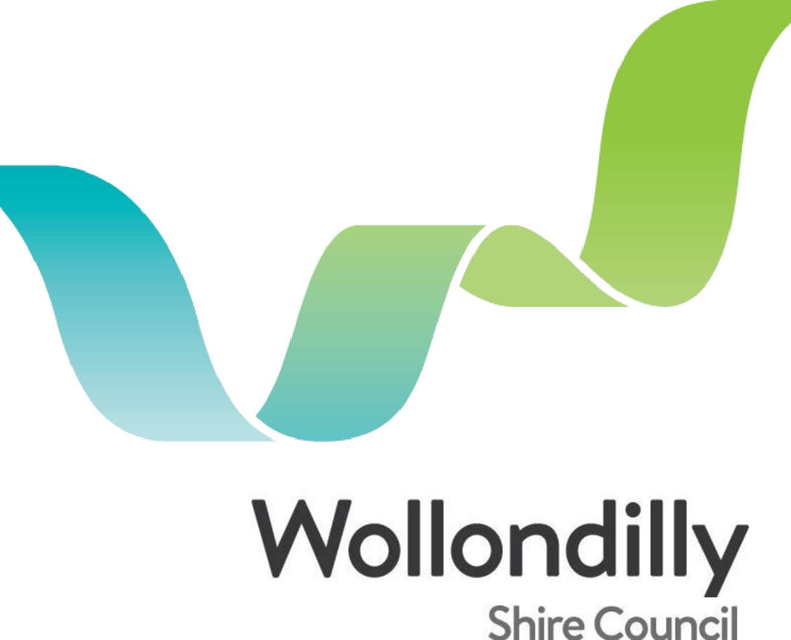
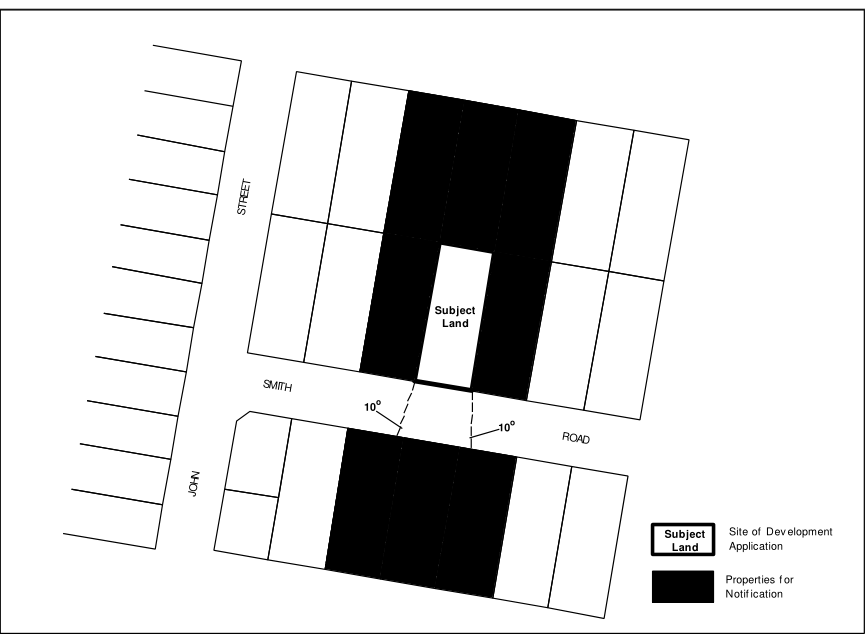

# Wollondilly Development Control Plan 2016 - Volume 1 General

> This chapter is split into 6 section file(s), one per numbered heading, in the order they appear in the PDF.

Source PDF: [Volume-1-General.pdf](https://planfortomorrow.sharepoint.com/sites/Planfortomorrow/Shared%20Documents/00%20NSW-Planning-Resources/dcp/wollondilly-development-control-plan-2016/volume-01-general/Volume-1-General.pdf)

### Development Control Plan 2016

> [Picture on page 1: a picture, saved as a picture (images/volume-01-general-page-1-2.gif, 150 dpi).]

### Development Control Plan 2016

### Volume 1 – General

> [Picture on page 2: a picture, saved as a picture (images/volume-01-general-page-2-3.gif, 150 dpi).]

#### Volume 1 – General

#### Revision History

#### Wollondilly Development Control Plan 2016 – Register of Amendments

| DCP Version No. | Volume(s) changed/ Name of DCP | Were the changes from a DCP review or were they site specific controls resulting from a Planning Proposal? | Dates Exhibited | Date Adopted by Council | Date in Force | Council TRIM File reference1 | TRIM ref finalised Version2 | Brief Description of Change |
|---|---|---|---|---|---|---|---|---|
| 1 | Wollondilly Development Control Plan 2016 (Volumes 1-8) | DCP Review | 13 May, 2015 to 17 July, 2015 | 21 December, 2015 | 20 January, 2016 | 3615- 6#278 | 3615#371 | Comprehensive review of Development Control Plan. Repeal of DCP 2011 and commencement of DCP 2016. |
| 2 | Volume 3 and Volume 4 | Planning Proposal (790 Montpelier Drive) | 2 December, 2015 to 14 January, 2016 | 15 February, 2016 | 7 March, 2016 | 6961#462 | 3615-6#387 3615-6#388 | Amendments were made to pre-existing controls relating to the Montpelier Drive Planning Proposal site in volumes 3 and 4. |
| 3 | Volume 2 and Volume 3 | Planning Proposal (Star Street former Road reserves) | 9 March, 2016 to 6 April, 2016 | 16 May, 2016 | 1 June, 2016 | 7965#112 | 3615-6#408 | Minor amendments were made to include site specific controls for the Star Street former Road Reserves Planning Proposal. The sections on PTT and West Picton in the various volumes was updated to make reference to this land. |
| 4 | Volume 3, Volume 4 and Volume 5 | Planning Proposal (Queen Victoria Memorial Home) | 18 November, 2015 to 18 December, 2015 | 15 February, 2016 | 19 August, 2016 | 6399#724 | 3615-6#426 3615-6#427 3615-6#428 | Site specific controls were added in Volumes 3-5 for the Queen Victoria Planning Proposal site. A new section was added in each volume titled ‘Queen Victoria Memorial Home’. |
| 5 | Volume 3 and 4 | Planning Proposal (Bulli Appin Road) | 14 December, 2016 to 3 February, 2017 | 15 May, 2017 | 7 June, 2017 | 6585#400 | 3615-6#446 3615-6#447 | Site specific controls were added in volume 3 and 4 for the Bulli Appin Road Planning Proposal. A new section was added titled ‘Bulli Appin Road’. |

1 TRIM file for day to day work associated with amendments 2 TRIM file reference for the finalised version of DCP

#### Volume 1 – General

| DCP Version No. | Volume(s) changed/ Name of DCP | Were the changes from a DCP review or were they site specific controls resulting from a Planning Proposal? | Dates Exhibited | Date Adopted by Council | Date in Force | Council TRIM File reference1 | TRIM ref finalised Version2 | Brief Description of Change |
|---|---|---|---|---|---|---|---|---|
| 6 | Volume 3 | Planning Proposal (No. 55-65 Bronzewing Street, Tahmoor) | 1 February, 2017 to 1 March, 2017 | 18 April, 2017 | 21 July, 2017 | 6115#600 | 3615-6#467 | Site specific controls were added in volume 3 relating to Bronzewing Street Planning Proposal. |
| 7 | Volume 3 | Planning Proposal (Boundary Adjustments and Minimum Subdivision Lot Size for Community Title Schemes) | 1 February to 3 March, 2017 | 16 October, 2017 | 8 November, 2017 | 9019#223 | 3615-6#460 | Controls added to facilitate the assessment of applications where boundary adjustment is carried out and no additional lots are created under clause 4.2B of WLEP 2011. |
| 8 | Whole DCP | DCP Review (Housekeeping Amendments) | 20 September, 2017 to 18 October, 2017 | 11 December, 2017 | 10 January, 2018 | 3615- 7#267 | 3615-7#286 | Housekeeping amendments carried out in response to Continuous Improvement Review. |
| 9 | Volume 3 & Volume 4 | Planning Proposal (Abbotsford Road Planning Proposal site) | 28 November, 2018 to 30 January, 2019 | 15 July, 2019 | 28 August, 2019 | 3615- 11#23 & 3615- 11#24 | 3615-11#31 & 3615-11#32 | Site specific controls were added in Volume 3 and 4 for the Abbotsford Road Planning Proposal site. The proposed controls are to guide any future development to keep these consistent with the heritage and landscape character of the site. |
| 10 | Volume 1, Volume 3 & Volume 4 | Menangle Landscape Conservation Area & Station Street Planning Proposal | 11 April 2018 to 16 May 2018 | 21 October, 2019 | 30 October, 2019 | 3615-10 | 3615-10#175, 3615- 10#207 & 3615- 10#208 | Development controls for Menangle Landscape Conservation Area to be added in Volume 1. Site specific controls were added in Volume 3 and 4 for the Station Street Planning Proposal site. The proposed controls are to guide any future development to keep these consistent with the heritage and landscape character of Menangle Landscape Conservation Area. |
| 11 | Volume 4 | Shire wide and Thirlmere area | 06 November 2019 to 04 December 2019 | 17 March 2020 | 1 April 2020 | 3615-14 | 3615-14#94 | These controls are prepared to ensure that Multi Dwelling Housing developments in the Shire achieve a better design outcome and better respond to the existing character of the area where they are located. Improved controls for |

#### Volume 1 – General

| DCP Version No. | Volume(s) changed/ Name of DCP | Were the changes from a DCP review or were they site specific controls resulting from a Planning Proposal? | Dates Exhibited | Date Adopted by Council | Date in Force | Council TRIM File reference1 | TRIM ref finalised Version2 | Brief Description of Change landscaping, car parking and waste management are also proposed. |
|---|---|---|---|---|---|---|---|---|
| 12 | Volume 4 | Shire wide and Thirlmere area | 05 May 2021 to 02 June 2021 | 21 September 2021 | 06 October 2021 | 3615-16 | 3615-16#85 3615-16#86 | These controls are prepared to ensure that Residential Flat Buildings in the Shire achieve a better design outcome and better respond to the existing character of the area where they are located. |
| 13 | Volume 5 | Wollondilly Cultural Precinct at Menangle Street, Picton | 14 November 2022 to 16 December 2022 | 23 February 2023 | 3 March 2023 | 12200-2 | Vol5-3615-7#325 3615-7#331 Vol1-3615-7#328 3615-7#333 Whole-3615-7#330 | New Part 4.5A is added with standards and controls to guide new development in the Wollondilly Cultural Precinct; and to ensure the precinct is sympathetic to its surroundings. |
| 14 | Volume 1 Volume 5 Volume 7 Volume 8 | The amendments were in response to the Stage 1, Stage 1A and Stage 2 planning proposals undertaken as part of Council’s LEP Review Program. | 12 March, 2025 to 9 April, 2025 | 23 September, 2025 | 31 October, 2025 | 3615-18 | Vol 1 – 3615-18#383 Vol 5 – 3615-18#384 Vol 7 – 3615-18#385 Vol 8 – 3615-18#386 | New controls for Development in the Metropolitan Rural Area, controls for helipads, timber yards, high technology industries and commercial bee keeping. |

#### Table of Contents

REVISION HISTORY ........................................................................................................................................................ 3 TABLE OF CONTENTS ................................................................................................................................................... 6 PART 1 – PRELIMINARY ................................................................................................................................................. 8

1.1 Introduction ........................................................................................................................................................ 8

1.2 Objective ........................................................................................................................................................... 8

1.3 Interpretation ..................................................................................................................................................... 8

1.4 Application of the volumes of this plan ............................................................................................................ 11 PART 2 – GENERAL CONSIDERATIONS FOR ALL DEVELOPMENT ....................................................................... 12

2.1 Objectives ........................................................................................................................................................ 12

2.2 Controls ........................................................................................................................................................... 12 PART 3 – VARIATIONS TO THIS PLAN ....................................................................................................................... 13

3.1 Controls ........................................................................................................................................................... 13 PART 4 – COMMUNITY ENGAGEMENT ...................................................................................................................... 14

4.1 Development applications to be notified ......................................................................................................... 14

4.2 Requirements for notification .......................................................................................................................... 17

4.3 Development applications involving Notification to Properties outside Wollondilly LGA ................................ 18

4.4 Development applications to be advertised .................................................................................................... 19

4.5 Requirements for Advertising .......................................................................................................................... 20

4.6 Development applications altered prior to determination ................................................................................ 20

4.7 Applications to modify a development consent ............................................................................................... 20

4.8 Requests for the review of a determination .................................................................................................... 21 PART 5 – COLONIAL HERITAGE (GENERAL) ............................................................................................................ 22

5.1 Objectives ........................................................................................................................................................ 22

5.2 General Controls ............................................................................................................................................. 22

5.3 Controls for particular development types ...................................................................................................... 22

5.4 Adaptive reuse proposals for Heritage items .................................................................................................. 27 PART 6 – HERITAGE (SPECIFIC LOCATIONS) .......................................................................................................... 28

6.1 Objectives ........................................................................................................................................................ 28

6.2 Application ....................................................................................................................................................... 28

6.3 Heritage Conservation Area and Landscape Conservation Area - Menangle ................................................ 28

6.4 Heritage Conservation Area - Picton............................................................................................................... 31

6.5 Heritage Conservation Area - Thirlmere ......................................................................................................... 38

6.6 Heritage Conservation Area - Warragamba .................................................................................................... 39

6.7 Heritage Conservation Area - Yerranderie ...................................................................................................... 40

6.8 The Greater Blue Mountains World Heritage Area ......................................................................................... 45

6.9 Landscape Conservation Area - Menangle ..................................................................................................... 46 PART 7 – ABORIGINAL HERITAGE ............................................................................................................................. 51

7.1 Objectives ........................................................................................................................................................ 51

7.2 Controls ........................................................................................................................................................... 51 PART 8 – FLOODING .................................................................................................................................................... 52

8.1 Objective ......................................................................................................................................................... 52

8.2 Controls ........................................................................................................................................................... 52

9.1 Objectives ........................................................................................................................................................ 58

9.2 Interpretation ................................................................................................................................................... 58

9.3 Controls ........................................................................................................................................................... 58 PART 10 – TREE REMOVAL ......................................................................................................................................... 60

10.1 Objectives ........................................................................................................................................................ 60

10.2 Interpretation ................................................................................................................................................... 60

10.3 Trees/other native vegetation that may be removed without consent and without a permit (i.e. exempt) ...... 61

10.4 Trees/other native vegetation that may be removed without development consent but require a permit ...... 63

10.5 Trees/other native vegetation that may be removed only with development consent .................................... 64 PART 11 – LANDSCAPING ........................................................................................................................................... 65

11.1 Objectives ........................................................................................................................................................ 65

11.2 Recommended Species .................................................................................................................................. 65

11.3 Banned Species .............................................................................................................................................. 67

11.4 Street Trees ..................................................................................................................................................... 67 PART 12 – SIGNAGE ..................................................................................................................................................... 68

12.1 Objectives ........................................................................................................................................................ 68

12.2 Signage as exempt development .................................................................................................................... 68 PART 13 – CONTROLS FOR DEVELOPMENT WITHIN THE METROPOLITAN RURAL AREA ............................... 69 Background ................................................................................................................................................................. 69 Principle 1: Enhancing Habitat and Biodiversity ......................................................................................................... 69 Principle 2: Protecting mineral and energy resources and extractive industries ........................................................ 71 Principle 3: Protecting Drinking Water Catchments .................................................................................................... 71 Principle 4: Preserving Land for Agriculture and Implementing appropriate buffers to support agriculture ............... 72 Principle 5: Preventing Incompatible Uses in Rural Areas; ........................................................................................ 73 Principle 6: Maintaining and enhancing the distinctive character of rural towns and villages; ................................... 74 Principle 7: Preserving Scenic Lands ......................................................................................................................... 75 Principle 8: Protecting areas of cultural and heritage value ........................................................................................ 76 Principle 9: Adequately Managing Hazards ................................................................................................................ 76

## PART 1 – PRELIMINARY

### 1.1 Introduction

The name of this plan is “Wollondilly Development Control Plan 2016”. This plan is made in 8 volumes. It applies to all land to which Wollondilly Local Environmental Plan 2011 applies.

### 1.2 Objective

1\. To assist in the realisation of the aims of Wollondilly Local Environmental Plan, 2011.

2\. The specific controls and volumes of this plan each have objectives as detailed throughout this plan.

### 1.3 Interpretation

In this plan, unless the context clearly indicates otherwise, words have meaning as defined in this section, Wollondilly Local Environmental Plan, 2011, and State Environmental Planning Policy (Exempt and Complying Development Codes), 2008. Where there is an inconsistency between the definitions, the definitions in this section of the plan shall prevail to the extent of the inconsistency but only for the purposes of interpreting this plan.

| Term | Meaning |
|---|---|
| Access Handle | A corridor of land used to provide access for vehicles from the public road network to or through an allotment that would otherwise be inaccessible for vehicles. |
| Adaptable Dwelling | A dwelling that is designed to facilitate its future conversion to comply with disabilities access standards without structural modification to the building in accordance with AS4299 Adaptable Housing. |
| Ancillary Buildings | A building (that is not a dwelling) on a residential or rural allotment that is used by the residents of the allotment as a part of their domestic occupation of the land and includes a detached garage but excludes an attached garage. |
| Any Subdivision | The subdivision of land by Torrens and/or Community Title and/or subdivision by Strata. This definition extends beyond the term “Subdivision of Land” as defined in the Environmental Planning and Assessment Act, 1979. |
| Blank Wall | A stretch of wall that is a straight wall and does not have any windows or doors. |
| Building Line | Means the closest point of a wall of a building to a defined boundary (excluding any allowable encroachments). |
| Building Setback | Means the horizontal distance between the relevant boundary of the lot and the building line. Setback area means the area between the building line and the relevant boundary of the lot. |

| Term | Meaning |
|---|---|
| Dormer window | A window set into the structural element of a building that protrudes from the plane of a sloping roof surface. Dormers are used, either in original construction or as later additions, to create usable space in the roof of a building by adding headroom and usually also by enabling addition of windows. |
| Dormitory Room | A room that provides sleeping accommodation for 3 or more adults. |
| EEC | An Endangered Ecological Community declared by the NSW Government. |
| Environmental Asset | A contiguous are of land greater than 5000m2 this is substantially composed of one or more of the following: ▪ An EEC; ▪ Threatened flora; ▪ Habitat occupied by threatened fauna or nearby land likely to be required by that fauna for foraging, nesting, mating or other similar needs; ▪ Wildlife Corridors; and ▪ A natural wetland, groundwater dependant ecosystem or similar. This definition includes (without limitation): an area of land that would, but for the carrying out of unauthorised works, meet one or more of the above criteria; and an area of land that is partially located on land not included within a planning proposal. |
| Environmental Landscape | A precinct or area that contains dispersed environmental land or that otherwise forms part of a landscape that has a strongly defined character that the Council considers desirable for retention and enhancement. |
| Event | A use of land for recreational purposes for a period of no more than 5 consecutive days (or up to 10 days inclusive of related setup and pack up activities) and no more than a total of 52 days in a year. |
| Fanlight casement window | A pane of glass installed over a door or window. |
| Finished Floor Level | Refers to the numerical difference (in metres) between the natural ground level and the floor level of a building at the completion of a development. |
| Flood Planning Level | The 1% AEP flood level + 0.5m. |
| Formal Landscaping | A garden bed that has fixed edging, a mulched or rock covered surface and planting with ground covers and/or shrubs and/or trees. |
| French doors | A twin set of doors which are hinged on one of its vertical edges so as to open inwards or outwards. |
| Front Façade | The front of a building that addresses a public road or a private road in a community title scheme. |
| Habitat Corridor | Means an area of habitat that connects otherwise isolated patches of habitat, allowing for the movement of plants and animals. Habitat is an area or areas occupied periodically or occasionally by a species, population or ecological community. |
| Hour of solar access | Exposure for a period of 1 hour to direct sunlight between the hours of 9:00am and 3:00pm on 21 June. |

| Term | Meaning |
|---|---|
| Large Subdivision | Any subdivision that creates more than 100 allotments. |
| Medium Density Development | Means any development that results in 3 or more dwellings on an allotment of land. |
| Medium Subdivision | Any subdivision that creates more than 10 allotments but no more than 100 allotments. |
| Minor Subdivision | Any subdivision that: • Does not create any additional dwelling opportunities (excluding an additional opportunity for a secondary dwelling); and • Does not, by its scale and nature, have any plausible adverse social, environmental or economic impacts; and • Does not involve any allotment on which an item of environmental heritage is situated; and • Does not involve any allotment located within a heritage conservation area or a Landscape Conservation Area; and • Does not result in more than 4 new allotments. This definition is not intended to be applied to the interpretation of exempt or complying development provisions or to a subdivision carried out under clause 4.2 of Wollondilly Local Environmental Plan 2011. |
| Mirror Reversed | A building that substantially appears to have a vertical axis of symmetry in or about the centre of a Front Façade. |
| Natural Ground Level | The ground level of a location that would have existed when the subject allotment was registered. |
| Panelled door | A door with sunk panels set between its frame. |
| Primary Front Façade | Refers to the front of a building which addresses the primary street frontage on a corner lot. |
| Public Realm | Refers to land in public ownership and/or privately owned land designed and intended to be accessible to the public. |
| Repeated Façade | A section of a Front Façade that is repeated or is substantially similar to another section of that Front Façade but not in cases where the section does not contain a door (be it a personal access door or a garage door). |
| Residential Battle-Axe Allotment | A residential small lot, Standard Residential Lot or residential large lot which only has vehicular access by an access handle. |
| Residential Large Lot | An allotment of land with an area of between 1500m2 and 3999m2 (inclusive) on which a dwelling may be lawfully constructed. |
| Residential Small Lot | An allotment of land with an area of between 450m2 and 699m2 (inclusive) on which a dwelling may be lawfully constructed. |
| Rural Lifestyle Lot | An allotment of land with an area between 4000m2 and 2 hectares on which a dwelling may be lawfully constructed. |
| Rural Lot | An allotment of land with an area greater than or equal to 2 hectares on which a dwelling may be lawfully constructed. |

| Term | Meaning |
|---|---|
| Secondary Front Façade | Refers to the front of a building which addresses the secondary frontage on a corner lot. |
| Site Coverage | Means the proportion of a site covered by buildings. However, the following are not included for the purpose of calculating site coverage: a) any basement; b) Porticos that service a door entry; c) any eaves; d) unenclosed balconies above the ground floor of a building. |
| Small Subdivision | Any subdivision that creates no more than 10 allotments except for a Minor Subdivision. |
| Standard Residential Lot | An allotment of land with an area of between 700m2 and 1499m2 on which a dwelling may be lawfully constructed. |
| Straight Wall | A stretch of wall that continues in a linear fashion without any change to its direction or any articulation. |
| Suspected flood affected land | Land that is located on the part of a flood plain and that could reasonably be expected to be inundated in a probable maximum flood. |
| Temporary Markets | A use of land for retail purposes for a period of no more than 2 consecutive days (or up to 4 days inclusive of related setup and pack up activities) and no more than 12 times per year. |
| Town Centre Residential Lot | An allotment of land with an area less than 450m2 on which a dwelling may be lawfully constructed. |
| Wet bars | Any room that contains a sink and is not a kitchen, bathroom or laundry. |

### 1.4 Application of the volumes of this plan

This volume applies to all development requiring development consent on, in or over land within the Wollondilly Local Government Area.

The volumes of this plan each identify the contexts in which they apply. Developments may be subject to more than one volume of this plan. If there is an inconsistency between the volumes of this plan then the earlier volume shall prevail over the later volume. For example, if there is an inconsistency between Volumes 2 and 5, Volume 2 would prevail because it is found earlier in this plan.

## PART 2 – General considerations for all development

### 2.1 Objectives

1\. To ensure that developments are undertaken with due regard to human safety.

2\. To ensure that developments do not unreasonably impact on their surrounds.

3\. To ensure that developments achieve a satisfactory level of social equity.

### 2.2 Controls

1\. The consent authority shall consider the following safety and human health risks in assessing a development application under this volume:

a) Road and traffic hazards;

b) Bushfire threat;

c) Flood risk;

d) Noise, vibration, pollution, odour, radiation or waste from surrounding land uses;

e) Exposure to electricity transmission systems;

f) Exposure to radiation from telecommunications infrastructure;

g) Potential exposure to children of material (including signage) from any nearby restricted premises and/or sex services premises;

h) Hazards from vehicles within car parking areas; and

i) Hazard from potential contamination of the land.

2\. The consent authority shall consider the suitability of the road network in the vicinity in assessing a development application under this volume.

3\. The consent authority must not grant consent to a development application for development within a proclaimed mine subsidence area without the concurrence of the Mine Subsidence Board.

4\. The consent authority must not grant consent to a development application for development subject to this volume on land unless it has considered the impact of the development on any system for the management of wastewater present on that land.

5\. The consent authority must not consent to the carrying out of development within a drinking water catchment area unless it is satisfied that the proposal will have a neutral or beneficial effect on water quality.

## PART 3 – Variations to this plan

There may be situations where the strict application of the controls in this plan is inappropriate. In such cases Council may vary the controls in the plan. The controls in this part apply where a development application proposes to vary a control in this plan.

### 3.1 Controls

1\. In cases where a variation to a control in this plan is sought, the applicant (or person acting on behalf of the applicant) should provide a written request which outlines:

• the control being varied

• the non-compliance with the relevant control

• reasons and justification for the non-compliance

• how the development meets all of the relevant objectives of the DCP

• why compliance with the control is unreasonable or unnecessary in the case of their development

• how the variation will not adversely impact on local amenity

Council may require additional supporting information to justify the request for variation. It is in the applicants’ best interest to provide Council with a written request.

2\. Council must be satisfied that the variation meets at least one of the following principles before issuing consent for the development:

• The objectives of the standard are achieved not withstanding non-compliance with the standard;

• The underlying objective or purpose of the standard is not relevant to the development and therefore compliance is unnecessary;

• The underlying object or purpose of the control would be defeated or thwarted if compliance was required and therefore compliance is unreasonable;

• The development standard has been virtually abandoned or destroyed by the Council’s own actions in granting consents departing from the standard and hence compliance with the standard is unnecessary or unreasonable;

• The zoning of the particular land is unreasonable or inappropriate so that a development standard appropriate for that zoning is also unreasonable and unnecessary as it applies to the land and compliance with the standard would be unreasonable or unnecessary.

## PART 4 – Community engagement

The purpose of this part is to ensure that members of the public potentially affected by a proposed development have input into the assessment process before a final decision is made on a development application. It outlines Council’s notification and advertising procedure for development applications.

### 4.1 Development applications to be notified

Notification of development applications will be required except where Council consider that the potential for adjoining and nearby land to be adversely affected by the development is minimal.

Notification is not required for the development types listed in Table 1 below so long as the criteria in the right hand column are met.

Development types where notification is not required:

#### Table 1

| Type of Development | Criteria which excludes the development from requiring notification |
|---|---|
| dwelling house (including alterations and additions) | ▪ No other Dwelling House located on the same allotment ▪ Finished floor levels no greater than 1m above or below the natural ground level ▪ Complies with Council’s building line setbacks prescribed in this plan ▪ For single storey dwellings - No walls less than one (1) metre from any boundary ▪ For two storey dwellings – be setback at least 10.0m from side boundaries. ▪ Total floor area of less than 430m2 ▪ No more than 2 garage doors visible from the street ▪ Not located on a lot containing a Heritage Item or within a Heritage Conservation Area, including a Landscape Conservation Area. |
| Carports (residential) | ▪ Relates to a residential use of the land; ▪ Complies with Council’s building line setbacks in this plan ▪ Setback from side boundaries is no less than 1.0m ▪ No taller than 4m above ground level (existing) ▪ Not located on a lot containing a Heritage Item or within a Heritage Conservation Area, including a Landscape Conservation Area. |
| Awnings and Pergolas (residential) | ▪ Relates to a residential use of the land ▪ Complies with Council’s building line setbacks in this plan ▪ Setbacks from side boundaries are no less than 1m ▪ No taller than 4m above existing ground level ▪ Not located on a lot containing a Heritage Item or within a Heritage Conservation Area, including a Landscape Conservation Area. |
| Gazebos (residential) | ▪ Relates to a residential use of the land ▪ Complies with Council’s building line setbacks in this plan ▪ Setback from side boundaries no less than 1m ▪ No taller than 4m above existing ground level ▪ Not located on a lot containing a Heritage Item or within a Heritage Conservation Area, including a Landscape Conservation Area. |

| Type of Development | Criteria which excludes the development from requiring notification |
|---|---|
| Retaining walls (residential) | ▪ Relates to a residential use of the land ▪ No more than 0.6m high ▪ Setback from side and rear boundaries is no less than 2.5m ▪ Located behind or beside the dwelling. |
| Swimming pools (residential) | ▪ Relates to a residential use of the land ▪ Setback from side and rear boundaries no less than 1m ▪ Located in the rear yard or on a corner lot, behind the front and secondary street setbacks of the dwelling ▪ No coping or decking more than 0.5m above ground level (existing). |
| Decks and Balconies (residential) | ▪ Relates to a residential use of the land ▪ No more than 0.5m above ground level (existing) ▪ Setback at least 10.0m from any boundary |
| Residential Outbuildings | ▪ Relates to a residential use of the land ▪ Complies with the building line setbacks in this plan ▪ Located in a residential zone (other than R5 Large Lot Residential) ▪ Setback from any boundary is no less than 900mm ▪ No higher than 3.5 metres above the natural ground level ▪ Can accommodate a maximum of two car parking spaces ▪ Floor area less than 50m2 |
| Rural Outbuildings | ▪ Relates to a residential use of the land ▪ Located on land zoned R5, RU1, RU2, RU4 or E4 ▪ Complies with the building line setbacks contained within this plan ▪ Setback from any boundary is no less than 10.0m ▪ No higher than 5.0m above natural ground level ▪ Floor area less than 100m2 |
| Telecommunications Facilities | ▪ Be “low impact facilities” as defined by the legislation of the Commonwealth. |
| Tree removal (residential) | ▪ Removal of 10 trees or less ▪ Located on residential zoned land |
| Tree removal (rural) | ▪ Removal of less than 10m2 of vegetation ▪ Located on rural zoned land |
| Tree removal (agricultural) | ▪ Located in a RU1 or RU2 ▪ Removal is required for the purposes of agriculture |
| Demolition | ▪ Demolition of a building that would have been subject to another exemption in this clause if it were being proposed as a new building. |
| Septic Tanks | ▪ No notification required |
| Rain Water Tanks | ▪ No notification required |
| Strata subdivision of existing buildings | ▪ Existing building is lawful and complies with the Building Code of Australia. |
| Subdivision of existing dual occupancy | ▪ Be located in Zones R2, R3 or B4 ▪ The existing building(s) is/are lawful |

| Type of Development | Criteria which excludes the development from requiring notification |
|---|---|
| Health Services Facility | ▪ Located within Zones B1, B2 or B5 ▪ Be located wholly within an existing commercial building |
| Kiosk | ▪ Be located within Zones B1, B2 or RE2 |
| Internal Works to an existing building | ▪ Does not affect the height, footprint or external appearance of the building. |
| Home Occupations | ▪ Where, in the responsible Council Officer’s opinion the proposed new use is unlikely to result in land use conflict due to noise, hours of operation or traffic generation. |
| Minor Commercial external building alterations/additions | ▪ Works are not proposed to a Heritage Item or to a building within a Heritage Conservation Area, including a Landscape Conservation Area. ▪ Does not increase the height of the building. ▪ Does not create additional shops/units. |
| Change of use of an existing building from one type of commercial use to another | ▪ Proposed use is permissible in the zone ▪ Adequate car parking is provided ▪ Where in the responsible Council Officer’s opinion the proposed new use is unlikely to result in land use conflict due to noise, hours of operation or traffic generation ▪ In a business zone ▪ Contained within an existing building |
| Change of use from one type of light industry to another type of light industry | ▪ Proposed use is permissible in the zone ▪ Adequate car parking is provided ▪ Where in the responsible Council Officer’s opinion the proposed new use is unlikely to result in land use conflict due to noise, hours of operation or traffic generation ▪ The land is within an industrial zone ▪ Contained within an existing building ▪ The land does not adjoin any residential, rural, environmental or open space zone |
| Secondary Dwellings | ▪ The lot is within a rural or environmental zone and is greater than 2 hectares ▪ Will not result in any more dwellings than the principal dwelling and the secondary dwelling on the site. ▪ Is consistent with the setback requirements for Secondary Dwellings in rural and environmental zones contained in Volume 4 of this Plan. |
| Minor Environmental Protection Works | ▪ No notification required. |

| Type of Development | Criteria which excludes the development from requiring notification |
|---|---|
| Signage | ▪ Within a business or industrial zone ▪ Does not require advertising under SEPP 64 ▪ Is not illuminated ▪ Is not attached to a heritage item, on a lot containing a heritage item or within a heritage conservation area, including a Landscape Conservation Area ▪ Is not in association with a restricted premises |
| Works that are required in response to an emergency situation (such as a natural disaster event, e.g. a flood). | ▪ No notification required. |

2\. Neighbour notification may not be required for a development application where, in Council’s considered opinion, the potential for adjoining or nearby land to be adversely impacted by the development is considered minimal in terms of the following:

▪ Amenity (including noise, odour, hours of use);

▪ Suitability of the land for the proposed development;

▪ The siting of the proposed building in relation to the development of the site boundaries;

▪ The scale and bulk of the proposed development.

Likewise, Council may require an application which would not require notification under the section above to be notified.

### 4.2 Requirements for notification

Development applications that require notification under this plan shall be notified in accordance with the requirements for a “written notice” under Part 6 Division 7 of the Environmental Planning and Assessment Regulations, 2000.

In cases where the owners address recorded in Council’s rating database for a notified property is different to the street address of that property, a “written notice” shall also be sent to “the occupier” at the street address.

Where the notification of a development application is required under this plan the Council must provide a written notice of the application to any person who owns or occupies land adjoining the land to which the application relates. Land that is considered to be adjoining the development site is identified in the diagram below:

Figure 1

> [Picture on page 18: a map, saved as a picture (images/volume-01-general-page-18-2.gif, 150 dpi); the street names and other small labels are on the picture.]
> Words printed on the picture (title and legend, copied from the PDF):
> Site of Dev elopment
> Properties f or

Council may elect to provide a written notification to owners or occupiers of land beyond those adjoining the development site if Council considers that the nature and scale of the development requires the notification of a broader area.

Where land is held in a strata or community title, the written notice must be forwarded to:

▪ The manager or secretary of the body corporate (under the Strata Titles Act, 1973 or the Strata Titles (Leasehold) Development Act, 1986) or the Association (under the Community Land Development Act, 1989), and

▪ The lessor of the leasehold strata scheme concerned and to the owners corporation (if the land is not a lot within the meaning of the Strata Schemes (Leasehold Development) Act, 1986) is taken to be written notice to the owner or occupier of each lot within the Strata Scheme (in accordance with the Environmental Planning and Assessment Regulations); and

▪ Each individual strata or community title owner, meeting the adjoining land criteria above.

Note: Where Council has not been provided with contact details for the association under the

#### Community Land Development Act, 1989 then the association will not be notified.

### 4.3 Development applications involving Notification to Properties outside Wollondilly LGA

Where, in Council’s opinion, an application may detrimentally affect property owners or occupants of land outside Wollondilly Shire Council’s Local Government Area (LGA), Council will contact the neighbouring Council to provide them with sufficient information to enable them to adequately inform such property owners.

The notification of property owners outside Wollondilly Shire Local Government Area regarding any application is at the discretion of the neighbouring Council.

### 4.4 Development applications to be advertised

1\. Development for any of the following purposes is advertised development under Clause 5 of the Environmental Planning and Assessment Regulations, 2000:

▪ Air transport facilities

▪ Animal Boarding or Training Establishments

▪ Any bottle shop, pub, licensed club or hotel requiring a license under the Liquor Act, 2008

▪ Caravan Parks, Camping Grounds

▪ Cemeteries, Crematoria, Mortuaries, Funeral Homes

▪ Child care centres with capacity for 40 or more enrolments

▪ Correctional centres

▪ Drive through restaurants

▪ Electricity generating works (excluding solar panels for domestic use)

▪ Forestry

▪ Heavy industrial storage establishments

▪ Hostels containing 5 or more boarding rooms

▪ Intensive livestock agriculture

▪ Intensive plant agriculture

▪ Livestock processing industries

▪ Multi dwelling housing, Seniors housing, Shop top housing and residential flat buildings comprising 5 or more dwellings

▪ Offensive, hazardous, extractive and heavy industries

▪ Places of public worship with a capacity greater than 100 people

▪ Recreation facilities (major), Recreation facilities (outdoor)

▪ Restricted premises

▪ Service stations

▪ Sex services premises and brothels

▪ Subdivision resulting in 5 or more lots (except for subdivision described in an exemption in Clause

4.1 of this plan),

▪ Transport Depots, Truck Depots, Depots, Freight Transport Facilities, Passenger Transport Facilities

▪ Tourist and visitor accommodation comprising more than 5 guest rooms

▪ Any other development that, in the opinion of the consent authority, is likely to have impacts beyond the immediate locality in which it is situated.

Development which constitutes any of the following may also be advertised for the purposes of this plan:

▪ State Significant Development;

▪ Nominated Integrated Development;

▪ Threatened Species Development;

▪ Class 1 Aquaculture Development;

▪ Any development that is identified as advertised development under by an environmental planning instrument.

2\. In circumstances where a minor development (such as an awning) is proposed to an existing lawful and established facility listed above, Council may use its discretion not to advertise the application provided that it is of minimal impact.

### 4.5 Requirements for Advertising

Development applications that require advertising under this plan shall be advertised in accordance with the requirements for a published notice of Part 6 Division 7 of the Environmental Planning and Assessment Regulations, 2000.

In cases where the owners address recorded in Council’s rating database for a notified property is different to the street address of that property, a “written notice” shall also be sent to “the occupier” at the street address.

In the case of any development that requires advertising, a written notification shall also be sent to the any person who owns or occupies land adjoining the land to which the application relates in the manner prescribed in section 4.2 of this part.

### 4.6 Development applications altered prior to determination

Where a development application is altered prior to being determined (but after notification has been carried out), it must be re-notified where in Council’s opinion, the amended development would have a greater impact as a result of the changes and it is in the public interest to do so.

Where re-notification is required it must include writing to any prior submitters on the application.

### 4.7 Applications to modify a development consent

Any person may lodge an application to modify a development consent under Section 96 of the Environmental Planning and Assessment Act, 1979 provided that the changes would result in substantially the same development as that originally approved.

The minimum notification requirements for applications to modify a consent are as follows:

| Type of | Type of Modification | Who is to be notified |  |  |
|---|---|---|---|---|
| modification | No Notification Required | Adjoining Owners/residents | Previous Submitters | Other |
| application (i.e. |  |  |  |  |
| under what section |  |  |  |  |
| of the Act) |  |  |  |  |
| S96(1) | Correction of minor errors, misdescriptions and miscalculations |  |  |  |
| S96(1A) | Changes that would have minimal environmental impact |  |  |  |
| S96(2) | Other changes |  |  |  |
| S96 (AA) | Modifications to development consents issued by the Land and Environment Court |  |  |  |

> [Picture text on page 20 is stored in the PDF without readable letters (no character map), so it could not be copied; see the original PDF.]

Council may determine to carry out additional notification or advertising of any application depending on the nature of the changes and whether Council sees it in the Public Interest to do so.

Council may also determine not to notify previous submitters if the amendments are minor and the changes do not relate to any of the issues raised in their original submission.

### 4.8 Requests for the review of a determination

Any request for a review of the determination of a development application under Section 82A of the Environmental Planning and Assessment Act, 1979 shall be subject to the community engagement requirements of this plan (be it notification or advertising) as though it were a new application unless it is identical to the original application or any modifications are minor only. Council must also notify all previous submitters in accordance with the requirements of this plan where a request for a review of determination is made.

## PART 5 – Colonial Heritage (General)

### 5.1 Objectives

The objectives of heritage conservation are:

(a) To establish good design principles to guide development to and around heritage items,

(b) To ensure development is sympathetic to the overall heritage values and characteristics of the area,

(c) To identify local heritage character and heritage elements of the built environment, and

(d) To ensure the retention and management of heritage values identified for each conservation area and specific precinct.

### 5.2 General Controls

1\. Development of heritage items and development on land within heritage conservation areas, including Landscape Conservation Areas, shall demonstrate consistency with the NSW Guidelines for Development in Conservation Areas ‘Design in Context’. In particular the impact of the following aspects of a development should be considered:

▪ Height and scale - must respect the predominant scale (building height, bulk, density and massing) of the heritage buildings in the vicinity in order to retain the prevailing scale of the Conservation Area. The impact of an inappropriately scaled building cannot be compensated for by building form, design or detailing.

▪ View corridors - must be retained to and from significant features within the Conservation Area.

▪ Architectural style and form - must be compatible with the existing heritage buildings in the vicinity.

▪ Materials, detailing and colour schemes - must respect the materials of the existing heritage buildings in the vicinity.

▪ Siting - must respect existing patterns of building setbacks of heritage buildings from property boundaries, which contribute to the harmony of the streetscape.

▪ Cumulative impact - must be considered to ensure that the characteristic features of the conservation area that give harmony and cohesiveness to streetscapes and individual buildings are not eroded.

### 5.3 Controls for particular development types

<!-- sections -->
## Sections

1. [1 Advertising and Signage](01-advertising-and-signage.md)
2. [2 Additions, Alterations and Ancillary Development](02-additions-alterations-and-ancillary.md)
3. [3 Demolition of Heritage Items](03-demolition-of-heritage-items.md)
4. [4 Subdivision of land containing a heritage item and/or land within a heritage conservation area or a Landscape Conservation Area.](04-subdivision-of-land-containing-a.md)
5. [5 Colours and built form on sites containing heritage items and within heritage conservation areas or a Landscape Conservation Area.](05-colours-and-built-form-on-sites.md)
6. [13 – Controls for Development within the Metropolitan Rural Area](06-13-controls-for-development-within-the.md)
