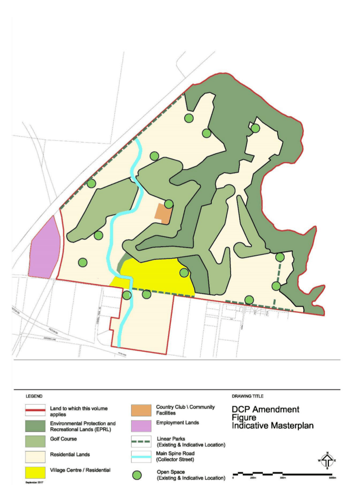
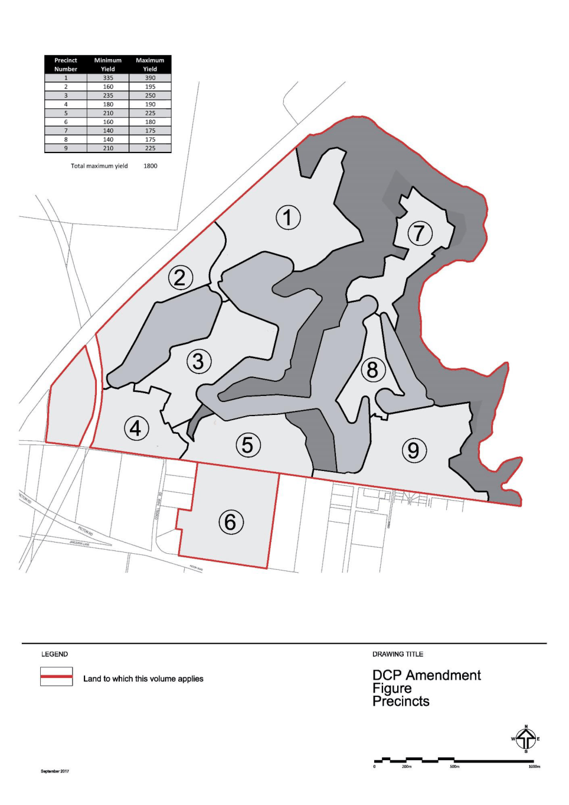
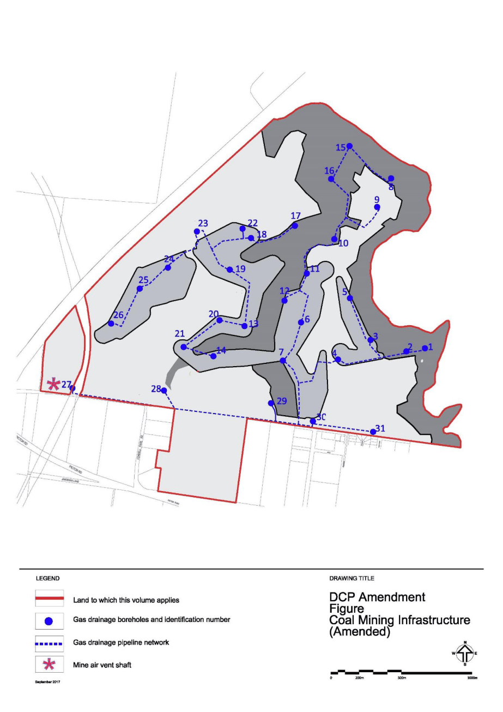
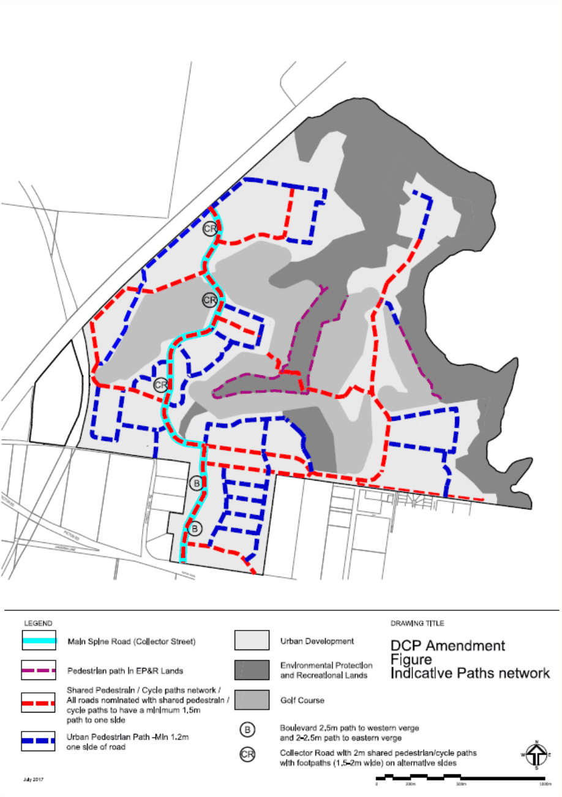
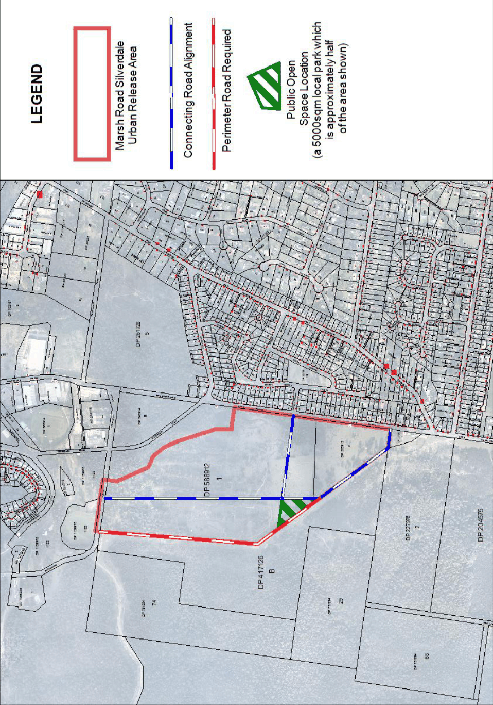

### 2.1 Wilton Park, Wilton (Bingara Gorge)

#### Objectives

1\. To minimise the risk to life, property and amenity as the result of underground mining activities (including aboveground supporting infrastructure).

2\. To minimise the risk to life, property and amenity as the result of the underground gas pipeline that runs through the site.

3\. To ensure development of this precinct has regard for the landscape features of the site and its surrounds.

4\. To ensure the density of development is controlled so that suitable infrastructure can be provided during relevant stages of the development.

5\. To limit the overall density of development to ensure that:

a) The precinct is developed in line with the agreed indicative range set out in Map 2: Precinct Allotment Allocation

b) The development does not compromise or overwhelm regional infrastructure

6\. To ensure a consistent road network through the urban release area.

7\. To promote connectivity with the existing Wilton Village.

8\. To improve pedestrian access and connectivity between housing, open space networks, community facilities, public transport, local activity centres and schools.

#### Maps

#### Map 1: Master Plan

> [Picture on page 5: a picture, saved as a picture (images/volume-02-urban-release-areas-page-5-3.gif, 150 dpi).]

#### Map 2: Precinct Allotment Allocation

> [Picture on page 6: a picture, saved as a picture (images/volume-02-urban-release-areas-page-6-2.gif, 150 dpi).]

#### Map 3: Mining Infrastructure

> [Picture on page 7: a picture, saved as a picture (images/volume-02-urban-release-areas-page-7-2.gif, 150 dpi).]

#### Map 4: Cycleways and Pedestrian Linkages

> [Picture on page 8: a picture, saved as a picture (images/volume-02-urban-release-areas-page-8-2.gif, 150 dpi).]

#### Controls

1\. The development is to be generally undertaken in accordance with Map 1: Master Plan.

2\. Prior to determining any application for subdivision the consent authority must be satisfied that the ultimate development of each precinct is carried out in accordance with the indicative yield outlined in Table 1.

#### Table 1 Development Precinct Indicative Yields and Total Maximum Yield

| Precinct Number | Minimum Yield | Maximum Yield |
|---|---|---|
| 1 | 335 | 390 |
| 2 | 160 | 195 |
| 3 | 235 | 250 |
| 4 | 180 | 190 |
| 5 | 210 | 225 |
| 6 | 160 | 180 |
| 7 | 140 | 175 |
| 8 | 140 | 175 |
| 9 | 210 | 225 |

Total maximum yield

1800

The above table is to be used for indicative purposes only.  The distribution of residential allotments across the Development Precincts shall be on a progressive cumulative basis such that the overall lot yield will not exceed 1800 within all precincts.

3\. Prior to determining any application for subdivision the consent authority must be satisfied that the ultimate development of this Urban Release Area will not result in more than 1,800 residential allotments.

4\. In controls 2 and 3 a residential allotment means any lot that is intended to contain one or more dwellings.

5\. The consent authority must have regard to the impact of a development on the potential future mining of the site prior to granting consent for that development. It must not grant such a consent unless it is satisfied that the surface development will not unreasonably impact on potential future or current underground mining.

6\. Cycleways and footpaths shall be provided generally in accordance with Map 4: Cycleways and Pedestrian Linkages contained in this volume.

7\. Prior to the issue of a relevant Construction Certificate for fire trails, detailed plans showing the location of all threatened species (state and federal) shall be provided.

8\. Transport infrastructure shall be provided in accordance with the following table.

#### Table 2 Road Category Design Specifications

| Road Category | Road Type | Design Speed (km/hr) | Max Daily Flow (veh/day) | Reservation Width (m) | Carriageway Width | Road Profile | Concrete Footpath | Other Criteria/Guidelines |
|---|---|---|---|---|---|---|---|---|
| A1 | Main Entry Road | 50 | >6000 | 32 | 2 x 6 (with a 7m median) | 6.5-6- 7-6- 6.5 | Yes | Road provides a main access to Wilton Parklands Footpaths on both sides of street Cyclists to be provided off carriageway |
| A1(b) | Main Entry Road - Extension | 50 | >6000 | 27.5 | 2 x 6 (with a 2.5m median) | 6.5-6- 2.5-6- 6.5 | Yes | Provide main access to Wilton Parklands – with narrower median Footpaths on both sides of the street Cyclists to be provided off carriageway |
| A2 | Main Spine Road – Road from Spine Road to Broughton Street (collector road) | 50 | 6000 | 22 | 11 | 5.5- 11-5.5 | Yes | Principle circulation road – geometry as per state deed Footpaths on both sides of the street Cyclists to be provided off carriageway Road geometry in excess of that minor collector road as defined by AMCORD |
| A3 | Hornby Street Deviation (minor collector road) | 50 | 3000 | 19 | 11 | 3.5- 11-4.5 | Yes | On street parking provided on both sides of the road Footpath on one side of street Cyclists to be provided off carriageway Road geometry in excess of that minor collector road as defined by AMCORD |
| B1 | Minor Collector Road | 50 | 3000 | 16 | 8 | 4.0-8- 4.0* | See criteria | Apply to standard residential streets serving more than 50 lots Footpath on one side of street Cyclists to be provided on street, or off carriageway as per network to be approved by Council Road geometry in excess of that of minor collector road |

| Road Category | Road Type | Design Speed (km/hr) | Max Daily Flow (veh/day) | Reservation Width (m) | Carriageway Width | Road Profile | Concrete Footpath | Other Criteria/Guidelines as defined by AMCORD |
|---|---|---|---|---|---|---|---|---|
| B2 | Local Street | 40 | 1500 | 15 | 7 | 4.0-7- 4.0* | See Criteria | Apply to standard residential streets serving 50 lots or less Footpath on one side of street when catchment to bus route or main pathway/cycleway exceeds 50 lots Cyclists to be provided for on-street, or off carriageway where shown on Map 4. Road geometry in excess of that of minor collector road as defined by AMCORD. |
| C1 | Cul-de-sac | 25 | 300 | 14 | 7 | 3.5-7- 3.5 | No | Apply to Standard Cul-de-sacs Cyclists to be provided for on-street as per network to be approved by Council |
| D1 | Residential Accessway | 15 | 300 | 11.5 | 5.5 | 3.5- 5.5-2.5 | No | Restrict to servicing a maximum of 10 lots Cyclists to be provided for on-street as per network to be approved by Council |
| D2 | Shareway/ Laneway | 15 | 100 | 10.5 | 4 | 4.0- 4.9-2.5 |  | Restrict to servicing 4 lots with 1 additional parking space per 2 dwellings Cyclists to be provided for on street, as per network to be approved by Council |

\* Where a 2.0 metre wide shareway is located on a B1 or B2 street, the verge width can be varied to override a width of 3.5m one side and 4.5m the other side of the road carriageway.

8\. Prior to granting development consent for any subdivision of land within the urban release area the consent authority must be satisfied that all reasonable efforts have been made to ensure that:

a) The views of the parkland setting are maximised. This includes the open spaces, golf course, environmental lands and the Razorback Range.

b) The visual impact of the development on Picton Road and the Hume Highway have been minimised.

c) Where practical, existing high amenity features of the site will be protected, retained and incorporated into the development to maximise the amenity benefit of those features.

9\. Development consent must not be granted for the development of any school, childcare centre, seniors living, health care facility or similar sensitive land use within 750 metres of the gas pipeline within the urban release area unless the consent authority is satisfied that the risks of that pipeline to human safety have been adequately mitigated.

#### Marsh Road, Silverdale (Former Lion Safari Park)

#### 2.2

| Requirement of LEP | Control(s) |
|---|---|
| (a) a staging plan for the timely and efficient release of urban land making provision for necessary infrastructure and sequencing, | 1. The development of the land is to be staged to ensure that intersections are provided to allow for a connecting road through the development generally in accordance with the map provided as Figure 1 of this section. 2. The development staging shall ensure that housing is delivered to front Marsh Road in the first stage of the development. 3. The development may be undertaken in any number of stages. |
| (b) an overall transport movement hierarchy showing the major circulation routes and connections to achieve a simple and safe movement system for private vehicles, public transport, pedestrians and cyclists, | 1. The road hierarchy shall ensure that roads step down from the connecting roads provided generally in accordance with the map provided as Figure 1 of this section to progressively lower volume roads. 2. Transport and pedestrian access along the perimeter road shall only be provided in accordance with the structure plan in figure 1 of this volume on privately owned land where an easement or other form of landowners consent has been provided. |
| (c) an overall landscaping strategy for the protection and enhancement of riparian areas and remnant vegetation, including visually prominent locations, and detailed landscaping requirements for both the public and private domain, | The site does not contain any features warranting special controls under this volume. The objective of this provision is achieved by satisfying Parts 9 and 10 of Volume 1 and Section 2.9 of Volume 3 of this plan. The most significant native vegetation on the site is zoned E2 Environmental Conservation and is excluded from the urban release area. |

| Requirement of LEP | Control(s) |
|---|---|
| (d) a network of passive and active recreational areas, | 1. This development is to utilise the existing facilities at Warragamba and is to provide a local park of approximately 5000m2 generally in the location identified in Figure 1. It should be noted that a park of this size will occupy approximately half of the area identified. 2. Council may consider an alternate location for the park running east-west across the central portion of the site provided that it can be demonstrated that any stormwater flows through this park would achieve a neutral or beneficial effect on water quality before leaving the site. 3. An off-carriageway pedestrian shared pathway is to be provided for the perimeter of the urban release area and is to be connected to the existing footpath in Warradale road along both Marsh Road and Production Avenue. |
| (e) stormwater and water quality management controls, | Are to be provided in accordance with Section 2.3 of Volume 3 of this plan. |
| (f) amelioration of natural and environmental hazards, including bush fire, flooding and site contamination and, in relation to natural hazards, the safe occupation of, and the evacuation from, any land so affected, | Bushfire Development is to comply with the most recent version of the NSW Rural Fire Service’s Planning for Bushfire Protection. Perimeter roads are to be provided in the locations identified in Figure 1. Flooding Development is to comply with Part 8 of Volume 1 of this plan. Contamination Development is to comply with State Environmental Planning Policy No. 55 – Remediation of Land. |
| (g) detailed urban design controls for significant development sites, | The precinct contains no significant development sites. |
| (h) measures to encourage higher density living around transport, open space and service nodes, | The site contains no areas which are particularly desirable for higher density living. |
| (i) measures to accommodate and control appropriate neighbourhood commercial and retail uses, | Neighbourhood shops shall only be located at intersections of Marsh Road with new roads servicing the precinct. |
| (j) suitably located public facilities and services, including provision for appropriate traffic management facilities and parking. | The precinct will rely on existing facilities at Warragamba. |

| Requirement of LEP | Control(s) |
|---|---|
| (a) measures to protect the water quality in, and the ecological integrity of, any special area in the vicinity of that land, | The development shall be provided with an integrated stormwater reticulation and treatment system to achieve a neutral or beneficial effect on the quality of stormwater leaving the site. |
| (b) security measures of any special area in the vicinity of that land, | The boundary of the urban release area with Lot B DP 417126 shall be provided with security fencing to the satisfaction of Water NSW. This fencing shall be provided outside the perimeter road indicated on the plan in figure 1 of this volume. The maintenance and retention of this fencing shall be subject to an appropriate maintenance agreement between Water NSW and the developer of the site which shall be completed prior to the issue of any development consent for the subdivision site. |
| (c) measures to ameliorate any adverse effect on the operation of the Sydney Catchment Authority helipad that is adjacent to that land. | Prior to determining a development application for development to which Clause 6.3 of Wollondilly Local Environmental Plan 2011 applies, the consent authority shall be satisfied that: a) Any dwelling to be constructed on a lot created by subdivision of the land shall be acoustically treated to ameliorate any adverse noise impacts from the nearby Water NSW helipad; and b) Any structure erected on a lot created by subdivision of the land shall be of a height that does not result in any adverse effect on the operation of the nearby Water NSW helipad. |

#### Figure 1: Conceptual Layout

> [Picture on page 16: a picture, saved as a picture (images/volume-02-urban-release-areas-page-16-2.gif, 150 dpi).]

#### Picton, Tahmoor, Thirlmere New Urban Lands (PTT) and Star Street Former
