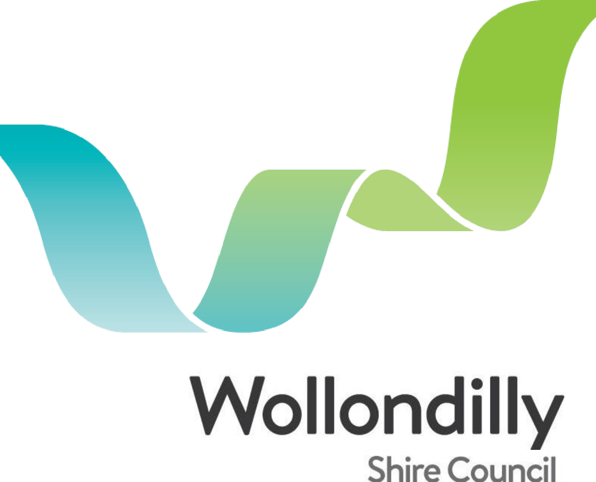

# Wollondilly Development Control Plan 2016 - Volume 2 Urban Release Areas

> This chapter is split into 5 section file(s), one per numbered heading, in the order they appear in the PDF.

Source PDF: [Volume-2-Urban-Release-Areas-as-of-10-January.pdf](https://planfortomorrow.sharepoint.com/sites/Planfortomorrow/Shared%20Documents/00%20NSW-Planning-Resources/dcp/wollondilly-development-control-plan-2016/volume-02-urban-release-areas/Volume-2-Urban-Release-Areas-as-of-10-January.pdf)

### Development Control Plan 2016

### Volume 2 – Urban Release Areas

> [Picture on page 1: a picture, saved as a picture (images/volume-02-urban-release-areas-page-1-3.gif, 150 dpi).]

#### Table of Contents

TABLE OF CONTENTS ................................................................................................................................... 2 PART 1 – PRELIMINARY ................................................................................................................................ 3

1.1 Introduction ....................................................................................................................................... 3

1.2 Objectives ......................................................................................................................................... 3

1.3 Parts of this Volume ......................................................................................................................... 3 PART 2 – URBAN RELEASE AREAS ............................................................................................................ 4

2.1 Wilton Park, Wilton (Bingara Gorge) ................................................................................................ 4

2.2 Marsh Road, Silverdale (Former Lion Safari Park) ........................................................................ 13

2.3 Picton, Tahmoor, Thirlmere New Urban Lands (PTT) .................................................................... 17

2.4 Land Between Picton Tahmoor and Thirlmere (commonly known as PTTAG) ............................. 19

## PART 1 – PRELIMINARY

<!-- sections -->
## Sections

1. [1.1 Introduction](01-1-1-introduction.md)
2. [1.2 Objectives](02-1-2-objectives.md)
3. [1.3 Parts of this Volume](03-1-3-parts-of-this-volume.md)
4. [2.1 Wilton Park, Wilton (Bingara Gorge)](04-2-1-wilton-park-wilton-bingara-gorge.md)
5. [2.3 Road Reserve](05-2-3-road-reserve.md)
