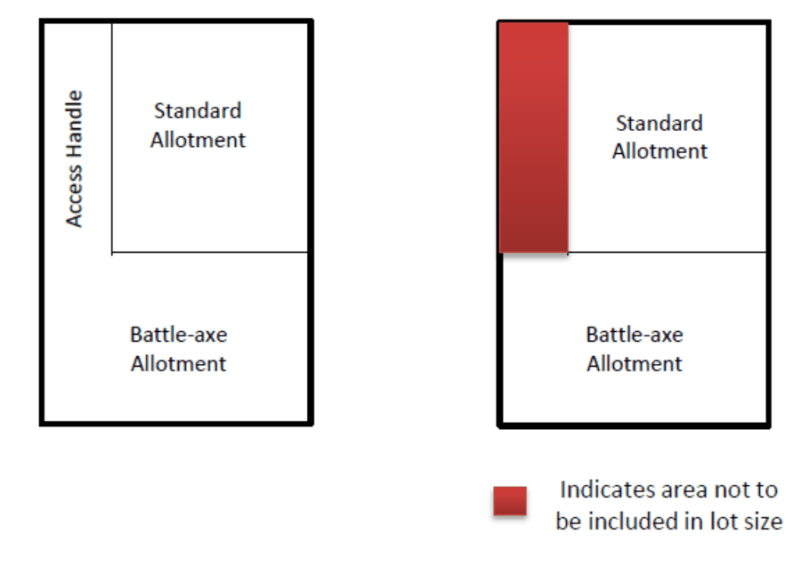
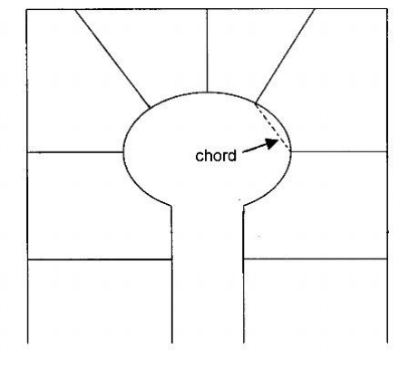

### 2.4 Lot Size and Shape Objectives

1\. To ensure regular and practical allotments that will encourage the orderly and economic use of land.

#### Controls

1\. Lots (other than lots in residential zones) shall have the following minimum dimensions:

| Zone | Minimum Lot Width | Minimum Lot Width (Corner allotment) | Minimum Lot Depth |
|---|---|---|---|
| RU1 | 50m | 50m | 50m |
| RU2 | 50m | 50m | 50m |
| RU4 | 30m | 30m | 50m |
| E3 | 30m | 30m | 50m |
| E4 | 30m | 30m | 50m |
| Other Zones | N/A | N/A | N/A |
| B5 | In the case of a subdivision intended for residential development refer to control 2. There are no minimum dimensions for subdivision intended for commercial development. |  |  |

2\. Lots in residential zones shall have the following minimum dimensions:

| Area | Minimum Lot Width | Minimum Lot Width (Corner allotment) | Minimum Lot Depth |
|---|---|---|---|
| Less than 450m2 | 12m | 12m | 20m |
| Between 450m2 and 650m2 (inclusive) | 13m | 15m | 20m |
| Between 650m2 and 1500m2 (exclusive) | 15m | 20m | 25m |
| 1500m2 or Greater | 20m | 30m | 30m |

3\. These controls do not apply to subdivision that places each dwelling on its own allotment in the following cases:

a. The subdivision of a dual occupancy or medium density development that is existing and lawful; or

b. The subdivision of a proposed dual occupancy or medium density development that complies with all other relevant controls in Wollondilly Development Control Plan, 2015.

4\. These controls do not apply to land to be dedicated to Council for roads, environmental reserves or for public open space.

5\. Lots that are irregularly shaped because of their location in the road network and/or because of constraints of the site may proceed in spite of a non-compliance with controls 1 and 2 if the consent authority is satisfied that the lots, when developed, will be capable of supporting:

a dwelling with a footprint of at least 150m2 ; and Any required asset protection zone wholly within the proposed lot boundaries If the subdivision occurs on unsewered land that the site can adequately accommodate any effluent disposal area that is required;

and the resulting character of that development would be consistent with the character of the area.

Council may require the submission of specialist studies to justify development carried out under this control.

6\. For the purposes of calculating minimum lot size for land within an R1, R2 or R3 zone, the area of the battle-axe handle is not included in the calculation of the area of a lot which it services. This is shown in the diagram below:

> [Picture on page 11: a picture, saved as a picture (images/volume-03-subdivision-of-land-page-11-8.gif, 150 dpi).]

7\. Proposed lots which face onto a cul-de-sac head shall achieve a minimum “chord” width of 10 metres. The area considered to be the chord of the cul-de-sac is demonstrated in the

> [Picture on page 11: a picture, saved as a picture (images/volume-03-subdivision-of-land-page-11-11.gif, 150 dpi).]

diagram below.

The width of any lot at the front building line shall be in accordance with the table above in control 2.
