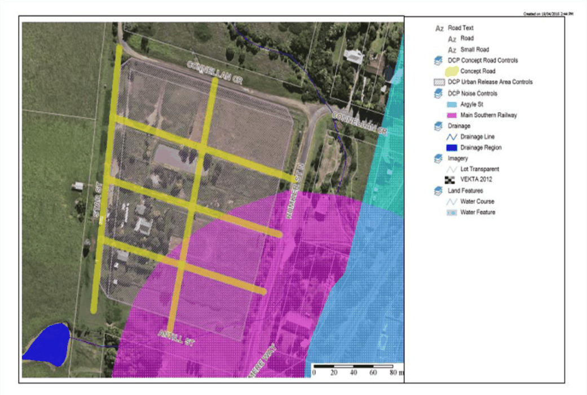

### 3.1 Picton West and Star Street Former Road Reserve

#### Application

1\. This section applies to land identified on the structure plan and map below which is part of an Urban Release Area (refer to Volume 2, Section 2.3):

> [Picture on page 16: a picture, saved as a picture (images/volume-03-subdivision-of-land-page-16-6.gif, 150 dpi).]

#### Objectives

1\. To ensure roads and pathways in future subdivision of the land provides direct connections to the internal and external road network.

2\. To ensure that contaminated land is suitably assessed and remediated prior to residential development.

3\. To ensure that satisfactory road access is provided for land owners using the right of carriageway across the site to access their properties.

#### Controls

1\. Roads and pathways shall be provided generally in accordance with the structure plan above.

2\. For the purpose of Clause 7(4) of State Environmental Planning Policy No. 55- Remediation of Land, Lot 1 DP 1182837 is taken to contain potentially contaminated land and shall require

further assessment and remediation prior to any development consent being granted for subdivision.

3\. Satisfactory road access shall be provided to properties benefiting from the right of carriageway applying to Lot 1 DP 1182837 prior to construction of any future subdivision of the site.

4\. The unformed road reserve named Connellan Crescent shall be constructed prior to the release of the Subdivision Certificate for the site.
