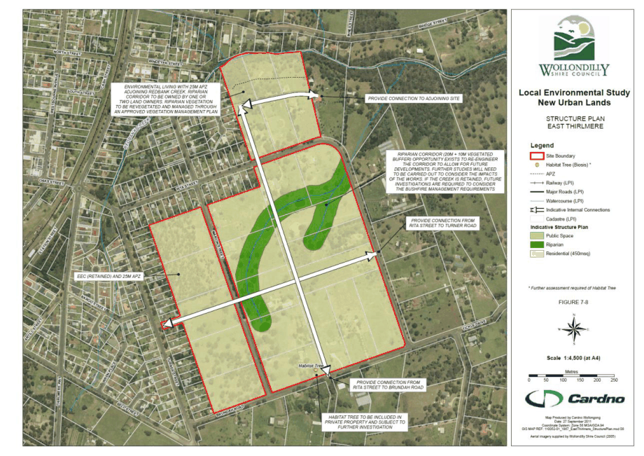

### 3.2 Thirlmere East

#### Application

1\. This section applies to the land identified on the structure plan below which is part of an Urban Release Area (refer to Volume 2, Section 2.3):

> [Picture on page 18: a picture, saved as a picture (images/volume-03-subdivision-of-land-page-18-5.gif, 150 dpi).]

#### Objectives

1\. To ensure future subdivision of the land is provided with direct connections to the external and internal road network.

2\. To ensure the protection of significant natural waterways and vegetation.

3\. To provide infrastructure to support the provision of public transport.

#### Controls

1\. All land within 30 metres of the top of bank of Redbank Creek shall be protected by the establishment of a covenant on the land restricting development on that part of the site to only vegetation management for environmental outcomes. The covenant shall also require, as a positive covenant, the land to be managed in accordance with a vegetation management plan approved by Council or the NSW Office of Environment and Heritage.

2\. Roads and pathways shall enable direct links to existing roads and areas within the site identified on the structure plan.

3\. The habitat tree identified on the structure plan shall be retained with a suitable environmental curtilage. The tree and associated curtilage shall be retained wholly within one lot. A restriction as to user shall be placed on the title of the lot where the habitat tree and curtilage are situated which requires the habitat tree and its nominated curtilage to be retained for environmental purposes.

4\. Staged construction of a pathway from the site along Rita Street and Turner Street to the existing bus shelter in Thirlmere Way shall be undertaken as part of any subdivision application and staging of the pathway shall be proportional based on the number of lots generated.
