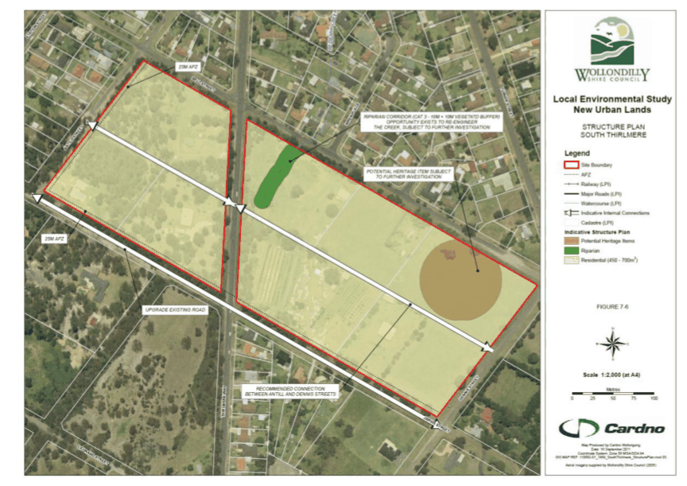

### 3.3 Thirlmere South

#### Application

1\. This section applies to the land identified on the structure plan map below which is part of an Urban Release Area (refer to Volume 2, Section 2.3):

> [Picture on page 19: a picture, saved as a picture (images/volume-03-subdivision-of-land-page-19-5.gif, 150 dpi).]

#### Objectives

1\. To ensure that roads and pathways in future subdivision of the land are suitably connected to the external and internal road network.

2\. To provide infrastructure to support the provision of public transport.

#### Controls

1\. Each existing lot shall fully construct and upgrade the public road for any part of its existing road frontages that have not been constructed to the standard specified in Council’s Design Specification. The roads shall be completed prior to the release of any subdivision certificate for any allotment with an area less than 2Ha to be created from the existing lot.

2\. The recommended connection between Antill and Dennis Streets identified on the structure plan shall be incorporated into the road network for the development of each existing lot within the precinct.

3\. A bus stop with shelter shall be provided along the existing bus route in Thirlmere Way and linked through the precinct via a shared pathway along the recommended connection between Antill and Dennis Streets.

4\. The subdivision of land identified as Potential Heritage Item shall not proceed prior to a heritage assessment being prepared to the satisfaction of the consent authority. A subdivision proposal for this land may not proceed unless it is consistent with the recommendations of such an assessment.

5\. Roads and pathways shall be provided generally in accordance with the structure plan and enable direct links to the road network and area within the site identified on the structure plan.
