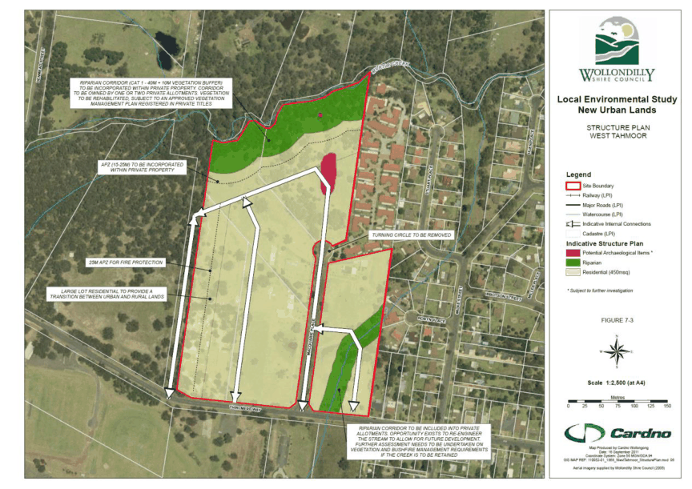

### 3.4 Tahmoor West

#### Application

1\. This section applies to the land identified on the structure plan map below:

> [Picture on page 20: a picture, saved as a picture (images/volume-03-subdivision-of-land-page-20-4.gif, 150 dpi).]

#### Objectives

1\. To ensure roads and pathways within future subdivision of the land are provided with direct links to the road network.

2\. To ensure the protection of significant natural waterways and vegetation.

3\. To provide infrastructure to support the provision of public transport.

4\. To provide for a transition in lot sizes appropriate to the visual character of the locality.

5\. To ensure aboriginal heritage is protected.

#### Controls

1\. All land within 50 metres of the top of bank of Myrtle Creek shall be protected by the establishment of a covenant on the land which provides the following:

i. Restrict development to only vegetation management for environmental outcomes.

ii. prohibit the fencing of this land

iii. require the land to be managed in accordance with a vegetation management plan approved by Council or the NSW Office of Environment and Heritage.

2\. The land identified as potential archaeological items shall be assessed in accordance with Clause 5.10 of Wollondilly Local Environmental Plan, 2011.

3\. The subdivision shall provider larger allotments along Thirlmere Way and the western edge of the precinct.

4\. Roads and pathways shall be provided generally in accordance with the structure plan and enable direct links to the road network and area within the site identified on the structure plan.

5\. A bus stop with shelter to be provided along the existing bus route in Thirlmere Way.
