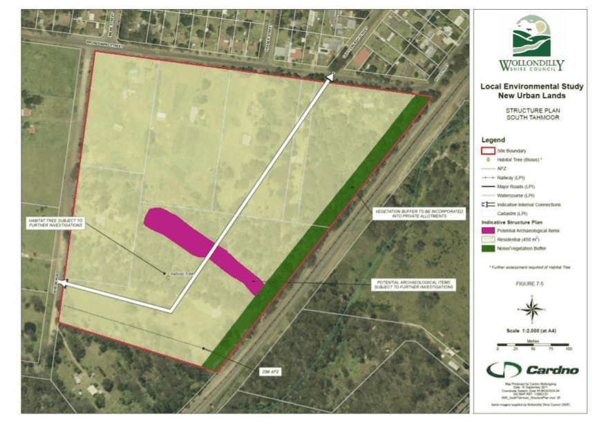

### 3.5 Tahmoor South Application

1\. This section applies to the land identified on the structure plan map below which is part of an Urban Release Area (Refer to Volume 2, Section 2.3):

> [Picture on page 21: a picture, saved as a picture (images/volume-03-subdivision-of-land-page-21-6.gif, 150 dpi).]

#### Objectives

1\. To ensure roads and pathways within future subdivision of the land are provided with direct links to the road network.

2\. To provide infrastructure to support the provision of public transport.

3\. To mitigate adverse impacts of the adjoining rail corridor on future residential development.

4\. To mitigate the risks of development on Aboriginal artefacts and sacred sites.

5\. To ensure the protection of significant vegetation.

6\. To provide for a transition in lot sizes appropriate to the visual character of the locality.

#### Controls

1\. All land within 30 metres of the top of bank of the watercourses identified on the structure plan shall be protected by the establishment of a covenant on the land which provides the following:

i. restricts development on that part of the site to only vegetation management for environmental outcomes;

ii. prohibits the fencing of this land;

iii. requires, as a positive covenant, the land to be managed in accordance with a vegetation management plan approved by Council or the NSW Office of Environment and Heritage.

2\. The habitat tree identified on the structure plan shall be retained with a suitable environmental curtilage. The tree and associated curtilage shall be retained wholly within

one lot. A restriction as to user shall be placed on the title of the lot where the habitat tree and curtilage are situated which requires the habitat tree and its nominated curtilage to be retained for environmental purposes.

3\. Developments shall provider larger allotments along the southern and western edges of the precinct.

4\. Roads and footpaths shall be provided generally in accordance with the structure plan to enable direct links to the existing road network and within the site identified on the structure plan.

5\. A bus stop with shelter to be provided along the existing bus route in Byron Road.

6\. Any identified archaeological items on the site shall be assessed in accordance with the requirements of Volume 1 Part 7 of this DCP.

7\. Staged construction of a pathway from the north east corner of the site to Thirlmere Way along Pitt Street shall be undertaken as part of any subdivision application and staging of the pathway shall be proportional based on the number of lots generated.

#### Notes

1\. Part of this precinct was not rezoned by the Wollondilly Local Environmental Plan Amendment Number 3, 2014 (the LEP amendment). This plan has been prepared on the basis of the entire site having been rezoned. As development for the purposes of Road is permissible across the entire precinct before and after the LEP amendment it is anticipated that the development of the residentially zoned part of the site can be undertaken in accordance with these controls.

2\. It is anticipated that the remainder of the site will be rezoned as part of a future amendment to Wollondilly Local Environmental Plan, 2011. These provisions are applied to the entire site in anticipation of it being wholly rezoned in the long term.
