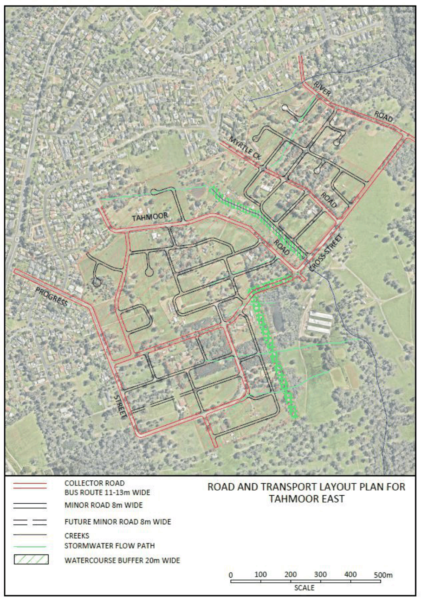

### 3.6 Tahmoor East

#### Application

1\. This section applies to the land identified on the structure plan map below which is part of an Urban Release Area (Refer to Volume 2, Section 2.3):

#### Objectives

1\. To ensure roads and pathways within future subdivision of the land are provided with direct links to the road network.

2\. To provide infrastructure to support the provision of public transport.

3\. To mitigate the risks of development on Aboriginal artefacts and sacred sites.

4\. To ensure the protection of significant natural waterways and vegetation.

5\. To provide a road network that maximises access for the general public and achieves a high level of permeability;

6\. To satisfactorily link with existing roads;

7\. To provide satisfactory public transport links throughout the precinct;

8\. To avoid isolating small sections of existing lots;

9\. To avoid inappropriate road locations which would disadvantage other landowners in the precinct and reduce the ability of other landowners to satisfactorily develop their land in the future.

#### Controls

1\. The habitat trees identified on the structure plan shall be retained with a suitable environmental curtilage. A restriction as to user shall be placed on the title of the lot where the habitat tree and curtilage are situated which requires the habitat tree and its nominated curtilage to be retained for environmental purposes.

2\. The subdivision of land identified as Potential Heritage Item shall not proceed prior to a heritage assessment being prepared to the satisfaction of the consent authority. A subdivision proposal for this land may not proceed unless it is consistent with the recommendations of such an assessment.

3\. Roads and pathways shall be provided generally in accordance with the structure plan below and enable direct links to the external road network and area within the site identified on the structure plan.

4\. Any identified archaeological items on the site shall be assessed in accordance with the requirements of Volume 1 Part 7 of this DCP.

> [Picture on page 24: a picture, saved as a picture (images/volume-03-subdivision-of-land-page-24-1.gif, 150 dpi).]
