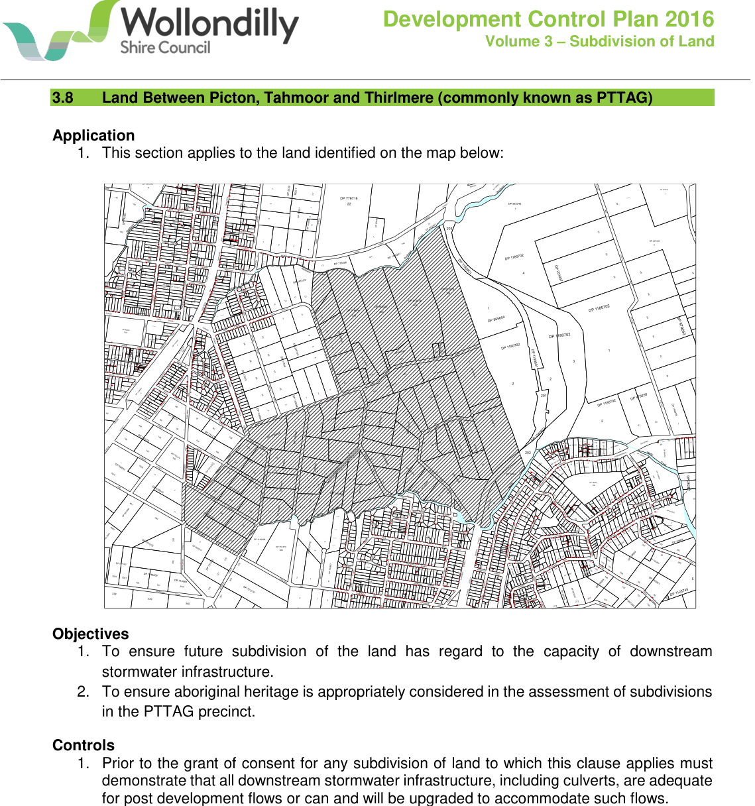

### 3.7 Avon Dam and Hawthorne Roads, Bargo

#### Application

1\. This section applies to the following allotments:

a. 67 Avon Dam Road (Lot 9 DP 877774)

b. 77 Avon Dam Road (Lot 132 DP 851807)

c. 214 Hawthorne Road (Lot 8 DP 877774)

d. 218 Hawthorne Road (Lot 7 DP 877774)

e. 235 Hawthorne Road (Lot 1 DP 877774)

f. 245 Hawthorne Road (Lot 2 DP 877774)

#### Objectives

1\. To encourage alternative modes of transport to the site.

2\. To ensure hazards such as flooding are managed effectively.

3\. To ensure riparian land is protected.

4\. To ensure native vegetation is maintained and improved.

5\. To provide a convenient vehicular and shared pathway route for future residents to local amenities.

6\. To reduce the number of lots fronting Avon Dam Road.

7\. To reduce the number of lots potentially impacted by road traffic and rail noise.

8\. To ensure that contaminated land is suitably assessed and remediated prior to residential development.

9\. To ensure that required infrastructure is provided if development is staged.

10\. To ensure water quality is maintained and improved.

#### Controls

1\. Any future subdivision of Lot 8 DP 877774 requires the submission of a Phase 2 Contaminated Site Assessment in order to satisfy the requirements of Clause 7(1) of State Environmental Planning Policy 55 – Remediation of Land.

2\. An east-west road link which incorporates a shared pathway route on the northern side of this road shall be provided between Hawthorne Road and Avon Dam Road.

3\. The lot layout shall ensure that where possible lots between Avon Dam Road and Hawthorne Road front the east-west road link.

4\. A shared pathway shall be constructed along the full length of the frontage of the site on the eastern side of Avon Dam Road and along the frontage of properties within the site on the south western side of Hawthorne Road.

5\. For the purposes of Volume 1 of this plan, the site is to be regarded as being at risk of flood.

6\. The existing culvert in Hawthorne Road shall be replaced with a culvert which has capacity to manage a 1% AEP (100yr) flood level and this shall be installed prior to release of the first Subdivision Certificate.

7\. A Vegetation Management Plan (VMP) for all restored or reconstructed riparian areas of the site shall be submitted with each development application for lots containing NRW mapped areas and shall be based on the document Controlled activities - Guidelines for Vegetation Management Plans by DECCW (2010).

8\. Existing mature Cumberland Plain Woodland (CPW) species shall be maintained and the mapped NRW area around the watercourse shall be revegetated using indigenous CPW species.

9\. The watercourse shall be protected and rehabilitated to mimic a natural creek system and this work shall be completed prior to release of the Subdivision Certificate for the land on which the watercourse is located.

10\. A Section 88B instrument with a Restriction on the Title to require the ongoing restoration and maintenance of riparian corridors shall be registered on the title for those lots containing NRW mapped land.

#### Notes

1\. For further detail on the location of flood prone land refer to Appendix C in the Flood Study prepared by SEEC (March 2011).

> [Picture on page 27: a picture, saved as a picture (images/volume-03-subdivision-of-land-page-27-1.gif, 150 dpi).]
> Words printed on the picture (title and legend, copied from the PDF):
> stormwater infrastructure.
> in the PTTAG precinct.
