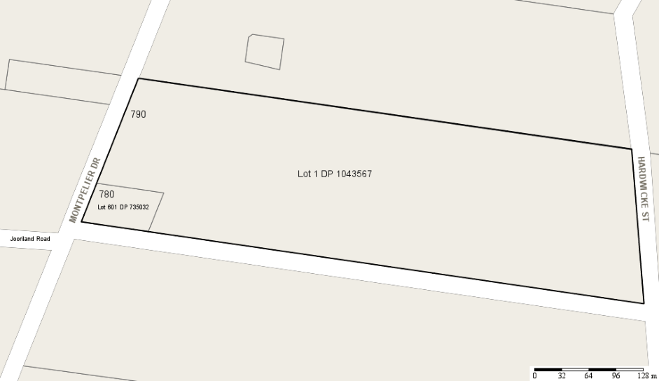

### 3.9 Montpelier Drive Residential Land (The Oaks)

#### Application

1\. This section applies to the land identified on the map below:

> [Picture on page 28: a picture, saved as a picture (images/volume-03-subdivision-of-land-page-28-4.gif, 150 dpi).]

#### Objectives

1\. To minimise the impacts on the scenic and cultural qualities of the rural and heritage landscape.

2\. To improve road efficiency and permeability between residential areas.

3\. To minimise rural land use conflict.

4\. To maintain water quality in the drinking water catchment.

5\. To reduce Council’s maintenance burden.

6\. To minimise the potential risk to life and property, and mitigate noise, from use of the nearby airfield.

7\. To ensure habitable buildings are not impacted by potential “dam failure” from the large dam located on the adjoining property to the south.

8\. To ensure that contaminated land is suitably assessed and remediated prior to residential development.

#### Controls

1\. Prior to construction of any subdivision a Historical Archaeological Assessment should be undertaken by an appropriately experienced and qualified Historical Archaeologist.  Should the assessment find that the proposed works are likely to discover, expose, move damage or destroy any archaeological relics an excavation permit under Section 139 of the Heritage Act 1977 is to be submitted for the approval of the Heritage Council.

2\. Any subdivision layout shall achieve an overall density of 9 lots per hectare with a graduating range from 10 lots per hectare at the northern end decreasing to 8 lots per hectare at the southern end of the site.

3\. Lots shall be orientated to Montpelier Drive and the main access road and fenced with open style rural fencing.

4\. The main access to the site shall be from Montpelier Drive via the unformed public road reserve adjoining the southern end of the site.  This access road shall be constructed in accordance with Council design requirements and align with Jooriland Road on the western side of Montpelier Drive.

5\. Vehicular access to Hardwicke Street will only be allowed during emergencies.

6\. Internal road and shared pathway links shall be provided to the adjoining northern residential area.

7\. The main access road shall be landscaped on its southern boundary with suitable vegetation prior to release of any subdivision certificate to achieve a suitable buffer from noise and dust associated with rural activities on adjoining land.

8\. All stormwater treatment systems shall be maintained and monitored by the developer for a period of 5 years after construction of the subdivision is completed for the whole site and these systems shall be demonstrated to be functioning effectively before being handed over to Council.  Note: The letter of offer by the landowner on 26 August 2014 to enter into a planning agreement at the development application stage to provide additional funds for maintenance of these systems beyond the 5 year period.

9\. The height of any new structure or tree shall be restricted to below the maximum permissible height as detailed in Figure 4 Height Limitations of the Aviation Risk Assessment by Rehbein Airport Consulting, 31 March 2014.  Details of this restriction shall be included within a Section 88B instrument to accompany any application for a subdivision certificate and shall be registered on the title of all lots.

10\. A noise assessment shall accompany all development applications for dwellings and detail design features to achieve an Aircraft Noise Reduction goal of approximately 20dBA in accordance with AS 2021.  Details of this building restriction shall be included within a Section 88B instrument to be lodged with any application for a subdivision certificate and shall be registered on the title of all lots.

11\. Uses such as hospitals, schools, child care centres and seniors living developments although permissible in the R2 Low Density Zone are not recommended for this site due to the potential risk from aircraft using the nearby east-west runway.  Council shall only consider a proposal for such uses if an assessment indicates that these risks can be mitigated effectively.

12\. All habitable buildings shall be constructed above the PMF flood level and to achieve this, building envelopes on affected lots shall be detailed on plans lodged as part of any development application for subdivision.  Details of this building restriction on affected lots shall be included within a Section 88B instrument to accompany any application for a subdivision certificate and shall be registered on the title of all such lots.

13\. For the purpose of Clause 7(4) of State Environmental Planning Policy No. 55 – Remediation of Land the site is taken to contain potentially contaminated land and shall require further assessment and remediation prior to any development consent being granted for subdivision.

14\. A minimum clearance zone of 3 metres shall be provided for development around mature trees fronting Montpelier Drive and throughout the site.  Details of this building restriction shall be included within a Section 88B instrument to be lodged with any application for a subdivision certificate and shall be registered on the title of all lots.
