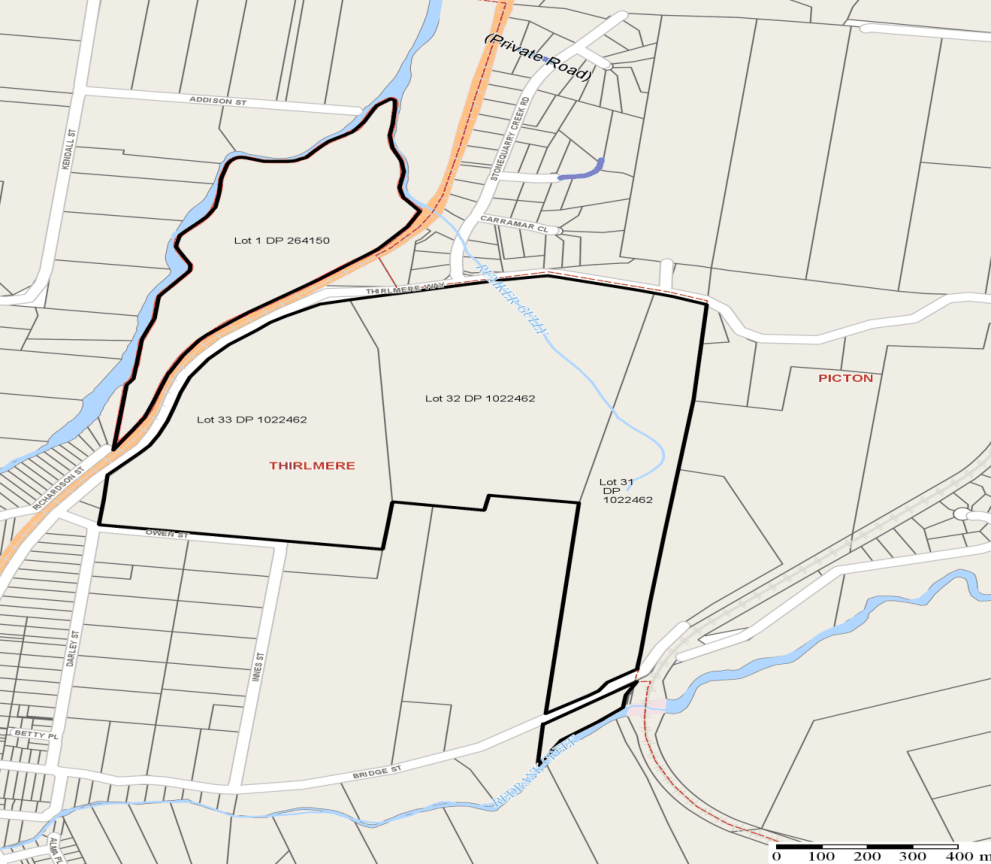

### 3.10 Queen Victoria Memorial Home Planning Proposal Site

#### Application

1\. This section applies to the land identified on the map below:

> [Picture on page 30: a picture, saved as a picture (images/volume-03-subdivision-of-land-page-30-4.gif, 150 dpi).]

#### Land Contamination Objectives

(a) To ensure remediation measures are undertaken to address any potential contaminants to enable the land to be used for residential purposes.

#### Controls

1\. For the purpose of Clause 7(4) of State Environmental Planning Policy No. 55 – Remediation of Land, the site has been identified as containing areas of environmental concern and shall require further assessment and remediation prior to any development consent being granted for seniors housing.

#### Biodiversity

The following requirements apply to all land identified on the Natural Resources Biodiversity Map

#### Objectives

(a) To protect and improve environmentally sensitive land identified on the site.

#### Controls

1\. A Bushland Management Plan shall be prepared and submitted with any application for seniors housing in accordance with the Requirements for the Bushland Plan of Management prepared by Wollondilly Shire Council’s Environment Section TRIM Ref: 6399#583

2\. A Restriction on the Title shall be registered on the title of all lots containing environmentally sensitive land mapped on the Natural Resources Biodiversity Map and include the following measures:

a. Requirement to implement the Bushland Management Plan

b. Detail that Asset Protection Zones shall be located outside environmentally sensitive land

c. Detail that environmentally sensitive land cannot be cleared

- for the purpose of fencing of allotment boundaries or

- for the provision of infrastructure, utilities or driveways.
