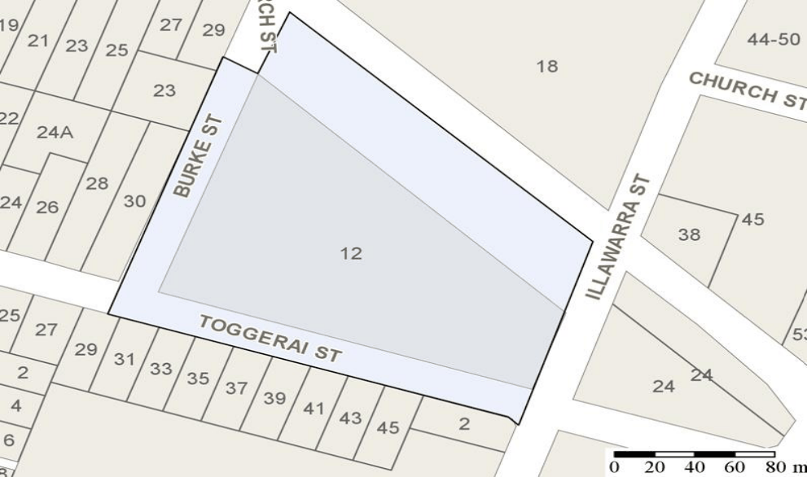

### 3.11 Bulli Appin Road Planning Proposal Site

#### Application

1\. This section applies to the land identified on the map below:

> [Picture on page 32: a picture, saved as a picture (images/volume-03-subdivision-of-land-page-32-4.gif, 150 dpi).]

#### Subdivision Plan Objectives

a) To establish an aesthetically pleasing streetscape on the prominent eastern gateway into the village.

b) To ensure the rural character of Appin is maintained and enhanced.

c) To retain existing native vegetation and reduce the impact of climate change.

#### Controls

1\. The subdivision shall be designed to maximise building frontages orientated to and accessed by pedestrians to existing streets particularly Bulli Appin Road and Illawarra Street.

2\. Lots adjacent to Bulli Appin Road will share a similar width and alignment to existing lots on Church Street.

3\. Residential lots fronting Bulli Appin Road will have a front orientated towards Bulli Appin Road.

4\. The lots shall be orientated to ensure that no future fencing, other than corner lots, adjoin an access road.

5\. A vegetation buffer using existing native trees along Bulli Appin Road shall be retained within the road reserve or an adjoining service road and further landscaping shall be provided. This landscaping shall include mid and understory plants which are typical of SSTF high sandstone influence.

6\. Details of restrictions relating to all controls in Volume 4, Part 4.3(1) and Part 4.3 (2) will be noted on an 88B instrument and must be lodged with the application for subdivision certificate and registered on the title of all lots.

#### Road Transport Infrastructure and Pedestrian Access Objectives

a) To provide adequate and safe vehicular access.

b) To provide good pedestrian access.

c) To ensure infrastructure is delivered prior to the completion of housing.

d) To reduce the impact of additional traffic caused by the development onto Bulli Appin Road.

e) To maximise walkability and connectivity for future residents.

f) To promote the site as a prominent eastern gateway into the village.

#### Controls

1\. The development shall not result in any additional road access points directly onto Bulli Appin Road.

2\. Works to open south Burke Street to be completed prior to the release of the Subdivision certificate.

3\. Vehicular access into properties adjacent to Bulli Appin Road shall be from a service road to the front of the property.

4\. With the exception of service roads, Cul-de-sacs are to be avoided.

5\. Other than corner lots, lots with dual frontages are to be avoided.

6\. Shared pathways shall be provided along Appin Bulli Road from east to west and will be linked to any future roads within the development and to Kennedy Creek Cycleway.

7\. Residential lots adjacent to Bulli Appin Road will have direct pedestrian access to Bulli Appin Road from the front of the lots.

8\. All roads and infrastructure to be provided in accordance with Council`s Design and Construction Specifications.

#### Noise and contamination

a) To promote positive amenity and address noise and dust from Bulli Appin Road and Appin Colliery.

b)  To protect the health of future residents.

#### Controls

1\. For the purpose of Clause 7(4) of State Environmental Planning Policy No. 55- Remediation of Land, the site is taken to contain potentially contaminated land and shall require further assessment and remediation prior to any development consent being granted for subdivision.

2\. An acoustic and vibration study is required to consider noise and vibration from Bulli Appin Road and The Appin Colliery. A copy of this report must be made available to all future land owners and be submitted as part of any Development Application.

3\. The acoustic report shall demonstrate that the noise criteria in Development Near Rail Corridors and Busy Roads- Interim Guideline (Department of Planning 2008), or updated document, has been addressed.

4\. Subdivision design on land impacted by noise shall implement measures to attenuate noise within dwellings and in external areas that are classified as Principle Private Open Space.

5\. Physical noise barriers (i.e. Noise walls or solid fencing) are not generally supported, and measures to attenuate noise through subdivision layout, such as service roads, setbacks, building orientation, building envelopes and building design and materials selection shall be implemented to achieve appropriate internal noise standards.

6\. Details of building restrictions and residential building design treatments for road and mining noise shall be included within a Section 88B instrument to be lodged with the application for subdivision certificate and registered on the title of all lots.
