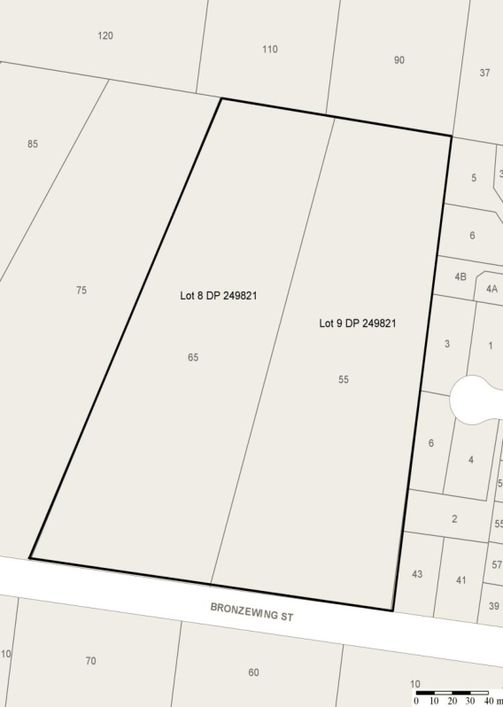

### 3.12 Bronzewing Street Planning Proposal Site Application

1\. This section applies to the land identified on the map below:

> [Picture on page 35: a picture, saved as a picture (images/volume-03-subdivision-of-land-page-35-4.gif, 150 dpi).]

#### Objectives

1\. To ensure that contaminated land is suitably assessed and remediated prior to residential development.

2\. To ensure that potential archaeological heritage is assessed.

3\. To improve road efficiency and permeability between residential areas.

4\. To protect large native trees to achieve connectivity for native animals.

5\. To ensure local indigenous vegetation is used for landscaping.

6\. To ensure asset protection zones do not impact on native vegetation

7\.         To minimise impacts on the rural character at the urban-rural interface.

#### Controls

1\. For the purpose of Clause 7(4) of State Environmental Planning Policy No. 55 – Remediation of Land the site is taken to contain potentially contaminated land and shall require further

assessment and remediation prior to any development consent being granted for subdivision.

2\. Prior to construction of any subdivision a Baseline Archaeological Assessment should be undertaken by an appropriately experienced and qualified Historical Archaeologist. A process for locating excavating, recording and conserving any potential archaeological relics shall be detailed. Should the assessment find that the proposed works are likely to discover, expose, move, damage or destroy any archaeological relics an excavation permit under Section 139 of the Heritage Act 1977 is to be submitted for the approval of the Heritage Council.

3\. A road and shared pathway link to connect to Manorina Place adjoining to the north shall be provided.

4\. A shared pathway shall be constructed along the frontage of the site on Bronzewing Street and across to Milne Street.

5\. A road connection to land adjoining to the west of the site shall be provided for future potential residential development.

6\. A vegetation and bushfire management plan that:

i) protects mature native trees providing connectivity to adjoining bushland and;

ii) locates Asset Protection Zones outside of vegetated land and;

iii) incorporates larger lot sizes in the north west corner of the site to protect bushland and;

iv) includes a recommended Restriction on the Title detailing these measures to be registered on the title of affected lots.

7\. A landscaping plan shall be submitted detailing use of local indigenous species for street tree planting.

8\. The subdivision layout shall include larger lots (at least 1000 sqm) along the western boundary to provide a lower density (10 lots per hectare) at the urban-rural interface.
