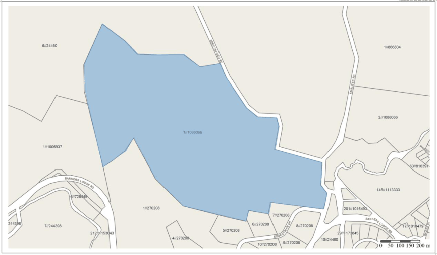
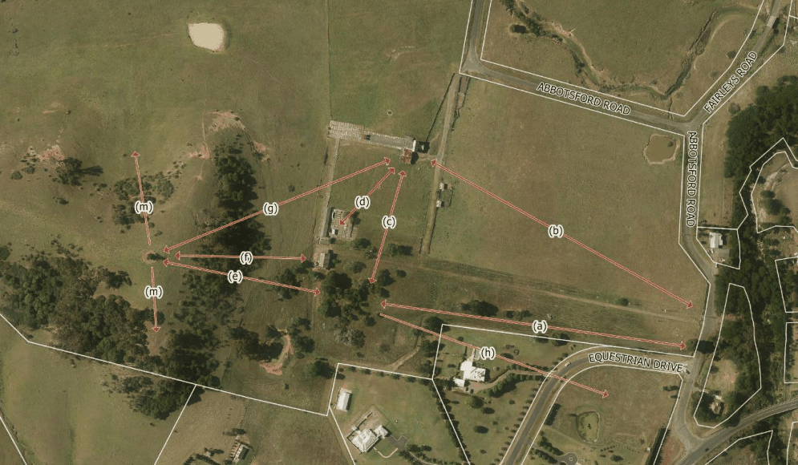

### 3.13 Abbotsford Road Planning Proposal Site Application

1\. This section applies to land at Abbotsford Road identified on the map below.

> [Picture on page 37: a picture, saved as a picture (images/volume-03-subdivision-of-land-page-37-4.gif, 150 dpi).]

#### Objectives

1\. Facilitate development of the site to achieve a high quality built form.

2\. Encourage adaptive reuse of heritage items.

3\. To ensure that new developments are designed and located so that they do not have an adverse impact on heritage items, the cultural landscape of the early pastoral property, historical archaeology and significant views and vistas.

4\. To ensure hazards such as flooding are managed effectively to reduce the risk of damage to property and human life.

5\. To protect scenic landscapes and ability to interpret the site as an early pastoral property.

#### Controls General

1\. Council will not grant consent to carry out a development unless the development application is accompanied by a site analysis addressing the following matters to Council’s satisfaction:

a) The spot levels and contours of the land;

b) The location of any watercourses and associated flooding or drainage characteristics;

c) The identification of soft and hard landscape features and location of any trees and vegetation;

d) The location and key views associated with any heritage items;

e) The location of visually prominent ridgelines and landscapes; and

f) A written statement and/or drawings explaining how the design of the proposed subdivision has taken the site analysis into account.

#### Building Envelopes

2\. Council will not grant consent to carry out a development unless the development application is accompanied by a subdivision plan showing the location of building envelopes and indicative dwelling locations to demonstrate that:

a) Development is within a landscaped setting;

b) The scale and footprint of the built form complements the Abbotsford Homestead;

c) Key views to and from Abbotsford Homestead, Byrnes Exhibition Dairy, Abbotsford Silos and Tree on Hill Summit which are identified in Figure 3.13.1 are not obstructed; and

d) No development will be located on visually prominent ridgelines.

> [Picture on page 38: a picture, saved as a picture (images/volume-03-subdivision-of-land-page-38-10.gif, 150 dpi).]

Figure 3.13.1 Key views and vistas with heritage value

Key View and Vistas

(a) View to and from Abbotsford Road, Homestead and Byrnes Dairy;

(b) View to and from Abbotsford Road to Silos;

(c) Views to and from Homestead and Silos;

(d) Views to and from Byrnes Dairy and Silos;

(e) View to and from Homestead and Tree on Hill Summit;

(f) View to and from Byrnes Dairy and Tree on Hill Summit;

(g) View to and from Silos and Tree on Hill Summit;

(h) View to Vault Hill; and

(m) View from Tree on Hill Summit to north and south.

3\. For any new lot that is created on the part of the site which has a minimum lot size of 4000m2 on the Minimum Lot Size Map under Wollondilly Local Environmental Plan 2011, the effluent disposal area may be situated outside the building envelope for the lot subject to satisfying the criteria in Council’s On-Site Sewage Management and Greywater Re-use Policy.

4\. The building envelope must accommodate the necessary wastewater irrigation area for any new lot created on the part of the site identified as having a minimum lot size of 20 hectares on the Minimum Lot Size Map which forms part of the Wollondilly Local Environmental Plan 2011.

5\. A geotechnical assessment is required to establish a suitable building envelope in regard to slope stability for any new lot identified as having minimum lot size of 20 hectares on the Minimum Lot Size Map which forms part of the Wollondilly Local Environmental Plan 2011.

6\. Details of all building restrictions (including building envelopes) and effluent disposal envelopes shall be included within a Section 88B instrument to accompany any application for a subdivision certificate and shall be registered on the title of the affected lots.

#### Heritage

7\. Council will not grant consent to carry out a development unless the development application is accompanied by a Heritage Impact Statement prepared by a suitably qualified and experienced professional. The Heritage Impact Statement should address the following matters:

a) Graphical representations demonstrating that the views to and from Abbotsford Homestead, Byrnes Exhibition Dairy and Abbotsford Silos including the visual connection between Abbotsford and Vault Hill will remain unencumbered by any proposed development;

b) The impacts to the curtilage of the State Heritage Register (SHR) item and on archaeological relics within the site;

d) Ability to identify historic uses of the site as an early colonial farm.

Note: For small scale and low impact development applications heritage considerations can be addressed within Statement of Environmental Effects (SoEE).

8\. The subdivision shall be designed to retain and enhance key view lines associated with Abbotsford Homestead, Byrnes Exhibition Dairy and Abbotsford Silos.

9\. Council will not grant consent to carry out a development unless the development application is accompanied by an Archaeological Management Plan (AMP) prepared by a suitably qualified and experienced professional and should address the following matters:

a) The Archaeological Management Plan should clearly outline the areas of archaeological potential and significance in relation to the State Heritage Register curtilage of ‘Abbotsford’;

b) It shall include clear provisions outlining how the subdivision will protect and retain significant archaeology;

c) If no archaeological testing program has occurred to inform this process, include an appropriate buffer to protect the State significant items within the subdivision;

d) Any further subdivision of the land shall ensure that significant archaeology is retained within one lot if possible;

e) The significant views and heritage character of the site should not be compromised by any proposed infrastructure such as sewerage, water, gas or electricity; and

f) Areas with significant historical archaeology identified in the Archaeological Management Plan and confirmed through archaeological test excavation shall be identified and protected within a Section 88B instrument to accompany any application for a subdivision certificate and shall be registered on the title of the affected lot(s).

10\. The following landscape elements are to be protected within lots created as part of any future subdivision:

a) The western-most araucaria tree on the hill top and hedge of Osage trees; and

b) Apparent thorn hedging on the northern side of the existing main driveway for the Abbotsford Homestead.

Details of this restriction shall be included within a Section 88B instrument to accompany any application for a subdivision certificate and shall be registered on the title of all affected lots.

#### Boundary Treatments, Fences & Gates

11\. Boundary fencing should be see-through rural style fencing (post and rail with chicken wire mesh detail or similar) to a maximum height of 1200mm.

Entrance gates should be constructed from timber and be of traditional in style.

Details of restrictions regarding fencing and gates shall be included within a Section 88B instrument to accompany any application for a subdivision certificate and shall be registered on the title of all affected lots.

12\. An interpretative sign/entrance feature is required near an entry road to the development to provide a link to the Abbotsford Homestead and the site’s heritage. It should include key details and text about the history of the place including key dates, use and importance.

#### Contamination

13\. Council will not grant consent to carry out a development unless the development application is accompanied by a Phase 2 Contaminated Site Assessment in order to satisfy the requirements of Clause 7(1) of State Environmental Planning Policy 55 – Remediation of Land.

#### Flood Risk

14\. Flood free access is to be provided from all new lots to Barkers Lodge Road. In this control, flood free access means any access provided via a public road at or above the Flood Planning Level and The Flood Planning Level is defined as the 1 in 100 AEP (Annual Exceedance Probability) Flood Level plus 0.5 metre freeboard.

#### Connectivity

15\. A shared pathway shall be constructed to provide access from new development to Picton Sportsground and to link with the existing shared path network.

#### Biodiversity

16\. Council will not grant consent to carry out a development unless the development application is accompanied by a flora and fauna report to determine the impact of the development on the biodiversity values of the site.

In addition to the standard scope for such a report, it should specifically include:

a) a  map that  identifies the presence and boundaries of vegetation communities on the site;

b) A map that  identifies areas of native and exotic grasses including those areas satisfying the definition of ‘derived’ native grassland under the scientific determination for Cumberland Plain Woodland under NSW legislation;

c) Details of methodology and outcomes of surveys within quadrats in the area of Cumberland Plain Woodland on the site using best practice involving the identification of coverage of each identified native species within each coverage; and

d) Methodology and outcomes of targeted surveys of threatened fauna species particularly Flying Foxes given the close proximity of the site to the Grey-Headed Flying Fox Camp occupying Stonequarry Creek.

#### Notes

For further information please refer to the following specialist studies prepared to inform the Abbotsford Planning Proposal:

1\. For further detail on the location of flood prone land refer to the Flood Assessment Report prepared by FloodMit (February 2013).

2\. For further detail on the location of constrained land in terms of slope and slip features refer to the Geotechnical Study prepared by Harvest Scientific Services Pty Ltd (January 2013).

3\. For further detail on biodiversity refer to the Biodiversity Study prepared by ACS Environmental Pty Ltd (June 2013).

4\. For further detail on heritage matters related to the Abbotsford Homestead refer to the:

a) Curtilage Study prepared by NBRS + Partners (June 2013), and

b) Statement of Heritage Impact prepared by NBRS + Partners (October 2017).
