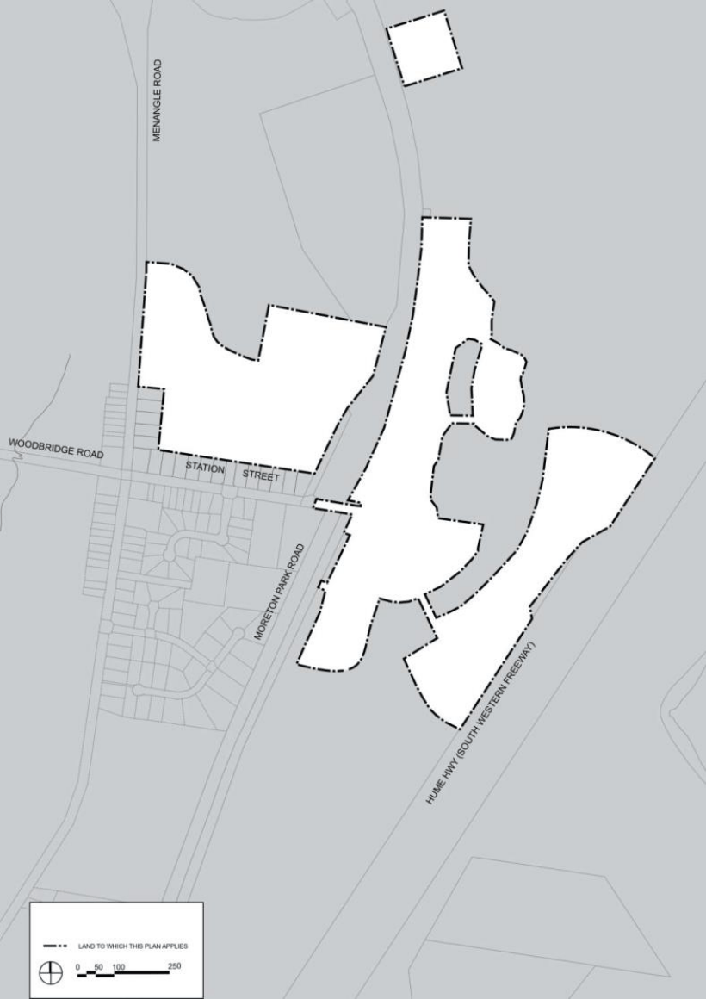
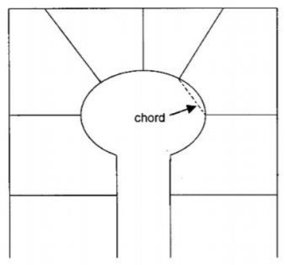
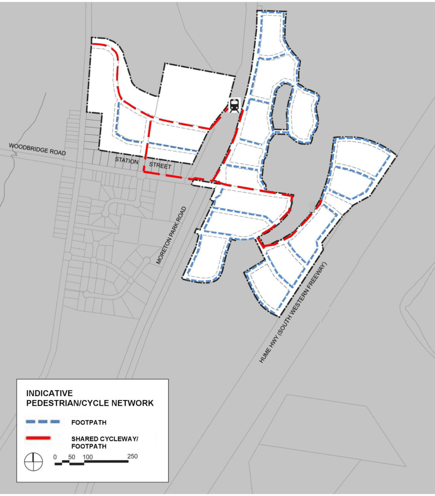
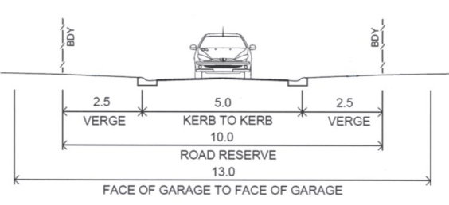
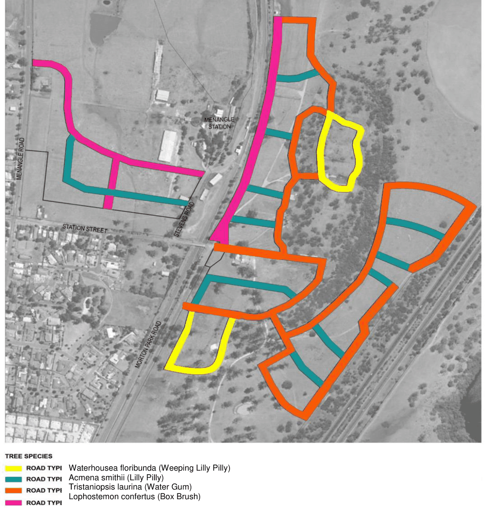

### 3.14 Station Street Planning Proposal Site Application

This section applies to the land identified on the map below:

> [Picture on page 42: a picture, saved as a picture (images/volume-03-subdivision-of-land-page-42-4.gif, 150 dpi).]

Figure 1: Land to which this part applies

#### Note

In the event of any inconsistencies between controls in this section and Section 6 in Volume 1 the controls in Section 6 in Volume 1 shall take precedence.

#### Lot Size and Shape Objectives

a. To ensure that residential development provides a range of dwelling types and sizes to meet the needs of the whole community in a way that promotes social equity and it is sympathetic to heritage values of Menangle;

b. To accommodate a mix of lot sizes and dwelling types across a precinct;

c. To establish minimum lot dimensions for different residential dwelling types; and

d. To encourage variety in dwelling size, type and design whilst retaining and enhancing the unique heritage qualities of Menangle in order to promote sympathetic housing choices and create attractive streetscapes that are consistent with the existing village character of Menangle.

#### Controls

1\. Controls in Section 2.4, Volume 3 of this Development Control Plan apply, except where the controls in this part differ, in which case the controls in this part take precedence.

2\. The following minimum dimension controls apply to the precinct:

| Area | Minimum Lot Width | Minimum Lot Width (Corner allotment) | Minimum Lot Depth |
|---|---|---|---|
| Less than 450m2 | 7m | 8m | 20m |
| Between 450m2 and 650m2 (including lots equal to 450 m2) | 12m | 14m | 20m |

3\. Proposed lots which face onto a cul-de-sac head shall achieve a minimum chord width of 10m so that the separation between driveways within the cul-de-sac is 3m. A chord length of less than 10m can be considered if it is demonstrated that the driveway separation can be achieved in accordance with Wollondilly Shire Council Design Specification. The width of any lot at the front building line shall be in accordance with the table above in control 2.

> [Picture on page 43: a picture, saved as a picture (images/volume-03-subdivision-of-land-page-43-21.gif, 150 dpi).]

Figure 2: Cord width

4\. Zero side boundary setbacks are permissible for lots that measure less than 300m2.

5\. Zero lot lines are to be nominated at subdivision stage and must include the provision of satisfactory easements have been provided over the adjoining allotment.

6\. Any filling of land in the northern area of the development site where filling of land is required in order to meet the relevant flood controls shall be supported by combination of retaining walls and battering to blend with the existing landscape.

7\. Retaining walls between two adjoining lots should not exceed 0.5m height.

#### Pedestrian and Cycle Access Objectives

a. To encourage walking and cycling for local trips to help reduce vehicle reliance; and

b. To create an accessible network of routes which connect the development with internal and external road networks and local amenities.

#### Controls

1\. Pedestrian and cycle paths should be provided in accordance with Figure 3 below. Streets, pedestrian and cycle paths shall provide suitable linkages to open space.

2\. Shared pedestrian/cycle links, cycle ways and public streets should be clearly signposted to indicate their shared status.

3\. Shared pedestrian and cycle paths should be a minimum of 2.5m wide.

4\. A pathway is to be provided in Station St. to Menangle Road to complete the path network.

> [Picture on page 45: a picture, saved as a picture (images/volume-03-subdivision-of-land-page-45-1.gif, 150 dpi).]

Figure 3: Cycleway and Footpath

#### Laneways

Laneways are public roads that are shareways, utilitarian throughways of the street network that provide rear vehicular access to compact or restricted access lots. The primary purpose of rear laneways is to create attractive front residential streets by removing garages and driveway cuts from the street frontages, improving the presentation of houses and maximising on street parking spaces and street trees. While laneways should be neat and tidy, they should not be confused with streets in width, character or function. A laneway is a shareway, designed to be shared by all users whether they are pedestrians, cyclists or drivers. Equal priority between all users reinforces the distinctive, slow speed environment for drivers.

#### Objectives

a. To provide vehicular access to the rear or side of lots where front access is restricted or not possible, particularly narrow lots;

b. To reduce garage dominance in residential streets;

c. To maximise on-street parking spaces and landscaping in residential streets;

d. To reduce vehicular conflict through reduced driveway cross overs and focusing of traffic to known points;

e. To facilitate the use of attached and narrow lot housing to achieve overall higher neighbourhood densities;

f. To enable garbage collection; and

g. To create a slow speed shared zone requiring co-operative driving practices for the very low volume and frequency of vehicle movements that is distinctly different in character and materials to residential streets.

#### Controls

1\. The design and construction of laneways is to be consistent with Figure 4.

2\. The laneway is a public “shareway” as the paved surface is for cyclists, pedestrians, garbage collection, mail deliveries, cars etc., with a 10km speed limit and driveway-style crossovers to the street rather than a road junction.

3\. The minimum garage doorway widths for manoeuvrability in a laneway are 2.4m (for a single garage) and 4.8m (for a double garage).

> [Picture on page 46: a picture, saved as a picture (images/volume-03-subdivision-of-land-page-46-30.gif, 150 dpi).]

Figure 4: Laneway configuration

4\. The configuration of the laneway, associated subdivision and likely arrangement of garages arising from the subdivision should create ordered, safe and tidy laneways and be designed in a manner whereby unintended uses such as casual parking, the storage of trailers and bin stacking do not arise.

5\. Right angle bends are not supported in the laneways.

6\. Any laneway is to be:

a. a minimum width of 5 metres carriageway, 10m shareway reserve, 13m separation between garages;

b. no longer than 50 metres;

c. parking be prohibited to allow for vehicle movements; and

d. No ‘T’ or “C” configurations.

7\. Install footpaths, pedestrian and cycle paths as required in Council’s Design Specifications.

8\. All lots adjoining a laneway should utilise the laneway for vehicle/garage access.

9\. Passive surveillance along the laneway from the upper storey rooms or balconies of dwellings is encouraged. Ground floor habitable rooms on laneways are to be avoided unless they are located on a corner lot where the laneway meets a street. In such cases the dwellings face the street to take advantage of the residential street for an address.

10\. All lot boundaries adjoining the lane are to be provided with 1.5m rear setback with no fencing forward of the building line.

#### Street Tree Plan Objectives

a. To enhance the existing rural village character by creating an attractive development that is suitably landscaped;

b. To create attractive streetscapes which enhance the quality and liveability of the area; and

c. Improve and retain the species, diversity, quality and quantity of tree canopy on private and public land within the development.

#### Controls

1\. Street trees are to be planted in conjunction with the creation of a new street.

2\. The street trees should be planted prior to the release of the subdivision certificate.

3\. Tree species planted along streets are to be in accordance with Figure 5.

4\. A minimum of one street tree should be provided per lot. For corner lots, a minimum of two street trees should be provided on the secondary street frontage.

5\. Details regarding street tree planting as well as ongoing maintenance and keeping of trees are to be submitted with any development application.

> [Picture on page 48: a picture, saved as a picture (images/volume-03-subdivision-of-land-page-48-1.gif, 150 dpi).]
> Words printed on the picture (title and legend, copied from the PDF):
> Waterhousea floribunda (Weeping Lilly Pilly)
> Acmena smithii (Lilly Pilly)
> Tristaniopsis laurina (Water Gum)
> Lophostemon confertus (Box Brush)

[Grab your reader’s attention with a great quote from the document or use this space to emphasize a key point. To place this text box anywhere on the page, just drag it.]

Figure 5: Street Trees
