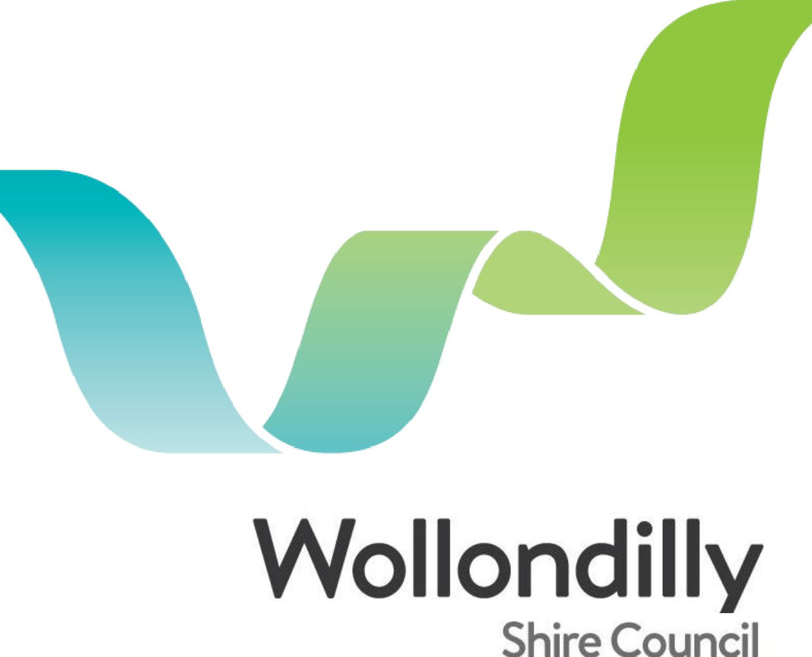

# Wollondilly Development Control Plan 2016 - Volume 3 Subdivision of Land

> This chapter is split into 28 section file(s), one per numbered heading, in the order they appear in the PDF.

Source PDF: [DCP-2016-Volume-3-Subdivision-of-Land2.pdf](https://planfortomorrow.sharepoint.com/sites/Planfortomorrow/Shared%20Documents/00%20NSW-Planning-Resources/dcp/wollondilly-development-control-plan-2016/volume-03-subdivision-of-land/DCP-2016-Volume-3-Subdivision-of-Land2.pdf)

### Development Control Plan 2016

### Volume 3 – Subdivision of Land

> [Picture on page 1: a picture, saved as a picture (images/volume-03-subdivision-of-land-page-1-3.gif, 150 dpi).]

#### Table of Contents

TABLE OF CONTENTS ................................................................................................................................... 2 PART 1 – PRELIMINARY ................................................................................................................................ 3

1.1 Introduction ....................................................................................................................................... 3

1.2 Objectives ......................................................................................................................................... 3

1.3 Parts of this DCP .............................................................................................................................. 3 PART 2 – GENERAL REQUIREMENTS FOR ALL DEVELOPMENT ............................................................ 4

2.1 Traffic and Transport ........................................................................................................................ 4

2.2 Wastewater ....................................................................................................................................... 8

2.3 Stormwater ....................................................................................................................................... 9

2.4 Lot Size and Shape ........................................................................................................................ 10

2.5 Landscape and Character .............................................................................................................. 12

2.6 Corner Allotments ........................................................................................................................... 12

2.7 Building Envelopes ......................................................................................................................... 12

2.8 Environmental Protection ............................................................................................................... 13

2.9 Non-Residential Development ........................................................................................................ 13

2.10 Agricultural Subdivision .................................................................................................................. 13

2.11 Boundary Adjustment to certain residential, environment protection and rural zones ....................... 14 PART 3 – CONTROLS FOR SPECIFIC LOCATIONS .................................................................................. 16

3.1 Picton West and Star Street Former Road Reserve ...................................................................... 16

3.2 Thirlmere East ................................................................................................................................ 18

3.3 Thirlmere South .............................................................................................................................. 19

3.4 Tahmoor West ................................................................................................................................ 20

3.5 Tahmoor South ............................................................................................................................... 21

3.6 Tahmoor East ................................................................................................................................. 23

3.7 Avon Dam and Hawthorne Roads, Bargo ...................................................................................... 25

3.8 Land Between Picton, Tahmoor and Thirlmere (commonly known as PTTAG) ............................ 27

3.9 Montpelier Drive Residential Land (The Oaks) .............................................................................. 28

3.10 Queen Victoria Memorial Home Planning Proposal Site ................................................................ 30

3.11 Bulli Appin Road Planning Proposal Site ....................................................................................... 32

3.12     Bronzewing Street Planning Proposal Site .................................................................................... 35

3.13     Abbotsford Road Planning Proposal Site ....................................................................................... 37

3.14     Station Street Planning Proposal Site ............................................................................................ 42

## PART 1 – PRELIMINARY

<!-- sections -->
## Sections

1. [1.1 Introduction](01-1-1-introduction.md)
2. [1.2 Objectives](02-1-2-objectives.md)
3. [1.3 Parts of this DCP](03-1-3-parts-of-this-dcp.md)
4. [2.1 Traffic and Transport Objectives](04-2-1-traffic-and-transport-objectives.md)
5. [2.2 Wastewater Objectives](05-2-2-wastewater-objectives.md)
6. [2.3 Stormwater Objectives](06-2-3-stormwater-objectives.md)
7. [2.4 Lot Size and Shape Objectives](07-2-4-lot-size-and-shape-objectives.md)
8. [2.5 Landscape and Character Objectives](08-2-5-landscape-and-character-objectives.md)
9. [2.6 Corner Allotments Objectives](09-2-6-corner-allotments-objectives.md)
10. [2.7 Building Envelopes Objectives](10-2-7-building-envelopes-objectives.md)
11. [2.8 Environmental Protection Objectives](11-2-8-environmental-protection-objectives.md)
12. [2.9 Non-Residential Development Objectives](12-2-9-non-residential-development-objectives.md)
13. [2.10 Agricultural Subdivision Objectives](13-2-10-agricultural-subdivision-objectives.md)
14. [2.11 Boundary Adjustment to certain residential, environment protection and rural zones](14-2-11-boundary-adjustment-to-certain.md)
15. [3.1 Picton West and Star Street Former Road Reserve](15-3-1-picton-west-and-star-street-former-road.md)
16. [3.2 Thirlmere East](16-3-2-thirlmere-east.md)
17. [3.3 Thirlmere South](17-3-3-thirlmere-south.md)
18. [3.4 Tahmoor West](18-3-4-tahmoor-west.md)
19. [3.5 Tahmoor South Application](19-3-5-tahmoor-south-application.md)
20. [3.6 Tahmoor East](20-3-6-tahmoor-east.md)
21. [3.7 Avon Dam and Hawthorne Roads, Bargo](21-3-7-avon-dam-and-hawthorne-roads-bargo.md)
22. [3.8 Land Between Picton, Tahmoor and Thirlmere (commonly known as PTTAG)](22-3-8-land-between-picton-tahmoor-and.md)
23. [3.9 Montpelier Drive Residential Land (The Oaks)](23-3-9-montpelier-drive-residential-land-the.md)
24. [3.10 Queen Victoria Memorial Home Planning Proposal Site](24-3-10-queen-victoria-memorial-home-planning.md)
25. [3.11 Bulli Appin Road Planning Proposal Site](25-3-11-bulli-appin-road-planning-proposal-site.md)
26. [3.12 Bronzewing Street Planning Proposal Site Application](26-3-12-bronzewing-street-planning-proposal-site.md)
27. [3.13 Abbotsford Road Planning Proposal Site Application](27-3-13-abbotsford-road-planning-proposal-site.md)
28. [3.14 Station Street Planning Proposal Site Application](28-3-14-station-street-planning-proposal-site.md)
