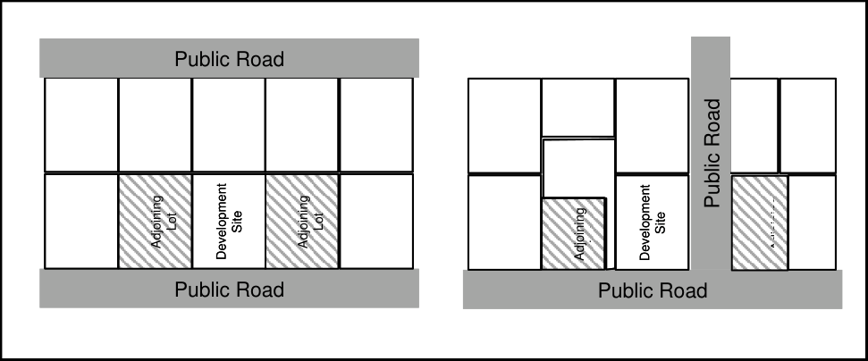
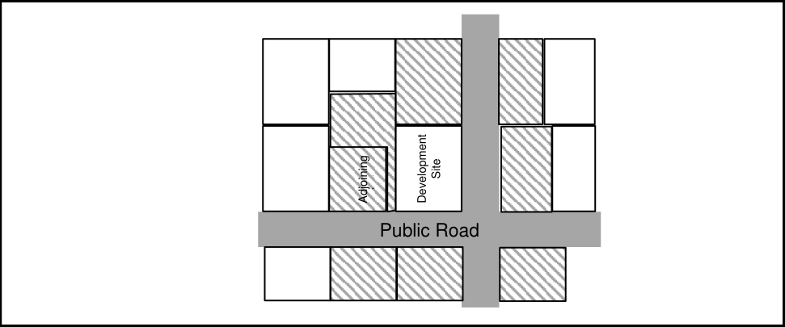
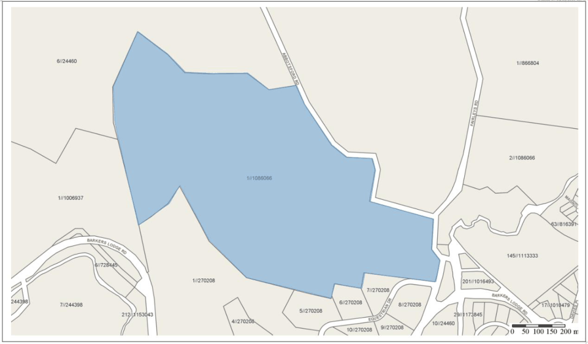
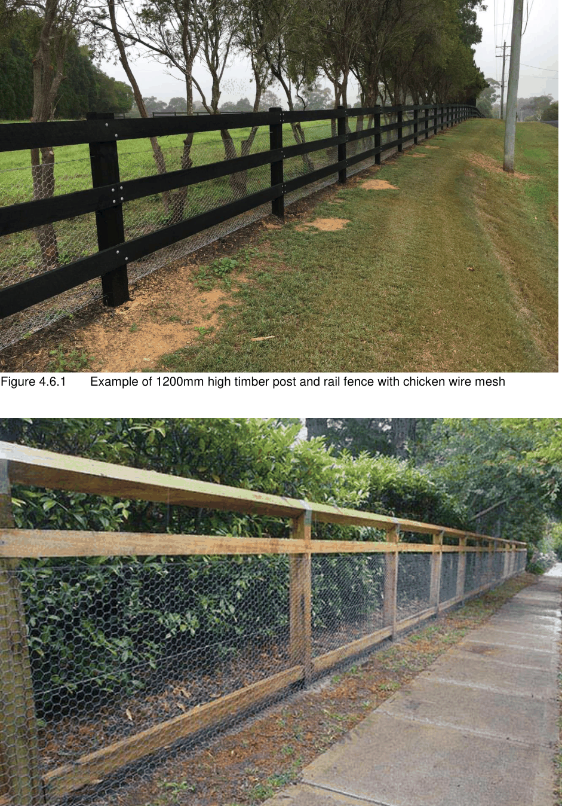
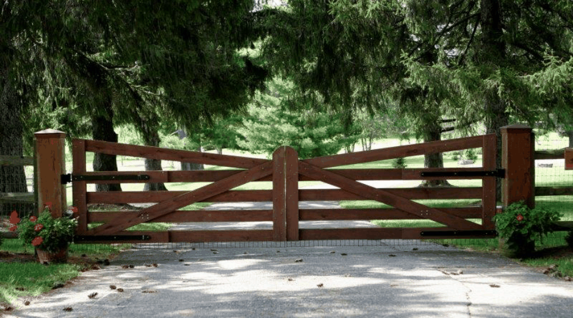
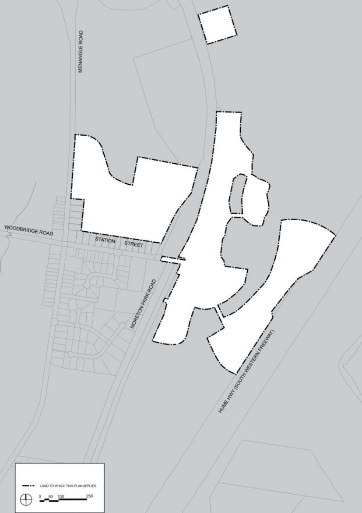
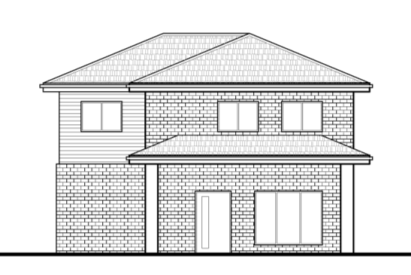
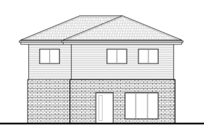
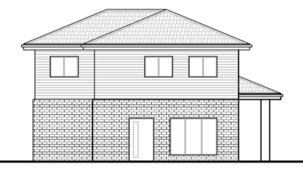
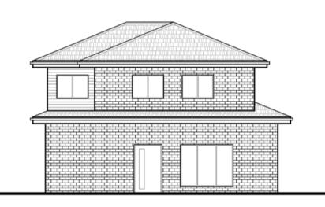

#### 17. Landscaping

17\. 1 Contribution to positive urban design outcomes by incorporating landscaping throughout the development.

17\. 2 Provision of landscaping within the development to assist with the effects of localised Urban Heat Island.

17.3 Encourage the retention of existing trees.

### 1.3 Parts of this DCP

The requirements contained within Part 2 apply to all development to which this plan applies.

Part 3 applies to specific types of residential accommodation development.

Part 4 applies to the following specific locations: Avon Dam Road and Hawthorne Road in Bargo Bingara Gorge Estate at Wilton Montpelier Drive Residential Land Queen Victoria Memorial Home Site Bulli Appin Road

### 1.4 How to apply this volume

The controls in this volume which apply to single dwellings and ancillary structures have been divided into various lot types which are depicted in the following table:

| Lot type | Lot size |
|---|---|
| Town Centre Residential Lot | <450m2 |
| Residential Small Lot | 450m2-699m2 |
| Standard Residential Lot | 700m2-1499m2 |
| Residential Large Lot | 1500m2-3999m2 |
| Rural Lifestyle lot | 4000m2-19999m2 |
| Rural Lot | Greater than or equal to 2ha |

If a single dwelling or ancillary structure is proposed the reference should be made to the relevant section based on the lot type above.

## PART 2 –GENERAL REQUIREMENTS FOR ALL DEVELOPMENT

### 2.1 Alterations and Additions Objectives

1\. To provide clarity and consistency in the assessment of applications to alter and expand development subject to this volume.

2\. To provide clarity and consistency in the assessment of applications for continued use of unauthorised works.

#### Controls

1\. A proposal for alterations and/or additions to an existing development shall be assessed as though both the existing and proposed development were proposed as a single application.

2\. The controls within this plan shall apply only to the alterations and/or additions and shall not be retrospectively applied to existing development that was lawfully undertaken.

3\. This control applies to development sites that include existing unauthorised works where an application seeks consent for continued use of those works. Unauthorised works shall be assessed under this plan in the same way that the works would have been assessed if the application had been made prior to the work being undertaken.

### 2.2 Residential Development in the B4 Mixed Use Zone Objectives

1\. To provide clarity in the assessment of applications for Residential Development in the B4 Mixed Use Zone.

2\. To ensure equity and consistency of character between residential development in the B4 Mixed Use Zone and nearby residential zones of similar density.

#### Controls

1\. Development for detached dwelling houses (including ancillary developments) in the B4 Mixed Use Zone shall be assessed as though it were undertaken in the R2 Low Density Residential Zone.

2\. Attached and detached dual occupancies (including ancillary developments) in the B4 Mixed Use Zone shall be assessed as though it were undertaken in the R2 Low Density Residential Zone.

3\. Medium density residential development (including ancillary developments) in the B4 Mixed Use Zone shall be assessed as though it were undertaken in the R3 Medium Density Residential Zone.

4\. Development for residential flat buildings (including ancillary developments) in the B4 Mixed Use Zone shall be assessed as though it were undertaken in the R3 Medium Density Residential Zone.

### 2.3 Effect of Building Envelopes Objectives

1\. To permit and encourage the master planning of built form in subdivisions at the subdivision stage.

#### Controls

1\. These controls apply to any allotment that is burdened by a restriction on title benefitting Council that has been imposed as the result of a condition of development consent on the subdivision of the land.

2\. Where there is an inconsistency between the restriction and any control in this volume the restriction shall prevail but only in so far as it relates to:

a. A building setback; and/or

b. A building height restriction.

3\. Notwithstanding control 2, no garage may be located within 5.5m of any boundary of a property with a public road.

### 2.4 Conversion of Buildings Objectives

1\. To ensure that buildings to be adapted or converted to a use subject to this volume achieves the same standards that would be required if a new building were erected.

2\. To ensure development is appropriate in its landscape.

3\. To ensure development has a satisfactory level of amenity.

#### Controls

1\. These controls apply to development for the purpose of converting an existing building into a development type subject to this volume.

2\. The development shall be assessed as though the development were being proposed as a new building.

### 2.5 Determining what constitutes an adjoining lot under this plan (for the purpose of calculating setbacks) Objectives

1\. To provide clarity in the determination of what constitutes an adjoining lot under this plan.

#### Controls

1\. In the case of a control relating to a setback from a road boundary of an allotment the adjoining lots are the lots on either side of the site that also have a boundary to that road ignoring any access handle or other road that may be present. This is represented below:

> [Picture on page 8: a map, saved as a picture (images/volume-04-residential-development-page-8-29.gif, 150 dpi); the street names and other small labels are on the picture.]

2\. In the case of any other control the adjoining lots are the lots that share a boundary with the development site and the lots that would share such a boundary but for the presence of a public road or access handle. This includes lots that share a common corner of a boundary even if this is the only common boundary. This is represented below:

> [Picture on page 9: a picture, saved as a picture (images/volume-04-residential-development-page-9-5.gif, 150 dpi).]
> Words printed on the picture (title and legend, copied from the PDF):
> Site
> Lots
> Adjoining Development
> Public Road

### 2.6 Wet bars Objectives

1\. To ensure that proposed wet bars are not readily adaptable to provide additional kitchens that would lead to a different use under the relevant environmental planning instruments.

#### Controls

1\. Wet bars shall have a counter area no greater than 3m2.

2\. Wet bars shall not be provided with ovens, cooktops or dishwashers.

### 2.7 Driveways Objectives

1\. To ensure that residential developments are provided with suitable vehicular access.

#### Controls

1\. Driveways shall be concrete for all residential development in the R1, R2, R3 zones.

2\. Driveways shall be bitumen sealed for dual occupancy development in the E4 zone or within rural zones if permitted by an Environmental Planning Instrument.

3\. Driveways shall be concrete or bitumen sealed for all residential development in the R5 zone.

4\. Driveways shall be sealed or all weather gravel for all other development under this volume.

### 2.8 Setbacks Objectives

1\. To clarify that a building may exceed a setback in this volume.

#### Controls

1\. Where there is a setback fixed for a building anywhere in this volume a building will be taken to comply if it is setback by an amount equal to or greater than the numerical standard provided.

### 2.9 Land Use Conflict Objectives

1\. To reduce potential land use conflict with an existing adjoining land use.

#### Controls

1\. Residential development shall not impede the operation of existing non-residential development in the vicinity including (without limitation):

a. Agriculture

b. Education Facilities

c. Recreation Facilities

d. Industries

e. Business Undertakings.

### 2.10 Stormwater Objectives

1\. To ensure that stormwater from buildings is collected and conveyed in a manner that does not cause environmental harm.

2\. To retain, as far as practicable, natural stormwater flows.

#### Controls

1\. Stormwater from new dwellings (other than water to be recycled for use on site) must be directed to at least one of the following to Council’s specifications:

Street drainage system; Drainage easement; Natural drainage path.

Council may consider the use of absorption trenches or similar on large lot residential or rural lots where one of the measures above cannot be satisfied.

2\. Where common drainage treatment methods are unable to suitably convey stormwater from the dwelling to one of the systems described in control (1) above, Council may require the creation of drainage easements over adjoining properties to carry stormwater from the site.

3\. The proposed dwelling and any associated stormwater drainage measures shall account for the existing drainage patterns of the area and shall not contribute to any localised ponding, nuisance flooding on adjoining properties, or impacts to overland flow or natural drainage paths.

4\. All stormwater disposal systems shall be in accordance with Council’s Engineering Design Specifications.

### 2.11 Temporary Occupation

These provisions apply to an application for temporary residential occupation of a building or structure, other than a dwelling, during the construction of the first house on the site.

#### Objectives

1\. To ensure that temporary occupation would not be detrimental to the existing natural and built environment.

2\. To ensure that temporary occupation is carried out over a timeframe which can reasonable be considered as being on a “temporary” basis.

3\. To avoid the use of structures for the purposes of temporary occupation which could remain capable of being readily converted for occupation after temporary occupation has ceased.

#### Controls

1\. The temporary occupation of a structure is not permitted in residential (R) zones.

2\. The temporary occupation of a structure is only permitted on a site which contains an existing consent for a dwelling house which has not lapsed.

3\. Temporary Occupation of a structure must not involve the occupation of a shed as a dwelling or domicile. Council may consider a shed with a bathroom facility however the place of residence during temporary occupation must be within a separate structure such as a caravan.

4\. Suitable arrangements for wastewater disposal where temporary occupation is permitted in unsewered areas must be provided.

5\. Council must not consent to the temporary occupation of a structure for greater than two (2) years.

## PART 3 – SPECIFIC LAND USE CONTROLS

### 3.1 Single Dwelling Houses (Town Centre Residential Lots)

These provisions apply to developments for dwelling houses on Town Centre Residential Lots (area less than 450m2 on which a dwelling can be lawfully constructed).

| Control |  | Objectives (refer to Clause 1.2) |
|---|---|---|
| Building Design |  |  |
| 1 | The total portion of the site covered by buildings shall not exceed 60% of the site area. | 1.2, 1.3, 3.1, 6.1 & 6.2. |
| 2 | Filling of land shall not increase the natural ground level by more than 1.0m. | 1.2, 1.3, 5.1 & 6.2 |
| 3 | Cut shall be limited to 1.0 metres below natural ground level. | 1.2, 1.3, 4.1, 6.2 & 9.1 |
| 4 | The overall bulk, scale, height and proportion of the dwelling shall be consistent with the existing streetscape character of the area. | 1.2, 1.3 |
| 5 | The roof form of dwellings shall be modulated or articulated to provide visual interest and shall not use bright reflective materials. | 1.2, 1.3 |
| 6 | The front façade must feature a personal access door. | 1.2, 1.3 |
| 7 | The front façade of any dwelling must address the street. In this regard the front facade shall include a combination of at least two (2) of the following: an entry feature or portico; bay windows; the use of a balcony, deck, pergola, terrace or verandah along the frontage; Roof overhangs; Awnings over windows which blend with the design of the dwelling; A combination of other architectural features suitable to Council which enhance the front façade of the dwelling. | 1.2, 1.3 & 4.2 |
| 8 | On corner allotments, the building façade on the secondary street frontage shall address the street in accordance with control (7) above. | 1.2, 1.3 & 4.2 |
| 9 | On corner lots, where the primary front façade is addressed by way of a building feature such as a balcony, deck, pergola, terrace or verandah, roof overhang, awning and the like, the feature shall “wrap around” the dwelling and continue along the secondary front façade for a minimum length of 3m. | 1.2, 1.3, 1.4 & 4.2 |
| 10 | Any fencing along the primary frontage (or secondary street frontage on a corner lot) must be of a height that would not visually obstruct the building features provided in accordance with control (7) to (9) above when viewed from the street. | 1.2, 1.3, 1.4 & 4.2 |
| 11 | Any front façade (and secondary front façade on corner lots) must have no stretch of blank wall greater than 5.0m in length. | 1.2, 1.3, 1.4, 4.2 |
| 12 | Any front façade (and secondary front façade on corner lots) must have no stretch of straight wall greater than 10.0 metres in length. | 1.2, 1.3, 1.4 |
| 13 | A side or rear façade must have no stretch of blank wall greater than 12.0 metres. | 1.2, 1.3, |

| 14 | No more than 50% of the front façade shall be garage doors. | 1.2, 1.3, |
|---|---|---|
| 15 | The number of garage doors visible to the street shall be limited to 2. In this control a double garage door shall be counted as 2 doors. | 1.2, 1.3, |
| 16 | The front façade shall be provided with at least one habitable room with a window looking out onto the public road. | 1.2, 1.3, 4.2 |
| 17 | Dwellings must appear no greater than two (2) storeys in height. | 1.1, 1.2, 1.3, |
| Setbacks |  |  |
| 18 | Where there is a dwelling on each adjoining lot, the setback for the dwelling from any primary road shall be within plus or minus 10% of the average setback of the adjoining dwellings. Such a setback shall be no less than 3m for lots less than 300m2. In all other cases the front setback shall be no less than 4.5m. | 1.1, 1.2, 1.3, |
| 19 | Where there is a dwelling on one adjoining lot the front setback for the dwelling shall be within plus or minus 10% of the setback of the adjoining dwelling. Such a setback shall be no less than 3m for lots less than 300m2. In all other cases the front setback shall be no less than 4.5m. | 1.1, 1.2, 1.3, |
| 20 | Where there is no dwelling on an adjoining lot the front setback shall be 3m for a lot with an area less than 300m2 and shall be 4.5m for all other Town Centre Residential lots. | 1.2, 1.3, |
| 21 | The minimum side setback shall be 0.9m. Except in cases where a zero lot line has been nominated at the subdivision stage and satisfactory easements have been provided over the adjoining allotment. | 1.2, 1.3, 5.2 |
| 22 | The minimum rear setback shall be 8.0m for a two (2) storey dwelling and 3.0m for a single storey dwelling or a single storey part of a two (2) storey dwelling. | 1.2, 1.3, 5.1, 5.2 |
| 23 | For corner or irregular allotments with multiple road frontages the setback from any secondary road shall be 2.0m. | 1.2, 1.3, 1.4 |
| 24 | The methods for determining primary and secondary roads and setbacks prescribed by State Environmental Planning Policy (Exempt and Complying Development Codes), 2008, are adopted by this volume. | 14.1 |
| 25 | Any garage attached to a dwelling shall be setback a minimum of 1 metre behind the front building line of the dwelling or 5.5 metres from the front street boundary, whichever is greater. | 1.2, 1.3, 2.1, 2.2, 2.3 |
| 26 | Awnings and other building features that do not form a wall of a room may be located between the building setback to a primary and/or secondary road but shall not extend more than 1.5m in front of that building setback. | 1.2, 1.3, |
| 27 | Eaves and other building features that do not form a wall of a room may be located within the side and rear building setbacks but shall not extend more than 450mm into that building setback. | 1.2, 1.3, |
| Private Open Space |  |  |
| 28 | A minimum principal area of private open space must be provided with the following characteristics: a. Gradient no steeper than 1:20 (Rise:Run) b. Width no less than 3 metres in any direction c. Must be directly accessible from, and adjacent to, a habitable room, other than a bedroom (i.e a living area) d. Have an area no less than 16 square-metres. e. Must not be located in the front building setback nor the setback from a secondary frontage. | 3.1, 6.1 |

|  | f. Not be used for clothes drying, effluent disposal or garbage storage |  |
|---|---|---|
| Solar Access |  |  |
| 29 | Sunlight is to be available to at least 50% of the dedicated private open space area of the dwelling for at least 3 hours between 9:00 am and 3:00 pm on June 21. | 1.3, 3.4 |
| 30 | A new dwelling shall not result in less than 3 hours of sunlight to the habitable rooms of an adjoining dwelling and 50% of the private open space area of any adjoining property between 9:00 am and 3:00 pm on June 21. | 1.3, 3.5 |
| Parking, Access and Vehicular Safety |  |  |
| 31 | A minimum of one (1) car parking space which is directly accessible for vehicles must be provided on the site behind the building line in the form of a carport, garage or hard stand space or any combination of these. Stacked car parking spaces may be considered forward of the building line in addition to the one (1) car parking space required above. | 2.1, 2.3, 2.4 14.1 |
| 32 | An open hard stand car parking space must measure a minimum of 2.6m wide by 5.4m long. | 2.1, 2.2, 14.1 |
| 33 | Garages shall have sufficient area to accommodate a parking space of 2.6m x 5.4m per allocated parking space. | 2.1, 2.2, 2.4 |
| 34 | Garage doors shall have a minimum width of 2.4 metres. | 2.1, 2.2 |
| Privacy |  |  |
| 35 | Wherever possible, a dwelling shall be designed to avoid overlooking the main living areas, private open space areas and windows of habitable rooms of adjoining dwellings. | 5.1, 5.2 |
| 36 | The outlook from second storey windows, balconies, stairs, landings, terraces or decks is to be screened where a direct view is available into the private open space areas of an existing adjoining dwelling to prevent overlooking. | 5.1, |
| 37 | A window that has a sill height of 1.7m or more above the floor level within the room shall be taken to have no potential for overlooking. | 5.1, 5.2 |
| 38 | In cases where windows of habitable rooms on a dwelling have a direct outlook onto windows of habitable rooms of adjacent dwellings, the windows of the proposed dwelling shall be offset by a sufficient distance to limit direct views between windows. | 5.2 |
| Waste Management |  |  |
| 39 | Dwellings shall be provided with bin storage areas in a location clear of private open space and out of view from any public space including any public road. | 1.2, 1.3, 3.1, 8.1 |

### 3.2 Single Dwelling Houses (Residential Small Lots)

These provisions apply to developments for dwelling houses on Residential Small Lots (area between 450 m2 and 699m2 on which a dwelling can be lawfully constructed). They do NOT apply to Residential Battle-Axe Allotments.

| Control |  | Objectives (refer to Clause 1.2) |
|---|---|---|
| Building Design |  |  |
| 1 | The total portion of the site covered by buildings shall not exceed 60% of the site area. | 1.2, 1.3, 3.1, 6.1 & 6.2. |
| 2 | Filling of land shall not increase the natural ground level by more than 1.0m. | 1.2, 1.3, 5.1 & 6.2 |
| 3 | Cut shall be limited to 2.0 metres below natural ground level. | 1.2, 1.3, 4.1, 6.2 & 9.1 |
| 4 | The overall bulk, scale, height and proportion of the dwelling shall be consistent with the existing streetscape character of the area. | 1.2, 1.3 |
| 5 | The roof form of dwellings shall be modulated or articulated to provide visual interest and shall not use bright reflective materials. | 1.2, 1.3 |
| 6 | The front façade must feature a personal access door. | 1.2, 1.3 |
| 7 | The front façade of any dwelling must address the street. In this regard the front facade shall include a combination of at least two (2) of the following: an entry feature or portico; bay windows; the use of a balcony, deck, pergola, terrace or verandah along the frontage; Roof overhangs; Awnings over windows which blend with the design of the dwelling; A combination of other architectural features suitable to Council which enhance the front façade of the dwelling. | 1.2, 1.3, 4.2 |
| 8 | On corner allotments, the building façade on the secondary street frontage shall address the street in accordance with control (7) above. | 1.2, 1.3, 1.4, 4.2 |
| 9 | On corner lots, where the primary front façade is addressed by way of a building feature such as a balcony, deck, pergola, terrace or verandah, roof overhang, awning and the like, the feature shall “wrap around” the dwelling and continue along the secondary front façade for a minimum length of 3.0m. | 1.2, 1.3, 1.4, 4.2 |
| 10 | Any fencing along the primary frontage (or secondary street frontage on a corner lot) must be of a height that would not visually obstruct the building features provided in accordance with control (7) to (9) above when viewed from the street. | 1.2, 1.3, 1.4, 4.2 |
| 11 | Any front façade (and secondary front façade on corner lots) must have no stretch of blank wall greater than 5.0m in length. | 1.2, 1.3, 1.4, 4.2 |
| 12 | Any front façade (and secondary front façade on corner lots) must have no stretch of straight wall greater than 10.0 metres in length. | 1.2, 1.3, 1.4 |
| 13 | A side or rear façade must have no stretch of blank wall greater than 12.0 metres. | 1.2, 1.3, |
| 14 | No more than 50% of the front façade shall be garage doors. | 1.2, 1.3, |

| 15 | The number of garage doors visible to the street shall be limited to 2. In this control a double garage door shall be counted as 2 doors. | 1.2, 1.3, |
|---|---|---|
| 16 | The front façade shall be provided with at least one habitable room with a window looking out onto the public road. | 1.2, 1.3, 4.2 |
| 17 | Dwellings must appear no greater than two (2) storeys in height. | 1.1, 1.2, 1.3, |
| Setbacks |  |  |
| 18 | Where there is a dwelling on each adjoining lot, the setback for the dwelling from any primary road shall be within plus or minus 10% of the average setback of the adjoining dwellings. Such a setback shall be no less than 4.5m. | 1.1, 1.2, 1.3, |
| 19 | Where there is a dwelling on one adjoining lot the front setback for the dwelling shall be within plus or minus 10% of the setback of the adjoining dwelling. Such a setback shall be no less than 4.5m. | 1.1, 1.2, 1.3, |
| 20 | Where there is no dwelling on an adjoining lot the front setback shall be 4.5m. | 1.2, 1.3, |
| 21 | The minimum side setback shall be 0.9m. | 1.2, 1.3, 5.2 |
| 22 | The minimum rear setback shall be 8.0m for a two (2) storey dwelling and 3.0m for a single storey dwelling or a single storey part of a two (2) storey dwelling. | 1.2, 1.3, 5.1, 5.2 |
| 23 | For corner or irregular allotments with multiple road frontages the setback from any secondary road shall be 2.5m. | 1.2, 1.3, 1.4 |
| 24 | The methods for determining primary and secondary roads and setbacks prescribed by State Environmental Planning Policy (Exempt and Complying Development Codes), 2008, are adopted by this volume. | 14.1 |
| 25 | Any garage attached to a dwelling shall be setback a minimum of 1 metre behind the front building line of the dwelling or 5.5 metres from the front street boundary, whichever is greater. | 1.2, 1.3, 2.1, 2.2, 2.3 |
| 26 | Awnings and other building features that do not form a wall of a room may be located between the building setback to a primary and/or secondary road but shall not extend more than 1.5m in front of that building setback. | 1.2, 1.3, |
| 27 | Eaves and other building features that do not form a wall of a room may be located within the side and rear building setbacks but shall not extend more than 450mm into that building setback. | 1.2, 1.3, |
| Private Open Space |  |  |
| 28 | A minimum principal area of private open space must be provided with the following characteristics: a. Gradient no steeper than 1:20 (Rise:Run) b. Width no less than 3 metres in any direction c. Must be directly accessible from, and adjacent to, a habitable room, other than a bedroom (i.e. a living area) d. Have an area no less than 24 square-metres. e. Must not be located in the front building setback nor the setback from a secondary frontage. f. Not be used for clothes drying, effluent disposal or garbage storage | 3.1, 6.1 |
| Solar Access |  |  |
| 29 | Sunlight is to be available to at least 50% of the dedicated private open space area of the dwelling for at least 3 hours between 9:00 am and 3:00 pm on June 21. | 1.3, 3.4 |
| 30 | New development shall not result in less than 3 hours of sunlight to the habitable rooms of an adjoining dwelling and 50% of the private open | 1.3, 3.5 |

|  | space area of any adjoining property between 9:00 am and 3:00 pm on June 21. |  |
|---|---|---|
| Parking, Access and Vehicular Safety |  |  |
| 31 | A minimum of one (1) car parking space which is directly accessible for vehicles must be provided on the site behind the building line in the form of a carport, garage or hard stand space or any combination of these. Stacked car parking spaces may be considered forward of the building line in addition to the one (1) car parking space required above. | 2.1, 2.3, 2.4 |
| 32 | An open hard stand car parking space must measure a minimum of 2.6m wide and 5.4m long. | 2.1, 2.2, |
| 33 | Garages shall have sufficient area to accommodate a parking space of 2.6m x 5.4m per allocated parking space. | 2.1, 2.2, 2.4 |
| 34 | Garage doors shall have a minimum width of 2.4 metres. | 2.1, 2.2 |
| Privacy |  |  |
| 35 | Wherever possible, a dwelling shall be designed to avoid overlooking the main living areas, private open space areas and windows of habitable rooms of adjoining dwellings. | 5.1, 5.2 |
| 36 | The outlook from second storey windows, balconies, stairs, landings, terraces or decks is to be screened where a direct view is available into the private open space areas of an existing adjoining dwelling to prevent overlooking. | 5.1 |
| 37 | A window that has a sill height of 1.7m or more above the floor level within the room shall be taken to have no potential for overlooking. | 5.1, 5.2 |
| 38 | In cases where windows of habitable rooms on a dwelling have a direct outlook onto windows of habitable rooms of adjacent dwellings, the windows of the proposed dwelling shall be offset by a sufficient distance to limit direct views between windows. | 5.2 |
| Waste Management |  |  |
| 39 | Dwellings shall be provided with bin storage areas in a location clear of private open space. | 1.2, 1.3, 3.1, 8.1 |

### 3.3 Single Dwelling Houses (Standard Residential Lots)

These provisions apply to developments for dwelling houses on Standard Residential Lots (area between 700m2 and 1499m2 on which a dwelling can be lawfully constructed). They do NOT apply to Residential Battle-Axe Allotments.

| Control |  | Objectives (refer to Clause 1.2) |
|---|---|---|
| Building Design |  |  |
| 1 | The total portion of the site covered by buildings shall not exceed 50% of the site area. | 1.2, 1.3, 3.1, 6.1 & 6.2. |
| 2 | Filling of land shall not increase the natural ground level by more than 1.0m. | 1.2, 1.3, 5.1 & 6.2 |
| 3 | Cut shall be limited to 2.0 metres below natural ground level. | 1.2, 1.3, 4.1, 6.2 & 9.1 |
| 4 | The overall bulk, scale, height and proportion of the dwelling shall be consistent with the existing streetscape character of the area. | 1.2, 1.3 |
| 5 | The roof form of dwellings shall be modulated or articulated to provide visual interest and shall not use bright reflective materials. | 1.2, 1.3 |
| 6 | The front façade must feature a personal access door. | 1.2, 1.3 & 4.2 |
| 7 | The front façade of any dwelling must address the street. In this regard the front facade shall include a combination of at least two (2) of the following: an entry feature or portico; bay windows; the use of a balcony, deck, pergola, terrace or verandah along the frontage; Roof overhangs; Awnings over windows which blend with the design of the dwelling; A combination of other architectural features suitable to Council which enhance the front façade of the dwelling. | 1.2, 1.3 |
| 8 | On corner allotments, the building façade on the secondary street frontage shall address the street in accordance with control (7) above. | 1.2, 1.3, 1.4, 4.2 |
| 9 | On corner lots where the primary front façade is addressed by way of a building feature such as a balcony, deck, pergola, terrace or verandah, roof overhang, awning and the like, the feature shall “wrap around” the dwelling and continue along the secondary front façade for a minimum length of 3.0m. | 1.2, 1.3, 1.4, 4.2 |
| 10 | Any fencing along the primary frontage (or secondary street frontage on a corner lot) must be of a height that would not visually obstruct the building features provided in accordance with control (7) to (9) above when viewed from the street. | 1.2, 1.3, 1.4, 4.2 |
| 11 | Any front façade (and secondary front façade on corner lots) must have no stretch of blank wall greater than 5.0m in length. | 1.2, 1.3, 1.4, 4.2 |
| 12 | Any front façade (and secondary front façade on corner lots) must have no stretch of straight wall greater than 10.0 metres in length. | 1.2, 1.3, 1.4 |
| 13 | A side or rear façade must have no stretch of blank wall greater than 12.0 metres. | 1.2, 1.3, |
| 14 | No more than 50% of the front façade shall be garage doors. | 1.2, 1.3, |

| 15 | The number of garage doors visible to the street shall be limited to 3. If 3 doors are proposed at least 1 door must be setback behind the other 2 by no less than 0.5m. In this control a double garage door shall be counted as 2 doors. | 1.2, 1.3, |
|---|---|---|
| 16 | The front façade shall be provided with at least one habitable room with a window looking out onto the public road. | 1.2, 1.3, 4.2 |
| 17 | Dwellings must appear no greater than two (2) storeys in height. | 1.1, 1.2, 1.3, |
| Setbacks |  |  |
| 18 | Where there is a dwelling on each adjoining lot, the setback for the dwelling from any primary road shall within plus or minus 10% of the average setback of the existing adjoining dwellings. Such a setback shall be no less than 4.5m. | 1.1, 1.2, 1.3, |
| 19 | Where there is a dwelling on one adjoining lot the front setback for the dwelling shall be within plus or minus 10% of the setback of the adjoining dwelling. Such a setback shall be no less than 4.5m. | 1.1, 1.2, 1.3, |
| 20 | Where there is no dwelling on an adjoining lot the front setback shall be 4.5m for a lot with an area less than 900m2 and 6.5m for other standard residential lots. | 1.2, 1.3, |
| 21 | The minimum side setback shall be 0.9m. | 1.2, 1.3, 5.2 |
| 22 | The minimum rear setback shall be 8.0m for a two (2) storey dwelling and 3.0m for a single storey dwelling or a single storey part of a two (2) storey dwelling. | 1.2, 1.3, 5.1, 5.2 |
| 23 | For corner or irregular allotments with multiple road frontages the setback from any secondary road shall be 2.5m for a lot with an area less than 900m2 and 3m for other residential lots. | 1.2, 1.3, 1.4 |
| 24 | The methods for determining primary and secondary roads and setbacks prescribed by State Environmental Planning Policy (Exempt and Complying Development Codes), 2008, are adopted by this volume. | 14.1 |
| 25 | Any garage attached to a dwelling shall be setback a minimum of 1 metre behind the front building line of the dwelling or 5.5 metres from the front street boundary, whichever is greater. | 1.2, 1.3, 2.1, 2.2, 2.3 |
| 26 | Awnings and other building features that do not form a wall of a room may be located between the building setback to a primary and/or secondary road but shall not extend more than 1.5m in front of that building setback. | 1.2, 1.3, |
| 27 | Eaves and other building features that do not form a wall of a room may be located within the side and rear building setbacks but shall not extend more than 450mm into that building setback. | 1.2, 1.3, |
| Private Open Space |  |  |
| 28 | A minimum principal area of private open space must be provided with the following characteristics: a. Gradient no steeper than 1:20 (Rise:Run) b. Width no less than 3 metres in any direction c. Must be directly accessible from, and adjacent to, a habitable room, other than a bedroom (i.e. a living area) d. Have an area no less than 24 square-metres. e. Must not be located in the front building setback nor the setback from a secondary frontage. f. Not be used for clothes drying, effluent disposal or garbage storage | 3.1, 6.1 |
| Solar Access |  |  |

| 29 | Sunlight is to be available to at least 50% of the dedicated private open space area for each dwelling for at least 3 hours between 9:00 am and 3:00 pm on June 21. | 1.3, 3.4 |
|---|---|---|
| 30 | New development shall not result in less than 3 hours of sunlight to the habitable rooms of an adjoining dwelling and 50% of the private open space area of any adjoining property between 9:00 am and 3:00 pm on June 21. | 1.3, 3.5 |
| Parking, Access and Vehicular Safety |  |  |
| 31 | A minimum of two (2) car parking spaces which are directly accessible for vehicles must be provided on the site behind the building line in the form of a carport, garage or hard stand space or any combination of these. Stacked car parking spaces may be considered forward of the building line in addition to the two car parking spaces required above. | 2.1, 2.2, 2.3, |
| 32 | An open hard stand car parking space must measure a minimum of 2.6m wide and 5.4m long. | 2.1, 2.2, |
| 33 | Garages shall have sufficient area to accommodate a parking space of 2.6m x 5.4 metres per allocated parking space. | 2.1, 2.2, 2.4 |
| 34 | Garage doors shall have a minimum width of 2.4 metres. | 2.1, 2.2 |
| Privacy |  |  |
| 35 | Wherever possible, a dwelling shall be designed to avoid overlooking the main living areas, private open space areas and windows of habitable rooms of adjoining dwellings. | 5.1, 5.2 |
| 36 | The outlook from second storey windows, balconies, stairs, landings, terraces or decks is to be screened where a direct view is available into the private open space areas of an existing adjoining dwelling to prevent overlooking. | 5.1 |
| 37 | A window that has a sill height of 1.7m or more above the floor level within the room shall be taken to have no potential for overlooking. | 5.1, 5.2 |
| 38 | In cases where windows of habitable rooms on a dwelling have a direct outlook onto windows of habitable rooms of adjacent dwellings, the windows of the proposed dwelling shall be offset by a sufficient distance to limit direct views between windows. | 5.2 |
| Waste Management |  |  |
| 39 | Dwellings shall be provided with bin storage areas in a location clear of private open space. | 1.2, 1.3, 3.1, 8.1 |

### 3.4 Single Dwelling Houses (Residential Large Lots)

These provisions apply to developments for dwelling houses on Residential Large Lots (area between 1500m2 and 3999m2 on which a dwelling may be lawfully constructed). They do NOT apply to Residential Battle-Axe Allotments.

| Control |  | Objectives (refer to Clause 1.2) |
|---|---|---|
| Building Design |  |  |
| 1 | The total portion of the site covered by buildings shall not exceed 40% of the site area. | 1.2, 1.4, 3.1, 6.1 & 6.2. |
| 2 | Filling of land shall not increase the natural ground level by more than 1.0m. | 1.2, 1.3, 5.1 & 6.2 |

| 3 | Cut shall be limited to 2.0 metres below natural ground level. | 1.2, 1.3, 4.1, 6.2 & 9.1 |
|---|---|---|
| 4 | The overall bulk, scale, height and proportion of the dwelling shall be consistent with the existing streetscape character of the area. | 1.2, 1.3 |
| 5 | The roof form of dwellings shall be modulated or articulated to provide visual interest and shall not use bright reflective materials. | 1.2, 1.3 |
| 6 | The front façade must feature a personal access door. | 1.2, 1.3 |
| 7 | The front façade of any dwelling must address the street. In this regard the front facade shall include a combination of at least two (2) of the following: an entry feature or portico; bay windows; the use of a balcony, deck, pergola, terrace or verandah along the frontage; Roof overhangs; Awnings over windows which blend with the design of the dwelling; A combination of other architectural features suitable to Council which enhance the front façade of the dwelling. | 1.2, 1.3 & 4.2 |
| 8 | On corner allotments, the building façade on the secondary street frontage shall address the street in accordance with control (7) above. | 1.2, 1.3, 1.4, 4.2 |
| 9 | On corner lots, where the primary front façade is addressed by way of a building feature such as a balcony, deck, pergola, terrace or verandah, roof overhang, awning and the like, the feature shall “wrap around” the dwelling and continue along the secondary front façade for a minimum length of 3.0m. | 1.2, 1.3, 1.4, 4.2 |
| 10 | Any fencing along the primary frontage (or secondary street frontage on a corner lot) must be of a height that would not visually obstruct the building features provided in accordance with control (7) to (9) above when viewed from the street. | 1.2, 1.3, 1.4, 4.2 |
| 11 | Any front façade (and secondary front façade on corner lots) must have no stretch of blank wall greater than 5.0m in length. | 1.2, 1.3, 1.4, 4.2 |
| 12 | A side or rear façade (and secondary front façade on corner lots) must have no stretch of blank wall greater than 12.0 metres. | 1.2, 1.3, 1.4 |
| 13 | No more than 50% of the front façade shall be garage doors. | 1.2, 1.3 |
| 14 | The number of garage doors visible to the street shall be limited to 3. In this control a double garage door shall be counted as 2 doors. | 1.2, 1.3 |
| 15 | The front façade shall be provided with at least one habitable room with a window looking out onto the public road. | 1.2, 1.3, 4.2 |
| 16 | Dwellings must appear no greater than two (2) storeys in height. | 1.2, 1.3 |
| Setbacks |  |  |
| 17 | Where there is a dwelling on each adjoining lot, the setback for the dwelling from any primary road shall be within plus or minus 10% of the average setback of the adjoining dwellings. Such a setback shall be no less than 10m. | 1.1, 1.2, 1.3, 2.1, 2.2, 2.3 |
| 18 | Where there is a dwelling on one adjoining lot the front setback for the dwelling shall be within plus or minus 10% of the setback of the adjoining dwelling. Such a setback shall be no less than 10m. | 1.1, 1.2, 1.3, 2.1, 2.2, 2.3 |
| 19 | Where there is no dwelling on an adjoining lot the front setback shall be 10m. | 1.2, 1.3, 2.1, 2.2, 2.3 |
| 20 | The minimum side setback shall be 1.5m. | 1.2, 1.3, 5.2 |
| 21 | The minimum rear setback shall be 8.0m. | 1.2, 1.3, 5.1, 5.2 |

| 22 | For corner or irregular allotments with multiple road frontages the setback from any secondary road shall be 5m. | 1.2, 1.3, 1.4 |
|---|---|---|
| 23 | The methods for determining primary and secondary roads and setbacks prescribed by State Environmental Planning Policy (Exempt and Complying Development Codes), 2008, are adopted by this volume. | 14.1 |
| 24 | Any garage attached to a dwelling shall be setback a minimum of 1 metre behind the front building line of the dwelling or 5.5 metres from the front street boundary, whichever is greater. | 1.2, 1.3, 2.1, 2.2, 2.3 |
| 25 | Awnings and other building features that do not form a wall of a room may be located within the building setback to a primary and/or secondary road but shall not extend more than 1.5m into that building setback. | 1.2, 1.3 |
| Private Open Space |  |  |
| 26 | A minimum principal area of private open space must be provided with the following characteristics: g. Gradient no steeper than 1:20 (Rise:Run) h. Width no less than 3 metres in any direction i. Must be directly accessible from, and adjacent to, a habitable room, other than a bedroom (i.e. a living area) j. Have an area no less than 24 square-metres. k. Must not be located in the front building setback nor the setback from a secondary frontage. l. not be used for clothes drying, effluent disposal or garbage storage | 3.1, 6.1 |
| Solar Access |  |  |
| 27 | Sunlight is to be available to at least 50% of the dedicated private open space area for each dwelling for at least 3 hours between 9:00 am and 3:00 pm on June 21. | 1.3, 3.4 |
| 28 | New development shall not result in less than 3 hours of sunlight to the habitable rooms of an adjoining dwelling and 50% of the private open space area of any adjoining property between 9:00 am and 3:00 pm on June 21. | 1.3, 3.5 |
| Parking, Access and Vehicular Safety |  |  |
| 29 | A minimum of two (2) car parking spaces which are directly accessible for vehicles must be provided on the site behind the building line in the form of a carport, garage or hard stand space or any combination of these. Stacked car parking spaces may be considered forward of the building line in addition to the two car parking spaces required above. | 2.1, 2.3, 2.4 |
| 30 | An open hard stand car parking space must measure a minimum of 2.6m wide by 5.4m long. | 2.1, 2.2 |
| 31 | Garages shall have sufficient area to accommodate a parking space of 2.6m x 5.4 metres per allocated parking space. | 2.1, 2.2, 2.4 |
| 32 | Garage doors shall have a minimum width of 2.4m. | 2.1, 2.2 |
| Privacy |  |  |
| 33 | Wherever possible, a dwelling shall be designed to avoid overlooking the main living areas, private open space areas and windows of habitable rooms of adjoining dwellings. | 5.1, 5.2 |
| 34 | The outlook from second storey windows, balconies, stairs, landings, terraces or decks is to be screened where a direct view is available | 5.1 |

|  | into the private open space areas of an existing adjoining dwelling to prevent overlooking. |  |
|---|---|---|
| 35 | A window that has a sill height of 1.7m or more above the floor level within the room shall be taken to have no potential for overlooking. | 5.1, 5.2 |
| Waste Management |  |  |
| 36 | Dwellings shall be provided with bin storage areas in a location clear of private open space. | 1.2, 1.3, 3.1, 8.1 |

### 3.5 Single Dwelling Houses (Rural Lifestyle Lots)

These provisions apply to developments for dwelling houses on Rural Lifestyle Lots (area between 4000m2 and 19,999m2 on which a dwelling may be lawfully constructed).

| Control |  | Objectives (refer to Clause 1.2) |
|---|---|---|
| Building Design |  |  |
| 1 | Dwellings must appear no greater than two (2) storeys in height. | 1.2, 1.3, 1.4 |
| 2 | Filling of land shall not increase the natural ground level by more than 1.0m. | 1.2, 1.3, 5.1 & 6.2 |
| 3 | Cut shall be limited to 2.0 metres below natural ground level. | 1.2, 1.3, 4.1, 6.2 & 9.1 |
| 4 | The overall bulk, scale, height and proportion of the dwelling shall be consistent with the existing streetscape character of the area. | 1.2, 1.3 |
| 5 | The roof form of dwellings shall be modulated or articulated to provide visual interest and shall not use bright reflective materials. | 1.2, 1.3 |
| 6 | The front façade must feature a personal access door. | 1.2, 1.3 |
| 7 | The front façade of any dwelling must address the street. In this regard the front facade shall include a combination of at least two (2) of the following: an entry feature or portico; bay windows; the use of a balcony, deck, pergola, terrace or verandah along the frontage; Roof overhangs; Awnings over windows which blend with the design of the dwelling; A combination of other architectural features suitable to Council which enhance the front façade of the dwelling. | 1.2, 1.3 & 4.2 |
| 8 | On corner allotments, the building façade on the secondary street frontage shall address the street in accordance with control (7) above. | 1.2, 1.3, 1.4, 4.2 |
| 9 | On corner allotments, where the primary front façade is addressed by way of a building feature such as a balcony, deck, patio, pergola, terrace or verandah, roof overhang, awning etc, the feature shall “wrap around” the dwelling and continue along the secondary front façade for a minimum distance of 3.0m. | 1.2, 1.3, 1.4, 4.2 |
| 10 | Any fencing along the secondary street frontage on a corner lot must be post and wire or post and rail and shall not visually obstruct the building features provided in accordance with controls (7) to (9) above when viewed from the street. | 1.2, 1.3, 1.4, 4.2 |
| 11 | Any front façade must have no stretch of blank wall greater than 5.0m in length. | 1.2, 1.3, 1.4, 4.2 |
| 12 | A side or rear façade must have no stretch of blank wall greater than 12.0 metres. | 1.2, 1.3, |

| 13 | No more than 50% of the front façade shall be garage doors. | 1.2, 1.3, |
|---|---|---|
| 14 | The number of garage doors visible to the street shall be limited to 3. In this control a double garage door shall be counted as 2 doors. | 1.2, 1.3, |
| 15 | The front façade shall be provided with at least one habitable room with a window looking out onto the public road. | 1.2, 1.3, 4.2 |
| Setbacks |  |  |
| 16 | Where there is a dwelling on each adjoining lot, the setback for the dwelling from any primary road shall be within plus or minus 10% of the average setback of the adjoining dwellings. Such a setback shall be no less than 10m. | 1.1, 1.2, 1.3, 2.1, 2.2, 2.3 |
| 17 | Where there is a dwelling on one adjoining lot the front setback for the dwelling shall be plus or minus 10% of the setback of the adjoining dwelling. Such a setback shall be no less than 10m. | 1.1, 1.2, 1.3, 2.1, 2.2, 2.3 |
| 18 | Where there is no dwelling on an adjoining lot the front setback shall be 10m. | 1.2, 1.3, 2.1, 2.2, 2.3 |
| 19 | The minimum side setback shall be 2.5m. | 1.2, 1.3, 5.2 |
| 20 | The minimum rear setback shall be 8.0m. | 1.2, 1.3, 5.1, 5.2 |
| 21 | For corner or irregular allotments with multiple road frontages the setback from any secondary road shall be 5m. | 1.2, 1.3, 1.4 |
| 22 | The methods for determining primary and secondary roads and setbacks prescribed by State Environmental Planning Policy (Exempt and Complying Development Codes), 2008, are adopted by this volume. | 14.1 |
| 23 | Any garage attached to the dwelling shall be located a minimum of 1 metre behind the front building line of the dwelling. | 1.2, 1.3, 2.1, 2.2, 2.3 |
| 24 | No part of any garage shall be located within 5.5 metres of a frontage to a secondary public road. Any detached garage on a corner lot shall also be located so as not to obstruct any building feature required by control (7) to (9) in this section. | 1.2, 1.3, 1.4, 2.1, 2.2, 2.3 |
| 25 | Awnings and other building features that do not form a wall of a room may be located within the building setback to a primary and/or secondary road but shall not extend more than 1.5m into that building setback. | 1.2, 1.3, |
| Parking, Access and Vehicular Safety |  |  |
| 26 | A minimum of two (2) parking space must be provided wholly on the site. Such a space or spaces may be an open hard stand space or a carport or garage, whether attached to or detached from the dwelling house. | 2.1, 2.2, 2.3, 14.1 |
| 27 | An open hard stand car parking space must measure a minimum of 2.6m wide by 5.4m long. | 2.1, 2.2, 14.1 |
| 28 | Garages shall have sufficient area to accommodate a parking space of 2.6m x 5.4 metres per allocated parking space. | 2.1, 2.2, 2.4 |
| 29 | Garage doors shall have a minimum width of 2.4m. | 2.1, 2.2 |
| Privacy |  |  |
| 30 | Dwellings must not result in unreasonable overlooking into the private open space or windows of habitable rooms in the vicinity. | 5.1, 5.2 |
| 31 | A window that has a sill height of 1.7m or more above the floor level within the room shall be taken to have no potential for overlooking. | 5.1, 5.2 |

### 3.6 Single Dwelling Houses (Rural Lots)

These provisions apply to developments for dwelling houses on Rural Lots (area greater than or equal to 2 hectares on which a dwelling may be lawfully constructed).

| Control |  | Objectives (refer to Clause 1.2) |
|---|---|---|
| Building Design |  |  |
| 1 | Filling of land shall not increase the natural ground level by more than 1.0m. | 1.2, 1.3, 5.1 & 6.2 |
| 2 | Cut shall be limited to 2.0 metres below natural ground level. | 1.2, 1.3, 4.1, 6.2 & 9.1 |
| 3 | Any front façade must feature a personal access door. | 1.2, 1.3 |
| 4 | Any front façade must have no stretch of blank wall greater than 5.0m in length. | 1.2, 1.3, 1.4, 4.2 |
| 5 | No more than 50% of the front façade shall be garage doors. | 1.2, 1.3, 1.4 |
| 6 | The number of garage doors visible to the street shall be limited to 3. In this control a double garage door shall be counted as 2 doors. | 1.2, 1.3, 1.4 |
| 7 | The front façade shall be provided with at least one habitable room with a window looking out onto the public road. | 1.2, 1.3, 1.4, 4.2 |
| 8 | Dwellings must appear no greater than two (2) storeys in height. | 1.2, 1.3, 1.4 |
| Setbacks |  |  |
| 9 | The front setback of a dwelling shall be a minimum of 18.0m from the front (street) boundary. | 1.2, 1.3, 1.4, 2.1, 2.2, 2.3 |
| 10 | The minimum side setback shall be 5.0m. | 1.2, 1.3, 1.4, 5.2 |
| 11 | The minimum rear setback shall be 10.0m. | 1.2, 1.3, 1.4, 5.1, 5.2 |
| 12 | For corner or irregular allotments with multiple road frontages the setback from any secondary road shall be 10m. | 1.2, 1.3, 1.4 |
| 13 | The methods for determining primary and secondary roads and setbacks prescribed by State Environmental Planning Policy (Exempt and Complying Development Codes), 2008, are adopted by this volume. | 14.1 |
| 14 | Notwithstanding the above setback controls, no dwelling shall be located on a part of the site that is on a ridgeline or within a visually prominent area that would be detrimental to the landscape character of the locality. | 1.1, 1.3, 10.1 |

### 3.7 Ancillary Buildings (Town Centre Residential Lots, Residential Small Lots and Standard Residential Lots)

These provisions apply to developments for buildings ancillary to dwellings on town centre residential lots, residential small lots and Standard Residential Lots.

| Control |  | Objectives (refer to Clause 1.2) |
|---|---|---|
| Building Design |  |  |
| 1 | The total portion of the site covered by buildings shall not exceed 50% of the site area for lots over 700m2 and 60% of the site area for lots less than 700m2. | 1.2, 1.4, 3.1, 6.1 & 6.2. |
| 2 | Filling of land shall not increase the natural ground level by more than 1.0m. | 1.2, 1.3, 5.1 & 6.2 |
| 3 | Cut shall be limited to 1.0 metres below natural ground level. | 1.2, 1.3, 4.1, 6.2 & 9.1 |
| 4 | Any façade visible from any public road must have no stretch of blank wall greater than 5.0 metres in length. | 1.2, 1.3, 1.4 |
| 5 | Any façade (other than a façade visible from a public road) must have no stretch of blank wall greater than 10.0 metres. | 1.2, 1.4 |
| 6 | The height of any ancillary building shall not exceed 5.0m. In this control building height is measured from the highest point of the building to the natural ground level immediately below. | 1.2, 1.3, 1.4 |
| 7 | Shipping containers shall not be used as ancillary buildings. | 1.2, 1.3 |
| 8 | The roof area of any ancillary building shall not exceed 120m2. | 1.2, 14.4 |
| Setbacks |  |  |
| 9 | Ancillary buildings shall be located no less than 1.0m behind the front building line of the dwelling on the primary road frontage. Ancillary buildings shall be setback no less than 1.0m from the secondary street frontage on corner lots. | 1.2, 1.3, 1.4, 2.1, 2.3 |
| 10 | Ancillary buildings shall achieve a side and rear setback that is consistent with the requirements of the Building Code of Australia. | 1.2, 1.4 |

### 3.8 Ancillary Buildings (Residential Large Lots)

These provisions apply to developments for buildings ancillary to dwellings on Residential Large Lots (area between 1500m2 and 3999m2 on which a dwelling may be lawfully constructed).

| Control |  | Objectives (refer to Clause 1.2) |
|---|---|---|
| Building Design |  |  |
| 1 | The total portion of the site covered by buildings (including dwellings) shall not exceed 40% of the site area. | 1.2, 1.4, 3.1, 6.1 & 6.2. |
| 2 | Filling of land shall not increase the natural ground level by more than 1.0m. | 1.2, 1.3, 5.1 & 6.2 |
| 3 | Cut shall be limited to 2.0 metres below natural ground level. | 1.2, 1.3, 4.1, 6.2 & 9.1 |
| 4 | Any façade visible from any public road must have no stretch of blank wall greater than 5.0 metres in length. | 1.2, 1.3, 1.4 |

| 5 | Any façade (other than a façade visible from a public road) must have no stretch of blank wall greater than 10.0 metres. | 1.2, 1.4 |
|---|---|---|
| 6 | The height of any ancillary building shall not exceed 5.0m. In this control building height is measured from the highest point on the building to the natural ground level immediately below. | 1.2, 1.3, 1.4 |
| 7 | Shipping containers shall not be used as ancillary buildings. | 1.2, 1.3 |
| 8 | The roof area of any ancillary building shall not exceed 180m2. | 1.2, 14.4 |
| Setbacks |  |  |
| 10 | Ancillary buildings shall be located no less than 1.0m behind the front building line of the dwelling on primary road frontages and the secondary front building line for secondary frontages. | 1.2, 1.3, 1.4, 2.1, 2.3 |
| 11 | Ancillary buildings shall be set back no less than 900mm from side and rear boundaries. | 1.2, 1.4 |

### 3.9 Ancillary Buildings (Rural Lifestyle Lots and Rural Lots)

These provisions apply to developments for buildings ancillary to dwellings on Rural Lifestyle Lots and Rural Lots. THESE CONTROLS DO NOT APPLY TO DEVELOPMENTS FOR BUILDING TO BE USED FOR RURAL PRODUCTION PURPOSES. Those structures are to be assessed under Volume 8 of this development control plan.

| Control |  | Objectives (refer to Clause 1.2) |
|---|---|---|
| Building Design |  |  |
| 1 | Filling of land shall not increase the natural ground level by more than 1.0m. | 1.2, 1.3, 5.1 & 6.2 |
| 2 | Cut shall be limited to 2.0 metres below natural ground level. | 1.2, 1.3, 4.1, 6.2 & 9.1 |
| 3 | Any façade visible from any public road must have no stretch of blank wall greater than 10.0 metres in length. | 1.2, 1.3, 1.4 |
| 4 | The height of any ancillary building shall not exceed 5.0m in the case of a Rural Lifestyle Lot and 7.0m in the case of a Rural Lot. In this control building height is measured from the highest point on the building to the natural ground level immediately below. | 1.2, 1.3, 1.4 |
| 5 | Shipping containers shall not be used as ancillary buildings. | 1.2, 1.3 |
| 6 | The roof area of any ancillary building shall not exceed 240m2. | 1.2, 14.4 |
| Setbacks |  |  |
| 7 | Ancillary buildings shall be setback no less than 1.0m behind the front building line of the main dwelling on the primary road frontage. | 1.2, 1.3 |
| 8 | Ancillary buildings shall be located no less than 5.0m from the secondary street frontage on Rural Lifestyle Lots and 10.0m from the secondary street frontage on Rural Lots on corner lots. | 1.2, 1.3, 1.4 |
| 9 | Ancillary buildings shall be set back no less than 5.0m from side and rear boundaries. A side setback of 2.5m will be considered for narrow lots which are 25.0m or less in width. | 1.2, 1.4 |
| Environmental Protection |  |  |
| 10 | Ancillary buildings and their relevant asset protection zones must be located to result in no clearing of significant stands of native vegetation. | 10.1 |

### 3.10 Dwellings on Residential Battle-Axe Allotments

These provisions apply to developments for dwellings on a Residential Battle-Axe Allotment.

| Control |  | Objectives (refer to Clause 1.2) |
|---|---|---|
| Building Design |  |  |
| 1 | The total portion of the site covered by buildings shall not exceed 50% of the site area exclusive of access handle. | 1.2, 1.4, 3.1, 6.1 & 6.2. |
| 2 | Filling of land shall not increase the natural ground level by more than 1.0m. | 1.2, 1.3, 5.1 & 6.2 |
| 3 | Cut shall be limited to 2.0 metres below natural ground level. | 1.2, 1.3, 4.1, 6.2 & 9.1 |
| 4 | No façade shall have a stretch of blank wall greater than 12.0 metres. | 1.2, 1.3, 1.4 |
| 5 | The design of dwellings on battle-axe allotments shall be generally consistent with the design of surrounding dwellings in terms of bulk, scale and materials. | 1.2, 1.3 |
| 6 | The roof form of dwellings shall be modulated or articulated to provide visual interest and shall not use bright reflective materials. | 1.2, 1.3 |
| 7 | Dwellings constructed on a Battle-Axe Allotment must be no more than one storey in height. | 1.2, 1.3, 1.4, 5.1 |
| Setbacks |  |  |
| 8 | The minimum setback to the front and rear boundaries shall be 3.0m. In this control the front boundary refers to the rear boundary of the lot immediately forward of the subject lot in a battle axe style subdivision. | 1.2, 1.3, 1.4, 5.1, 5.2 |
| 9 | The minimum side setback shall be 1.5m. | 1.2, 1.4 |
| 10 | Eaves and other building features that do not form a wall of a room may be located within the building setbacks but shall not extend more than 450mm into that building setback. | 1.2, 1.3, 1.4 |
| Private Open Space |  |  |
| 11 | A minimum principal area of private open space must be provided with the following characteristics: a. Gradient no steeper than 1:20 (Rise:Run) b. Width no less than 3 metres in any direction c. Must be directly accessible from, and adjacent to, a habitable room, other than a bedroom (i.e. a living area) d. Have an area no less than 24 square-metres. e. Must not be located adjacent to the access handle f. Not be used for clothes drying, effluent disposal or garbage storage | 3.1, 6.1 |
| Parking, Access and Vehicular Safety |  |  |
| 12 | A minimum of one (1) parking space must be provided wholly on the site. Such a space or spaces may be an open hard stand space or a carport or garage, whether attached to or detached from the dwelling house. | 2.1, 2.2, 2.3, 14.1 |
| 13 | An open hard stand car parking space must measure a minimum of 2.6m wide by 5.4m long. | 2.1, 2.2, 14.1 |
| 14 | Garages shall have sufficient area to accommodate a parking space of 2.6m x 5.4m per allocated parking space. | 2.1, 2.2, 2.4 |
| 15 | Garage doors shall have a minimum width of 2.4 metres. | 2.1, 2.2 |

| Solar Access |  |  |
|---|---|---|
| 16 | Sunlight is to be available to at least 50% of the dedicated private open space area for each dwelling for at least 3 hours between 9:00 am and 3:00 pm on June 21. | 1.3, 3.4 |
| 17 | New development shall not result in less than 3 hours of sunlight to the habitable rooms of an adjoining dwelling and 50% of the private open space area of any adjoining property between 9:00 am and 3:00 pm on June 21. | 1.3, 3.5 |
| Privacy |  |  |
| 18 | Wherever possible dwellings shall be designed to avoid overlooking the main living areas, private open space areas and windows or habitable rooms of adjoining dwellings. | 5.1, 5.2 |
| 19 | A window that has a sill height of 1.7m or more above the floor level within the room shall be taken to have no potential for overlooking. | 5.1, 5.2 |
| Waste Management |  |  |
| 20 | Dwellings shall be provided with bin storage areas in a location clear of private open space. | 1.2, 1.3, 3.1, 7.1 |

### 3.11 Swimming Pools

These provisions apply to developments for swimming pools that are provided ancillary to residential development.

| Setbacks |  |  |
|---|---|---|
| 1 | Swimming pools shall not be constructed between a dwelling and a property boundary to a public road on Standard Residential Lots nor on Residential Large Lots. | 1.2, 1.3, 1.4 |
| 2 | Pool fencing shall be provided at least 1m from the water’s edge of the pool. | 15.1 |
| 3 | Pools shall only be provided within 40 metres of a dwelling. | 15.1 |
| Site Coverage |  |  |
| 4 | The total portion of the site covered by all pools and buildings (including dwellings) shall not exceed the following: LOT SIZE SITE COVERAGE Town Centre Lots (<450m2) 60% Residential Small Lots (451m-700m) 60% Standard Residential Lots (700-1500) 50% Residential Large Lots (1500-4000) 40% Rural Lifestyle Lots (4000-2ha) N/A Rural Lots (>2ha) N/A | 1.2, 1.3, 1.4, 3.1, 6.1, 6.2 |
| Environmental Protection |  |  |
| 5 | Swimming pools shall not be located in locations that would have an adverse impact on significant stands of native vegetation by either the construction of the pool or by the provision of an asset protection zone or defendable space. | 10.1 |

### 3.12 Car Ports

These provisions apply to developments for car ports.

| Building Design |  |  |
|---|---|---|
| 1 | The total portion of the site covered by buildings shall not exceed the following: LOT SIZE SITE COVERAGE Town Centre Lots (<450m2) 60% Residential Small Lots (451m-700m) 60% Standard Residential Lots (700-1500) 50% Residential Large Lots (1500-4000) 40% Rural Lifestyle Lots (4000-2ha) N/A Rural Lots (>2ha) N/A | 1.2, 1.4, 3.1, 6.1 & 6.2. |
| 2 | Filling of land shall not increase the natural ground level by more than 1.0m. | 1.2, 1.3, 5.1 & 6.2 |
| 3 | Cut shall be limited to 2.0 metres below natural ground level. | 1.2, 1.3, 4.1, 6.2 & 9.1 |
| 4 | The height of any car port shall not exceed 5.0m. In this control building height is measured from the highest point on the building to the natural ground level immediately below. | 1.2, 1.3, 1.4 |
| Setbacks |  |  |
| 5 | Car Ports shall be setback a minimum of 1 metre behind the front building line of the dwelling. | 1.2, 1.3, 1.4, 2.1, 2.3 |
| 6 | Car ports shall achieve a boundary setback which is in accordance with the requirements of the Building Code of Australia. | 1.2, 1.4 |

### 3.13 Retaining Walls

These provisions apply to developments for retaining walls.

| Retaining Wall Design |  |  |
|---|---|---|
| 1 | Filling of land shall not increase the natural ground level by more than 1.0m. | 1.2, 1.3, 5.1 & 6.2 |
| 2 | Cut shall be limited to 2.0 metres below natural ground level. | 1.2, 1.3, 4.1, 6.2 & 9.1 |
| 3 | Retaining walls in front of dwellings shall be designed to minimise their impact on the streetscape. | 1.2, 1.3, 1.4 |
| 4 | Retaining walls within 0.5 metres of a property boundary shall be no greater than 1.0 metres in height. | 1.2, 1.3, 1.4, 5.1 |

### 3.14 Secondary Dwellings in all Residential Zones (other than R5 Large Lot Residential Lot Residential Zones

| Control |  | Objectives (refer to |
|---|---|---|
|  |  | clause 1.2) |
| Building Design |  |  |
| 1 | The total portion of the site covered by buildings shall not exceed the following: Lot size Site coverage <699m2 60% 700-1499m2 50% 1500-3999m2 40% 4000m2> N/A | 1.2, 1.3, 3.1, 6.1 and 6.2 |
| 2 | A Detached Secondary Dwelling shall have the clear visual character of either a shed or a small dwelling. A building that appears to be a hybrid of a shed and a dwelling is not permitted. However, any Secondary Dwelling that is located in front of the principal dwelling must have the clear visual character of a small dwelling and not a shed. | 1.2, 1.2, 1.3 |
| 3 | A Secondary Dwelling must not be in the form of a converted shipping container. | 1.2, 1.3, 14.4 and 14.5 |
| 4 | The Secondary Dwelling must include the following: 1) A minimum of one habitable room; and 2) Kitchen sink and facilities for the preparation and cooking of food; and 3) A bath or shower; 4) Clothes washing facilities, comprising at least one wash tub and space in the same room for a washing machine; and 5) A closet pan (toilet) and wash basin. | 1.2, 1.3, 14.4 and 14.5 |
| 5 | External building materials and colours incorporated in the Secondary Dwelling must be compatible with the existing character of the locality. | 1.2, 1.3 |
| 6 | Filling of land shall not increase the natural ground level by more than 1.0m | 1.2, 1.3, 5.1 & 6.2 |
| 7 | Cut shall be limited to 1.0m below natural ground level for lots under 450m2 and 2.0m below natural ground level for all other lot types. | 1.2, 1.3, 4.1, 6.2 & 9.1 |
| 8 | Where a Secondary Dwelling is visible from the street (i.e. it is not on a battle axe lot and is not obscured from view by the principal dwelling, fencing, vegetation or the like, it must achieve the following: Any front façade must have no stretch of blank wall greater than 5.0 metres. Any front façade must have no stretch of straight wall greater than 10.0 metres. | 1.2, 1.3, 4.2 |
| 9 | A side or rear façade must not have a stretch of blank wall greater than 10.0 metres. | 1.2, 1.3 |
| 10 | A Secondary Dwelling on a Battle-Axe Lot shall be single storey. | 5.1 |

| 11 | If the Secondary Dwelling is located forward of the main dwelling and has street frontage, any façade facing the street is to be provided with at least one habitable room with a window looking onto a public road. | 1.2, 1.3, 4.2 |
|---|---|---|
| 12 | Where the Secondary Dwelling is located in front of the principal dwelling on the site and has street frontage, the Secondary Dwelling must be provided with an entry door on the street elevation. | 1.2, 1.3 |
| 13 | The Secondary Dwelling shall be provided with an easily identifiable personal access door in an appropriate location. | 1.2, 1.3 |
| Setbacks |  |  |
|  | NOTE: To assist in the use of control 14 and 15 please refer to part 2.5 to establish the adjoining lots. |  |
| 14 | Front setback where there is a dwelling on each adjoining lot: Where there is a dwelling on each adjoining lot, the setback for the Secondary Dwelling from any primary road shall be within plus or minus 10% of the average setback of the existing adjoining dwellings; or Equal to or behind the front building line of the principal dwelling on the site. | 1.1, 1.2, 1.3 |
| 15 | Front setback where there is a dwelling on one adjoining lot: Where there is a dwelling on one adjoining lot, the setback for the Secondary Dwelling from any primary road shall be within plus or minus 10% of the setback of that adjoining dwelling; or Equal to or behind the front building line of the main dwelling on the site. | 1.1, 1.2, 1.3 |
| 16 | Front setback where there are no dwellings on either of the adjoining allotments: Where there are no dwellings on either adjoining lot the Secondary Dwelling shall adhere to the following minimum front setbacks: Lot Size Minimum Setback 300m2 3m 301-900m2 4.5m 901-1500m2 6.5m 1500>m2 10.0m | 1.1, 1.2, 1.3, 14.1 |
| 17 | The minimum side setback shall be as follows: Lot Size Single Storey Single Storey Dwelling Dwelling 900m2 or less 0.9m 0.9m + one quarter of the height greater than 3.8 metres 901-1500m2 1.5m 1.5m + one quarter of the height greater than 3.8 metres | 1.1, 1.2, 1.3, 14.1 |

|  | 1500m2> | 2.5m | 2.5m + one quarter of the height greater than 3.8 metres |
|---|---|---|---|
| 18 | The minimum side setback requirement on corner lots shall be as follows: Lot size Minimum setback 600m2 or less 2m 601-1500m2 3m >1500m2 5 m For the purposes of this control, if a lot has contiguous boundaries with a road or roads but is not a corner lot, the lot is taken to have a boundary only with a primary road. |  | 1.2, 1.3, 1.4 |
| 19 | The minimum rear setback shall be as follows: Lot Size Single Storey Two Storey Dwelling Dwelling 900m2 or less 3m 8m 901-1500m2 5m 12m >1500m2 10m 15m |  | 1.2, 1.4, 14.1 |
| Private Open Space |  |  |  |
| 20 | The Secondary Dwelling must achieve a principal area of private open space at ground level with the following: Gradient no steeper than 1:20 (Rise:Run) Width no less than 3 metres in any direction Must be directly accessible from and adjacent to a habitable room, other than a bedroom (i.e. a living area) Have an area no less than 24 metres. |  | 3.1, 6.1 |
| Privacy |  |  |  |
| 21 | A Secondary Dwelling located on the first floor must not result in unreasonable overlooking into the private open space or windows of habitable rooms of adjoining dwellings. |  | 5.1, 5.2 |
| 22 | A window that has a sill height of 1.7m or more above the floor level within the room is taken to have no potential for overlooking. |  | 5.1, 5.2 |
| Waste Management |  |  |  |
| 23 | The Secondary Dwelling shall be provided with a bin storage area in a location clear of the private open space area. |  | 1.2, 1.3, 3.8, 8.1 |

### 3.15 Secondary Dwellings in R5 Large Lot Residential Zones, Environmental and rural zones

| Control |  | Objectives (refer to |
|---|---|---|
|  |  | clause 1.2) |
| Building Design |  |  |
| 1 | A Detached Secondary Dwelling shall have the clear visual character of either a shed or a small dwelling. A building that appears to be a hybrid of a shed and a dwelling is not permitted. | 1.1, 1.2, 1.3 |
| 2 | A Secondary Dwelling must not be in the form of a converted shipping container. | 1.2, 1.3, 14.4, 14.5 |
| 3 | The Secondary Dwelling must include the following: 1) A minimum of one habitable room; and 2) Kitchen sink and facilities for the preparation and cooking of food; and 3) A bath or shower; 4) Clothes washing facilities, comprising at least one wash tub and space in the same room for a washing machine; and A closet pan (toilet) and wash basin. | 1.2, 1.3, 14.4, 14.5 |
| 4 | External building materials and colours incorporated in the Secondary Dwelling must be compatible with the existing character of the locality. | 1.2, 1.3 |
| 5 | Filling of land must not increase the natural ground level by more than 1.0m. | 1.2, 1.3, 5.1, 6.2 |
| 6 | Cut must be limited to 2.0 metres below natural ground level. | 1.2, 1.3, 4.1, 6.2, 9.1 |
| 7 | Any front façade must have no stretch of blank wall greater than 5.0 metres in length. | 1.2, 1.3, 1.4 |
| 8 | Any front façade must have no stretch of straight wall greater than 10.0 metres in length (other than those on rural lots) | 1.2, 1.3 |
| 9 | A side or rear façade must have no stretch of blank wall greater than 12 metres (other than those on rural lots) | 1.2, 1.3 |
| 10 | A Secondary Dwelling on a battle-axe lot shall be single storey (other than those on rural lots). | 5.1 |
| 11 | If the Secondary Dwelling is located forward of the main dwelling and has street frontage, any façade facing the street is to be provided with at least one habitable room with a window looking onto a public road. | 1.2, 1.3, 4.2 |
| 12 | Where the Secondary Dwelling is located in front of the principal dwelling on the site and has street frontage, the Secondary Dwelling must be provided with an entry door on the street elevation. | 1.2, 1.3 |
| 13 | The Secondary Dwelling shall be provided with an easily identifiable personal access door in an appropriate location. | 1.2, 1.3 |
| Setbacks |  |  |
| 14 | The Secondary Dwelling must comply with the setback controls for single dwellings contained in this volume relevant to the size of the lot. | 1.2, 1.3, 1.4 |

### 3.16 Dual Occupancy Development in R2 and R3 zones

These provisions apply to development for the purposes of dual occupancy housing on land within Zone R2 Low Density Residential and R3 Medium Density Residential under Wollondilly Local Environmental Plan 2011.

| Control |  | Objectives (refer to Clause 1.2) |
|---|---|---|
| Lot Size |  |  |
| 1 | A dual occupancy development may only be carried out on land which is capable of connecting into a reticulated sewerage scheme or private sewer scheme. NOTE: Where there is doubt over the availability of reticulated sewer, Council may request confirmation of the ability of additional dwellings to connect into the scheme by either the service provider or operator of the reticulated sewer scheme (in the case of a private sewer scheme). |  |
| 2 | Dual occupancy development shall only be permitted on lots which: Have an area no less than 975m2 and no greater than 1400m2 where a detached dual occupancy is proposed. Have an area no less than 800m2 and no greater than 1400m2 where an attached dual occupancy is proposed. | 12.5, 14.3 |
| 3 | For proposed dual occupancy dwellings in which the configuration of the two dwellings would be side by side, the minimum frontage of the original lot shall be no less than 24 metres so that each dwelling shall be subdivided onto a lot which has a minimum frontage of 12m. | 1.2, 12.5 |
| 4 | For proposed dual occupancy dwellings in which one dwelling is located directly behind the other (in a battle axe formation), the minimum frontage of the existing lot shall be no less than 18 metres. | 1.2, 12.5 |
| 5 | Dual occupancy development on an existing battle-axe allotment is not permitted. | 1.2, 1.3, 12.5, |
| 6 | Where one dual occupancy dwelling is located behind the other, the access way servicing the rear lot shall be a minimum of 5 metres in width and incorporate a 3m sealed driveway in accordance with Engineering Council’s Design Code. | 1.2, 2.2, 12.5 |
| Building Design |  |  |
| 7 | The maximum site coverage shall be 50%. (The site coverage shall be based on the original lot before any subdivision of the dual occupancy development has occurred). | 1.2, 1.3, 1.4, 3.1, 6.1, 6.2 |
| 8 | Filling of land shall not increase the natural ground level by more than 1.0m. | 1.2, 1.3, 5.1 & 6.2 |
| 9 | Cut shall be limited to 2.0 metres below natural ground level. | 1.2, 1.3, 4.1, 6.2 & 9.1 |
| 10 | The front façade of any dwelling must address the street. In this regard the front facade shall include a combination of at least two (2) of the following: an entry feature or portico; bay windows; | 1.2, 1.3 & 4.2 |

|  | the use of a balcony, deck, pergola, terrace or verandah along the frontage; Roof overhangs; Awnings over windows which blend with the design of the dwelling; A combination of other architectural features suitable to Council which enhance the front façade of the dwelling. Note: A different combination of entry features shall be used for each dual occupancy dwelling to avoid mirror imaging or repeated facades. A building element such as that described above may encroach 1.5 metres into the articulation zone provided that Council considers the building element will have a beneficial design outcome. |  |
|---|---|---|
| 11 | On corner allotments, the building façade on the secondary street frontage shall address the street in the manner prescribed in control (10) above. | 1.2, 1.3, 1.4, 4.2 |
| 12 | Where the front façade is addressed by way of a balcony, deck, patio, pergola, terrace or verandah, awning feature or roof overhang, the feature shall “wrap around” the dwelling and continue along the secondary front façade for a minimum length of 3.0m. | 1.2, 1.3, 1.4, 4.2 |
| 13 | Any fencing along the primary frontage (or secondary street frontage on a corner lot) must be of a height that would not visually obstruct the building features provided in accordance with control (10) to (12) above when viewed from the street. | 1.2, 1.3, 1.4, 4.2 |
| 14 | The front façade must feature a personal access door. | 1.2, 1.3 |
| 15 | Any front (and secondary front facade on corner lots) façade must have no stretch of blank wall greater than 5.0m in length. | 1.2, 1.3, 1.4, 4.2 |
| 16 | A side or rear façade must have no stretch of blank wall greater than 12.0 metres. | 1.2, 1.3, 1.4 |
| 17 | No more than 50% of the front façade for each dwelling shall be garage doors. | 1.2, 1.3, 1.4 |
| 18 | The number of garage doors visible to the street from the total development shall be limited to 3. In this control a double garage door shall be counted as 2 doors. This control does not apply to corner lots where each dwelling is facing onto alternate streets. | 1.2, 1.3, 1.4 |
| 19 | The front façade of each dual occupancy dwelling shall be provided with at least one habitable room with a window looking out onto the public road. | 1.2, 1.3, 1.4, 4.2 |
| 20 | Dual occupancy developments must not: Be mirror reversed; Have a repeated façade; Locate garages at the centre of the building’s front façade; nor Present an excessively bulky front façade. | 1.2, 1.3, 1.4 |
| Setbacks |  |  |
| 21 | Where there is a dwelling on each adjoining lot, the setback for the dwelling from any primary road shall be within plus or minus 10% of the average setback of the adjoining dwellings. Such a setback shall be no less than 4.5m. In the case of a battle-axe style dual occupancy, this control only applies to the front dwelling. | 1.1, 1.2, 1.3, 1.4 |

| 22 | Where there is a dwelling on one adjoining lot the front setback for the dwelling shall be within plus or minus 10% of the setback of the adjoining dwelling. Such a setback shall be no less than 4.5m. In the case of a battle-axe style dual occupancy, this control only applies to the front dwelling. | 1.1, 1.2, 1.3, 1.4 |
|---|---|---|
| 23 | Where there is no dwelling on an adjoining lot the front setback shall be 4.5m. In the case of a battle-axe style dual occupancy, this control only applies to the front dwelling. | 1.2, 1.3, 1.4 |
| 24 | For corner or irregular allotments with multiple road frontages the setback from any secondary road shall be 2.5m for a lot with an area less than 900m2 and 3m for other residential lots. | 1.2, 1.3, 1.4 |
| 25 | The minimum side setback shall be 0.9m. | 1.2, 1.3, 1.4, 5.2 |
| 26 | The minimum rear setback shall be 8.0m for a two (2) storey dwelling and 3.0m for a single storey dwelling or a single storey part of a two (2) storey dwelling. | 1.2, 1.3, 1.4, 5.1, 5.2 |
| 27 | The methods for determining primary and secondary roads and setbacks prescribed by State Environmental Planning Policy (Exempt and Complying Development Codes), 2008, are adopted by this volume. | 14.1 |
| 28 | Any garage attached to a dwelling shall be setback a minimum of 1 metre behind the front building line of the dwelling or 5.5 metres from the front street boundary, whichever is greater. | 1.2, 1.3, 1.4, 2.1, 2.2, 2.3 |
| 29 | Awnings and other building features that do not form a wall of a room may be located between the building setback to a primary and/or secondary road but shall not extend more than 1.5m in front of that building setback. | 1.2, 1.3, 1.4 |
| 30 | Eaves and other building features that do not form a wall of a room may be located within the side and rear building setbacks but shall not extend more than 450mm into that building setback. | 1.2, 1.4 |
| Private Open Space |  |  |
| 31 | A minimum principal area of private open space must be provided for each dwelling with the following characteristics: a. Gradient no steeper than 1:20 (Rise:Run) b. Width no less than 3 metres in any direction c. Must be directly accessible from, and adjacent to, a habitable room, other than a bedroom (i.e. a living area). d. Have an area no less than 24 square-metres. e. Must not be located in the front building setback nor the setback from a secondary frontage f. Not be used for clothes drying, effluent disposal or garbage storage | 3.1, 6.1 |
| Parking, Access and Vehicular Safety |  |  |
| 32 | A minimum of one parking space must be provided wholly on the site for each dwelling. Such a space or spaces may be an open hard stand space or a carport or garage, whether attached to or detached from the dwelling house. | 2.1, 2.2, 2.3, 14.1 |
| 33 | An open hard stand car parking space must measure a minimum of 2.6m wide by 5.4m long. | 2.1, 2.2, 14.1 |
| 34 | Garages shall have sufficient area to accommodate a parking space of 2.6m x 5.4 metres per allocated parking space. | 2.1, 2.2, 2.4 |
| 35 | Garage doors shall have a minimum width of 2.4 metres. | 2.1, 2.2 |
| Privacy |  |  |

| 36 | Dwellings must not result in unreasonable overlooking into the private open space or windows of habitable rooms in the vicinity. | 5.1, 5.2 |
|---|---|---|
| 37 | A window that has a sill height of 1.7m or more above the floor level within the room shall be taken to have no potential for overlooking. | 5.1, 5.2 |
| 38 | The rear dwelling of a battle-axe style dual occupancy development shall be single storey. | 1.2, 1.3, 1.4, 5.1 |
| Solar Access |  |  |
| 39 | Sunlight is to be available to at least 50% of the dedicated private open space area of the dwellings for at least 3 hours between 9:00 am and 3:00 pm on June 21. | 1.3, 3.4 |
| 40 | A new dwelling shall not result in less than 3 hours of sunlight to the habitable rooms of an adjoining dwelling and 50% of the private open space area of any adjoining property between 9:00 am and 3:00 pm on June 21. | 1.3, 3.5 |
| Waste Management |  |  |
| 41 | Each dwelling shall be provided with a bin storage area in a location clear of private open space. | 1.2, 1.3, 3.1, 8.1 |

### 3.17 Dual Occupancy Development in Rural and Environmental Zones

These provisions apply to development for the purposes of dual occupancy housing in rural and environmental zones (where permitted by an Environmental Planning Instrument) under Wollondilly Local Environmental Plan, 2011.

| Control |  | Objectives (refer to Clause 1.2) |
|---|---|---|
| Building Design |  |  |
| 1 | Dwellings must appear no greater than two (2) storeys in height. | 1.2, 1.3, 3.1, 6.1 & 6.2. |
| 2 | Filling of land shall not increase the natural ground level by more than 1.0m. | 1.2, 1.3, 5.1 & 6.2 |
| 3 | Cut shall be limited to 2.0 metres below natural ground level. | 1.2, 1.3, 4.1, 6.2 & 9.1 |
| 4 | Any front façade must have no stretch of blank wall greater than 5.0m in length. | 1.2, 1.3, 4.2 |
| 5 | A side or rear façade must have no stretch of blank wall greater than 12.0 metres. | 1.2, 1.3, |
| 6 | No more than 50% of the front façade shall be garage doors. | 1.2, 1.3, |
| 7 | The number of garage doors visible to the street shall be limited to 3. In this control a double garage door shall be counted as 2 doors. | 1.2, 1.3, |
| 8 | The front façade shall be provided with at least one habitable room with a window looking out onto the public road. | 1.2, 1.3, 4.2 |
| 9 | The front façade of each dwelling shall feature a personal access door. | 1.1, 1.2, 1.3, 2.1 |
| 10 | All Dual Occupancy Development shall be compatible on terms of bulk, scale, size and height with dwellings on adjoining lands and shall use colours and materials which are complementary to the existing character of the area. | 1.2, 1.3, |
| 11 | Dual Occupancy development in rural and environmental zones must ensure that the dwellings are physically attached by way of a common wall under the same roofline and have the general appearance of a single dwelling-house (rather than two individual dwellings) when viewed from the primary street frontage. Structures such as carports, breezeways, pergolas, covered awnings and the like are not acceptable as a mode of attachment. | 1.1, 1.2, 1.3, 14.3, 14.5 |
| 12 | The common wall which attaches the two dwellings must allow a connection of at least 50% of the length of that wall. | 1.1, 1.2, 14.3 |
| 13 | Dual Occupancy Development in rural and environmental zones shall incorporate complementary and integrated rooflines and other architectural features to ensure that the development has the appearance of a single dwelling. | 1.1, 1.2, 1.3, 14.3, 14.5 |
| 14 | Garage doors located between the two (2) dwellings should be avoided to ensure that the building retains the overall appearance of one (1) dwelling. | 1.1, 1.2, 1.3, 14.3 |
| Setbacks |  |  |
| 15 | The front setback of the dual occupancy development shall be a minimum of 18m from the front (street) boundary. | 1.1, 1.2, 1.3 |
| 16 | The minimum side setback shall be 5.0m. | 1.1, 1.2, 1.3 |
| 17 | The minimum rear setback shall be 10.0m. | 1.2, 1.3 |

| 18 | For corner or irregular allotments with multiple road frontages the setback from any secondary road shall be 10.0m. | 1.2, 1.3, 1.4, 5.2 |
|---|---|---|
| 19 | The methods for determining primary and secondary roads and setbacks prescribed by State Environmental Planning Policy (Exempt and Complying Development Codes) 2008, are adopted by this volume. | 1.2, 1.3, 5.1, 5.2 |
| Private Open Space |  |  |
| 20 | A minimum principal area of private open space must be provided for each dwelling with the following characteristics: g. Gradient no steeper than 1:20 (Rise:Run) h. Width no less than 3 metres in any direction i. Must be directly accessible from, and adjacent to, a habitable room, other than a bedroom (i.e. a living area). j. Have an area no less than 24 square-metres. k. Must not be located in the front building setback nor the setback from a secondary frontage l. Not be used for clothes drying, effluent disposal or garbage storage | 3.1, 6.1 |
| Solar Access |  |  |
| 21 | Sunlight is to be available to at least 50% of the dedicated private open space area of the dwelling for at least 3 hours between 9:00 am and 3:00 pm on June 21. | 1.3, 3.4 |
| 22 | A new dwelling shall not result in less than 3 hours of sunlight to the habitable rooms of an adjoining dwelling and 50% of the private open space area of any adjoining property between 9:00 am and 3:00 pm on June 21. | 1.3, 3.5 |
| Parking, Safety and Vehicular Access |  |  |
| 23 | A minimum of two (2) parking spaces shall be provided on the site for each dwelling behind the front building line in the form of a car port, garage or hard stand space or any combination of these. | 2.1, 2.3, 2.4, 14.1 |
| 24 | An open hard stand car parking space must measure a minimum of 2.6m wide by 5.4m long. | 2.1, 2.2, 14.1 |
| 25 | Garages shall have sufficient area to accommodate a parking space of 2.6m x 5.4m per allocated parking space. | 2.1, 2.2, 2.4 |
| 26 | Garage doors shall have a minimum width of 2.4 metres. | 2.1, 2.2 |
| Waste Management |  |  |
| 27 | Each dwelling shall be provided with a bin storage area in a location clear of private open space. | 1.2, 1.3, 3.1, 8.1 |

### 3.18 Multi Dwelling Housing

These provisions apply to development for the purposes multi dwelling housing under Wollondilly Local Environmental Plan 2011 but do not apply to residential flat buildings.

| Control |  | Objectives |
|---|---|---|
|  |  | (refer to |
|  |  | Clause 1.2) |
| Site coverage |  |  |
| 1 | The total portion of the site covered by impervious surfaces shall not exceed 60% of the total site area. | 1.2, 1.3, 1.8, 1.9, 6.1, 6.2 & 12.4 |
| Site specifications |  |  |
| 2 | A minimum site frontage of 20m and minimum lot size of 1000m2 are required for any multi dwelling housing development. If the lot has a site frontage less than 30m or lot size less than 1500m2, the development is to meet the following density requirements: Three residential units for first 1000m2 area; and 1 additional residential unit for every 350m2 of land thereafter. (Note: In case of decimal number, achievable residential units should be rounded down to nearest whole number.) | 1.1-1.9 |
| 3 | The density requirements in Control 2 (above) do not apply if the lot has a site frontage of 30m or greater and a lot size of 1500m2 or greater. | 1.1-1.9 |
| 4 | Filling of land shall not increase the natural ground level by more than 1.0m. | 1.1, 1.2, 1.5, 1.9, 5.1 & 6.2 |
| 5 | Cut shall be limited to 2.0 metres below natural ground level. | 1.2, 1.5, 1.9, 4.1, 6.2 & 9.1 |
| Building and development design |  |  |
| 6 | Any development shall avoid continuous rows of more than three attached dwellings. A minimum of 2m separation shall be provided between each block of attached dwellings. | 1.1, 1.2, 1.8, 1.5 |
| 7 | Any development should avoid gun barrel driveways (where possible) and repeated facades. Different finishes or roof forms should be incorporated to provide for visual interest and articulation to avoid repeated facades. | 1.2, 1.8, 1.5 |
| 8 | The front façade of any dwelling fronting the street must actively address the street. In this regard the front façade must feature a personal access door and shall include a combination of at least two (2) of the following: an entry feature or portico; bay windows; the use of a balcony, deck, pergola, terrace or verandah along the frontage; Roof overhangs; Awnings over windows which blend with the design of the dwelling; A combination of other architectural features suitable to Council which enhance the front façade of the dwelling. | 1.2, 1.8, 1.5 & 4.2 |
| 9 | A facade facing a street of any dwelling in the development must have no stretch of blank wall greater than 5.0m in length. | 1.2, 1.8, 1.5, 4.2 |

| 10 | A side or rear façade of any dwelling in the development must have no stretch of blank wall greater than 12.0 metres. | 1.2, 1.8, 1.5 |
|---|---|---|
| 11 | No more than 50% of the front façade of any dwelling in the development shall be garage doors. | 1.2, 1.5 |
| 12 | The number of garage doors forming part of any dwelling that are visible to the street shall be limited to 2. In this control a double garage door shall be counted as 2 doors. | 1.2, 1.5 |
| 13 | The front façade of any dwelling which has frontage to a public road shall be provided with at least one habitable room with a window looking out onto the public road. | 1.2, 1.5, 4.2 |
| 14 | The roof colour selected for the development should avoid dark colours in order to not unnecessarily attract heat. A darker coloured roof may be considered where it is demonstrated there will be no negative impact on heat generation through a design solution. | 9.3 |
| 15 | Each development shall be provided with a shared mail box structure, in an easily accessible location within the site and designed to be in keeping with the design of the development. | 1.2, 1.8 |
| 16 | One dwelling per five provided in a multi dwelling housing development (rounded down) shall be provided as an adaptable dwelling in accordance with AS4299 Adaptable Housing. Plans which demonstrate compliance with this standard shall be submitted with any development application for a Multi Dwelling Housing Development. | 11.1 |
| 17 | Dwellings are to have the following minimum internal floor areas: Minimum area requirement for multi dwelling housing Number of bedrooms Unit size 1 bed 65m² 2 bed 90m² 3 bed 115m² If more than one bathroom is proposed within the dwelling, an additional 5m2 of internal floor area (per additional bathroom) should be added to the minimum area requirement for the dwelling. Any dwelling containing more than 3 bedrooms will require an increase in the minimum internal area by 12m2 per additional bedroom. | 1.7, 1.8 |
| 18 | Bedrooms are to have the following minimum standards: At least one master bedroom with a minimum area of 12m2 excluding any space for a wardrobe and door swing area Additional bedrooms to have a minimum area of 10m2 excluding any space for a wardrobe and door swing area All bedrooms are to have minimum dimensions of 3m in any direction (excluding wardrobe space) | 1.8, 1.7 |
| 19 | In addition to storage in kitchens and bedrooms, the following storage area with a minimum dimension of 500mm is to be provided: 1 bed - 6m3 2 bed - 8m3 3+ bed - 10m3 At least 50% of the required storage area is to be located inside the dwelling. Storage located outside dwellings must be provided in addition to any parking spaces required by control 41 for the development. | 1.8, 1.7 |
| 20 | Each multi dwelling housing development shall provide a range of dwelling sizes and types (measured by number of bedrooms). | 1.8, 1.5, 1.7 |

| 21 | Each multi dwelling housing development shall be serviced by a shared access driveway. Additional driveways servicing individual dwellings are discouraged, except where required by site constraints. | 1.1, 1.2, 1.3, 2.2, 17.1 |
|---|---|---|
| 22 | The roof pitch and dwelling design shall be consistent with the existing character of the area. | 1.1, 1.2, 1.8, 1.5 |
| 23 | Internal vehicle circulation must be: At least 1m setback from any boundary; At least 1m setback from any other dwelling in the development (except where required to facilitate vehicles moving to and from garages). | 1.2, 2.2 |
| 24 | Internal access driveways should terminate with trees, open space or the window of a dwelling – not a garage or car space. | 1.3, 17.1 |
| 25 | Internal pedestrian paths are required for all developments where there are more than 20 dwellings. Pedestrian paths to be separated from an internal access driveway by a kerb or landscaped area. | 2.1, 2.2 |
| Fencing |  |  |
| 26 | Fences are to be installed in accordance with the State Environmental Planning Policy (Exempt and Complying Development Code) 2008. Where this Code does not apply, fencing is to be timber lapped and capped or similar for side boundaries, not exceeding 1.8 metres in height. Any fencing proposed forward of the building line of dwellings facing a street are to be open style, not exceeding 1.2 metres in height. | 1.1, 1.2 |
| 27 | Other styles of fencing may be considered where they contribute to the urban design outcomes of the development and complement the existing character of the area. | 1.2, 1.2 |
| Setbacks |  |  |
| 28 | The minimum front setback for the dwelling closest to the street in a multi dwelling housing development shall be either 6.5 metres or within 25% of the average setback of neighbouring properties, whichever is the greater. Minor ancillary structures such as bin storage enclosures, postal box facilities etc may be located within the front setback. Council will require such structures to be screened through suitable landscape planting or other means. | 1.1, 1.2, 17.1 |
| 29 | The minimum side boundary setback is 3.0m for a two (2) storey dwelling and 1.5m for a single storey dwelling or a single storey part of a two (2) storey dwelling. | 1.2, 1.5, 5.1, 5.2 |
| 30 | The minimum rear boundary setback is 6.0m for a two (2) storey dwelling and 3.0m for a single storey dwelling or a single storey part of a two (2) storey dwelling. | 1.2, 1.5, 5.1, 5.2 |
| 31 | The methods for determining primary and secondary roads and setbacks prescribed by State Environmental Planning Policy (Exempt and Complying Development Codes), 2008, are adopted by this volume. | 14.1 |
| 32 | Any garage attached to a dwelling shall be setback a minimum of 1 metre behind the front building line of the dwelling. | 1.2, 1.5, 2.1, 2.2, 2.3 |
| 33 | Awnings and other building features that do not form a wall of a room may be located between the building setback to a primary and/or secondary road and shall not extend more than 1.5m in front of that building setback. | 1.2, 1.5 |
| 34 | Eaves and other building features that do not form a wall of a room may be located within the side and rear building setbacks but shall not extend more than 450mm into that building setback. | 1.2 |
| 35 | For corner allotments, the following controls apply: Developments should address both street frontages by providing habitable room windows and at least two of the features prescribed in control 8 above. Minimum 4.5m front setback should be provided along the primary and secondary street frontage. | 1.2, 1.4, 1.5, 1.9, 3.5, 4.2, 5.1, 5.2 |

|  | The minimum side and rear boundary setback is 3m for a two (2) storey dwelling and 2m for a single storey dwelling or a single storey part of a two (2) storey dwelling. Increased setbacks should be provided if considered necessary to ensure solar access and visual privacy of adjoining properties. |  |
|---|---|---|
| Private Open Space |  |  |
| 36 | A minimum principal area of private open space must be provided for each dwelling with the following characteristics: a. Gradient no steeper than 1:20 (Rise:Run) b. Width no less than 4 metres in any direction c. Must be directly accessible from, and adjacent to, a habitable room, other than a bedroom (i.e. a living area) d. Have an area no less than 24 square-metres. e. Must not be located in the front building setback f. Not be used for clothes drying, effluent disposal or garbage storage. An appropriate area must be provided for each dwelling outside the private open space area for the purposes of clothes drying. | 3.1, 6.1 |
| Common Open Space |  |  |
| 37 | Where more than 8 dwellings are proposed, a minimum of 5% of the site area is to be provided for communal open space. The communal open space shall be no less than 8m in any direction. Communal Open Space is to have the following characteristics: Located at ground level behind the building line and be screened from the street by the built form. Accessible in accordance with Part 2 Section 7 of AS1428. Be secured from public access but available to all occupiers in the development. Gradient no steeper than 1:20 (Rise:Run) At least 3 hours of solar access to 50% of the area (ignoring shadowing caused by trees) between 9am and 3pm on June 21. All communal open spaces are to be capable of surveillance from a minimum of two dwellings for safety reasons. Adequate fixed outdoor seating and tables. | 1.2, 3.2 |
| Solar Access |  |  |
| 38 | Sunlight is to be available to at least 50% of the dedicated private open space area of all dwellings in the development for at least 3 hours between 9:00am and 3:00pm on 21 June. | 1.5, 1.7, 3.4 |
| 39 | Any dwelling within a multi dwelling housing development shall not: i. result in less than 3 hours of sunlight to the habitable rooms of an adjoining dwelling and 50% of the private open space area of any adjoining property between 9:00am and 3:00pm on 21 June; ii. result in less than 4 hours sunlight to 50% of the rooftop of any adjoining property between 9:00am and 3:00pm on 21 June; iii. have any unreasonable impact on the performance of any existing solar panels installed within the adjoining properties by restricting direct solar access; or iv. unreasonably restrict the ability of adjoining properties to install solar panels in future. | 1.5, 1.7, 3.5 |

|  | Any dwelling within a multi dwelling housing development shall not result in less than 3 hours of sunlight to the habitable rooms of an adjoining dwelling and 50% of the private open space area of any adjoining property between 9:00am and 3:00pm on 21 June. |  |
|---|---|---|
| 40 | Any development application for multi dwelling housing must include appropriate shadow diagrams to demonstrate compliance with above controls. | 1.5, 1.7, 3.5 |
| Parking, Access and Vehicle Safety |  |  |
| 41 | Any multi dwelling housing development must be provided with the following car parking provisions: Up to 2 bedrooms: 1 car parking space 3 or more bedrooms: 2 car parking spaces A minimum of one of the required spaces for each dwelling shall be provided through an attached garage. | 2.1, 2.3, 2.4, 14.1 |
| 42 | An open hard stand car parking space must measure a minimum of 2.6m wide by 5.4m long. | 2.1, 2.2, 14.1 |
| 43 | A minimum of one (1) visitor parking space per five (5) dwellings (rounded up) must be provided wholly on the site. Visitor parking must be appropriately signposted. | 2.1, 2.2 |
| 44 | A minimum of one (1) parking bay measuring a minimum of 2.6m by 5.4m shall be located on the site and serve as a vehicle wash bay. The wash bay shall be within adequate distance of a water source (i.e. a tap) and shall drain to a landscaped area on the site. A visitor car parking space can be used as a vehicle wash bay. | 2.1, 2.2, 2.4, 6.2 |
| 45 | Garages shall have sufficient area to accommodate a parking space of 2.6m x 5.4m per allocated parking space and facilitate unobstructed opening of car doors. | 2.1, 2.2, 2.4 |
| 46 | Garage doors shall have a minimum width of 2.4 metres. | 2.1, 2.2 |
| 47 | The width of any access driveway and the overall design of the development shall enable vehicles to enter and leave the site in a forward direction. | 2.2 |
| 48 | Provision shall be made for footpaths/sharepaths/cycleways to be provided to the nearest available network connection to the village centre in accordance with Council’s Design Specifications. | 2.5, 11.5 |
| 49 | Any hard surface areas, excluding driveways, vehicular access areas and bin storage areas, shall incorporate the use of quality treatments such as unit pavers, textured materials and pervious materials. | 1.2, 1.8 |
| Landscaping |  |  |
| 50 | A landscape plan, prepared by a suitably qualified person shall be submitted with each development application for multi dwelling housing demonstrating compliance with controls 51 – 60 below. | 1.1, 1.2, 1.3, 6.1, 17.1, 17.2 |
| 51 | A minimum 40% of the site shall be landscaped area. Landscape area is defined as; Part of a site used for growing plants, grasses and trees, but does not include any building, structure or hard surface area and may include swimming pools. | 1.1, 1.2, 1.3, 17.1, 17.2 |
| 52 | The landscape plan is to provide for a combination of tree planting (for shade), mid height shrubs, lawn and ground covers. | 1.1, 1.2, 1.3, 17.1, 17.2 |
| 53 | At least 50% of the area forward of the building line of dwellings facing a street is to be landscaped area. Within this front landscaped area, a minimum of 1 tree with a mature height of approximately 5m is to be planted for every dwelling fronting the public road (street). | 1.1, 1.2, 1.3, 17.1, 17.2 |

|  | Front boundary lines must be delineated by a hedge, low retaining wall with landscaping on top, or combination of fencing, hedging and other plantings. |  |
|---|---|---|
| 54 | Access driveways must be provided with a 1m wide landscaping strip on both sides for the length of the driveway (except where access to parking spaces is required). | 1.2, 1.3, 17.1, 17.2, |
| 55 | Mature trees are to be retained as much as possible, particularly those along the boundary (except those where approval is granted by Council for their removal). Mature trees identified for retention shall be nominated on the landscape plan. | 1.1, 1.3, 17.1, 17.2, 17.3 |
| 56 | A minimum of 20% of each area of private open space must be planted with combination of trees, hedges and other plantings. This is to include some native species endemic to the area. | 1.2, 1.3, 17.1, 17.2 |
| 57 | A minimum of 1 medium / large shade tree per 50 square metres (rounded up) of common open space shall be provided within the common open space area. Other landscaping including garden beds and shrubs shall be provided. | 1.2, 1.3, 17.1, 17.2, 17.3 |
| 58 | The minimum soil standards for plant sizes are provided in accordance with the Table below. Tree size Height Spread Min Soil Min Soil Depth Area Large trees >12m >8m 10 x 10m 1.2m Medium trees 8-12m 4-8m 6 x 6m 1.0m Small trees 5-8m <4m 3.5 x 3.5m 0.8m Shrubs 0.5-0.6m Groundcover 0.3-0.45m Turf 0.2m | 1.2, 1.3, 6.1, 17.1, 17.2 |
| 59 | An ongoing maintenance plan is to be provided as part of the landscape plan. | 1.2, 1.3, 17.1, 17.2 |
| 60 | Street trees shall be provided within the verge along the frontage of the site at a rate of one medium tree (selected from the species within Volume 1 of the DCP) per 10 metres of frontage (rounded up). | 1.1, 1.2, 1.3, 17.1, 17.2 |
| Privacy |  |  |
| 61 | Wherever possible, dwellings shall be designed to avoid overlooking the main areas, private open space areas and windows of habitable rooms of adjoining dwellings. | 5.1, 5.2 |
| 62 | The outlook from second storey windows, balconies, stairs, landings, terraces or decks is to be screened where a direct view is available into the private open space areas of an existing adjoining dwelling to prevent overlooking. | 5.1 |
| 63 | A window that has a sill height of 1.7m or more above the floor level within the room shall be taken to have no potential for overlooking. | 5.1, 5.2 |
| Waste Management |  |  |
| 64 | Each multi dwelling housing development shall incorporate a communal bin storage structure in an easily accessible location. This communal bin storage structure shall incorporate the following: A semi-enclosed structure with walls, or other screening such as lattice or slats that complement the external finished materials used throughout the development Be not more that 25m from the street Be covered Contain a hose with hot and cold water connection available Have an impervious floor Be located no closer than 3m from an opening within a dwelling | 1.2, 1.5, 8.1, 8.2 |

|  | Adequate lighting |  |
|---|---|---|
| 65 | For kerb side collection the proposal shall be able to accommodate bins not exceeding the 50% frontage of the site. For the purpose of calculating the minimum area behind the kerb required for bin placement, each bin shall be provided a clear width of 1.0 metre which allows for a 400mm separation distance either side of each bin). | 1.2, 1.5, 8.1, 8.2 |
| 66 | Any development containing 8 or more dwellings or where kerb side collection is not possible shall provide for onsite collection of waste by a waste collection vehicle. Provision shall be made for forward in / forward out vehicular collection for a 24.5 tonnes vehicle comprising 10.5 metres in length. Turning circles for a waste collection vehicle shall be provided with any development application to which this control applies demonstrating the above can be achieved. | 1.2, 1.5, 8.1, 8.2 |
| 67 | A Waste Management Plan shall be submitted with each development application for multi dwelling housing demonstrating compliance with controls 64 and 65 above. | 1.2, 1.5, 8.1, 8.2 |

### 3.19 Residential Flat Buildings

These provisions apply to developments for residential flat buildings.

| Control |  | Objectives (refer to Clause 1.2) |
|---|---|---|
| Site Coverage |  |  |
| 1 | The total portion of the site covered by impervious surfaces shall not exceed 75% of the total site area. | 12.4 |
| Site Specifications |  |  |
| 2 | A minimum site frontage of 30m and a minimum lot size of 1500m2 is required for development of a residential flat building. | 12.4 |
| 3 | Development proposal should amalgamate lots where site does not meet the above requirements. | 12.4 |
| Density |  |  |
| 4 | Any residential flat building development should not exceed the overall residential density of one residential unit per 250m2 of the total site area. Area free of all development restrictions shall only be considered for density calculation purposes. | 12.4 |
| Building Design and Built Form |  |  |
| 5 | Filling of land shall not increase the natural ground level by more than 1.0m. | 1.2, 1.3, 5.1, 6.2 |
| 6 | Cut shall be limited to 2.0 metres below natural ground level except for the purposes of basement. | 1.2, 1.3, 4.1, 6.2, 9.1 |
| 7 | Basements fronting the primary street are not to project more than 500mm above ground level (existing) at the street setback alignment. | 1.1, 1.2 |
| 8 | The front façade of any residential flat building must address the primary and secondary street. In this regard the front facade shall include a combination of at least two (2) of the following: an entry feature or portico; bay windows; the use of a balcony, deck, pergola, terrace or verandah along the frontage; Roof overhangs; Awnings over windows which blend with the design of the dwelling; A combination of other architectural features suitable to Council which enhance the front façade of the dwelling | 1.2, 4.2 |
| 9 | Fencing along primary and secondary street frontage shall be 50% see through with a maximum height of 1.2m and must not visually obstruct the building features. | 1.2, 1.5, 1.8, 4.2 |
| 10 | Along secondary street 1.8m high boundary fence can only be used to the extent of private open space but must not exceed the 50% secondary street frontage. Any such fence should be setback one metre from the property boundary and provided with landscaping for visual appeal. | 1.2, 1.5, 1.8, 4.2 |
| 11 | Street facing ground floor units must be provided with access door facing the street to enhance streetscape. | 1.2, 1.3, 4.2 |

| 12 | Any primary or secondary street façade must have no stretch of blank wall greater than 5.0m in length. | 1.2, 1.3, 1.4, 4.2 |
|---|---|---|
| 13 | Any primary or secondary street façade must have no stretch of straight wall greater than 10.0m in length. | 1.2, 1.3 |
| 14 | A side or rear façade must have no stretch or blank wall greater than 12.0 metres. | 1.2, 1.3 |
| 15 | Garage doors must not directly face the primary or secondary street with exception of parallel lots where garages can be provided along laneways. | 1.2, 1.3 |
| 16 | On-site car parking must be located at the rear of development or in basement level so that these are not directly visible from public domain. | 1.2, 1.3 |
| 17 | Any street facing residential unit shall be provided with at least one habitable room window overlooking the street to achieve passive surveillance. | 1.2, 1.3, 4.2 |
| 18 | Any proposal must address the provisions of crime prevention through environmental design (CPTED) in accordance with the Safer by Design-A Practical Guide to Crime Prevention Through Environmental Design. | 4.1, 4.2 |
| 19 | Residential Flat Building developments must not: Be mirror reversed; Have a repeated façade; have street facing parking areas Present an excessively bulky front façade. | 1.2, 1.3 |
| 20 | No more than 30% of the units in a residential flat building shall comprise one type of units. | 12.1 |
| 21 | At least 20% (rounded up) of the units in a residential flat building shall have three or more bedrooms. | 12.1 |
| 22 | A minimum 10% of the total number of residential units within a residential flat building must be in accordance with AS4299 Adaptable Housing. A minimum 20% of the total number of residential units within a residential flat building must incorporate the Liveable Housing Guideline's silver level universal design features. | 11.1 |
| 23 | Residential units must have the following minimum internal floor areas: Number of bedrooms Unit size Studio apartment 35m² 1 bedroom apartment 50m² 2 bedroom apartment 70m² 3+ bedroom apartment 90m² If more than one bathroom is proposed within the dwelling, an additional 5m2 of internal floor area (per additional bathroom) should be added to the minimum area requirement for the dwelling. Any dwelling containing more than 3 bedrooms will require an increase in the minimum internal area by 12m2 per additional bedroom. | 1.7 |
| 24 | In addition to storage in kitchens and bedrooms, the following storage area with a minimum dimension of 500mm is to be provided: | 1.7 |

|  | Number of bedrooms Unit size Studio apartment 4m3 1 bedroom apartment 6m3 2 bedroom apartment 8m3 3+ bedroom apartment 10m3 At least 50% of the required storage area is to be located inside the dwelling. Storage located outside dwellings must be provided in addition to any parking spaces required by this development control plan. |  |
|---|---|---|
| 25 | Any residential flat building should be serviced through one driveway to maximise the landscaping forward of the building line. Second driveway is only permissible if separate driveways are proposed for entry and exit. | 1.2, 1.3 |
| 26 | Internal vehicle driveways and circulation areas must be: a. At least 1m setback from any site boundary; b. At least 1m setback from any other dwelling in the development | 1.2, 1.3 |
| 27 | Internal pedestrian paths are required for all developments where there are more than 10 dwellings. Pedestrian paths to be separated from an internal access driveway by a kerb or landscaped area. | 2.2 |
| 28 | The roof colour selected for the development should avoid dark colours in order to not unnecessarily attract heat. A darker coloured roof may be considered where it is demonstrated there will be no negative impact on heat generation through a design solution. | 9.3 |
| 29 | The roof pitch and design shall be consistent with the existing character of the area. | 1.1, 1.2, 1.8, 1.5 |
| 30 | Each development shall be provided with a shared mail box structure in an easily accessible location within the site and designed to be in keeping with the design of the development. | 1.2, 1.8 |
| Setbacks |  |  |
| 31 | The minimum front setback for a residential flat building shall be either 6.5 metres or within 25% of the average setback of neighbouring properties, whichever is the greater. | 1.1, 1.2, 17.1 |
| 32 | For corner or irregular allotments with multiple road frontages the secondary street setback shall be minimum 4m. | 1.4 |
| 33 | Any proposal shall be provided with 4m side boundary setback. | 1.2, 1.5, 5.1, 5.2 |
| 34 | Ground floor component of any residential flat building shall be provided 6m rear setback. Any component of residential flat building above ground floor shall be provided with 8m rear setback. Rear setback shall be landscaped area and should not be used for car parking or vehicular manoeuvring. | 1.2, 1.5, 5.1, 5.2 |
| 35 | Additional setbacks must be considered if the proposal adjoins other residential zones where residential flat buildings are not permissible to ensure the visual privacy of the adjoining properties. | 1.1, 1.2 |
| 36 | The methods for determining primary and secondary roads and setbacks prescribed by State Environmental Planning Policy (Exempt | 14.1 |

|  | and Complying Development Codes), 2008, are adopted by this volume. |  |
|---|---|---|
| 37 | Any above ground car parking spaces shall be setback a minimum of 1 metre behind the front building line. | 1.2, 1.3, 2.1, 2.2, 2.3 |
| 38 | Awnings and other building features that do not form part of a room or a balcony may be located within the required primary and secondary street setback but shall not extend more than 1.5m into that building setback. | 1.2, 1.3, |
| 39 | Eaves and other building features that do not form part of a room may be located within the side and rear building setbacks but shall not extend more than 450mm into that building setback. | 1.2 |
| Private Open Space |  |  |
| 40 | All the proposed residential units must be provided with the following private open space: Number of bedrooms Minimum Area Minimum depth Studio apartment 4m² - 1 bedroom apartment 8m² 2m 2 bedroom apartment 10m² 2m 3+ bedroom apartment 12m² 2.4m |  |
| 41 | Private open space must be provided for each residential unit with the following characteristics: a. Gradient no steeper than 1:20 (Rise:Run). b. Must be directly accessible from, and adjacent to, a habitable room, other than a bedroom. c. Must not encroach any setback if located above ground floor. d. Not be used for clothes drying, effluent disposal or bin storage. e. The private open space may be provided through a balcony or verandah. | 3.1, 6.1 |
| Common Open Space |  |  |
| 42 | Where more than 8 residential units are proposed, a minimum of 10% of the site area is to be provided for communal open space. The communal open space shall be no less than 8m in any direction. Communal Open Space is to have the following characteristics: a. Located at ground level behind the building line and be screened from the street. b. Shall not be separated from residential units by any on-ground parking or any other structure. c. Accessible in accordance with Part 2 Section 7 of AS1428. d. Be secured from public access but available to all occupiers in the development. e. Gradient no steeper than 1:20 (Rise:Run). f. At least 3 hours of solar access to 50% of the area (ignoring shadowing caused by trees) between 9am and 3pm on June 21. g. All communal open spaces are to be capable of surveillance from a minimum of two dwellings for safety reasons. h. Adequate fixed outdoor seating and tables. | 1.2, 3.2 |
| Solar Access |  |  |
| 43 | Sunlight is to be available to at least 50% of the dedicated private open space area of each dwelling within the Residential Flat Building for at least 3 hours between 9:00 am and 3:00 pm on June 21. | 1.3, 3.4 |

| 44 | The development shall not result in less than 3 hours of sunlight to the habitable rooms of an adjoining dwelling and 50% of the private open space area of any adjoining property between 9:00am and 3:00pm on 21 June. | 1.3, 3.5 |
|---|---|---|
| 45 | The development shall not: a. result in less than 4 hours sunlight to 50% of the rooftop of any adjoining property between 9:00am and 3:00pm on 21 June; b. have any unreasonable impact on the performance of any existing solar panels installed within the adjoining properties by restricting direct solar access; or c. unreasonably restrict the ability of adjoining properties to install solar panels in future. | 1.5, 1.7, 3.5 |
| 46 | Any proposal for residential flat building must include appropriate shadow diagrams to demonstrate compliance with above controls. | 1.5, 1.7, 3.5 |
| Parking, Access and Vehicle Safety |  |  |
| 47 | Not more than eight residential units shall be accessed by one circulation core. | 1.7 |
| 48 | All the proposed residential units must be provided with the following car parking provisions: Bedrooms Car parking spaces Studio and 1 bed 1 car parking space 2-3 bedrooms 2 car parking spaces 4 bedrooms or more 3 car parking spaces At least one car parking space per unit shall be under cover. | 2.1 |
| 49 | An open hard stand car parking space must measure a minimum of 2.6m wide by 5.5m long. | 2.1 |
| 50 | A minimum of 1 visitor parking space per three (3) units (rounded up) must be provided wholly on the site. Such a space or spaces may be an open hard stand space or a carport or garage, whether attached to or detached from the building. | 2.1 |
| 51 | Garages shall have sufficient area to accommodate a parking space of 2.6m x 5.5m per allocated parking space and facilitate unobstructed opening of car doors. | 2.1 |
| 52 | Garage doors shall have a minimum width of 2.4 metres. | 2.1, 2.2 |
| 53 | The width of any access driveway and the overall design of the development shall enable vehicles to enter and leave the site in a forward direction. Compliance with AS 2890 must be demonstrated by using a B99 vehicle and car parking spaces should permit a car to entre in forward direction. | 2.2 |
| 54 | Any hard surface areas, excluding driveways, vehicular access areas and bin storage areas, shall incorporate the use of quality treatments such as unit pavers, textured materials and pervious materials. | 1.2, 1.8 |
| Landscaping |  |  |
| 55 | A landscape plan, prepared by a suitably qualified person shall be submitted with each development application for residential flat building demonstrating compliance with controls 56– 64 below. | 1.1, 1.2, 1.3, 17.1, 17.2 |
| 56 | A minimum 25% of the site shall be landscaped area. Landscape area is defined as; | 1.1, 1.2, 1.3, 17.1, 17.2 |

|  | Part of a site used for growing plants, grasses and trees, but does not include any building, structure or hard surface area and may include swimming pools. |  |
|---|---|---|
| 57 | The landscape plan is to provide for a combination of tree planting (for shade), mid height shrubs, lawn and ground covers. | 1.1, 1.2, 1.3, 17.1, 17.2 |
| 58 | At least 50% of the area forward of the building line facing a street is to be landscaped area. Within this front landscaped area, a minimum of one large tree is to be planted for every 10m of street frontage. | 1.1, 1.2, 1.3, 17.1, 17.2 |
| 59 | Access driveways must be provided with a 1m wide landscaping strip on both sides for the length of the driveway (except where access to parking spaces is required). | 1.2, 1.3, 17.1, 17.2, |
| 60 | Mature trees are to be retained as much as possible, particularly those along the boundary (except those where approval is granted by Council for their removal). Mature trees identified for retention shall be identified on the landscape plan. | 1.1, 1.3, 17.1, 17.2, 17.3 |
| 61 | A minimum of 1 medium / large shade tree per 50 square metres (rounded up) of common open space shall be provided within the common open space area. Other landscaping including garden beds and shrubs shall be provided. | 1.2, 1.3, 17.1, 17.2, 17.3 |
| 62 | The minimum soil standards for plant sizes are provided in accordance with the Table below. Tree size Height Spread Min Soil Min Soil Area Depth Large trees >12m >8m 10 x 10m 1.2m Medium trees 8-12m 4-8m 6 x 6m 1.0m Small trees 5-8m <4m 3.5 x 3.5m 0.8m Shrubs 0.5-0.6m Groundcover 0.3-0.45m Turf 0.2m | 1.2, 1.3, 6.1, 17.1, 17.2 |
| 63 | An ongoing maintenance plan is to be provided as part of the landscape plan. | 1.2, 1.3, 17.1, 17.2 |
| 64 | Street trees shall be provided within the verge along the frontage of the site at a rate of one large or medium tree (selected from the species within Volume 1 of the DCP) per 10 metres of frontage (rounded up). | 1.1, 1.2, 1.3, 17.1, 17.2 |
| Privacy |  |  |
| 65 | Wherever possible, dwellings shall be designed to avoid overlooking the main living areas, private open spaces areas and windows of habitable rooms of adjoining dwellings. | 5.1 |
| 66 | The outlook from second storey windows, balconies, stairs, landings, terraces or decks is to be screened where a direct view is available into the private open space areas of an existing adjoining dwelling to prevent overlooking. | 5.1, 5.2 |
| 67 | A window that has a sill height of 1.7m or more above the floor level within the room shall be taken to have no potential for overlooking. | 5.1 |
| Waste Management |  |  |
| 68 | Residential flat buildings shall include a communal bin storage structure in an easily accessible location incorporating the following: a. A semi-enclosed structure with walls, or other screening such as lattice or slats that complement the external finished materials used throughout the development b. Must not encroach front setback for more than 1.5m. | 1.2, 1.5, 8.1, 8.2 |

|  | c. Be covered to provide protection from weather d. Contain a hose with water connection and waste water trap connected to sewer e. Have an impervious floor f. Be located no closer than 3m from an opening within a any dwelling entrance/window, private open space or communal open space g. Adequate lighting |  |
|---|---|---|
| 69 | Kerbside bin collection is not permissible for residential flat buildings. | 1.1, 1.2 |
| 70 | Developments containing up to 7 residential units and having bin storage area not more than 8m from the street can benefit from manual bin collection. | 1.2, 1.5, 8.1, 8.2 |
| 71 | Any development containing 8 or more residential units shall provide for onsite waste collection by a waste collection vehicle. Provision shall be made for forward in / forward out vehicular movement for a 24.5 tonnes vehicle comprising 10.5 metres in length. Turning circles for a waste collection vehicle shall be provided with any development application demonstrating that vehicle manoeuvring can be achieved with no more than 3 point turn. | 1.2, 1.5, 8.1, 8.2 |
| 72 | Any development containing 8 or more residential units shall include designated area for communal placement of bulky waste clean-up materials. Any such area shall not be less than 2 square metres per dwelling, up to a maximum requirement of 24 square metres. This area shall not be visible from public domain and can be part of the proposed landscape area. | 1.2, 1.5, 8.1, 8.2 |
| 73 | Any development application for residential flat building shall address the provisions of waste management guidelines. | 1.2, 1.5, 8.1, 8.2 |
| 74 | A Waste Management Plan shall be submitted with each development application for residential flat building demonstrating compliance with controls 68-73 above. | 1.2, 1.5, 8.1, 8.2 |

### 3.20 Hostels and Boarding Houses

These provisions apply to developments for Hostels and Boarding Houses in Wollondilly Shire. In these controls a reference to a boarding house is also a reference to a Hostel.

#### Control

#### Objectives (refer to Clause

11.2

#### 1.2)

#### Density

1 Development to which these provisions apply must achieve a minimum density of 4 boarding rooms per 1,000m2 of allotment area rounded down to the nearest whole boarding room.

#### Example A 1,345m2 allotment.

𝑀𝑖𝑛𝑖𝑚𝑢𝑚 𝑌𝑖𝑒𝑙𝑑= 4 × 𝑙𝑜𝑡 𝑎𝑟𝑒𝑎 𝑖𝑛 𝑚2

1000

= 4 × 1345

1000

= 5.38 = 5 𝑏𝑜𝑎𝑟𝑑𝑖𝑛𝑔 𝑟𝑜𝑜𝑚𝑠

11.2

2 Residential development to which these provisions apply must not exceed a maximum density of 8 boarding rooms per 1,000m2 of allotment area rounded down to the nearest whole boarding room.

#### Example A 1,345m2 allotment.

𝑀𝑎𝑥𝑖𝑚𝑢𝑚 𝑌𝑖𝑒𝑙𝑑= 8 × 𝑙𝑜𝑡 𝑎𝑟𝑒𝑎 𝑖𝑛 𝑚2

1000

= 8 × 1345

1000

= 10.76 = 10 𝑏𝑜𝑎𝑟𝑑𝑖𝑛𝑔 𝑟𝑜𝑜𝑚𝑠

11.2

3 In determining the density of development under these provisions land used for the following purposes is not taken into account: Environmental Conservation Public Roads Land reserved for future development Dedication to Council as public open space Basins, wetlands and similar stormwater management systems (water tanks are to be included in the calculation)

11.2

#### Site Selection and Transport

4 Boarding house and hostel developments must only be provided within 400m of the following train stations: Douglas Park Picton Tahmoor Bargo

| Building Design |  |  |
|---|---|---|
| 5 | The total portion of the site covered by all pools, buildings and paving shall not exceed 75% of the site area. | 1.2, 1.3, 1.4, 3.1, 6.1 & 6.2. |
| 6 | Filling of land shall not increase the natural ground level by more than 1.0m. | 1.2, 1.3, 5.1 & 6.2 |
| 7 | Cut shall be limited to 2.0 metres below natural ground level. | 1.2, 1.3, 4.1, 6.2 & 9.1 |
| 8 | The front façade of any dwelling must address the street. In this regard the front facade shall include a combination of at least two (2) of the following: an entry feature or portico; bay windows; the use of a balcony, deck, pergola, terrace or verandah along the frontage; Roof overhangs; Awnings over windows which blend with the design of the dwelling; A combination of other architectural features suitable to Council which enhance the front façade of the dwelling. | 1.2, 1.3 & 4.2 |
| 9 | On corner allotments, the building façade on the secondary street frontage shall address the street in accordance with control (8) above. | 1.2, 1.3 & 4.2 |
| 10 | Where the primary front facade is addressed by way of a building feature such as a balcony, deck, pergola, terrace or verandah, roof overhang, awning and the like, the feature shall wrap around the dwelling and continue along the secondary front facade for a minimum length of 3.0m. | 1.2, 1.3, 1.4 & 4.2 |
| 11 | Any fencing along the primary frontage (or secondary street frontage on a corner lot) must be of a height that would not visually obstruct the building features provided in accordance with control (8) to (10) above when viewed from the street. | 1.2, 1.3, 1.4, 4.2 |
| 12 | The front façade must feature a single personal access door. | 1.2, 1.3 |
| 13 | Any front façade must have no stretch of blank wall greater than 5.0m in length. | 1.2, 1.3, 1.4, 4.2 |
| 14 | Any front façade must have no stretch of straight wall greater than 10.0m in length. | 1.2, 1.3, 1.4 |
| 15 | A side or rear façade must have no stretch or blank wall greater than 12.0 metres. | 1.2, 1.3, 1.4 |
| 16 | No more than 50% of the front façade shall be garage doors. | 1.2, 1.3, 1.4 |
| 17 | The number of garage doors visible to the street shall be limited to 2. In this control a double garage door shall be counted as 2 doors. | 1.2, 1.3, 1.4 |
| 18 | The front façade shall be provided with at least one habitable room with a window looking out onto the public road. | 1.2, 1.3, 1.4, 4.2 |
| 19 | and Boarding Houses developments must not: Be mirror reversed; Have a repeated façade; Locate garages at the centre of the building’s front façade; Be greater than 2 storeys in height; nor Present an excessively bulky front façade. | 1.2, 1.3, 1.4 |

| 20 | Each boarding room must have an area of between 16 and 25m2 (excluding any area used for the purposes of private kitchen or bathroom facilities). | 11.4 |
|---|---|---|
| 21 | A Communal living area must be provided at the rate of 12m2 per 5 boarding rooms or part thereof. | 11.4 |
| 22 | No boarding rooms may be occupied by more than two adult lodgers (except for a Hostel which may provide dormitory rooms). | 14.3 |
| 23 | Adequate kitchen, laundry and bathroom facilities must be provided for lodgers. | 11.4 |
| 24 | If the boarding house has capacity to accommodate 20 or more lodgers then it must be provided with an onsite boarding room or dwelling for a boarding house manager. | 11.4, 14.1 |
| 25 | If the boarding house is proposed in a business zone then no part of the ground floor may be used for residential purposes. | 13.1 |
| 26 | At least one boarding room per five boarding rooms (rounded down) provided in a boarding house (excluding a hostel) shall be an accessible room complying with relevant Commonwealth Standards for disabilities access. | 11.5 |
| 27 | At least one hostel room per five hostel rooms provided in a hostel (rounded down) shall be an accessible room complying with relevant Commonwealth Standards for disabilities access. | 11.5 |
| Setbacks |  |  |
| 28 | Where there is a dwelling on each adjoining lot, the setback for the building from any primary road shall be within plus or minus 10% of the average setback of the adjoining dwellings. Such a setback shall be no less than 4.5m. | 1.1, 1.2, 1.3, 1.4 |
| 29 | Where there is a dwelling on one adjoining lot the front setback for the building shall be plus or minus 10% of the setback of the adjoining dwelling. Such a setback shall be no less than 4.5m. | 1.1, 1.2, 1.3, 1.4 |
| 30 | Where there is no dwelling on an adjoining lot the front setback shall be 6.5m. | 1.2, 1.3, 1.4 |
| 31 | The minimum side setback shall be 0.9m from land not included in the development. | 1.2, 1.3, 1.4, 5.2 |
| 32 | The minimum rear setback from land not included in the development shall be 8.0m for a two (2) storey building and 3.0m for a single storey building or a single storey part of a two (2) storey building. | 1.2, 1.3, 1.4, 5.1, 5.2 |
| 33 | The methods for determining primary and secondary roads and setbacks prescribed by State Environmental Planning Policy (Exempt and Complying Development Codes), 2008, are adopted by this volume. | 14.1 |
| 34 | No part of any garage shall be located within 5.5 metres of a frontage of the site to a public road. | 1.2, 1.3, 1.4, 2.1, 2.2, 2.3 |
| 35 | Awnings and other building features that do not form a wall of a room or a balcony may be located between the building setback to a primary and/or secondary road shall not extend more than 1.5m in front of that building setback. | 1.2, 1.3, 1.4 |
| 36 | Eaves and other building features that do not form a wall of a room may be located within the side and rear building setbacks but shall not extend more than 450mm into that building setback. | 1.2, 1.3, 1.4 |
| 37 | For corner or irregular allotments with multiple road frontages the setback from any secondary road shall be 6m. | 1.2, 1.3 |
| Common Open Space |  |  |

| 38 | An area of common open space shall be provided for the development with the following characteristics: a. Gradient no steeper than 1:20 (Rise:Run) b. Width no less than 3 metres in any direction c. At least 3 hours of solar access to 50% of the area (ignoring shadowing caused by trees). d. Provided with suitable fixed embellishment comprising a minimum of: a. Seating and tables at the rate of 6 seats and one table per 3 dwellings rounded up to the nearest whole number. b. Barbeque facilities at the rate of 1 barbeque per 3 dwellings rounded up to the nearest whole number c. Children’s play equipment e. Have a total area no less than 20m2 f. Must not be located in the front building setback g. Not be used for effluent disposal or garbage storage h. Be secured form public access but available to all occupiers in the development. | 3.2 |
|---|---|---|
| Solar Access |  |  |
| 39 | Sunlight is to be available to at least 50% of the dedicated private open space area of each dwelling for at least 3 hours between 9:00 am and 3:00 pm on June 21. | 1.3, 3.4 |
| 40 | The development shall not result in less than 3 hours of sunlight to the habitable rooms of an adjoining dwelling and 50% of the private open space area of any adjoining property between 9:00 am and 3:00 pm on June 21. | 1.3, 3.5 |
| Parking, Access and Vehicle Safety |  |  |
| 41 | Parking shall be provided at the rate of a minimum of one (1) bicycle space and one (1) motorcycle space per every five (5) bedrooms in the development. | 2.4 |
| 42 | Parking shall be provided at the rate of: One (1) parking space per boarding room that is not a dormitory room; and 0.5 parking spaces per bed in a dormitory room (rounded up). | 2.4 |
| 43 | All driveways and car parking are to be sealed and line marked and be sufficient to allow vehicles to enter and leave in a forward direction. | 2.4 |
| 44 | Development to which this clause applies shall not be undertaken on a residential battle-axe allotment. | 1.2, 1.3, 1.4, 11.2 |
| 45 | A minimum of One (1) visitor car parking space shall be provided per three (3) rooms in the case of a boarding house or one space per three (3) dormitories in the case of a hostel. | 2.1 |
| 46 | Provision shall be made for footpaths/sharepaths/cycleways to be provided to the nearest available network connection to the village centre in accordance with Council’s Design Specifications. | 2.5, 11.5 |
| Landscaping |  |  |
| 47 | At least 10% of the area of the site shall be formally landscaped with an automated water system to be provided. | 1.2, 1.3, 1.4, 5.2, 6.1 |
| Privacy |  |  |
| 48 | Wherever possible, dwellings within the hostel or boarding house shall be designed to avoid overlooking the main living areas, private open spaces areas and windows of habitable rooms of adjoining dwellings. | 5.1, 11.2 |

| 49 | The outlook from second storey windows, balconies, stairs, landings, terraces or decks is to be screened where a direct view is available into the private open space areas of an existing adjoining dwelling to prevent overlooking. | 5.1 |
|---|---|---|
| 50 | A window that has a sill height of 1.7m or more above the floor level within the room shall be taken to have no potential for overlooking. | 5.1 |
| Waste Management |  |  |
| 51 | The development shall be provided with onsite waste management facilities to allow for: a) the storage of the waste out of sight of any publically accessible place, dwelling window, area of private open space and area of common open space; and b) The collection of domestic waste from the development by waste collection vehicles. | 1.2, 1.3, 8.1 |

### 3.21 Shop top housing

These provisions apply to developments for Shop top housing in Wollondilly Shire.

| Control |  | Objectives (refer to Clause 1.2) |
|---|---|---|
| Building Design |  |  |
| 1 | The first floor of the development shall be constructed as a commercial development in accordance with the relevant provisions of Volume 5 of this plan. | 1.1, 1.3, 13.1 |
| 2 | The front façade of each floor of shop top housing shall be provided with at least one habitable room with a window looking out onto the public road. | 1.2, 1.3, 1.4, 4.2 |
| 3 | Shop top housing developments must not: Be mirror reversed; Have a repeated façade; nor Present an excessively bulky front façade. | 1.2, 1.3, 1.4 |
| 4 | If more than 10 shop top housing units are proposed then at least one dwelling per five dwellings (rounded down) provided shall be an accessible dwellings complying with relevant Commonwealth Standards for disabilities access. | 11.5 |
| 5 | Shop top housing must not exceed the building footprint of the ground floor commercial part of the building. | 1.3, 13.1, 13.2 14.3, |
| Site Selection and Amenity |  |  |
| 6 | Shop top housing must only be provided within 400m of an area of eligible public open space. In this clause eligible public open spaces means an area of public park with an area no less than 3,000m2 and with children’s play equipment and restrooms. Nothing in this control prevents an applicant from proposing works to enhance a public park to make it an eligible public open space. | 11.2 |
| Private Open Space |  |  |
| 7 | A balcony or verandah which provides a minimum principal area of private open space must be provided for each dwelling with the following characteristics: a. Width no less than 2.5 metres in any direction b. Must be directly accessible from, and adjacent to, a habitable room, other than a bedroom c. Have an area no less than 8 square-metres. d. Must not be located in the front building setback of the ground floor e. Not be used for garbage storage | 3.1, 6.1 |
| Parking, Access and Vehicular Safety |  |  |
| 8 | A minimum of One (1) car parking space shall be provided for each dwelling and one (1) visitor parking space shall be provided for every 5 dwellings (rounded up). Where this parking is located within a parking lot used by commercial development suitable measures shall be provided to ensure they are reserved for residential use to the satisfaction of the consent authority. | 2.4 |
| Solar Access |  |  |

| 9 | Sunlight is to be available to at least 50% of the dedicated private open space area of each dwelling for at least 3 hours between 9:00 am and 3:00 pm on June 21. | 1.3, 3.4 |
|---|---|---|
| 10 | Wherever possible, the living areas within dwellings shall be given a northern orientation to maximise solar access. | 1.3, 3.4 |
| Privacy |  |  |
| 11 | The development must not result in unreasonable overlooking into the private open space or windows of habitable rooms in the vicinity. | 5.1, 11.2 |
| 12 | A window that has a sill height of 1.7m or more above the floor level within the room shall be taken to have no potential for overlooking. | 5.1 |
| Waste Management |  |  |
| 13 | The development shall be provided with onsite waste management facilities to allow for: a)the storage of the waste out of sight of any publically accessible place, dwelling window, area of private open space and area of common open space; and b) The collection of domestic waste from the development by waste collection vehicles. | 1.2, 1.3, 8.1 |

### 3.22 Exhibition Homes and Villages

These provisions apply to developments for Exhibition Homes and Villages within Wollondilly Shire.

#### Objectives

1\. To ensure developments for display homes are suitable for their commercial and final residential use.

2\. To ensure exhibition villages are provided with suitable infrastructure to support their commercial use.

#### Controls

1\. Development for an exhibition home shall be assessed under this volume as though it were being constructed as a dwelling.

2\. If a variation is required to any control in this volume the applicant must, in addition to any other need to justify the variation, justify the departure in the light of the public interest matter that arises from a display home being contrary to the provisions of this volume as display homes are seen by the community as a model for new dwelling construction.

3\. Exhibition homes must be provided with off-street car parking for patrons at the rate tabulated below. This parking may be provided at the individual exhibition homes or at a

| Number of Exhibition Homes | Number of Car Parking Spaces |
|---|---|
| 1 – 5 | 3 per exhibition home |
| 5 – 10 | 15 + 2 per exhibition home over 5 |
| 10 or more | 25 + 1 per exhibition home over 10 |

centralised car park.

4\. Where a central parking area is provided it must:

a. Comply with Council’s design specification for a public car park

b. Be located within 200m of all of the exhibition homes by a continuous pedestrian pathway

c. Have an intended use after the exhibition village is closed.

5\. Where parking is provided at an individual exhibition home it must be constructed and finished in a way that will give the appearance of a private driveway or parking spot when the exhibition village is closed.

## PART 4 – CONTROLS FOR SPECIFIC LOCATIONS

### 4.1 Avon Dam and Hawthorne Roads, Bargo

#### Application

1\. This section applies to the following allotments:

a. 67 Avon Dam Road (Lot 9 DP 877774)

b. 77 Avon Dam Road (Lot 132 DP 851807)

c. 214 Hawthorne Road (Lot 8 DP 877774)

d. 218 Hawthorne Road (Lot 7 DP 877774)

e. 235 Hawthorne Road (Lot 1 DP 877774)

f. 245 Hawthorne Road (Lot 2 DP 877774)

#### Objectives

1\. To ensure that contaminated land is suitably assessed and remediated prior to residential development.

2\. To ensure potential noise and vibration impacts from road and railway sources are minimised for new sensitive receivers.

#### Controls

1\. For the purposes of Clause 7.1(4) of State Environmental Planning Policy No. 55 – Remediation of Land, Lot 8 DP 877774 is taken to be potentially contaminated land. In this regard, it must be demonstrated that either the land is not contaminated or, if the land is contaminated ensure that appropriate measures have been taken to make the land suitable for a residential use.

2\. Development applications for noise impacted dwellings should detail design and architectural treatments which may be required to reduce noise to acceptable levels and these may include all or some of the following:

a. upgrading of glazing;

b. the sealing of gaps around windows and doors;

c. sealing of wall vents;

d. the upgrading of doors to solid door;

e. reconfiguration of internal spaces to provide non sensitive rooms adjacent to the Avon Dam Road frontage.

### 4.2 Bingara Gorge Estate Application

1\. This section applies to the Wilton Park Urban Release Area under Wollondilly Local Environmental Plan, 2011.

#### Objectives

1\. To provide a different front setback for some lots to retain consistency throughout the Bingara estate.

#### Controls

1\. For land within the Wilton Park Urban Release Area Control 17 in Clause 3.4 shall be taken to read:

Where there is a dwelling on one adjoining lot the front setback for the dwelling shall be plus or minus 10% of the setback of the adjoining dwelling. Such a setback shall be no less than 7m.

### 4.3 Montpelier Drive Residential Land

#### Application

1\. This section applies to the following allotments:

a) 780 Montpelier Drive, The Oaks (Lot 601 DP 735032)

b) 790 Montpelier Drive, The Oaks (Lot 1 DP 1043567)

#### Objectives

1\. To mitigate noise impacts from the nearby airfield.

2\. To provide separation between the urban-rural edge to minimise rural land use conflict.

3\. To minimise the impact on the historical character.

#### Controls

1\. A noise assessment shall accompany all development applications for dwellings and shall detail how building design and building materials for noise attenuation shall meet the noise level objectives for ‘sleeping areas and dedicated lounges’ in AS 2021 which will require an Aircraft Noise Reduction goal of approximately 20dBA.  This should be able to be achieved through standard building construction methods.

2\. All dwellings along the southern end of the site shall be set back a minimum of 10 metres from the front boundary of each allotment.

3\. A minimum clearance zone of 3 metres shall be provided for development around mature trees fronting Montpelier Drive and throughout the site.

### 4.4 Queen Victoria Memorial Home

#### Biodiversity

The following requirements apply to all land identified on the Natural Resources Biodiversity Map

Objectives:

(a) To protect and improve environmentally sensitive land identified on the site.

Requirements:

1\. A Bushland Management Plan shall be prepared and submitted with any application for seniors housing in accordance with the Requirements for the Bushland Plan of Management prepared by Wollondilly Shire Council’s Environment Section TRIM Ref: 6399#583

### 4.5 Bulli Appin Road, Appin

#### Application

1\. This section applies to the following allotments:

a) Lot 78 DP 752012 and (incl road reserve)

#### Streetscape and Rural Outlook

#### Objectives

a) To ensure the development contributes positively to the existing streetscape of the neighbouring residential area.

b) To retain the rural feel of the Appin Village.

c) To identify the site as a key entrance to the Appin Village.

d) To encourage the active use of front gardens through provision of a secure area.

e) To ensure that rear and side fencing will assist in providing privacy to private open space areas.

f) To ensure that fence height, location and design will not affect traffic and pedestrian visibility at intersections.

#### Controls

1\. Dwellings adjacent to Bulli Appin Road shall have a minimum setback of 15 metres.

2\. The front of the dwellings running parallel to Bulli Appin Road shall be orientated towards Bulli Appin Road.

3\. The building design of any dwelling with frontage to more than one street must promote natural surveillance to Bulli Appin Road and any other street.

4\. Front fencing must be provided for lots along Bulli Appin Road and shall be a maximum of 1.2m high above ground level (existing), shall be an open style rural fencing and shall provide personal pedestrian access to the street.

Front fencing, in this control, refers to any fencing forward of the building line as well as fencing not considered to be side and rear fences under condition 7 below.

5\. Front fences shall not impede safe sight lines for traffic.

6\. Front fencing and personal access gates along Bulli Appin Road are to be constructed as part of the subdivision works to ensure a complementary form of fencing.

7\. Information shall be submitted with the subdivision development application identifying whether it is appropriate or not to provide front fencing and personal access gates to Illawarra Street having regard to the chosen subdivision layout. If consisted appropriate, these are to be constructed as part of the subdivision works to ensure a complementary form of fencing.

8\. Side and rear fences are to be a maximum of 1.8m high commencing 2m behind the building line.

9\. On corner lots or lots that have a side boundary that adjoins open space or drainage, the front fencing style and height is to be continued along the secondary street or open space/drainage land frontage to at least 4m behind the building line of the dwelling.

10\. Dwellings on the corner lot of the most eastern part of the site along Bulli Appin Road will be sympathetic to the rural outlook of adjoining properties, and have architectural features to address both Bulli Appin Road and Illawarra Street.

11\. All houses shall be single storey, however the first floor can be considered as part of the roof pitch.

#### Habitability and community connectedness Objectives

a) To ensure that noise and vibration sources such as road and mining do not impact on the amenity of residents or detract from the character street.

b) To promote liveability and community connectedness.

#### Controls

1\. Dwellings are to incorporate appropriate noise attenuation measures, as identified in the noise and vibration study carried out under Volume 3, Part 3.1(3), when designed and constructed, to ensure that future residents are afforded an appropriate level of amenity.

### 4.6 Abbotsford Road, Picton

#### Application

1\. This section applies to land at Abbotsford Road identified on the map below.

> [Picture on page 67: a picture, saved as a picture (images/volume-04-residential-development-page-67-4.gif, 150 dpi).]

2\. These controls apply to all new dwellings and outbuildings.

#### Objectives

1\. To manage visual impact of new development.

2\. To ensure any proposed development gives due consideration to the protection of significant views and vistas.

3\. To ensure that any proposed development is designed and located so that it does not have any adverse impact on heritage items, cultural landscape and historical archaeology.

4\. To provide housing in a rural setting.

5\. To protect scenic landscapes and ability to interpret the site as an early pastoral property.

6\. To facilitate opportunities for appropriate new uses for heritage buildings.

#### Controls Views and Vistas

1\. Any new development should not intrude into the views that are identified in Figure 3.13.1, in Volume 3 of this plan.

2\. The location of any new development needs to consider significant views associated with the Abbotsford Homestead, Byrnes Exhibition Dairy and Abbotsford Silos including views to Vault Hill.

3\. Views from Abbotsford homestead towards the north and north-east should be conserved.

4\. Any new development should not located on visually prominent ridgelines.

#### Landscape & Planting

5\. New plantings should be selected with a view to avoid any impact on the historical archaeology and landscape character of the site.

#### Architectural style and form

6\. Any new development should be sympathetic to existing heritage character and be located so that it is not visually intrusive.

7\. New dwellings and outbuildings must have a 30 to 40 degree roof pitch and incorporate gable elements to provide facade articulation. Verandahs are excluded from this control.

8\. Roofs should be tile, colorbond or similar with natural terracotta and light earth colours.

9\. The minimum floor to ceiling height for the ground floor of any proposed buildings should be 2700mm. This is to avoid an odd proportion between the steeply pitched roof and the ground floor.

10\. Windows should be vertically proportioned on all elevations.

11\. Windows should be timber framed, aluminium framed or similar with profiling to approximate timber framing.

12\. Decorative elements such as timber trim detailing or similar to gables is to be used to provide relief and articulation to facades.

13\. Walls are to consist of sandstock bricks and should be similar to those found elsewhere in the locality. Horizontal weatherboard walls may be used to provide relief and articulation to elevations. Any weatherboard material to be sympathetic and comprise of non-reflective colours such as Dune, Cove, Gully or similar.

14\. Any new development should have a single storey appearance. However, a first floor can be included within the roof pitch area.

#### Boundary Treatments, Fences and Gates

15\. Boundary fencing should be see-through rural style fencing (post and rail with chicken wire mesh detail or similar) to a maximum height of 1200mm.

16\. Entrance gates should be constructed from timber and traditional in style.

> [Picture on page 69: a picture, saved as a picture (images/volume-04-residential-development-page-69-1.gif, 150 dpi).]

Figure 4.6.1 Example of 1200mm high timber post and rail fence with chicken wire mesh

Figure 4.6.2 Example of 1200mm high timber post and rail fence with chicken wire mesh

> [Picture on page 70: a picture, saved as a picture (images/volume-04-residential-development-page-70-1.gif, 150 dpi).]

Figure 4.6.3 Example of traditional style timber gate

#### Adaptive re-use

17\. Adaptive reuse of Abbotsford Silos, Byrne’s Exhibition Dairy, feed lot and associated sheds is to be encouraged.

18\. Any new development should retain the form and rural character of existing heritage items.

19\. Before granting consent for the adaptive reuse of any heritage item, the following matters should be considered:

a) The impact of any proposed changes to the heritage item;

b) Any adverse impact on the  surrounding residential amenity including but not limited to noise and traffic;

c) The building’s suitability for conversion, including potential sources of contamination from previous uses; and

d) Ability to interpret the original function of the heritage item.

### 4.7 Station Street, Menangle

#### Application

1\. This section applies to the land identified on the map below:

> [Picture on page 71: a picture, saved as a picture (images/volume-04-residential-development-page-71-4.gif, 150 dpi).]

Figure 1: Land to which this part applies

#### Single Dwelling Houses (Town Centre Residential Lots)

Additional controls for dwelling houses are outlined below, and should be read in conjunction with those in Section 3.1 Single Dwelling Houses (Town Centre Residential Lots).

#### Parking, Access and Vehicular Safety Objectives

a. To provide vehicular access to the rear of lots where front access is restricted or not possible; and

b. To reduce garage dominance in residential streets.

#### Controls

1\. Garages can be front or rear loaded.

#### Attached Dwellings and Semi-Detached Dwellings

Additional controls for attached dwellings and semi-detached dwellings are outlined below, and should be read in conjunction with those in Section 3.1 Single Dwelling Houses (Town Centre Residential Lots).

#### Objectives

a. To ensure that the development of attached and semi-detached dwellings creates an architecturally consistent street character.

#### Controls

1\. It is preferred that garages for attached dwellings are located at the rear of the lot. Garages should be setback a minimum of 1.5m to the rear lane.

2\. For attached or semi-detached dwellings the side setback only applies to the end of a row of attached dwellings or the detached side of a semi-detached dwelling.

3\. Attached dwellings and semi-detached dwellings should have a pleasing rhythm and order when seen together as a group, rather than appear as a random arrangement of competing dwellings. Each dwelling should benefit from the unified design of the whole form, a co-ordinated style and base colour palette. Individuality can be added as small details or accent colours, rather than strikingly different forms.

#### Single Dwelling Houses (Residential Small Lots)

Additional controls for dwelling houses are outlined below, and should be read in conjunction with those in Section 3.2 Single Dwelling Houses (Residential Small Lots).

#### Setbacks Objectives

a. To provide a different setback for some lots to enable the development of a diversity of dwelling types.

#### Controls

1\. The minimum side setback shall be 0.9m. Except in cases where a zero lot line has been nominated at the subdivision stage and satisfactory easements have been provided over the adjoining allotment.

#### Parking, Access and Vehicular Safety Objectives

a. To provide vehicular access to the rear of lots where front access is restricted or not possible.

b. To reduce garage dominance in residential streets.

#### Controls

1\. Garages should be front loaded.

### 4.8 R3 zoned land at Thirlmere

#### Application

This section applies to development for the purposes of multi dwelling housing located within R3 zoned land in Thirlmere.

The controls below override the controls in Part 3.18 of this volume to the extent of any inconsistency.

#### Objectives

(a) To ensure the design of any multi dwelling housing development is in keeping with the prevailing character and streetscape.

(b) To ensure that any multi dwelling housing development does not have any unacceptable impact on the amenity of the adjoining dwellings.

(c) To ensure that future developments complement the existing setback pattern in the locality.

(d) To provide for a transition to the adjoining R2 – Low Density Residential zoned land.

#### Controls for Multi-Dwelling Housing Setbacks

1\. A minimum site frontage of 30m and minimum lot size of 1500m2 are required for any multi dwelling housing development.

2\. Any development exceeding single storey must have a recessive second storey to reduce bulk and scale. Additional setbacks for second storey and above are provided below:

| First Storey | Front Boundary Setback (Street setback) Side Boundary Setback Rear Boundary Setback | Front boundary setback (including primary and secondary street frontages) shall be provided in accordance with ‘Clause 3.18- Multi Dwelling Housing’ in Volume 4 of Wollondilly DCP 2016 (WDCP 2016), except as mentioned below: Any development along Carlton Road shall be provided with 10m setback from the street including corner lots. Setbacks shall be provided in accordance with ‘Part 3.18- Multi Dwelling Housing’ in Volume 4 of WDCP 2016. |
|---|---|---|
| Second Storey and above | Front Boundary Setback (Street setback) Side Boundary Setback Rear Boundary Setback | Maximum 50% of first floor façade: Minimum 1.0m behind the front building line; and Remaining first floor façade: Minimum 1.5m behind the front building line. Note: This control only applies to the dwellings directly facing the primary or secondary street. Setbacks shall be provided in accordance with ‘Part 3.18- Multi Dwelling Housing’ in Volume 4 of WDCP 2016. |

Note: Building Line has the same meaning as defined in Volume-1 of WDCP 2016.

#### Car Parking

3\. On-site car parking shall not be located forward of the front building line.

4\. Car parking spaces should be integrated within the built form and design. Continuous rows of car parking spaces with more than three car parking spaces shall be avoided.

#### Built Form

5\. New developments shall be designed with a traditional pitched roof form to keep it compatible with the prevailing character of the street.

6\. Large spans of unbroken hipped roofs shall be avoided and gables or similar elements should be incorporated for articulation.

7\. Walls going up to two storeys shall be provided with different finished materials or a break in the facade. Light coloured finishes should be used for second storey and above. Examples of how

> [Picture on page 74: a picture, saved as a picture (images/volume-04-residential-development-page-74-12.gif, 150 dpi).]

this control can be achieved are provided below:

> [Picture on page 74: a picture, saved as a picture (images/volume-04-residential-development-page-74-14.gif, 150 dpi).]

Example 1: First storey brick finish,                     Example 2: Extended roof between the first and second

> [Picture on page 74: a picture, saved as a picture (images/volume-04-residential-development-page-74-16.gif, 150 dpi).]

storey weatherboard finish                                   second stories

> [Picture on page 74: a picture, saved as a picture (images/volume-04-residential-development-page-74-18.gif, 150 dpi).]

Example 3: Recessed first floor                            Example 4: Portico or verandah to break the continuous wall

8\. The Statement of Environmental Effects submitted with any development application shall address the following matters to Council’s satisfaction: How the proposed built form is consistent with the built form of the surrounding developments, including the roof pitch. How the amenity of the dwellings within an adjoining R2 - Low Density Residential zone (if applicable) has been addressed and mitigated. How the proposed materials, finishes and details complement the existing built form of the street.

#### Controls for Residential Flat Buildings

9\. Additional setbacks for second storey and above are required and explained as follows:

| First Storey | Front Boundary Setback (Street setback) Side Boundary Setback Rear Boundary Setback | Front boundary setback (including primary and secondary street frontages) shall be provided in accordance with ‘Clause 3.19- Residential Flat Building’ in Volume 4 of Wollondilly DCP 2016 (WDCP 2016), except as mentioned below: Any development along Carlton Road shall be provided with 10m setback from the street including corner lots. Setbacks shall be provided in accordance with ‘Part 3.19- Residential Flat Building’ in Volume 4 of WDCP 2016. |
|---|---|---|
| Second Storey and above | Front Boundary Setback (Street setback) Side Boundary Setback Rear Boundary Setback | Maximum 50% of first floor façade: Minimum 1.0m behind the front building line; and Remaining first floor façade: Minimum 1.5m behind the front building line. Note: This control only applies to the dwellings directly facing the primary or secondary street. Setbacks shall be provided in accordance with ‘Part 3.19- Residential Flat Building’ in Volume 4 of WDCP 2016. |

Note: Building Line has the same meaning as defined in Volume-1 of WDCP 2016.
