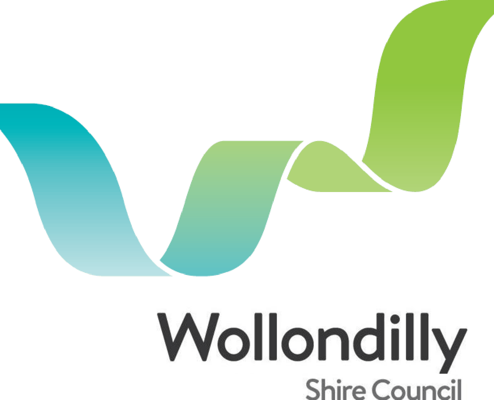

# Wollondilly Development Control Plan 2016 - Volume 4 Residential Development

> This chapter is split into 17 section file(s), one per numbered heading, in the order they appear in the PDF.

Source PDF: [DCP-Volume-4.pdf](https://planfortomorrow.sharepoint.com/sites/Planfortomorrow/Shared%20Documents/00%20NSW-Planning-Resources/dcp/wollondilly-development-control-plan-2016/volume-04-residential-development/DCP-Volume-4.pdf)

### Development Control Plan 2016

### Volume 4 – Residential Development

> [Picture on page 1: a picture, saved as a picture (images/volume-04-residential-development-page-1-3.gif, 150 dpi).]

#### Table of Contents

TABLE OF CONTENTS ................................................................................................................................... 2 PART 1 – PRELIMINARY ................................................................................................................................ 3

1.1 Introduction ..................................................................................................................................... 3

1.2 Objectives........................................................................................................................................ 3

1.3 Parts of this DCP ............................................................................................................................ 6

1.4 How to apply this volume .............................................................................................................. 6 PART 2 –GENERAL REQUIREMENTS FOR ALL DEVELOPMENT ............................................................. 7

2.1 Alterations and Additions .............................................................................................................. 7

2.2 Residential Development in the B4 Mixed Use Zone .................................................................. 7

2.3 Effect of Building Envelopes ......................................................................................................... 7

2.4 Conversion of Buildings ................................................................................................................ 8

### 2.5 Determining what constitutes an adjoining lot under this plan (for the purpose of calculating

setbacks) ......................................................................................................................................... 8

2.6 Wet bars ........................................................................................................................................... 9

2.7 Driveways ........................................................................................................................................ 9

2.8 Setbacks .......................................................................................................................................... 9

2.9 Land Use Conflict ......................................................................................................................... 10

2.10 Stormwater .................................................................................................................................... 10

2.11 Temporary Occupation ................................................................................................................ 10 PART 3 – SPECIFIC LAND USE CONTROLS ............................................................................................. 12

3.1 Single Dwelling Houses (Town Centre Residential Lots) ......................................................... 12

3.2 Single Dwelling Houses (Residential Small Lots) ..................................................................... 15

3.3 Single Dwelling Houses (Standard Residential Lots) ............................................................... 18

3.4 Single Dwelling Houses (Residential Large Lots) ..................................................................... 20

3.5 Single Dwelling Houses (Rural Lifestyle Lots) .......................................................................... 23

3.6 Single Dwelling Houses (Rural Lots) .......................................................................................... 25

### 3.7 Ancillary Buildings (Town Centre Residential Lots, Residential Small Lots and Standard

Residential Lots) ........................................................................................................................... 26

3.8 Ancillary Buildings (Residential Large Lots) ............................................................................. 26

3.9 Ancillary Buildings (Rural Lifestyle Lots and Rural Lots) ........................................................ 27

3.10 Dwellings on Residential Battle-Axe Allotments....................................................................... 28

3.11 Swimming Pools ........................................................................................................................... 30

3.12 Car Ports ........................................................................................................................................ 30

3.13 Retaining Walls ............................................................................................................................. 31

### 3.14 Secondary Dwellings in all Residential Zones (other than R5 Large Lot Residential Lot

Residential Zones) ........................................................................................................................ 32

3.15 Secondary Dwellings in R5 Large Lot Residential Zones, Environmental and rural zones . 35

3.16 Dual Occupancy Development in R2 and R3 zones.................................................................. 36

3.17 Dual Occupancy Development in Rural and Environmental Zones ........................................ 40

3.18 Multi Dwelling Housing ................................................................................................................ 42

3.19 Residential Flat Buildings ............................................................................................................ 49

3.20 Hostels and Boarding Houses .................................................................................................... 56

3.21 Shop top housing ......................................................................................................................... 61

3.22 Exhibition Homes and Villages ................................................................................................... 63 PART 4 – CONTROLS FOR SPECIFIC LOCATIONS .................................................................................. 64

4.1 Avon Dam and Hawthorne Roads, Bargo .................................................................................. 64

4.2 Bingara Gorge Estate ................................................................................................................... 64

4.3 Montpelier Drive Residential Land ............................................................................................. 65

4.4 Queen Victoria Memorial Home .................................................................................................. 65

4.5 Bulli Appin Road, Appin .............................................................................................................. 65

4.6 Abbotsford Road, Picton ............................................................................................................. 67

4.7 Station Street, Menangle .............................................................................................................. 71

4.8 R3 zoned land at Thirlmere .......................................................................................................... 73

## PART 1 – PRELIMINARY

### 1.1 Introduction

This Volume provides controls for development for the purposes of residential accommodation and other related land uses and any development ancillary to those uses. This volume is intended to provide guidance to the community, developers and Council in the design of residential developments. When Council considers a development application it must consider this development control plan and other legislation that applies.

### 1.2 Objectives

The object of this volume is to ensure that residential accommodation developments achieve the aims of Wollondilly Local Environmental Plan 2011 (WLEP) by ensuring that residential developments achieve excellent planning outcomes. The specific objectives referred to in this volume are detailed below:

<!-- sections -->
## Sections

1. [1 Visual Character and amenity](01-visual-character-and-amenity.md)
2. [2 Vehicular Access, Car Parking and Traffic](02-vehicular-access-car-parking-and-traffic.md)
3. [3 Encouraging Healthier Lifestyles](03-encouraging-healthier-lifestyles.md)
4. [4 Crime Prevention Through Environmental Design](04-crime-prevention-through-environmental.md)
5. [5 Privacy](05-privacy.md)
6. [6 Water Sensitive Urban Design](06-water-sensitive-urban-design.md)
7. [7 Services](07-services.md)
8. [8 Waste Management](08-waste-management.md)
9. [9 Ecologically Sustainable Development](09-ecologically-sustainable-development.md)
10. [10 Environmental Protection](10-environmental-protection.md)
11. [11 Social Equity](11-social-equity.md)
12. [12 Housing Delivery](12-housing-delivery.md)
13. [13 Economic Development](13-economic-development.md)
14. [14 Appropriate Integration with State Environmental Planning Policies and Wollondilly Local Environmental Plan, 2011.](14-appropriate-integration-with-state.md)
15. [15 Swimming Pools](15-swimming-pools.md)
16. [16 Maintenance](16-maintenance.md)
17. [17 Landscaping](17-landscaping.md)
