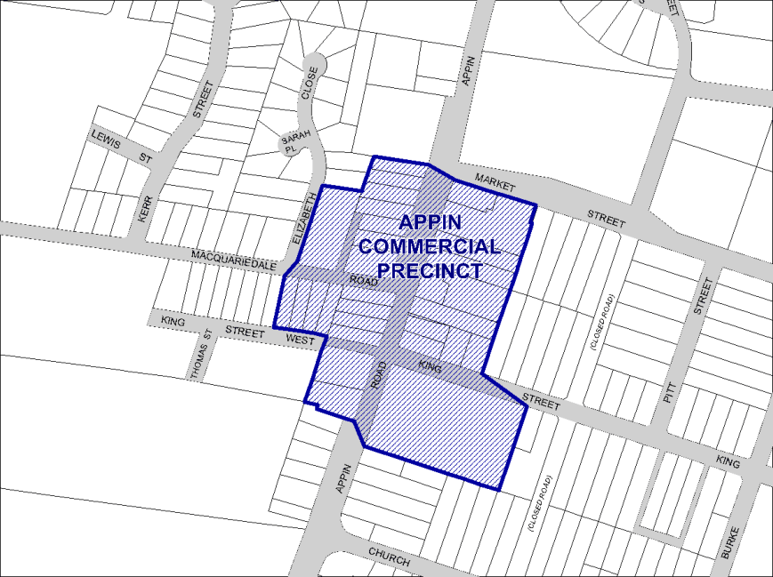
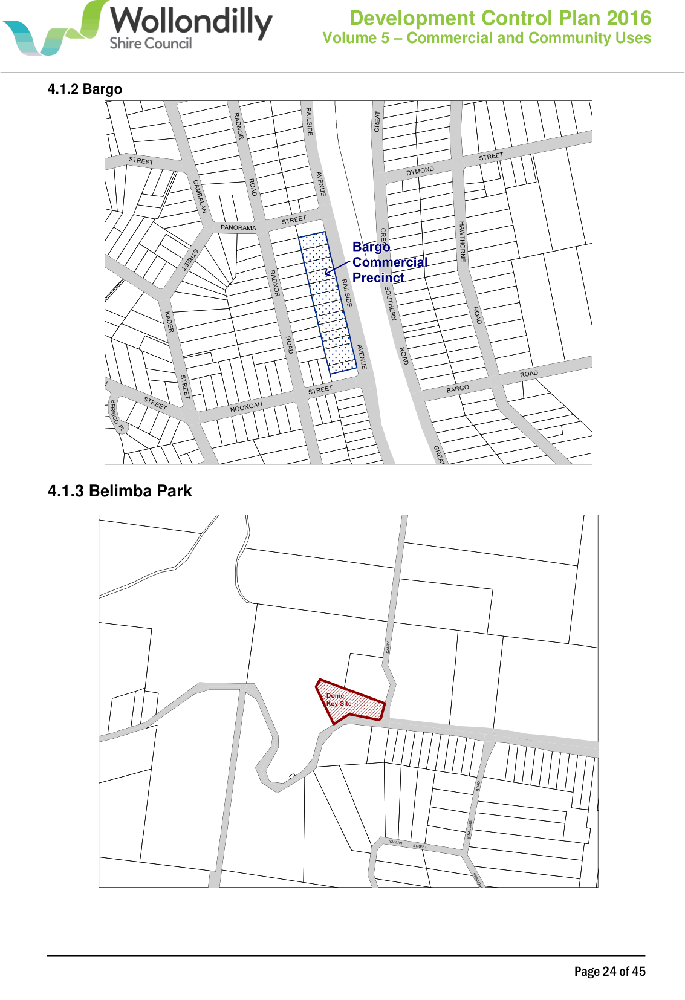
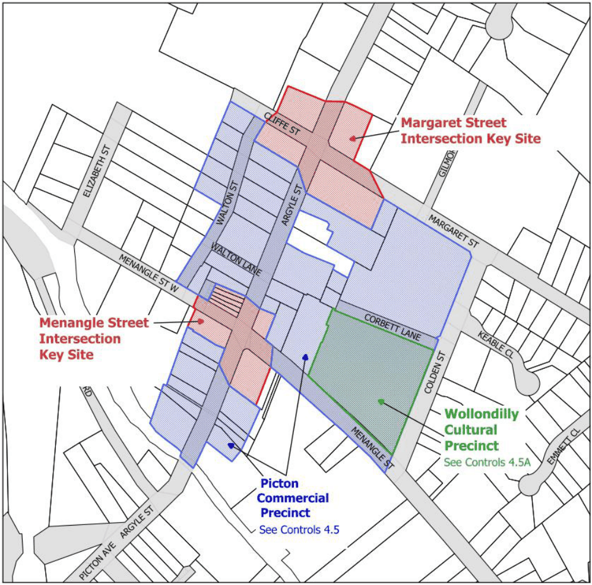
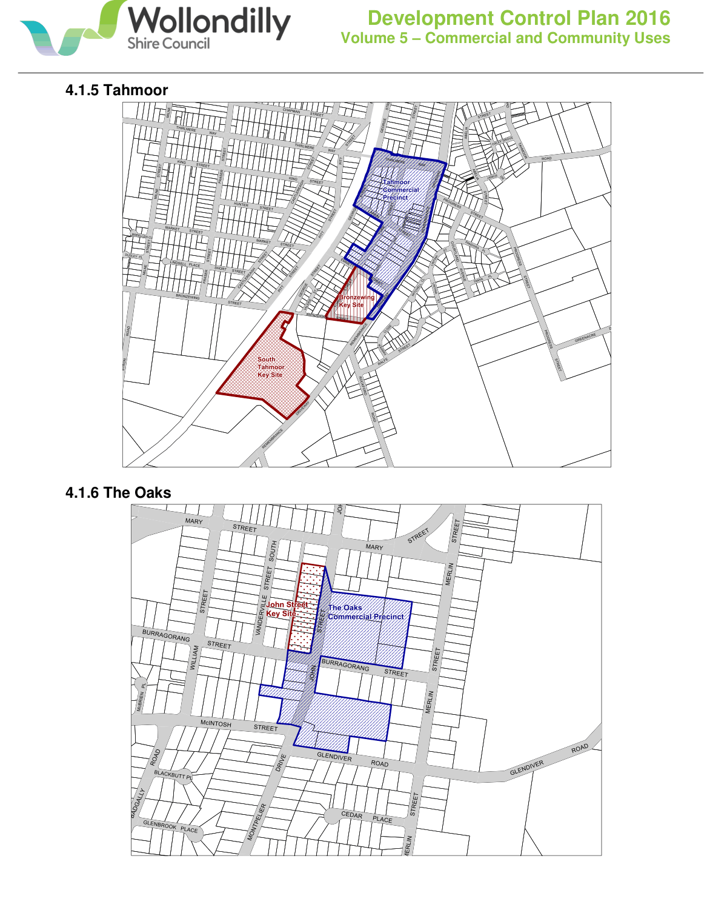
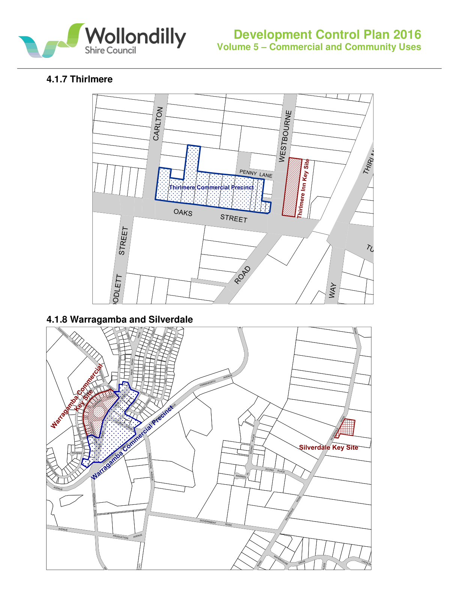
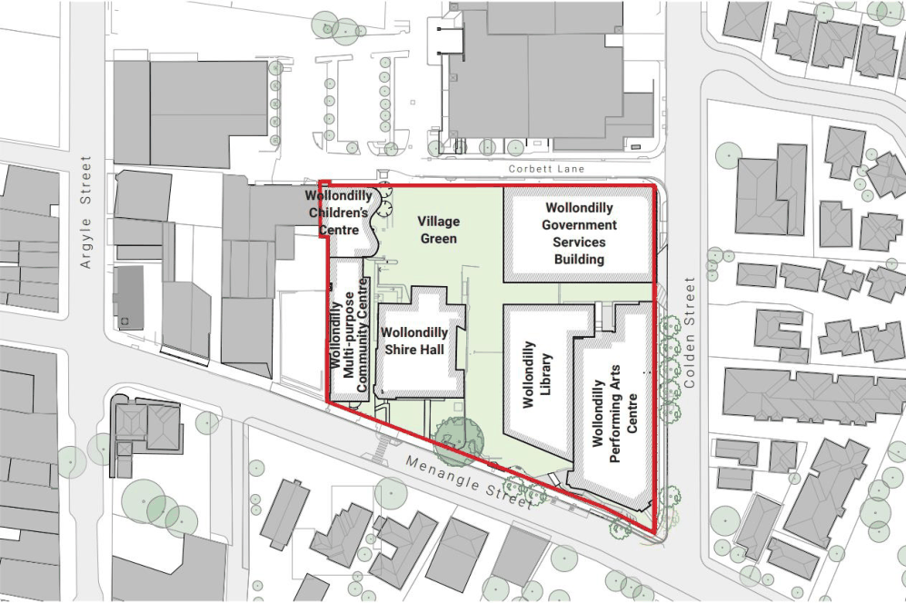

## Part 4 – Controls for Specific Locations:

### 4.1 Maps and Definitions

1\. In this section Commercial Building refers to any building for which the  construction or use is subject to this volume.

2\. A reference to a map in this part is a reference to one or more of the maps below:

#### 4.1.1 Appin

> [Picture on page 23: a picture, saved as a picture (images/volume-05-commercial-and-community-uses-page-23-7.gif, 150 dpi).]

> [Picture on page 24: a picture, saved as a picture (images/volume-05-commercial-and-community-uses-page-24-1.gif, 150 dpi).]

#### 4.1.2 Bargo

#### 4.1.3 Belimba Park

#### 4.1.4 Picton Town Centre

> [Picture on page 25: a picture, saved as a picture (images/volume-05-commercial-and-community-uses-page-25-2.gif, 150 dpi).]

> [Picture on page 26: a picture, saved as a picture (images/volume-05-commercial-and-community-uses-page-26-1.gif, 150 dpi).]

#### 4.1.5 Tahmoor

#### 4.1.6 The Oaks

> [Picture on page 27: a picture, saved as a picture (images/volume-05-commercial-and-community-uses-page-27-1.gif, 150 dpi).]

#### 4.1.7 Thirlmere

#### 4.1.8 Warragamba and Silverdale

### 4.2 Appin Objectives

1\. To ensure commercial and community development contributes to the character and amenity of Appin.

#### Controls

1\. Commercial buildings within the Appin Commercial Precinct shown in Map 4.1.1 must be designed to ensure that the roof pitch is visible within the public domain. The use of parapets and other roof screen structures is not permitted.

### 4.3 Bargo Objectives

1\. To ensure commercial and community development contributes to the character and amenity of Bargo.

#### Controls

1\. Commercial buildings within the Bargo Commercial Precinct shown in Map 4.1.2 shall be sited to ensure car parking is located between the building and Railside Avenue. The buildings shall be setback to accommodate 2 rows of car parking spaces and a continuous awning shall be provided across the front of new commercial buildings.

2\. The carparking areas required by Control 1 of this clause shall be connected to similar parking on adjoining lots where such parking is existing.

### 4.4 Belimba Park Objectives

1\. To ensure location appropriate amounts of car parking are provided.

#### Controls

1\. The Dome Key Site shown in Map 4.1.3 is isolated from a supporting population and is, therefore, more car dependent than the other commercial centres. For this reason, development within this site shall provide car parking at a rate of 150% the amount otherwise required under part 2 of this volume.

### 4.5 Picton Objectives

1\. To ensure commercial and community development contributes to the character and amenity of Picton.

2\. To promote efficient and safe all weather access for pedestrians in Picton.

#### Controls –

These controls do not apply to Section 4.5A of the DCP for the Wollondilly Cultural Precinct. See Section 4.5A for the applicable Wollondilly Cultural Precinct controls.

1\. Commercial buildings within the Picton Commercial Precinct shown in Map 4.1.4 shall be sited with a setback no greater than 1 metre from any boundary of the site with Margaret, Colden, Menangle and/or Argyle Streets.

2\. Commercial buildings referred to in Control 1 shall provide an awning from the façade of any building to Margaret, Colden, Menangle and/or Argyle Streets that shall extend from the building façade to a point 0.8 metres from the edge of the road pavement.

3\. Commercial buildings within the Margaret Street Intersection Key Site shown in Map 4.1.4 shall:

a) Be designed to principally address the intersection of Cliffe, Argyle and Margaret Streets;

b) Incorporate adequate setbacks to allow for safe sight distances at the intersection;

c) Minimise setbacks to each street frontage

d) Ensure no vehicular access is provided directly to Argyle Street

4\. Commercial buildings within the Menangle Street Intersection Key Site shown in Map 4.1.4 shall be designed with due regard to its visual impacts on both items of heritage significance located at the intersection.

5\. Council has an adopted strategy to deliver more public car parking in Picton. Proponents may, in lieu of providing some or all of the car parking in accordance with Part 2 of this volume, make contribution towards the provision of such parking through dedication of particular lands and through financial contributions as part of a Voluntary Planning Agreement.

#### 4.5A Wollondilly Cultural Precinct

Development within the Wollondilly Community, Cultural and Civic Precinct (WCP), outlined in Map 4.1.4, is to have regard to the controls outlined within this section of the DCP.

In the event of any inconsistency between this section and the rest of the WDCP, the requirements of this section prevail.

References within this section to the various buildings and spaces within the WCP are to be taken to be referring to the buildings, uses and locations as identified in the figure below.

> [Picture on page 30: a picture, saved as a picture (images/volume-05-commercial-and-community-uses-page-30-8.gif, 150 dpi).]

Figure 1: WCP layout and building footprints
