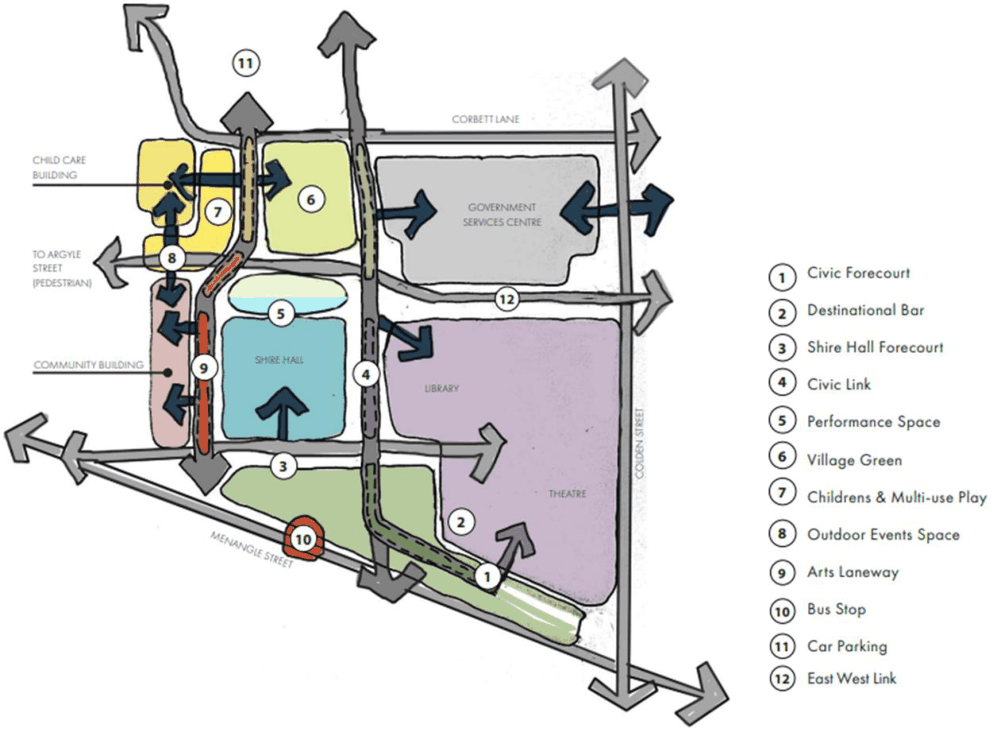

#### 2. Public Domain Objectives

1\. To ensure the WCP is connected, both internally and to the broader town centre and easily navigated.

2\. To ensure the public domain reflects the public nature of the uses within the WCP.

3\. To promote high quality public domain.

4\. To maintain a consistent character within the public realm of Picton.

#### Controls

1\. Development is to demonstrate consistency with the Wollondilly Community, Cultural & Civic Precinct Public Realm Plan, prepared by Tract and dated 28/10/2020 (available at the following link: https://www.wollondilly.nsw.gov.au/shire-projects/projects/wollondilly-cultural-precinct/plans/).

2\. Through site links and connectivity through the WCP is to be provided in accordance with the below figure, including:

• an east-west through site link from Colden Street to Argyle Street (item number 12)

• a north-south link from Menangle Street to Corbett Lane adjacent to the Library and Government Services Building (item number 4)

• a north-south link from Menangle Street to Corbett Lane adjacent to the Multi-purpose Community Building and the Children’s Centre (item number 9)

Any future development must not impede the delivery of the through site links in the below figure.

> [Picture on page 32: a picture, saved as a picture (images/volume-05-commercial-and-community-uses-page-32-1.gif, 150 dpi).]

Figure 2: WCP Public Realm Elements

3\. An east-west pathway is to be provided in front of the Shire Hall to provide a direct path of travel to the Library for pedestrians travelling to and from the west of the WCP.

4\. A new laneway which connects Menangle Street to the Village Green is to be provided to the west of the Multi-purpose Community Building.

5\. The area of the north-south link from Menangle Street to Corbett Lane adjacent to the Multi-purpose Community Building is to be an Arts Laneway. Opportunities for public art within this area are to be maximised through the design of buildings and the public domain.

6\. Development adjoining the Village Green is to be designed to activate and address the open space.

7\. Facades adjoining public roads and through-site links are to be activated to contribute to street life.

8\. Future development is to minimise cut and fill adjoining the Village Green and publicly accessible spaces through the use of ramps, natural levelling and garden beds.

9\. Buildings on sites the Village Green must not cast a shadow onto more than 50% of that open space between the hours of 9am and 3pm during the winter solstice (measured at ground level).

10\. Future development must provide climate protection measures, such as additional tree canopies and awnings to key links through the public domain.

11\. Wayfinding signage is to be provided throughout the WCP including at entry points to the precinct, junctions of through-site links and at each building entry.

12\. Building elements are not to extend into and obstruct view lines such as those created from street level through the Civic Forecourt, Arts Laneway and other through-site links as shown in Figure 2.
