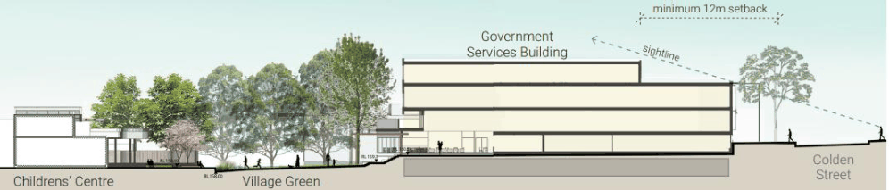

#### 3. Built Form

General Controls

#### Objectives

1\. To establish a human scale and a desired relationship between the street and footpath, public spaces, private spaces and buildings.

2\. To preserve and acknowledge the broader rural village character of Picton.

3\. To enhance and protect areas of public space within and surrounding the precinct.

4\. To achieve buildings that are well designed and functional.

5\. To ensure development within the WCP transitions and presents appropriately to surrounding low density development, particularly along interfaces with Colden Street and Menangle Street.

6\. To ensure built form responds to existing heritage features both within the WCP and the wider Picton Town Centre.

#### Controls

1\. Development is to satisfy the building design controls under Part 2.3 of Volume 5 of the DCP.

2\. Development is to demonstrate consistency with the streetscape through materials and building massing. New buildings are to be designed to complement the character of development facing the street frontage.

3\. Privacy of the neighbouring residential buildings must be maintained by mitigating direct views into private spaces.

4\. Buildings within the WCP must be located generally in accordance with the arrangement of buildings as shown in Figure 1.

5\. Separation distances between all buildings in the WCP should have a minimum width of 6m to provide for pedestrian movement.

Wollondilly Government Services Building

#### Controls

1\. The Government Services Building is to be no greater than 4 storeys.

2\. The gross floor area of the Government Services Building must not exceed 5,925m2.

3\. A nil setback control applies to the boundary to Colden Street and Corbett Lane.

4\. The Government Services Building is to present as a maximum of 2.5 storeys with a maximum height of 9m at street frontage to Colden Street (as depicted in Figure 3).

5\. Any protrusions of parking or service areas above ground level must be limited or mitigated through design solutions, landscaping and a selection of suitable building elements to avoid creating blank facades along the street frontage.

6\. The Government Services Building is to incorporate a minimum upper-level setback of 12m from Colden Street above 9m.

7\. The terrace created as a result of the upper-level setback to Colden Street may be accessible to occupants of the building and is to include planter boxes with suitable landscaping.

8\. If vehicular access is proposed from Colden Street, the driveway must be integrated in the design of the building and not compromise the interface with Colden Street.

> [Picture on page 34: a picture, saved as a picture (images/volume-05-commercial-and-community-uses-page-34-18.gif, 150 dpi).]

Figure 3: Government Services Building

Wollondilly Performing Arts Centre

#### Controls

1\. The Wollondilly Performing Arts Centre is to provide a high quality, well-designed gateway element which emphasises the importance of the corner of Menangle and Colden Street.

2\. Where large areas of solid walls are required to accommodate seating areas, stage and back of stage services, the adverse visual impacts of these solid walls must be ameliorated by considering the following solutions on the subject building facades:

• mix of colours, patterns and materials,

• addition of human scale and visually dynamic details,

• volumetric modulations,

• minimising use of mono colour or reflective materials,

• use of green walls or other creative landscaping solutions,

• weather protection measures and pedestrian friendly furniture,

• low impact, artistic lighting.

3\. The Performing Arts Centre is to be no greater than 2 storeys.

4\. The gross floor area of the Performing Arts Centre must not exceed 3,000m2.

5\. A 2m setback must be provided to Menangle Street.

6\. A nil setback control applies to Colden Street.

Wollondilly Library

#### Controls

1\. The Library is to be no greater than 2 storeys.

2\. The gross floor area of the Library must not exceed 4,000m2.

3\. A 4m building setback must be provided to Menangle Street together with a 2m awning. Any variation to this control must consider the heritage controls at Section 4.5A(5).

4\. The design of the Library shall positively relate to and complement the built form of the Performing Arts Centre whilst also clearly delineating the two separate uses.

Wollondilly Shire Hall

#### Controls

1\. Any alterations and additions to the Wollondilly Shire Hall must be sympathetic to the heritage character of the existing development and be of a compatible bulk and scale.

2\. The building height of the Wollondilly Shire Hall, including any additions, must not be greater than 1 storey.

3\. Any addition to the Wollondilly Shire Hall must not exceed 1,500m2 gross floor area.

4\. Development of this site fronting Menangle Street must be setback in accordance with the existing building line.

5\. Visibility of any addition to the rear of the Wollondilly Shire Hall must be limited from Menangle Street.

Wollondilly Multi-Purpose Community Centre

#### Controls

1\. The Wollondilly Multi-Purpose Community Centre is to be no greater than 2 storeys.

2\. The gross floor area of the Wollondilly Multi-Purpose Community Centre must not exceed 1,500m2.

3\. The treatment of the eastern façade must complement the co-location of the Arts Laneway along this elevation by providing a balanced proportion of glazing and solid building elements.

4\. Use of awnings on the eastern façade is encouraged to allow for the use of Arts Laneway in different weather conditions.

5\. The building line must be consistent with the orientation of the adjoining Wollondilly Shire Hall.

Wollondilly Children’s Centre

#### Controls

1\. The building height of the Wollondilly Children’s Centre must not be greater than 2 storeys.

2\. The gross floor area of the Wollondilly Children’s Centre must not exceed 1,000m2.

3\. A nil setback control applies to the northern and western site boundaries.

4\. Development is to be designed to maximise solar access to the Village Green.

5\. Fencing around the Wollondilly Children’s Centre that adjoins the Village Green must be able to be removed to maximise the flexibility of the Village Green outside the hours of operation of the Children’s Centre.

Village Green

#### Controls

1\. The design of the Village Green must promote useability for a variety of events such as markets and small-scale concerts.
