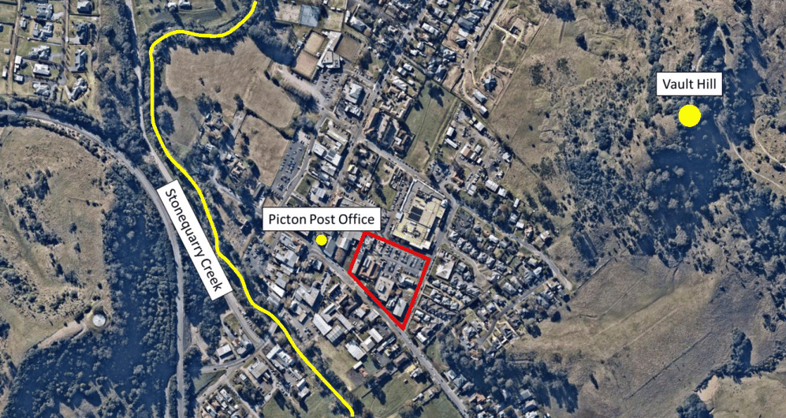

#### 5. Heritage Objectives

1\. The objectives of heritage conservation are:

• To establish good design principles to guide development to and around heritage items,

• To ensure development is sympathetic to the overall heritage values and characteristics of the area,

• To identify local heritage character and heritage elements of the built environment, and

• To ensure the retention and management of heritage values identified for each conservation area and specific precinct.

2\. To preserve view lines from the town centre to the significant built and natural landforms, including Vault Hill, wooded hillsides, Stonequarry Creek and Picton Post Office Clock Tower.

3\. To ensure all developments preserve the significance of heritage items and heritage conservation areas, including significant natural landscaping features and contextual settings and character.

4\. To ensure all developments positively contribute to and preserve well-established parts of the streetscape within heritage conservation areas.

#### Controls

1\. Development is to comply with heritage controls under Part 5 and 6.4 of Volume 1 of the DCP.

2\. All development must maintain significant view lines, including (but not limited to) Vault Hill, wooded hillsides, Stonequarry Creek, and Picton Post Office Clock Tower as identified on the figure below.

> [Picture on page 38: a picture, saved as a picture (images/volume-05-commercial-and-community-uses-page-38-1.gif, 150 dpi).]

Figure 4: Significant view features (Base source: Nearmap)

3\. Where significant public domain features (for example, the public domain in front of the Shire Hall) with heritage value exist in the vicinity of a development site, any new development must demonstrate how any potential adverse impacts as a result of the development on these features are reduced through design.

4\. Consideration must be given to how development alters the setting of the Shire Hall and where necessary, mitigation measures such as landscaping or additional setbacks must be implemented to limit heritage impacts.
