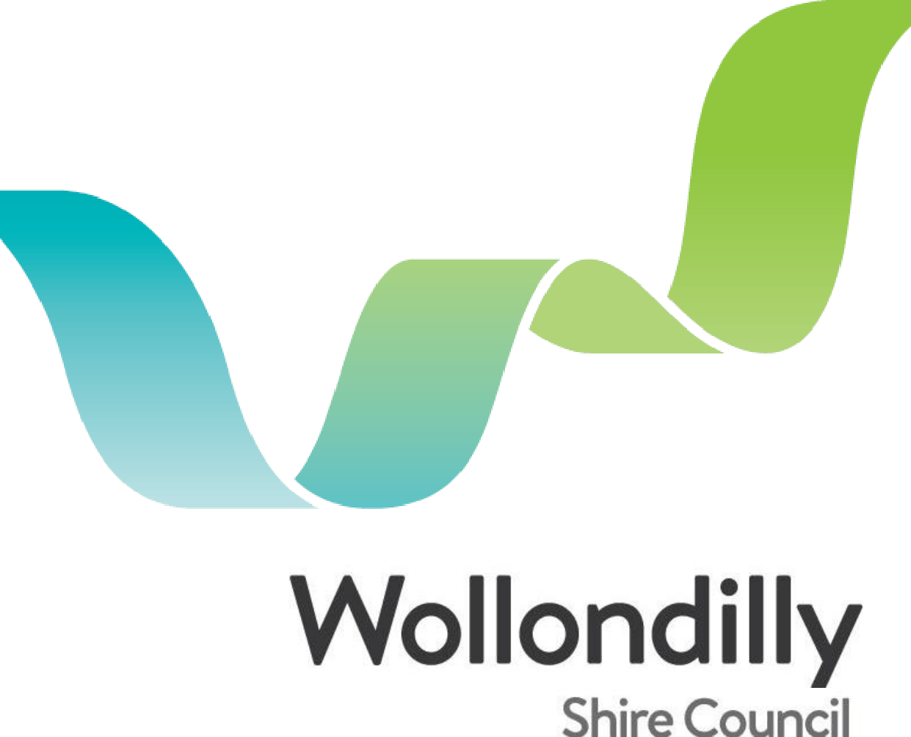

# Wollondilly Development Control Plan 2016 - Volume 5 Commercial and Community Uses

> This chapter is split into 13 section file(s), one per numbered heading, in the order they appear in the PDF.

Source PDF: [Volume-5-Commercial-and-Community-Uses.pdf](https://planfortomorrow.sharepoint.com/sites/Planfortomorrow/Shared%20Documents/00%20NSW-Planning-Resources/dcp/wollondilly-development-control-plan-2016/volume-05-commercial-and-community-uses/Volume-5-Commercial-and-Community-Uses.pdf)

### Development Control Plan 2016

### Volume 5 – Commercial and Community Uses

> [Picture on page 1: a picture, saved as a picture (images/volume-05-commercial-and-community-uses-page-1-3.gif, 150 dpi).]

#### Table of Contents

TABLE OF CONTENTS ................................................................................................................................... 2 PART 1 – PRELIMINARY ................................................................................................................................ 3

1.1 Introduction ....................................................................................................................................... 3

1.2 Objective ........................................................................................................................................... 3

1.3 Parts of this volume .......................................................................................................................... 3 PART 2 – GENERAL REQUIREMENTS FOR ALL COMMERCIAL AND COMMUNITY USES ................... 5

2.1 Sustainability..................................................................................................................................... 5

2.2 Setbacks ........................................................................................................................................... 5

2.3 Building Design ................................................................................................................................. 6

2.4 Open space ...................................................................................................................................... 8

2.5 Outdoor eating and seating .............................................................................................................. 8

2.6 Landscaping ..................................................................................................................................... 9

2.7 External storage ............................................................................................................................... 9

2.8 Public realm ...................................................................................................................................... 9

2.9 Access and Traffic Generation ....................................................................................................... 10

2.10 Parking and Manoeuvring ............................................................................................................... 11

2.11 Waste Management ....................................................................................................................... 15

2.12 On-site waste water and stormwater management ........................................................................ 16 PART 3 – SPECIFIC LAND USE CONTROLS ............................................................................................. 17

3.1 Amusement centres ........................................................................................................................ 17

3.2 Bulky goods premises .................................................................................................................... 17

3.3 Child care centres ........................................................................................................................... 17

3.4 Community facilities, Entertainment Facilities, Function centres, Places of Public Worship and Registered Clubs ............................................................................................................................ 17

3.5 Home-based child care ................................................................................................................... 18

3.6 Landscape and garden supplies, Timber and building supplies, Wholesale Supplies................... 18

3.7 Restricted premises ........................................................................................................................ 18

3.8 Service stations .............................................................................................................................. 19

3.9 Sex service premises, Home occupations (sex services) .............................................................. 19

3.10 Educational establishments ............................................................................................................ 20

3.11 Health services facilities ................................................................................................................. 20

3.12 Funeral chapels and Funeral homes .............................................................................................. 20

3.13 Helipads .......................................................................................................................................... 21

3.14 Timber Yards .................................................................................................................................. 21 PART 4 – CONTROLS FOR SPECIFIC LOCATIONS: ................................................................................. 23

4.1 Maps and Definitions ...................................................................................................................... 23

4.2 Appin ............................................................................................................................................... 28

4.3 Bargo .............................................................................................................................................. 28

4.4 Belimba Park .................................................................................................................................. 28

4.5 Picton .............................................................................................................................................. 29 4.5A Wollondilly Cultural Precinct ........................................................................................................... 30

4.6 Tahmoor ......................................................................................................................................... 42

4.7 The Oaks ........................................................................................................................................ 43

4.8 Thirlmere ......................................................................................................................................... 43

4.9 Warragamba and Silverdale ........................................................................................................... 44

4.10 Queen Victoria Memorial Home ..................................................................................................... 44

## PART 1 – PRELIMINARY

### 1.1 Introduction

This Volume provides controls for development for the purposes of commercial, community and other related land uses and any development ancillary to those uses and forms part of the Wollondilly Development Control Plan 2016.

### 1.2 Objective

The object of this volume is to ensure commercial and community development achieves the aims of Wollondilly Local Environmental Plan, 2011 by promoting economic activity and local job creation while ensuring developments achieve excellent planning outcomes.

### 1.3 Parts of this volume

The requirements contained within Part 2 apply to all development types to which this volume applies.

Part 3 applies to the following specific land uses:

| Land Use | Clause |
|---|---|
| Amusement centres | 3.1 |
| Bulky goods premises | 3.2 |
| Child care centres | 3.3 |
| Community facilities | 3.4 |
| Educational establishments | 3.10 |
| Entertainment Facilities | 3.4 |
| Function centres | 3.4 |
| Funeral chapels | 3.12 |
| Funeral homes | 3.12 |
| Health services facilities | 3.11 |
| Helipads | 3.13 |
| Home occupation (Sex Services) | 3.9 |
| Home-based child care | 3.5 |
| Landscape and garden supplies | 3.6 |
| Place of public worship | 3.4 |
| Registered clubs | 3.4 |
| Restricted premises | 3.7 |
| Service stations | 3.8 |
| Sex service premises | 3.9 |
| Timber and building supplies | 3.6 |
| Timber Yard | 3.14 |

Part 4 applies to the following specific locations:

• Appin

• Bargo

• Belimba Park

• Picton

• Wollondilly Cultural Precinct, Picton

• Silverdale

• Tahmoor

• The Oaks

• Thirlmere

• Warragamba

<!-- sections -->
## Sections

1. [2 – General Requirements for all Commercial and Community uses](01-2-general-requirements-for-all-commercial.md)
2. [3 – Specific Land Use Controls](02-3-specific-land-use-controls.md)
3. [4 – Controls for Specific Locations:](03-4-controls-for-specific-locations.md)
4. [1 Character Statement](04-1-character-statement.md)
5. [2 Public Domain Objectives](05-2-public-domain-objectives.md)
6. [3 Built Form](06-3-built-form.md)
7. [4 Landscaping Objectives](07-4-landscaping-objectives.md)
8. [5 Heritage Objectives](08-5-heritage-objectives.md)
9. [6 Traffic and Parking Objectives](09-6-traffic-and-parking-objectives.md)
10. [7 Accessibility Objectives](10-7-accessibility-objectives.md)
11. [8 Sustainability Objectives](11-8-sustainability-objectives.md)
12. [9 Safety and Crime Prevention Through Environmental Design Objectives](12-9-safety-and-crime-prevention-through.md)
13. [10 Flooding Objectives](13-10-flooding-objectives.md)
