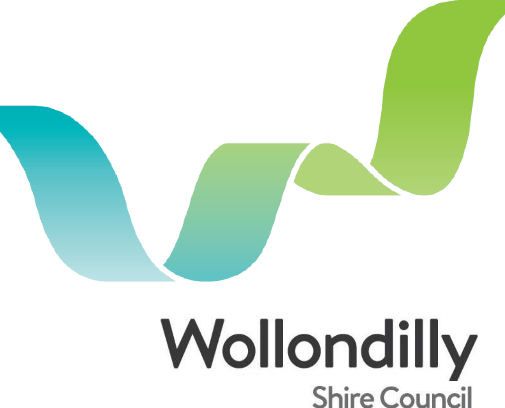

# Wollondilly Development Control Plan 2016 - Volume 6 Tourism and Events

> This chapter is split into 2 section file(s), one per numbered heading, in the order they appear in the PDF.

Source PDF: [Volume-6-Tourist-Uses-as-of-10-January-2018.pdf](https://planfortomorrow.sharepoint.com/sites/Planfortomorrow/Shared%20Documents/00%20NSW-Planning-Resources/dcp/wollondilly-development-control-plan-2016/volume-06-tourism-and-events/Volume-6-Tourist-Uses-as-of-10-January-2018.pdf)

### Development Control Plan 2016

### Volume 6 –Tourism and Events

> [Picture on page 1: a picture, saved as a picture (images/volume-06-tourism-and-events-page-1-3.gif, 150 dpi).]

#### Table of Contents

TABLE OF CONTENTS ................................................................................................................................... 2 PART 1 – PRELIMINARY ................................................................................................................................ 3

1.1 Introduction ....................................................................................................................................... 3

1.2 Objectives ......................................................................................................................................... 3

1.3 Parts of this Volume ......................................................................................................................... 3 PART 2 - GENERAL REQUIREMENTS FOR ALL DEVELOPMENT ............................................................ 4

2.1 Environmental Protection ................................................................................................................. 4

2.2 General Requirements ..................................................................................................................... 4 PART 3 – CONTROLS FOR SPECIFIC LAND USES .................................................................................... 5

3.1 Hotel and Motel Accommodation...................................................................................................... 5

3.2 Bed and Breakfast Accommodation and Farm Stay Accommodation ............................................. 5

3.3 Serviced Apartments ........................................................................................................................ 6

3.4 Temporary Markets ........................................................................................................................ 10

3.5 Events ............................................................................................................................................. 10

## PART 1 – PRELIMINARY

### 1.1 Introduction

This Volume provides controls for the development and use of land for tourism related uses including visitor accommodation, events and markets.

### 1.2 Objectives

The object of this volume is to ensure that tourism related developments are undertaken in a way that achieves positive planning outcomes.

### 1.3 Parts of this Volume

The requirements contained within Part 2 apply to all development types to which this volume applies.

Part 3 applies to specific types of tourist uses.

## PART 2 - GENERAL REQUIREMENTS FOR ALL DEVELOPMENT

### 2.1 Environmental Protection Objectives

1\. To ensure significant environmental assets are not adversely impacted by development subject to this volume.

#### Controls

1\. Development subject to this volume must not result in the removal of significant stands of native vegetation.

2\. Development subject to this volume shall not result in negative impacts that are not minor on watercourses or other environmental assets.

### 2.2 General Requirements Objectives

1\. To ensure that tourist and accommodation uses achieve a standard of development that is complementary to the existing residential environment and ensures that development is carried out in an appropriate manner.

#### Controls

1\. The development of land for the purposes of Tourist and Visitor Accommodation (being Hotel or Motel Accommodation, Bed and Breakfast Accommodation, Farm Stay Accommodation or Serviced Apartments) must comply with the requirements of Part 2 of Volume 4 of this plan.

## PART 3 – CONTROLS FOR SPECIFIC LAND USES

### 3.1 Hotel and Motel Accommodation

#### Objectives

1\. To ensure the development is consistent with the character of the surrounding neighbourhood,

2\. To encourage and promote a high quality standard of accommodation.

#### Controls

1\. Accommodation must not be provided to the same person or persons for more than a 3 month period. Where accommodation is provided for more than 28 consecutive days there must be no more than two persons per room.

2\. The maximum number of persons accommodated in a bedroom shall be determined on the basis of 3.25m² per person per sleeping room.

3\. Soundproof transmission reduction in the wall and ceiling construction by reason of the layout or location of the building may be required.

4\. A maximum of 1 advertising sign no greater than 2.0m² in size is permitted on the site.  No illuminated or neon signs are permitted.

5\. Where reception facilities are provided, 1 parking space per 5m² of public floor area must be provided (may include on-street car parking where located within an existing commercial centre).

6\. If the development involves non-accommodation uses (restaurants, function rooms etc) those other uses must comply with the relevant volumes of this Development Control Plan.

7\. In addition to any car parking required for other uses on the site, the development shall provide two (2) parking spaces and one (1) parking space per visitor bedroom.

### 3.2 Bed and Breakfast Accommodation and Farm Stay Accommodation Objectives

1\. To ensure the development is consistent with the character of the surrounding neighbourhood,

2\. To encourage and promote a high quality standard of accommodation.

3\. To assist in the implementation of appropriate farm stay accommodation.

#### Controls

1\. Development subject to this clause must comply with the building design and setback controls for a dwelling in Volume 4 of this plan.

2\. Visitor bedrooms shall accommodate no more than 2 guests.

3\. An area of open space shall be provided for patrons of the development with a total area no less than 20m2.

4\. The development shall meet the following requirements:

a) Car parking shall be provided at the rate of one (1) parking space per visitor bedroom.

b) All driveways and car parking are to be sealed and line marked.

c) Bed and Breakfast accommodation shall not be provided on a residential battle-axe allotment.

5\. Fixtures within the development shall be provided in accordance with the following specifications:

a) Shower heads are to have a flow rate no greater than 9 litres per minute

b) Taps for hand washing are to have a flow rate no greater than 7.5 litres per minute

c) Toilets are to be 3, 4 or 5 Star and to be plumbed to source water from either a recycled water scheme or from a roof water tank. Mains potable water is not to be used in toilet flushing for this type of development.

6\. The use of incandescent and halogen light globes is not permitted in developments subject to this clause. All light sources are to be fluorescence globes/tubes or LEDs.

7\. The development must not result in unreasonable overlooking into the private open space or windows of habitable rooms in the vicinity.

8\. A window that has a sill height of 1.7m or more above the floor level within the room shall be taken to have no potential for overlooking.

9\. The development shall be provided with onsite waste management facilities to allow for:

a) the storage of the waste out of sight of any publically accessible place, dwelling window, area of private open space and area of common open space; and

b) The collection of domestic waste from the development by waste collection vehicles.

10\. Developments that provide visitor accommodation must be open to bookings from the general public and must provide accommodation for periods of no greater than

<!-- sections -->
## Sections

1. [72 consecutive days.](01-72-consecutive-days.md)
2. [72 consecutive days.](02-72-consecutive-days.md)
