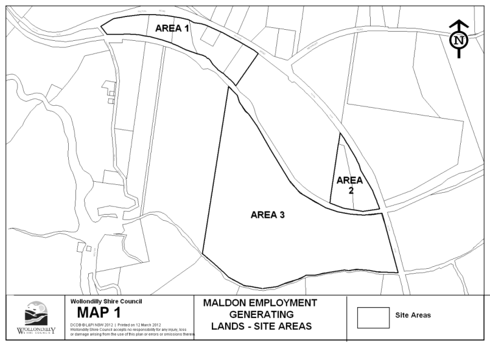
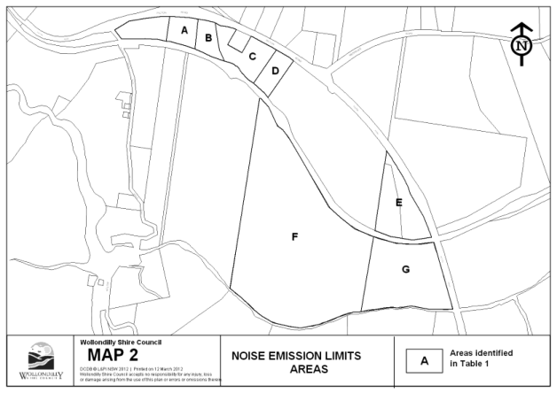
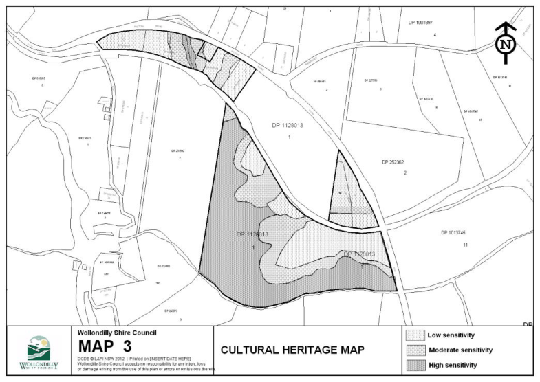

## Part 5 – Maldon Employment Generating Lands - Special Provisions

### 5.1 Introduction

These provisions are additional to the controls outlined in Volume 7.  Reference should also be made to applicable controls in Volume 1 – General which applies to all development in Wollondilly Shire.

### 5.2 Objectives for Development

The following objectives and controls are based on the specialist studies which were undertaken for the rezoning of the above land to IN1 General Industrial and E2 Environmental Conservation.

#### Overall Objectives

a) To ensure development is serviced adequately by water and sewer.

b) To achieve the provision of a sustainable water supply.

c) To ensure the efficiency of Picton Road is maintained.

d) To encourage alternate modes of transport to the site.

e) To ensure hazards such as bushfire, flooding and mine subsidence are managed effectively.

f) To ensure noise and dust emissions are controlled effectively.

g) To ensure cultural heritage is conserved.

h) To ensure biodiversity is managed effectively.

i) To ensure native vegetation is maintained and improved.

j) To retain the overall rural landscape character.

k) To provide an attractive landscaped entrance to Picton township.

### 5.3      Location

Maldon Employment Generating Lands are located at Picton Road, Maldon and include the following properties:

#### Address

#### Cadastre (Lot and Deposited Plan)

200 Picton Road

Lot 2 DP 818975

240 Picton Road

Lot 1 DP 732582

250 Picton Road

Lot 2 DP 732582

270 Picton Road

Lot 1 DP 105348

290 Picton Road

Lot 3 DP 732582

300 Picton Road

Lot 31 DP 731012

Part of 330 Picton Road

Part of Lot 1 DP 1128013

390 Picton Road

Lot 30 DP 826690

400 Picton Road

Lot 31 DP 826690

The employment lands comprise three areas which are outlined on Map 1 below:

#### Map 1 – Site Map

> [Picture on page 23: a picture, saved as a picture (images/volume-07-industry-and-infrastructure-page-23-3.gif, 150 dpi).]

### 5.4 Special Provisions for Development

#### 5.4.1 Subdivision Objectives

a) To ensure subdivision is undertaken sustainably

b) To ensure vehicular access minimises impact on Picton Road.

c) To ensure there is adequate road infrastructure to maintain efficient traffic flow on Picton Road.

#### Controls

1\. Subdivision is only permitted in association with a nominated land use and a demonstrated satisfactory water supply and wastewater management assessment.

2\. A plan detailing vehicular access that incorporates internal road links to service all proposed and future lots shall be submitted with any future development application for subdivision of the land.

3\. No access into Area 1 (indicated on the map) shall be permitted from Maldon Bridge Road.

4\. Vehicular access across the Aboriginal Heritage Conservation Zone at 330 Picton Road, Maldon being Lot 1 DP 1128013 shall only be provided if approval to modify consent DA- 318-12-2004 from the Minister for Planning and concurrence from the Office of Environment and Heritage and the Tharawal Local Aboriginal Land Council and the Cubbitch Barta Native Title Claimants Aboriginal Corporation is submitted with the development application for subdivision.

5\. Access into the site shall be provided by a roundabout which is able to cater for traffic movement from B Double trucks and shall be funded by developers of the site.

6\. Vehicular access into any future subdivision of land in Area 1 shall include provision of a bridge over Carriage Creek and shall be funded by agreement with all landowners/developers in Area 1.

7\. Vehicular access including a bridge over the Main Southern Railway into Area 3 shall be funded by the landowner/developer of Area 3.

8\. Road widening of Picton Road required to provide access and or improve traffic movement into and from the site shall be funded by the developer.

9\. The subdivision plan shall detail an on-site PMF refuge to provide an evacuation point during sudden severe storm and flooding events.

#### 5.4.2 Water Supply Objectives

a) To ensure potable and non-potable water supplies are adequate to satisfy all needs of the proposed development including fire fighting.

b) To minimise the reliance on Sydney Water’s water supply infrastructure to achieve water supply objectives.

c) To promote environmentally sustainable water supply solutions to potable and non-potable water supply through the collection, treatment and reuse of site stormwater and wastewater resources.

d) To ensure protection of surface and groundwater resources.

e) To minimise risk to health and safety associated with the supply of potable and non-potable water resources.

#### Controls

1\. Development shall only be permissible in association with a satisfactory water supply assessment.

2\. A water supply assessment shall be required to:

- investigate and report on water supply requirements (potable, non-potable and fire protection) for the proposed development;

- investigate and report on available potable and non-potable resources (Sydney Water Feasibility application to be conducted as part of this assessment);

- nominate a water supply strategy and provide sufficient security modelling utilising local climate records;

- assess environmental impact / nominate recommendations for minimising impact on surface and groundwater resources with respect to water supply (i.e. water balance modelling).

- assess fire protection requirements including fire hydrant and onsite fire storage and booster system design for the proposed development.

3\. The water supply assessment shall be undertaken to satisfy relevant Council and industry guidelines and Australian Standards regarding potable and non-potable water supply and fire protection.

4\. Stormwater harvesting management solutions shall be sustainable and shall not lessen levels of surface water and groundwater required for sustaining adjoining bushland and riparian areas.

5\. Non-potable supply sources such as roof water collection, necessary on-site stormwater detention infrastructure and treated on-site wastewater shall be used to satisfy requirements for non-potable uses such us toilet flushing, irrigation, cleaning and industrial processes where applicable.

#### 5.4.3 Wastewater Management Objectives

a) To ensure on-site wastewater management solutions are adequate to satisfy all needs of the proposed development.

b) To conserve and reuse resources (water, nutrients and organic matter)

c) To minimise the risk to public health and safety associated with on-site sewage management.

d) To ensure the protection of surface and groundwater resources

e) To ensure the protection of land and native flora and fauna through implementation of sustainable on-site sewage management solutions.

f) To protect community amenity

g) To promote ecologically sustainable development.

#### Controls

1\. Development shall only be permissible with a demonstrated satisfactory wastewater management strategy.

2\. An on-site wastewater and geotechnical assessment shall be submitted to -

- Investigate and report on sewage generation rates from the proposed development.

- Investigate and report on environmental and geotechnical constraints to on-site sewage disposal.

- Nominate minimum standards of acceptable on-site sewage treatment.

-Determine minimum effluent disposal/irrigation requirements based on moisture and nutrient modelling and incorporating buffer/setback requirements to relevant site features.

- Provide specifications for the nominated treatment and disposal system including a site location plan.

3\. The on-site wastewater and geotechnical assessment shall be undertaken in accordance with relevant Australian Standards, State government policy and Council’s “On-site Sewage Management Systems and Greywater Re-use Policy.”

4\. Wastewater management systems shall be ecologically sustainable and shall not impact on adjoining bushland and riparian areas or surface water and groundwater resources.

5\. On-site sewage management systems shall be designed and managed to ensure they do not interfere with the quality of life or reduce the amenity of surrounding rural residents.

#### 5.4.4 Stormwater Management Objectives

a) To provide standards for achieving the sustainable use of stormwater.

b) To ensure water quality is maintained and improved.

c) To ensure there is sufficient water available for environmental purposes.

#### Controls

1\. A Stormwater/Water Quality Management Plan (SMP) with detailed design of all stormwater management measures shall be undertaken for each development and be in accordance with Council’s Engineering Design Specifications.

2\. A maximum of 50% impervious site coverage including buildings and hardstand areas shall be permissible.

3\. On- Site Detention (OSD) tanks shall be provided with a minimum Specific Site Storage Requirement (SSR) of 125 KL/ha (with a 50% impervious site cover) to achieve a specified Permissible Site Discharge of 230 L/s/ha.

4\. Each development shall have a rainwater tank with all roof runoff being directed to this tank and collected rainwater shall be re-used on-site for non-potable purposes such as toilet flushing and irrigation.

5\. Each development shall have a raingarden filter unit with a minimum size of 59.5 m2/ha and raingarden filters shall consist of a 0.5 m deep sand filter with underdrain.

6\. Each development shall have an appropriately sized Gross Pollutant Trap (GPT) for removal of gross pollutants prior to discharge of hardstand runoff to raingardens and OSD tanks.

7\. Stormwater runoff from the proposed road reserve shall be directed to appropriately sized GPT(s) prior to discharge from the site.

8\. Stormwater runoff from the proposed road reserve shall be directed from GPT(s) to an outlet swale prior to discharge from the site. Outlet swales are to have a minimum area of 150 m2/ha road reserve.

9\. A report detailing proposed ongoing maintenance of on-site detention facilities shall be submitted with any application for development.

10\. Details of individual lot on-site stormwater detention and drainage design and ongoing maintenance for such shall be detailed in Section 88B instruments submitted with subdivision plans and then registered on the title of each lot.

#### 5.4.5 Transport Management Objectives

a)  To provide infrastructure to service alternative modes of transport.

Controls.

1\. A shared pathway shall be provided for each development along Picton Road in accordance with the Wollondilly Bike Plan prior to release of the Occupation Certificate.

2\. An assessment of public transport infrastructure requirements to service the area shall be submitted with each development application.

#### 5.4.6 Bushfire Hazard Protection Objectives:

a) To afford occupants of any building adequate protection from exposure to a bushfire;

b) To provide for a defendable space to be located around buildings;

c) To provide appropriate separation between a hazard and buildings which, in combination with other measures, prevent direct flame contact and material ignition;

d) To ensure that safe operations access and egress for emergency service personnel and residents is available;

e) To provide for ongoing management and maintenance of bushfire protection measures, including fuel loads in the Asset Protection Zone [APZ];

f) To ensure that utility services are adequate to meet the needs of firefighters and others assisting in bushfire fighting

#### Controls

1\. An assessment of the level of hazard posed to future development by the land or adjacent land and how the hazard may change as a result of the development shall be incorporated in a Bushfire Management report submitted with an application for development.

2\. The Defendable Space setback detailed in Table 1 shall be provided to the future General Industrial buildings located adjacent to the bushfire prone vegetation around the Nepean River and Carriage Creek:

#### Table 1 – Defendable Space Setbacks

| Aspect | of 140m within Vegetation development | Vegetation A2.1 Bushfire Class[Table for 2006] Predominant Formation Planning Protection | 100 for Land buildings of Slope from Effective metres | Defendable building of width proposed Available to Space |
|---|---|---|---|---|
| South of development within Area 3 | Western Sandstone Gully Forest in the Nepean River corridor | Forest | > 25 degrees downslope into the Nepean River | Defendable Space of more than 50 metres to be provided to buildings adjacent to the Nepean River vegetated corridor / buffer zone. |
| West of development within Area 3 | Shale Sandstone Transition Forest in the Carriage Creek corridor | Forest | 10 - 18 degrees downslope to the west | Defendable Space of more than 50 metres to be provided to buildings adjacent to the Carriage Creek vegetated corridor / buffer zone. |
| South of development on Lot 3 in DP 732582 & Lot 31 in DP 731012 | Shale Sandstone Transition Forest on the adjoining land to the south | Forest | < 10 degrees downslope to the south | Defendable Space of more than 31 metres to be provided to the south of buildings located to the north of the adjoining land |

2\. Management of the defendable spaces/landscaped areas shall comply with the following:

- Maintain a clear area of low cut lawn or pavement adjacent to the building;

- Keep areas under shrubs and trees raked and clear of combustible fuels;

- Utilise non-flammable materials such as Scoria, pebbles and recycled crushed bricks as ground cover to landscaped gardens in close proximity to buildings;

- Non-flammable material shall not contain substances which are likely to impact on the adjoining environmental conservation zone and riparian corridors or leach into waterways and groundwater.

- Trees and shrubs should be maintained in such a manner that tree canopies are separated by 2 metres and understorey vegetation is not continuous [retained as clumps];

3\. Future buildings located adjacent to any bushfire hazard shall be constructed to comply with BAL 40 standards pursuant to A.S. 3959 – 2009 – ‘Construction of Buildings in Bushfire Prone Areas’.  The following construction standards are also recommended in addition to the specifications of BAL 40 – A.S. 3959 - 2009:

- Access doors both pedestrian and vehicular to the buildings shall be fitted with seals that seal the bottom, stiles and head of the door against the opening/frame to prevent the entry of embers into the building.  Particular attention shall be paid to the gap at the head of the curtain of the roller doors, where mohair type seals can be used;

- Any external vents, grilles and ventilation louvres shall have stainless steel mesh with a maximum aperture of 2mm square fitted to prevent the entry of embers into the building or be fitted with a louvre system which can be closed in order to maintain a maximum aperture or gap of no more than 2mm.

- Roof ventilators shall be fitted with stainless steel flymesh [2mm aperture] to prevent the entry of embers into the building or be fitted with a louvre system which can be closed in order to maintain a maximum aperture or gap of no more than 2mm.

4\. The fire-fighting water supply to the future buildings and for bushfire prevention shall comply with the Building Code of Australian [BCA], Australian Standard A.S. 2419.1 – 2005 and Planning for Bushfire Protection 2006.

5\. Public Road access shall comply with, as a minimum, the deemed-to-satisfy provisions of Section 4.2(1) of Planning for Bushfire Protection 2006.

6\. An Asset Protection Zone comprising an inner protection zone and an outer protection zone shall be located outside of the environmental conservation and riparian areas.

7\. A perimeter road of minimum 8.0 metre formed width shall be provided to the southern and western aspect of the future development adjoining the Nepean River and Carriage Creek corridors within Area 3 for fire safety purposes. This perimeter road shall be designed to provide a two-way loop road which connects to the main access road across the railway line. Internal connector roads shall be provided to permit safe evacuation from the perimeter road to the main access road to Area 3.

8\. A Bushfire Evacuation Plan shall be submitted with any development application for buildings located within 100 metres of the bushfire prone vegetation.

#### 5.4.7 Flood Prone Land Objectives

a) To ensure development does not increase flood levels along Picton Road in the vicinity of Carriage Creek.

b) To ensure development does not increase flood levels on adjoining properties.

#### Controls

1\. Any future proposed development shall not adversely affect flood behaviour on-site or on adjoining properties.

2\. Provide an assessment of the impact of development on changes in flood behaviour (flow, flow-paths, velocity, etc.) by defining the floodway and flood storage areas on each lot and determine whether compensatory works and/or management measures are required to offset these increases for the full range of flooding.

3\. Prepare an emergency response plan which shall provide safe flood evacuation and shall ensure limited impact on critical infrastructure.

4\. No building is permissible within the high hazard flood areas.

5\. Provide minimum Flood Planning Levels for proposed buildings and infrastructure located within flood affected areas outside of the high hazard areas.

6\. Flood proofing of buildings shall be undertaken in areas affected by floodwaters. Note: For further detail on the location of flood prone land refer to Figure 11 in the Hydrology Study prepared by Martens Consulting Engineers (March 2011).

#### 5.4.8 Noise and Lighting impact management Objectives

a) To ensure potential noise impacts from development are mitigated for existing rural residential sensitive receivers.

b) To provide a framework for assessing the cumulative impact of noise from new development

c) To ensure the lighting of development does not impact on surrounding rural residents and the habitat of nocturnal native fauna.

#### Controls

1\. A noise assessment shall be lodged for each development which demonstrates that the sound power level within each of the areas outlined in Map 2 would not exceed the noise emission limits identified in Table 2.

#### Map 2 – Noise Emission Limits Areas

> [Picture on page 29: a picture, saved as a picture (images/volume-07-industry-and-infrastructure-page-29-21.gif, 150 dpi).]

#### Table 2 – Noise Emission Limits

| Area | Noise Limits – Sound Power Level dB(A) |  |  |
|---|---|---|---|
|  | Daytime | Evening | Night-time |
| A | 101 | 101 | 101 |
| B | 100 | 97 | 97 |
| C | 103 | 98 | 98 |
| D | 100 | 96 | 96 |
| E | 102 | 102 | 102 |
| F | 106 | 106 | 106 |
| G | 102 | 102 | 102 |

Footnote: The development has been divided into seven land packages to define the appropriate noise criteria. The noise assessment has considered the cumulative noise impact of all existing industrial developments in addition to those proposed in this development.  The noise emission limits are the maximum allowable limit for each parcel of land to achieve the appropriate noise criteria at nearby receivers.  The existing go-kart track property has been excluded as it would currently exceed these requirements.

2\. Sleep disturbance shall be assessed individually for each development at the Development Application stage to ensure rural residential sensitive receivers would not be adversely impacted as a result of the proposal.

3\.  Noise attenuation and noise management procedures if required shall be detailed to ensure sensitive receivers are not adversely impacted.

4\. Noise emissions shall be assessed by each proposal at the development application stage to ensure compliance with the criteria provided in the Maldon Employment Lands rezoning Noise Impact Assessment by AECOM dated 23 March 2012.

5\. All reasonable and feasible noise mitigation measures shall be installed by each development to ensure the potential noise impacts on nearby existing rural properties are minimised. If the proposal is to be operational during the night-time period from 10pm to 6 am, the development must be able to show that it would not result in sleep disturbance at nearby properties.

6\. A plan of proposed lighting of the development shall demonstrate that light spill will not impact on the amenity of surrounding rural residents or the habitat of native fauna in nearby bushland areas.

#### 5.4.9 Air Quality Management Objectives

a) To ensure air quality is not impacted by hazardous emissions or odour from new development.

b) To ensure existing industries are not impacted by emissions from new development.

#### Controls

1\. A separate air quality impact assessment for those uses which are likely to emit odour or hazardous chemicals or heavy metals shall be submitted with each development application.

2\. A report outlining detailed management practices to ensure the reduction and control of dust and odour emissions shall be submitted with each development application.

#### 5.4.10 Aboriginal Heritage Conservation Objectives

a) To ensure potential areas of high and moderate archaeological sensitivity are investigated prior to development.

#### Controls

1\. Archaeological test excavations shall be undertaken within areas of low and moderate (archaeological) sensitivity within Area 3 detailed on Map 3 prior to any future development to provide certainty about the presence, extent and significance of subsurface archaeological deposits.

2\. Archaeological test excavations shall be undertaken within areas of moderate (archaeological) sensitivity within Area 1 and Area 2 detailed on Map 3 prior to any future development to provide certainty about the presence, extent and significance of subsurface archaeological deposits.

3\. Archaeological test excavations must follow the Code of Practice for Archaeological Investigation of Aboriginal Objects in New South Wales (the Code) (DECCW 2010).

4\. Any aboriginal archaeological deposits found on-site shall be recorded and with the approval of the Tharawal Local Aboriginal Land Council and the Cubbitch Barta Native Title Claimants Aboriginal Corporation and the Office of Environment and Heritage, placed in the Aboriginal Conservation Area located on the north western end of Lot 1 DP 1128013 (see Map 3).

#### Map 3 – Cultural Heritage

> [Picture on page 31: a picture, saved as a picture (images/volume-07-industry-and-infrastructure-page-31-21.gif, 150 dpi).]

Note:  For additional detail on the areas identified in Map 3 see Figure 6 of the Aboriginal and Non- Aboriginal Heritage Study by Biosis dated March 2011.

#### 5.4.11 Mine Subsidence Building Design Objectives

a) To provide design parameters for industrial buildings to mitigate the potential impact of mine subsidence.

#### Controls

1\. Proposed buildings, structures, plant, equipment and associated services and infrastructure should be designed to meet the design requirements of the Mine Subsidence Board. The Board will provide the developers of the employment sites with design parameters, which normally include maximum values of vertical subsidence, tilt, strain and curvature that need to be accommodated in the design of the buildings and associated structures and services. The Mine Subsidence Study design parameters for buildings and structures for the Maldon land were identified as follows:

• Maximum vertical subsidence 900 mm

• Maximum tilt 6 mm/m

• Maximum tensile strain 2 mm/m

• Maximum compressive strain 2 mm/m

• Minimum radius of curvature 7.5 km

2\. The building design should be certified as satisfactory by the Mine Subsidence Board and this certification submitted with the development application.

3\. Design guidelines recommended for industrial buildings potentially affected by mine subsidence are attached as Appendix 1.

#### 5.4.12 Biodiversity Conservation Objectives

a) To ensure consistency with the principles of total catchment management.

b) To maintain and improve riparian and habitat corridors

c) To maintain water quality and aquatic ecology in the river system.

d) To minimise fragmentation of environmentally significant land.

e) To ensure fire management regimes do not impact on environmental conservation areas and riparian corridors.

#### Controls

1\. Any future subdivision and associated infrastructure shall be designed to ensure riparian and environmental conservation zones are not impacted.

2\. Stormwater management features such as open drainage, retention or detention basins and permanent ponds shall be designed to include habitat features which may include rock armoured drainage lines with low cascades, voids and cavities and permanent ponds with habitat features such as roosting/resting islands and margins with dense plantings of sedges, rushes and reeds.

3\. Groundwater and Groundwater Dependant Ecologies shall be assessed as part of any development in accordance with Clause 7.3 (3) (e) of the WLEP.

4\. A Vegetation Management Plan (VMP) for all retained native vegetation and restored or reconstructed riparian areas of the site shall be submitted with each development application and shall be based on the document Controlled activities - Guidelines for Vegetation Management Plans by DECCW (2010).

5\. In any future subdivision land within Area 3 zoned E2 Environmental Conservation along the Nepean River and Carriage Creek shall be retained in one landholding and maintained in accordance with the Vegetation Management Plan. Note:  There may be options for biobanking this E2 land which may be considered by any future landowner.

6\. Asset Protection Zones (APZ’s) shall be located outside of environmental conservation zones and riparian corridors.

7\. Any future development application shall provide details of permanent markers installed by survey around the boundary of the environmental conservation zone to delineate the limit of the Asset Protection Zones.

8\. A Section 88B instrument with a Restriction on the Title to require the ongoing maintenance of Asset Protection Zones, weed control and restoration of environmentally degraded areas in the environmental conservation zoned land shall be placed on the title of any lots containing bushfire hazard and/or environmental conservation zones.

#### 5.4.13 Landscape and Scenic Protection Objectives

a) To maintain the rural cultural character.

b) To ensure an urban industrial landscape does not eventuate.

c) To ensure the scale and bulk of new development does not increase the visual impact of existing development.

d) To provide landscaping buffers to soften the impact of industrial development.

#### Controls

1\. A fully integrated landscape master plan shall be prepared for future development proposals and shall include street tree plantings with limited connectivity to reduce the risk of bushfire hazard.

2\. Revegetation works including street tree plantings shall consist of locally occurring native species (see 11.2 Landscaping of Volume 1, WDCP).

3\. Large scale and bulky buildings and structures shall be sited to minimise additional visual impact on the rural landscape character.

4\. Buildings and hardstand areas (parking, storage, roads and access etc) shall comprise a total of no more than 50% of the lot size.

5\. Natural colours and muted tones shall be used for the exterior of buildings.

6\. Development shall be restricted to existing cleared areas to protect the scenic quality of the riverine corridor.

7\. A 20m landscape buffer to Area 3 along the Picton Road frontage shall be provided within the building setback to be consistent with that provided to the current Allied Mills development and shall incorporate 4 rows of large trees, on a mound of approximately 1m in height.

8\. A 10m landscaping buffer shall be provided for Areas 1 and 2. (Buffer areas between the road and lot boundaries are highly important in softening the visual impact of industrial development).

9\. Future development shall maintain and enhance existing vegetated areas around the riverine corridor.

#### 5.4.14 Electricity Supply Objectives

a) To ensure development does not impact on the security of electricity supply.

#### Controls

1\. Any future proposed development on sites affected by transmission lines should detail compliance with Endeavour Energy requirements and demonstrate that the development and use of the site will not impact on the security of the supply.
