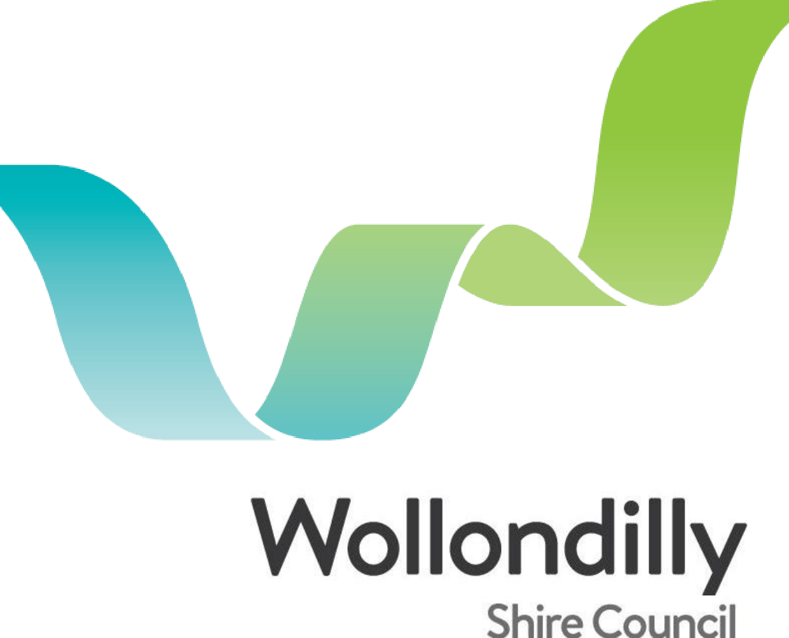

# Wollondilly Development Control Plan 2016 - Volume 8 Primary agricultural and Rural uses

> This chapter is split into 11 section file(s), one per numbered heading, in the order they appear in the PDF.

Source PDF: [Volume-8-Primary-Agricultural-and-Rural-Uses.pdf](https://planfortomorrow.sharepoint.com/sites/Planfortomorrow/Shared%20Documents/00%20NSW-Planning-Resources/dcp/wollondilly-development-control-plan-2016/volume-08-primary-agricultural-and-rural-uses/Volume-8-Primary-Agricultural-and-Rural-Uses.pdf)

### Development Control Plan 2016

### Volume 8 – Primary agricultural and Rural uses

> [Picture on page 1: a picture, saved as a picture (images/volume-08-primary-agricultural-and-rural-uses-page-1-3.gif, 150 dpi).]

#### Table of Contents

TABLE OF CONTENTS ................................................................................................................................... 2 PART 1 – PRELIMINARY ................................................................................................................................ 3

1.1 Introduction ....................................................................................................................................... 3

1.2 Objective ........................................................................................................................................... 3 PART 2 – GENERAL REQUIREMENTS FOR ALL DEVELOPMENT ............................................................ 4 PART 3 – SPECIFIC LAND USE CONTROLS ............................................................................................... 5

3.1 Animal boarding or training establishments ..................................................................................... 5

3.2 Aquaculture....................................................................................................................................... 7

3.3 Intensive livestock agriculture ........................................................................................................... 7

3.4 Intensive plant agriculture ............................................................................................................... 11

3.5 Farm buildings ................................................................................................................................ 15

3.6 Earth dams ..................................................................................................................................... 17

3.7 Commercial Bee Keeping ............................................................................................................... 18 PART 4 – CONTROLS FOR SPECIFIC LOCATIONS: ................................................................................. 19

## PART 1 – PRELIMINARY

<!-- sections -->
## Sections

1. [1.1 Introduction](01-1-1-introduction.md)
2. [1.2 Objective](02-1-2-objective.md)
3. [2 – General Requirements for all Development](03-2-general-requirements-for-all-development.md)
4. [3.1 Animal boarding or training establishments](04-3-1-animal-boarding-or-training.md)
5. [3.2 Aquaculture Objectives](05-3-2-aquaculture-objectives.md)
6. [3.3 Intensive livestock agriculture](06-3-3-intensive-livestock-agriculture.md)
7. [3.4 Intensive plant agriculture](07-3-4-intensive-plant-agriculture.md)
8. [3.5 Farm buildings](08-3-5-farm-buildings.md)
9. [3.6 Earth dams Objectives](09-3-6-earth-dams-objectives.md)
10. [3.7 Commercial Bee Keeping Objectives](10-3-7-commercial-bee-keeping-objectives.md)
11. [4 – Controls for Specific Locations:](11-4-controls-for-specific-locations.md)
