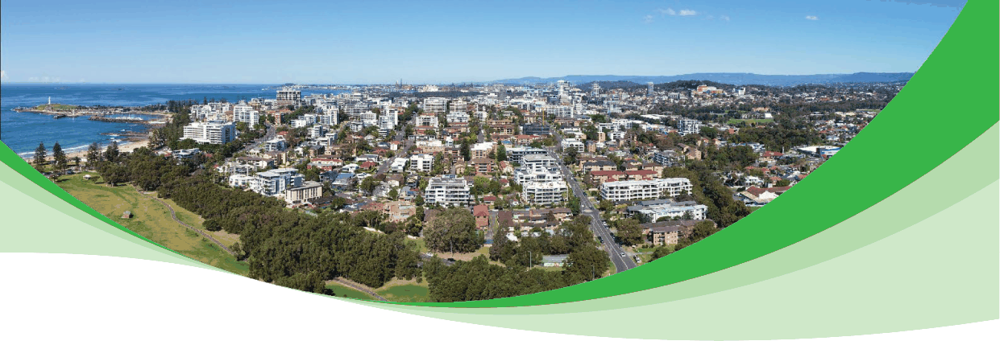

# Wollongong Development Control Plan 2009 - Appendix 4 Definitions

> This chapter is split into 4 section file(s), one per numbered heading, in the order they appear in the PDF.

Source PDF: [Wollongong-DCP-Appendix-4.pdf](https://planfortomorrow.sharepoint.com/sites/Planfortomorrow/Shared%20Documents/00%20NSW-Planning-Resources/dcp/wollongong-development-control-plan-2009/appendix-04-definitions/Wollongong-DCP-Appendix-4.pdf)

> [Picture on page 1: a picture, saved as a picture (images/appendix-04-definitions-page-1-1.gif, 150 dpi).]

### •

### Appendices

<!-- sections -->
## Sections

1. [Appendix 4 Definitions](01-appendix-4-definitions.md)
2. [1 INTRODUCTION](02-1-introduction.md)
3. [2 ABBREVIATIONS](03-2-abbreviations.md)
4. [3 DEFINITIONS](04-3-definitions.md)
