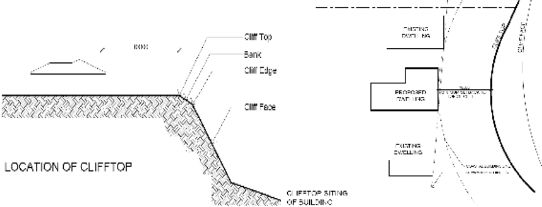

### 4.15 Development near the Coastline

#### 4.15.1 Objectives

(a) To minimise built intrusions into the coastal landscape.

(b) To protect property from the threat of coastal hazards and land instability.

(c) To retain views to the ocean from roads and public spaces.

(d) To facilitate buildings that are consistent with a coastal character.

#### 4.15.2 Development Controls

1\. All development must be setback at least 10m from a beach or cliff top to reduce the potential risk of instability and long term coastal erosion. In some instances, restricted building zones indicated on the Deposited Plan for an allotment of land will also need to be considered when situating buildings on the site.

2\. Any development near coastal foreshore areas is to be sited and designed so to be protected from long term coastal erosion.

3\. (Note: A Geotechnical Report will be required which confirms that the structural adequacy of the development near a coastal foreshore area from any long term coastal erosion effects. The Geotechnical Report must be prepared in accordance with the requirements contained in the Geotechnical chapter in Part E of the DCP).

4\. Development on land with frontage to natural features including the ocean, a clifftop, beach or public open space fronting the ocean is to be sited so as to provide a minimum side boundary setback from any building(s) or structures of 3 metres or 25% of the total width of the site, whichever is the lesser. This setback is required in order to provide a public view corridor and is to be unencumbered with any structures or significant vegetation that restricts public views through the site to the relevant coastal feature.

5\. In the circumstances where there is an existing public view corridor specifically provided on immediately adjoining land, then development may be provided with a reduced setback, subject to the combined corridor on the immediately adjoining sites be no less than 4 metres in width and unencumbered with any structures and significant vegetation.

6\. Buildings within the coastal zone are to incorporate the following design features:

(a) Development should generally be designed in a contemporary Australian coastal style which incorporates elements such as varied roof lines, a modest scale, light weight materials where appropriate, wide eaves and covered outdoor living areas, and consistent with the desired future character outlined for the relevant suburb or locality as contained in Character Statements in Part A of the DCP.

(b) Consideration is to be given to the appearance of buildings from all public areas. Buildings are to be well articulated by the use of such features as indentations, off-set wall alignments, shading devices, balconies, window openings, awnings, and a mix of external materials and/or colours.

(c) Skillion and/or peaked roof forms with overhangs, which bring the roof line down towards the earth and therefore blend with the landscape, are preferred on sites adjacent to coastal foreshores.

(d) Buildings must not incorporate an unbroken horizontal elevation of more than 16 metres in length. Elevations are to be broken up by building articulation and/or variation in external colours and materials.

(e) Buildings shall be designed to utilise a composite of construction materials (such as a combination of masonry, glass, timber, weatherboard cladding and powder coated metal). The preferred roofing material is corrugated metal sheeting similar to “Colorbond®”.

(f) In most instances the use of low-reflective materials will be required although this may vary in circumstances where a building seeks to echo the existing character of part of a neighbourhood (as reflected in the desired future character statement contained in Part A of the DCP). The use of curtain wall glazing and large expanses of framed glass will not be permitted in the vicinity of main roads in order to minimise reflectivity impacts.

(g) Colour schemes are to incorporate a mix of finishes drawn from colours found in the natural environment of the coastline. This does not however preclude the use of colour highlights on façade elements. Colour schemes in visually exposed areas must be recessive (i.e. backdrop colour or darker) to allow the development to blend with the coastal landscape.

> [Picture on page 17: a picture, saved as a picture (images/chapter-b1-residential-development-page-17-19.gif, 150 dpi).]

#### Figure 1: Cliff top sitting of building
