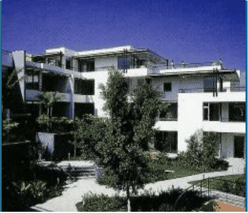

## 6 RESIDENTIAL FLAT BUILDINGS

### 6.1 General

1\. For development required to comply with SEPP 65 and the Apartment Design Guide 2015, the objectives, design criteria and design guidance relating to:

(a) visual privacy,

(b) solar and daylight access,

(c) natural ventilation,

(d) ceiling heights,

(e) apartment size and layout,

(f) private open space and balconies,

(g) common circulation and spaces, and

(h) storage, as detailed in Part 3 and Part 4 of the Apartment Design Guide, prevail over any inconsistent objective or control in this DCP.

2\. In addition to the controls in this Section the controls within Section 4 (excluding 4.1 to 4.12 and 4.20 to 4.23) of this chapter that must also be taken into consideration when preparing a development application for Residential Flat Buildings.

3\. This chapter should be read in conjunction with other relevant chapters of the DCP including but not limited to E2 CPTED, E3 Car Parking Access Servicing/Loading Facilities and Traffic

> [Picture on page 38: a picture, saved as a picture (images/chapter-b1-residential-development-page-38-20.gif, 150 dpi).]

Management; E6 Landscaping.
