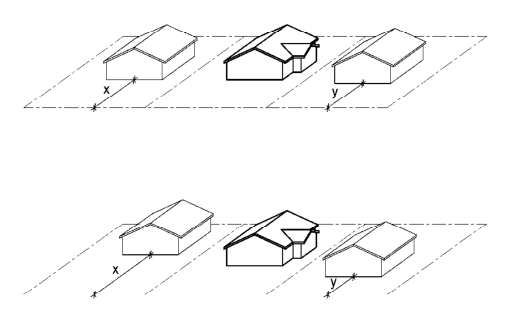

### 6.3 Front Setbacks

#### 6.3.1 Objectives

(a) To reinforce the existing character of the street by acknowledging building setbacks.

(b) To define the spatial proportions of the street and define the street edge.

(c) To provide a transition between the public and private domain.

(d) To promote compatibility in front setbacks to provide unity in the building line.

#### 6.3.2 Development Controls

1\. For residential flat buildings the following setback requirements apply from the front property boundary to the front façade of the building:

(a) The same distance as one or other of the adjoining buildings, provided the difference between the setbacks of the two adjoining dwellings is less than 2.0m.

(b) The average of the setbacks of the two adjoining buildings, if the difference between the setbacks of the buildings is greater than 2.0m.

(c) A minimum front setback of 6m applies to residential apartment buildings where calculations of a) or b) result in a front setback of less than 6m.

2\. On corner allotments, a minimum setback of 3m to the secondary street frontage from the dwelling façade must be provided.

3\. Balconies, front courtyard fences and other building extrusions may be setback up to 900mm closer than the required front or secondary setback.

4\. An increase in setbacks may be required to retain existing trees or respect adjacent heritage items.

> [Picture on page 40: a picture, saved as a picture (images/chapter-b1-residential-development-page-40-24.gif, 150 dpi).]

Figure 2: (Top) Where y- x is less than or equal to 2 metres, the setback equals x or y

Figure 3: (Bottom) Where y-x is greater than 2 metres, the setback equals the average of x and y
