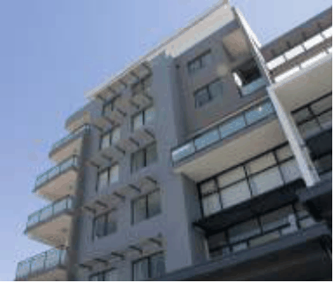
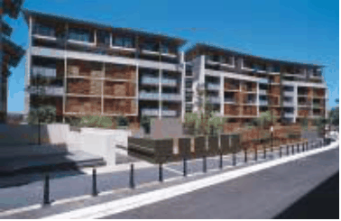
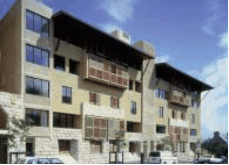
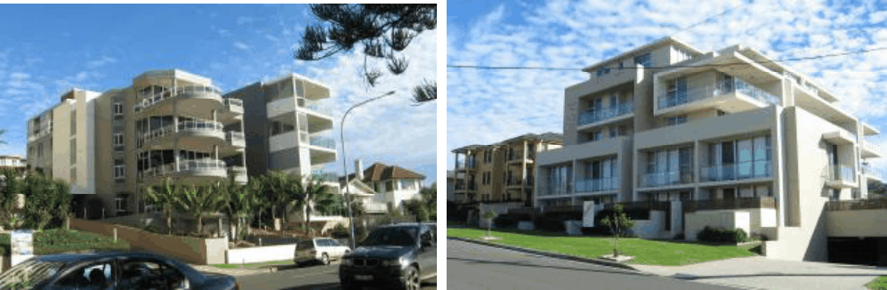
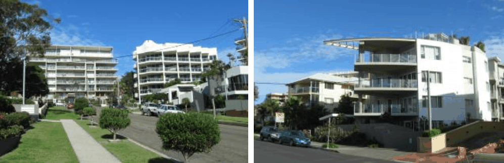

### 6.5 Built Form

#### 6.5.1 Objectives

(a) To promote high quality architectural design that is responsive and innovative.

(b) To ensure that new developments have well articulated and harmonious facades which define the public domain.

(c) To ensure corner sites are developed as visually significant elements to promote a strong and legible character.

(d) To provide an identifiable and desirable street address to each building and dwelling.

(e) To define the street edge by creating a clear transition between private and public spaces along the street frontage.

(f) To allow for outlook and surveillance towards the street and the public domain.

#### 6.5.2 Development Controls

1\. All residential flat buildings must be designed by a qualified designer in accordance with State Environmental Planning Policy No. 65 – Design Quality of Residential Apartment Development. A Design Verification Statement must accompany the Development Application.

2\. The design, height and siting of the development must respond to its context, being both the natural and built features of an area. The Site and Context Analysis must be utilised as the process by which the opportunities and constraints of the site are identified and the character of a local area defined.

> [Picture on page 42: a picture, saved as a picture (images/chapter-b1-residential-development-page-42-31.gif, 150 dpi).]

> [Picture on page 42: a picture, saved as a picture (images/chapter-b1-residential-development-page-42-32.gif, 150 dpi).]

> [Picture on page 42: a picture, saved as a picture (images/chapter-b1-residential-development-page-42-33.gif, 150 dpi).]

Examples of built form controls

3\. The appearance of new development must be in harmony with the buildings around it and the character of the street. New development must contain or respond to the essential elements that make up the character of the surrounding urban environment. This character is created by elements such as building height, setbacks, architectural style, window treatment and placement, materials and landscaping.

4\. The following elements must be incorporated into the building design:

(a) Define a base, middle and top related to the overall proportion of the building.

(b) Articulate all building elevations in both plan and section to reduce monotonous flat facades.

(c) Highly reflective finishes and curtain wall glazing are not permitted above ground level.

(d) Avoid expanses of any single material.

(e) Utilise high quality and durable materials and finishes.

(f) Avoid blank or solid walls and the use of dark or obscured glass on street frontages.

(g) Air conditioning units must be screened and not be visible from the street.

(h) For those dwellings adjacent to the street frontage, the habitable rooms must face the street.

(i) The main pedestrian entrance or a foyer must be 1.2m or less above natural ground level.

(j) Entrances must be visible at eye level from the street and well lit. Ensure entrances can accommodate the movement of furniture.

5\. The design of roof forms must address the following:

(a) Lift over runs and service plants must be concealed within the roof of the building or relate to adjacent roof top rooms or open space.

(b) Where flat roofs are proposed, lift overruns and rooftop plant and machinery are to be obscured from view by parapets or designed to be incorporated with rooftop activities/features. Details of any rooftop overruns or equipment must accompany the development application for the residential apartment building.

(c) The siting of ventilation stacks within the landscaped areas will not be permitted.

(d) Landscaped and shaded areas on the roof of residential apartment buildings for private use by residents will be considered where residential amenity is not unreasonably affected.

6\. Residential flat buildings which are located on corner sites must address the following:

(a) Emphasise verticality at corners, where possible, by concentrating the tallest portion of the building on the corner itself.  Utilise design devices such as increased wall heights, splayed corner details, increased heights, expression of junction of building planes and other architectural features to reinforce the way finding attributes of street corners.

(b) Design corners to add variety and interest to the street and clarify the street hierarchy.

(c) Present each frontage of a corner building as a main street frontage.

> [Picture on page 44: a picture, saved as a picture (images/chapter-b1-residential-development-page-44-1.gif, 150 dpi).]

> [Picture on page 44: a picture, saved as a picture (images/chapter-b1-residential-development-page-44-2.gif, 150 dpi).]

#### Figure 4: Examples of Residential Flat Building design
