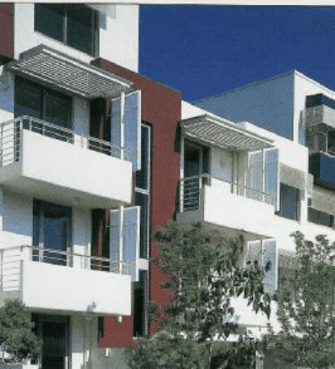
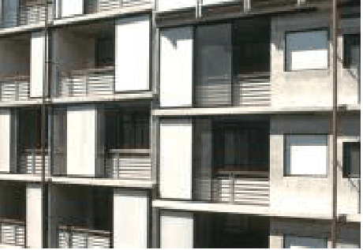

### 6.14 Private Open Space

#### 6.14.1 Objectives

(a) To ensure that private open spaces are of sufficient size to accommodate a range of uses and are accessible and connected to indoor spaces where appropriate.

(b) To ensure functionality of private open space by reducing overlooking and overshadowing of such spaces.

(c) To ensure that balconies are integrated into the overall architectural form and detail of residential flat buildings.

(d) To ensure balconies are functional and responsive to local context and climate thereby promoting the enjoyment of outdoor living for residents.

#### 6.14.2 Development Controls

1\. Private open space must be provided for each dwelling within a residential apartment building in the form of a balcony, courtyard, terrace and/or roof garden.

2\. Private open space for each dwelling within a residential apartment building must comply with the following:

(a) The courtyard/terrace for the ground level dwellings must have a minimum area of 25m2 and width of 2 metres. This area must be separated from boundaries by at least 1.5m with a vegetated landscaping bed and must not encroach upon deep soil zone landscaping areas.

(b) The primary private open area of at least 70% of the dwellings within a residential apartment building must receive a minimum of three hours of direct sunlight between 9.00am and 3.00pm on June 21.

(c) Private open space areas (courtyards) must not extend forward of the front building setback by greater than 900mm.

(d) Private open space should be sited in a location which provides privacy, solar access, and pleasing outlook and has a limited impact upon adjoining neighbours.

(e) Design private open spaces so that they act as direct extensions of the living areas of the dwellings they serve.

(f) Clearly define private open space through use of planting, fencing or landscaping features.

(g) Screen private open space where appropriate to ensure privacy.

3\. Where private open space is provided in the form of a balcony, the following requirements must also be met:

(a) Avoid locating the primary balconies where they address side setbacks.

(b) The balcony must have a minimum area of 12m2 open space and a minimum depth of 2.4 metres.

(c) The primary balcony of at least 70% of the dwellings within a multi dwelling housing development shall receive a minimum of three hours of direct sunlight between 9.00am and 3.00pm on June 21.

(d) Balconies must be designed and positioned to ensure sufficient light can penetrate into the building at lower levels.

4\. The enclosure of balconies on existing residential flat buildings will generally not be permitted due to their negative impact on maximum floor space controls, fire rating, building aesthetics and form, and the availability and functionality of private open space.

5\. Balcony screening and climate control elements shall be provided in the initial design of new residential flat buildings. Operable screens, pergolas, shutters, operable walls or similar shall be provided in locations where noise or high winds prohibit reasonable outdoor use (i.e. next to rail corridors, busy roads and tall towers).

6\. Balcony screening and climate control will only be permitted by Council for existing residential flat buildings if the following requirements are met:

(a) A proposal is submitted for an overall building façade design treatment. This need not include the installation of building elements to all balconies but shall exhibit an appropriate pattern and proportion within the overall façade composition (i.e. treatments may vary depending upon the type and location of balconies at the base, middle or top of facades).

(b) The proposal involves the written agreement of all of the owners of unit facades that will be affected (e.g. if screening is proposed to four out of six balconies located on the north façade, the agreement of all owners of units on the north façade is required even if all units are not directly affected by the works).

(c) The proposal does not compromise the functionality of a balcony as a private open space area nor reduce the aesthetic quality or articulation of the building.

(d) The proposal improves the functionality of the balcony and thereby promotes the enjoyment of the outdoor living area

(e) The use of curtain wall glazing or an expanse of glazing is not permitted. Any glazing used to screen balconies shall be broken up by framing (e.g. louvers) which also casts shadows on the glass in order to reduce reflectivity and building bulk.

(f) The design integrates with existing balustrades and/or involves the removal of balustrades to ensure the additions do not appear as a ‘retrofit’.

(g) The design integrates with the existing façade composition and increases the variety in façade design particularly for existing facades that exhibit little variation in materials, finishes and form. This may necessitate other modifications to façades such as the installation of awnings, pergolas and/or blade walls, a new colour scheme, and/or cornice treatment.

(h) Coloured elevations and a photomontage shall be submitted with a Development Application.

(i) If staged installation is proposed then the approved design shall be included as a by-law attached to the strata plan of the residential flat building prior to issue of an Occupation

Certificate for the first stage in order to ensure that the installation of screening/climate control elements accord with an overall building façade design treatment and can be undertaken by various owners when it suits them.

> [Picture on page 55: a picture, saved as a picture (images/chapter-b1-residential-development-page-55-4.gif, 150 dpi).]

> [Picture on page 55: a picture, saved as a picture (images/chapter-b1-residential-development-page-55-5.gif, 150 dpi).]

Figure 5: Examples of balcony screening and climate control elements. Reference: Residential Flat Design Code
