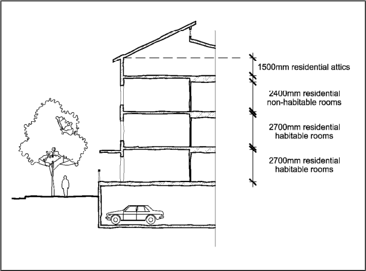

### 6.17 Apartment Size and Layout Mix for Larger Residential Flat

### Building Developments

#### 6.17.1 Objectives

(a) To provide variety in apartment sizes and layouts to cater for a range of household types.

(b) To ensure that the internal arrangement of apartments is functional and satisfies occupant’s needs.

(c) To design apartments to promote resident amenity and adaptability of use.

#### 6.17.2 Development Controls

1\. A mix of apartment sizes and layouts is required for larger residential apartment buildings involving ten (10) or more dwellings. This could include both variation in the number of bedrooms and gross floor areas of apartments, variety in the internal design or incorporating single and two level apartments to accommodate various resident requirements.

2\. The selection of the number of bedrooms within developments shall be determined having regard to the site’s context, geographic location and anticipated market demands. For residential apartment buildings having ten (10) or more dwellings, a minimum of 10% of the apartments must be one bedroom and/or studio apartments, to provide for housing choice.

3\. Consideration should be given to the design of apartments to encourage future flexibility.  This may include opportunities to combine smaller apartments with adjacent dwellings should residents’ lifestyle change or may include the ability to accommodate home office opportunities.  Consideration should also be given to the location of one and three bedroom apartments on the ground level where accessibility is more easily achieved for disabled, elderly people or families with children.

4\. Apartments must be designed with internal spaces which are flexible and adaptable to resident’s requirements. This should involve the efficient utilisation of available floor space to maximise useable room areas.  Apartment layouts must respond to the site’s opportunities, including views and aspect.

5\. Ceiling heights of apartments must be selected to encourage the penetration of natural sunlight into all areas of the building. Provide the following minimum floor to ceiling heights, for residential flat buildings:

(a) 2.7m minimum for all habitable rooms on all floors;

(b) 2.25 to 2.4m minimum for non habitable rooms on all floors;

(c) For two storey apartments, 2.4m minimum for the second storey if 50% or more of the apartment has 2.7m minimum ceiling heights;

(d) For 2 storey units with a two storey void space, 2.4m minimum ceiling heights;

(e) Attic spaces, 1.5m minimum wall height at edge of room with a 30 degree minimum ceiling

> [Picture on page 57: a picture, saved as a picture (images/chapter-b1-residential-development-page-57-10.gif, 150 dpi).]

slope.
