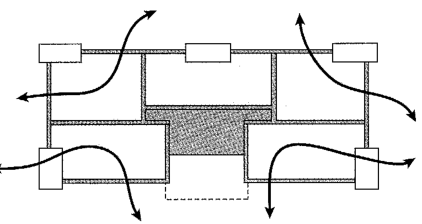
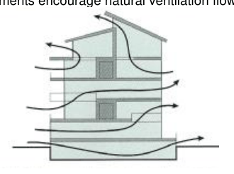

### 6.19 Natural Ventilation

#### 6.19.1 Objectives

(a) To encourage apartment design which allows for natural ventilation of habitable rooms.

(b) To provide natural ventilation in non –habitable rooms, where possible.

(c) To reduce energy consumption by minimising the use of mechanical ventilation.

> [Picture on page 59: a picture, saved as a picture (images/chapter-b1-residential-development-page-59-3.gif, 150 dpi).]

> [Picture on page 59: a picture, saved as a picture (images/chapter-b1-residential-development-page-59-4.gif, 150 dpi).]

Figure 6: Natural Ventilation, Corner apartments encourage natural ventilation flows. (Ref: Residential Flat Design Code)

Figure 7: This optimal layout allows air flow directly from one side of the apartment to the other (Ref: Residential Flat Design Code)

#### 6.19.2 Development Controls

1\. All residential apartment buildings shall have a building depth of between 10 and 18 metres.  The depth is measured across the shortest dimension of the building. Dwellings should be a maximum depth of 21 metres, measured from the outside of the balcony.

Variation to this standard will only be considered where it can be demonstrated that apartments will achieve the minimum requirements with regard to natural ventilation. This may be achieved where apartments have a wider frontage, or increased ceiling and window height to allow for greater penetration of natural light. The building depth is measured across the shortest access, excluding the depth of any unenclosed balconies.

2\. A minimum of sixty percent (60%) of all residential apartments shall be naturally cross ventilated.

3\. Twenty five (25%) of kitchens within a development must have access to natural ventilation. Where kitchens do not have direct access to a window, the back of the kitchen must be no more than 8 metres from a window.

4\. Single aspect apartments must be limited in depth to 8 metres from a window.
